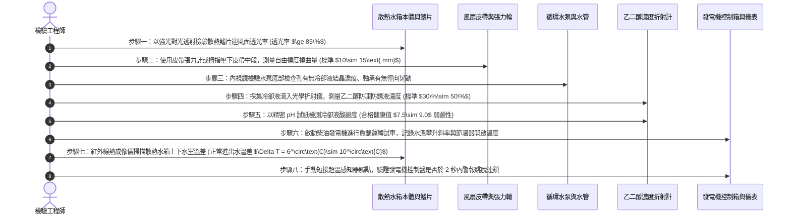

# 全案購屋實戰第六百零九部：中古大樓社區地下室緊急柴油發電機冷卻水箱散熱鰭片鋁蝕淤塞冷卻風扇皮帶打滑水泵軸封滲漏與過熱高溫抱死體檢工序全書

---

## 壹、前言與核心體檢宗旨

在現代集合住宅高層建築（屋齡 20～35 年）之防災與備援供電體系中，當外部台電電網突發大停電時，整座大樓之緊急救災電梯、消防加壓泵、防排煙風機及避難照明，全賴地下室設置之「緊急柴油發電機組（Emergency Diesel Generator Set）」支撐。

柴油引擎在滿載輸出時，燃油燃燒釋放之能量約有 **30%～35%** 轉化為劇烈的廢熱，必須仰賴發電機專用之「冷卻水循環與散熱水箱系統（Radiator Cooling Water System）」以極高之熱交換效率強制帶走熱量，確保引擎冷卻水溫嚴格維持在健康工作區間（**$80^\circ\text{C}\sim 90^\circ\text{C}$**）。

然而，在屋齡 20～35 年之中古集合住宅中，發電機常年深處空氣對流不良、潮濕且粉塵油污沉積之地下室最底層，加上許多社區保養僅做「每月無載空轉運轉 3 分鐘」，導致冷卻水系統長年暗藏以下**四項極其致命的機電熱衰竭暗病**：
1. **散熱水箱散熱鰭片（Radiator Cooling Fins）鋁蝕粉化與油泥棉絮淤塞**：地下室通風夾帶之車輛油氣與落塵，將散熱器迎風面緊密糊死成「毛氈狀油泥」，空氣流量暴跌 60% 以上，熱交換能力完全喪失。
2. **冷卻水泵驅動 V 型皮帶（Fan & Water Pump V-Belt）橡膠硬化打滑**：皮帶長年受熱老化、張力鬆弛，大負載全速運轉時皮帶打滑尖叫，冷卻水循環流量與散熱風扇風量同步崩跌。
3. **引擎循環水泵機械軸封（Water Pump Mechanical Seal）老化滲漏與冷卻液乾涸**：軸封陶瓷/碳化矽端面遭冷卻液中的水垢結晶研磨刮傷，冷卻水（乙二醇防凍防銹液）持續由排泄孔慢速滴漏，副水箱見底，水套產生局部氣塞空化。
4. **節溫器（Thermostat / 水龜）高溫卡死引發引擎「高溫抱死拉缸（Piston Seizure）」**：雙金屬節溫器感溫蠟包破裂或閥芯水垢咬死在大循環關閉位置，當真實大停電全載運轉時，水溫在 5 分鐘內飆破 $105^\circ\text{C}$，水箱沸騰噴水，引擎活塞高溫膨脹死死卡死在汽缸壁內，全棟陷入徹底黑燈滅頂。

本工序全書旨在深入剖析柴油發電機熱熱力學平衡、散熱鰭片紅外線溫差檢測、水泵軸封探傷及水溫高溫超溫連鎖試驗，為買方守護社區備援電力之終極安全。

---

## 貳、柴油發電機冷卻水循環與熱交換架構

```mermaid
flowchart TD
    A["柴油引擎本體 (汽缸套與汽缸蓋水套 Cylinder Water Jacket)"] -->|高溫出水 (80~90°C)| B["雙閥式節溫器 (Thermostat / 水龜)"]
    
    B -->|低溫冷車時 (水溫 < 75°C) 小循環| C["旁通管路 (Bypass Pipe)"]
    C --> D["引擎離心式循環水泵 (Engine Water Pump)"]
    
    B -->|正常工作水溫 (水溫 > 82°C) 大循環| E["散熱水箱上水管 (Upper Radiator Hose)"]
    E --> F["銅管鋁鰭片散熱器本體 (Radiator Core)"]
    
    subgraph 散熱熱交換核心機構
        F --> G["直立式銅扁管流道 (Coolant Tubes)"]
        F --> H["百葉窗型散熱鋁鰭片 (Aluminum Fins)"]
        I["大直徑吸風式冷卻風扇 (Cooling Fan)"] -->|高風壓抽風對流| H
        J["曲軸普利盤 + V型傳動皮帶 (V-Belt)"] -->|機械驅動| I
        J -->|機械驅動| D
    end
    
    F --> K["冷卻水箱下水管 (Lower Radiator Hose)"]
    K --> D
    D -->|低溫冷卻液強制壓入| A
    
    F --> L["壓力水箱蓋 (Radiator Pressure Cap 0.9 kgf/cm²)"]
    L --> M["透明塑膠副水箱 / 膨脹水箱 (Expansion Tank)"]
    
    A -.->|水龜卡死/散熱淤塞| N["水溫破百爆沸 (高溫抱瓦拉缸大災難)"]
```

---

## 參、中古社區現場五大常見致命病徵與工程成因

| 病徵分類 | 現場常見故障現象 | 工程深層成因分析 | 對住戶家庭置產之潛在危害 |
| :--- | :--- | :--- | :--- |
| **一、散熱鰭片油泥封死** | 水箱正面散熱網格被厚達數公厘的黑色毛氈油泥覆蓋，手電筒照射完全不透光 | 地下室車輛尾氣油霧與皮帶磨損粉塵長年吸附在潮濕散熱片表面，從未以專用藥劑清洗。 | 平時空載運轉看不出問題，斷電大負載運轉 10 分鐘即因散熱不良引發超溫跳脫。 |
| **二、風扇皮帶嚴重打滑** | 啟動或急加速時引擎前段傳出尖銳刺耳的「吱吱吱——」金屬皮帶尖叫聲 | V型皮帶長期處於高溫環境橡膠硬化龜裂，張力下垂量超過 25mm，滑動摩擦生熱燒焦。 | 水泵轉速不足導致水流停滯，散熱風量衰減 50% 以上，冷卻效能瞬間崩塌。 |
| **三、水泵下軸封滴漏液** | 水泵下方洩水孔周圍長滿綠色或紅色碳酸結晶，機底承油盤積滿發霉冷卻液 | 軸封陶瓷面遭未更換之劣質自來水中的硬質砂石磨損，水封失去彈性，冷卻液持續外漏。 | 冷卻液緩慢漏乾，引擎內部產生氣穴空泡，汽缸壁局部過熱產生致命裂紋。 |
| **四、冷卻液酸化發黑** | 旋開水箱蓋檢視，液體呈現黑褐色混濁鐵鏽水，甚至漂浮黃色油花 | 社區從未添加專業防凍防蝕劑，僅隨意補充自來水，水中礦物質導致水套鐵件嚴重鏽蝕。 | 水道內部結滿厚重水垢，熱阻暴增 5 倍以上，散熱水管隨時因高壓爆裂。 |
| **五、高溫警報接點被拔** | 水溫已達 $100^\circ\text{C}$，發電機控制盤上的「WATER TEMP HIGH」警報燈卻完全不亮 | 過去因頻繁高溫跳機，不肖水電工為圖交差，私自將高溫感知器信號線剪斷或拔除。 | 喪失最後的電氣自動保護，發電機在無人知曉中活生生燒熔抱死，徹底報廢。 |

---

## 肆、標準發電機冷卻水系統八步精密體檢工序



### 關鍵檢驗數據與判定標準表：

| 檢驗參數 | 原廠規範與健康標準值 | 臨界警告數值 | 致命故障特徵（一票否決 - 隨時縮缸） |
| :--- | :--- | :--- | :--- |
| **1. 滿載連續運轉水溫** | $80^\circ\text{C} \sim 90^\circ\text{C}$ | $91^\circ\text{C} \sim 97^\circ\text{C}$ | $\ge 100^\circ\text{C}$（開鍋沸騰噴水，立即抱死） |
| **2. 散熱鰭片透光率** | 透光面積 $\ge 85\%$ | 透光率 $60\% \sim 84\%$ | $< 50\%$（表面完全被黑毛氈油泥糊死） |
| **3. 皮帶壓下下垂量** | 施加 100N 外力下垂 $10\sim 15\text{ mm}$| 下垂量 $16\text{ mm} \sim 25\text{ mm}$| $> 25\text{ mm}$ 或皮帶內側出現深度龜裂斷齒 |
| **4. 冷卻液乙二醇濃度** | 體積濃度 $33\% \sim 50\%$ | 濃度 $15\% \sim 32\%$ | $< 10\%$ 或純自來水（管壁嚴重鏽蝕結垢） |
| **5. 冷卻液酸鹼度 (pH)** | $\text{pH } 7.5 \sim 9.0$ (弱鹼防腐) | $\text{pH } 6.5 \sim 7.4$ | $\text{pH } < 6.0$（強烈酸化，腐蝕汽缸壁） |
| **6. 水箱上下水溫差** | 溫差 $\Delta T = 6^\circ\text{C} \sim 10^\circ\text{C}$ | 溫差 $3^\circ\text{C} \sim 5^\circ\text{C}$ | $\Delta T < 2^\circ\text{C}$（水流堵塞或風扇完全無風） |

---

## 伍、買方看屋現場發電機房 3 分鐘實戰快檢表

| 查驗步驟 | 操作手法與檢驗重點 | 合格優質特徵 | 致命隱患警訊（高危險折價項） |
| :--- | :--- | :--- | :--- |
| **1. 檢視副水箱水質顏色** | 找到發電機旁的透明塑膠副水箱，檢視內部液體 | 液體清澈透亮，呈現鮮艷之「螢光綠色」或「粉紅色」 | 液體乾涸見底，或呈現如鐵鏽般的混濁黃褐色污水 |
| **2. 強光手電筒照散熱網** | 將強光手電筒貼在散熱水箱後方，從前方觀察透光 | 光線能均勻穿透密集鋁鰭片，網孔乾淨通透無毛屑 | 完全漆黑不透光，正面布滿黏稠黑油泥、灰塵與破布纖維 |
| **3. 手指按壓風扇皮帶** | 在引擎靜止狀態下，以大拇指用力下壓發電機風扇皮帶 | 皮帶緊繃堅韌、回彈迅速，內側無裂紋、無毛邊 | 皮帶極其鬆垮、能輕鬆翻轉超過 90 度，表面發黑打滑發亮 |
| **4. 俯身檢視水泵下方地坪** | 拿手電筒照射發電機前端循環水泵的正下方承盤 | 承盤乾燥平整、無水痕、無綠色水漬 | 承盤積滿一灘發綠的黏稠冷卻水，水泵外殼掛著長條結晶鐘乳石 |
| **5. 查閱每月試車保養紀錄** | 檢視掛在發電機控制盤旁的「發電機每月維護保養卡」 | 每月定期試車，且有明確記錄「運轉水溫 $85^\circ\text{C}$、水壓正常」 | 紀錄卡空白超過半年，或備註欄記載「水溫偏高待清洗水箱」 |

---

## 陸、購屋特約條款範本：緊急發電機冷卻效能與妥善率擔保

> **社區緊急發電設備冷卻散熱系統妥善率擔保特約：**  
> 「賣方保證本買賣標的所屬大樓地下室緊急柴油發電機組之冷卻水箱、散熱鰭片、循環水泵、傳動皮帶及超溫自動保護系統功能健全，冷卻液品質及容量符合原廠規範，且機組於連續滿載運轉下冷卻水溫嚴格維持在攝氏九十五度以下之安全範圍。  
> 點交日前若經實地檢驗發現散熱鰭片油泥嚴重淤塞不透光、水泵軸封滲漏水、風扇皮帶老化打滑、或運轉水溫超過警戒值引發高溫跳脫等重大公共機電缺失，賣方應督促管理委員會及專業發電機保養廠商於交屋日前完成水箱化學清淤清洗、皮帶更換及水泵修復完畢；若未能於期限內修復改善，賣方同意提撥新台幣 **參萬元整** 作為公共機電修繕保留款，自本買賣尾款中扣留，待管委會複驗合格後始得撥付。」

---

## 柒、結語

緊急柴油發電機，是大樓在面臨滔天黑夜時的唯一希望方舟。
而那座隱身在引擎前端、承受強風呼嘯的散熱水箱與皮帶，則是維持這艘方舟心臟持續搏動的呼吸之肺。
買房買的不只是白天的繁華視野，更必須用冷靜的工程眼光審視黑暗中的守護神是否能經受住熱浪的考驗，為全家人的安居生活鑄造永不熄滅的光明堡壘！
