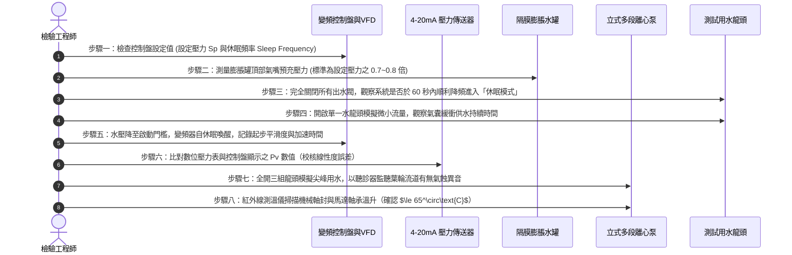

# 全案購屋實戰第六百零二部：中古大樓社區地下室生活自來水二次加壓變頻泵浦PID控制恆壓傳送器漂移葉輪氣蝕剝落與機械軸封高溫乾磨體檢工序全書

---

## 壹、前言與核心體檢宗旨

在現代集合住宅高層與中高層大樓（屋齡 20～35 年）之供水水力體系中，為克服水塔重力供水在頂樓與次頂樓水壓不足、熱水器無法點火、水流忽大忽小之長年沉痾，中大型社區普遍於地下室或屋頂中繼機房裝設「生活自來水二次加壓變頻泵浦系統（Variable Frequency Drive Booster Pump System）」。

該系統由多台並聯多段立式離心泵（Vertical Multistage Centrifugal Pump）、變頻器（VFD）、PLC 微電腦控制器、壓力傳送器（Pressure Transmitter）及氣壓隔膜膨脹水罐（Diaphragm Expansion Tank）組成，藉由閉迴路比例積分微分（PID）演算法達成全天候 24 小時出水恆壓控制。

然而，在屋齡 20～35 年之中古社區中，加壓供水系統常年暗藏以下致命機電與流體力學隱患：
1. **壓力傳送器訊號零點漂移與頻率震盪**：壓阻式傳送器受水垢淤塞或壓電元件老化影響，輸出 $4\sim 20\text{ mA}$ 訊號漂移失真，導致變頻器於極限高低頻之間頻繁劇烈升降頻（Hunting），管網壓力上下狂飆，破壞各住戶室內進水軟管與三角凡而。
2. **葉輪氣蝕（Cavitation）與流道剝落穿孔**：泵浦進水端有效淨正吸入水頭（NPSHa）不足，流體在葉輪葉片吸入面汽化產生微小氣泡，氣泡於高壓區瞬時崩塌爆裂，產生數千大氣壓之局部微射流衝擊，將不銹鋼葉輪打成蜂窩狀穿孔，出水效率暴跌 60% 以上。
3. **機械軸封（Mechanical Seal）高溫乾磨脆裂**：小流量保壓或進水端斷水時，缺水保護開關遲鈍未跳脫，動環（碳化矽/石墨）與靜環在高轉速下無水冷卻直接乾磨，動靜環高溫熱裂、O型密封圈碳化，自來水自泵體軸頸處激射噴出，浸泡地下室泵浦房。

本工序全書旨在深入剖析恆壓變頻加壓系統之控制邏輯、氣蝕成因、軸封防護與現場量測標準，守護家庭每日出水穩定與公共機電安全。

---

## 貳、二次加壓變頻恆壓泵浦系統控制與流力架構

```mermaid
flowchart TD
    A["地下室受水箱 (或屋頂高位水箱出水)"] --> B["吸水端防震軟管 (Flexible Joint)"]
    B --> C["Y型過濾器 (Strainer)"]
    C --> D["並聯立式多段離心泵浦組 (Pump 1, 2, 3)"]
    
    D --> E["出水端無水錘靜音止回閥 (Silent Check Valve)"]
    E --> F["出水集水幹管 (Discharge Header)"]
    F --> G["氣壓隔膜式壓力膨脹水罐 (Pressure Tank)"]
    F --> H["4-20mA 壓阻式精密壓力傳送器 (PT)"]
    F --> I["出水端分區減壓閥 / 直立給水立管"]
    
    H -->|即時壓力反饋訊號 (Pv)| J["PID 恆壓變頻控制盤 (VFD Controller)"]
    K["系統設定目標恆壓值 (Sp e.g. 4.0 kgf/cm²)"] --> J
    
    J -->|誤差運算 e = Sp - Pv| L["變頻器輸出頻率調整 (0~60Hz)"]
    L -->|驅動變頻主泵| D
    J -.->|大用水量時並聯工頻啟動| D
```

---

## 參、中古社區現場五大常見致命病徵與工程成因

| 病徵分類 | 現場常見故障現象 | 工程深層成因分析 | 對家庭置產之潛在危害 |
| :--- | :--- | :--- | :--- |
| **一、壓力傳送器漂移** | 住戶家中水壓忽大忽小，熱水器頻繁熄火；變頻器馬達轉速劇烈忽快忽慢 | 壓力傳導銅管水垢結晶堵塞，或壓電晶片老化，輸出電流與實際水壓線性度嚴重偏離。 | 水管承受劇烈動態疲勞震盪，接頭脫落爆管，室內木地板與昂貴裝潢泡湯。 |
| **二、葉輪氣蝕穿孔** | 泵浦運轉時內部傳出如同「打碎石頭、炒豆子」般的爆裂喀喀異音 | 吸水管徑偏小、吸入管阻過大，有效 NPSH 低於必需 NPSH，空化氣泡在葉片表面密集內爆。 | 泵浦出水量嚴重衰退，高樓層尖峰時段無水可用，泵體內部零件粉碎報廢。 |
| **三、機械軸封高溫乾磨** | 泵浦運轉時軸頸處冒出白煙伴隨焦味，水柱沿電機基座向外連續飛濺 | 夜間微小用水時變頻器未能進入休眠模式（Sleep Mode），泵體內部死水摩擦升溫至沸騰乾磨。 | 軸封碳化矽動環碎裂，高壓水灌入電機軸承與定子線圈，導致馬達短路燒燬。 |
| **四、膨脹水罐氣囊破裂** | 只要住戶打開一個水龍頭，變頻泵立即猛然啟動；關水立刻停機，一分鐘啟閉數十次 | 膨脹水罐內部丁基橡膠氣囊老化破裂，內部全部被水充滿失去空氣彈性緩衝作用。 | 變頻器接觸器頻繁吸合打火損壞，馬達線圈承受頻繁啟動大電流衝擊而絕緣劣化。 |
| **五、變頻器散熱風扇停擺** | 變頻控制盤表面滾燙，夏季尖峰時段頻繁跳出「OH（過熱 Overheat）」警報跳脫停機 | 變頻器散熱排散熱膏乾涸、風扇軸承卡死、控制箱濾網積滿油污毛屑，散熱不良。 | 社區無預警大斷水，待修期間需人工手動工頻強制送電，超壓風險極高。 |

---

## 肆、標準變頻加壓系統八步精密體檢工序



### 關鍵體檢檢驗數據標準表：

| 檢驗參數 | 標準正常數值 | 異常警示數值 | 致命故障特徵（必須立即停機維修） |
| :--- | :--- | :--- | :--- |
| **1. 恆壓控制精度 ($\Delta P$)** | 設定值 $\pm 0.1\ \text{kgf/cm}^2$ | 設定值 $\pm 0.3\ \text{kgf/cm}^2$ | 波動超過 $\pm 0.8\ \text{kgf/cm}^2$，指針狂甩 |
| **2. 休眠喚醒響應時間** | 停水後 30~60 秒內進入休眠 | 停水後持續運轉 $>3$ 分鐘 | 永不休眠，全天候 60Hz 滿載狂轉 |
| **3. 膨脹罐氣囊狀態** | 按壓氣嘴只有乾燥氣體釋出 | 氣嘴氣壓偏低需要補氣 | 按壓氣嘴噴出高壓水柱（氣囊已破裂全毀） |
| **4. 傳送器讀數誤差** | 儀表讀數與機械充油表誤差 $\le 2\%$ | 誤差 $3\% \sim 5\%$ | 誤差 $>10\%$ 或壓力信號劇烈跳變跳字 |
| **5. 馬達軸承與軸封溫度** | 運轉平衡溫度 $\le 55^\circ\text{C}$ | 溫度 $56^\circ\text{C} \sim 70^\circ\text{C}$ | 表面溫度 $> 85^\circ\text{C}$，伴隨焦臭味與冒煙 |
| **6. 運轉振動值 (RMS)** | 軸承座振動速度 $\le 2.8\ \text{mm/s}$ | 振動 $2.9 \sim 4.5\ \text{mm/s}$ | 振動 $> 7.1\ \text{mm/s}$（葉輪動平衡已破壞） |

---

## 伍、買方看屋現場 3 分鐘加壓供水實戰快檢表

| 查驗步驟 | 操作手法與觀察位置 | 合格優質特徵 | 致命隱患警訊（高危險折價項） |
| :--- | :--- | :--- | :--- |
| **1. 蓮蓬頭出水穩定度** | 將浴室蓮蓬頭水量開至最大持續 1 分鐘 | 水流綿密充沛，水柱高度保持一致不顫動 | 水柱脈動明顯、如波浪般忽強忽弱，伴隨水管喀喀聲 |
| **2. 混水冷熱水衝擊測試** | 快速反覆切換熱水與冷水龍頭 | 水流切換順暢，熱水器燃燒聲音穩定恆定 | 冷水一開熱水立刻熄火，或水壓驟降導致被滾燙熱水燙傷 |
| **3. 地下室加壓機房巡視** | 檢視變頻控制盤外觀與指示燈 | 面板顯示「RUNNING / AUTO」，運轉頻率在 35~45Hz 穩定平順 | 面板報警代碼閃爍（如 Err / OL / OC），頻率在 0~60Hz 劇烈抽搐 |
| **4. 膨脹水罐外觀檢驗** | 輕敲紅色或藍色大型圓形膨脹罐上下部 | 上部敲擊為空心金屬聲（氣體），下部為沉悶聲（水） | 全身敲擊皆為沉悶實心水聲，氣嘴周圍生鏽嚴重滴水 |
| **5. 泵體基座漏水巡檢** | 強光手電筒照射三台立式泵浦底部 | 基座排水溝乾淨，泵體漆面完整無剝落 | 泵體底部長滿白色鐘乳石水垢，基座積水深達腳踝 |

---

## 陸、購屋特約條款範本：變頻給水系統妥善率擔保

> **社區公共變頻加壓供水設備效能保證條款：**  
> 「賣方保證本買賣標的所在社區之公共生活自來水二次加壓供水設備（包含立式變頻泵浦組、變頻器控制盤、壓力傳送器及氣囊式膨脹水罐）功能正常，管網供水恆壓穩定無忽大忽小之現象。  
> 點交日前若經實地檢驗發現變頻器無法自動休眠、膨脹罐氣囊破裂、泵浦氣蝕穿孔或出水壓力波動超過 $\pm 0.5\ \text{kgf/cm}^2$，賣方應督促管委會於交屋日前更換修復完畢；若未改善，賣方同意提撥新台幣 **參萬元整** 作為公共水電修繕擔保金，暫扣於履約保證專戶中，待檢驗合格後結清。」

---

## 柒、結語

穩定的自來水壓力與安靜的供水環境，是現代家庭高尊嚴生活品質不可或缺的微觀基石。
透過對二次加壓變頻泵浦 PID 控制、葉輪氣蝕與軸封健康的嚴格把關，買方不僅守護了日常沐浴時的舒適恆溫，更能杜絕暗藏在地下室隨時可能爆管、燒機或斷水的重大公產災難，為家庭築起最堅固的用水安全堡壘！
