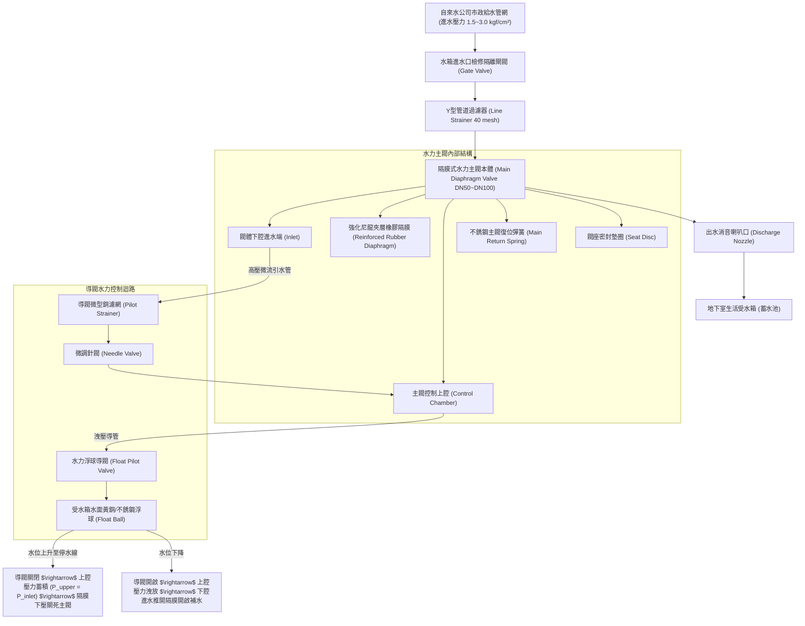
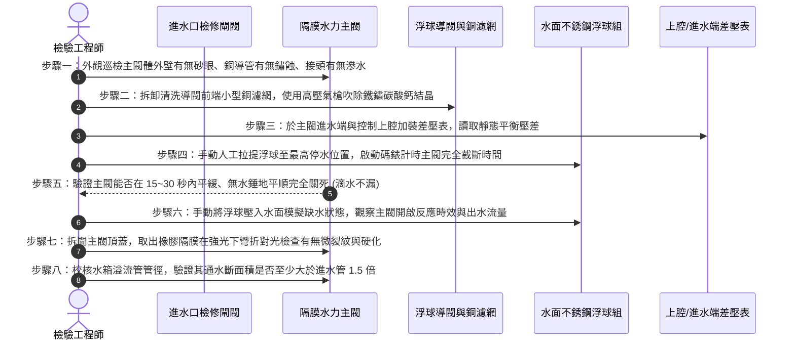

# 全案購屋實戰第六百零八部：中古大樓社區地下室生活自來水受水箱進水水力浮球閥主閥隔膜微裂紋導閥濾網水垢淤塞洩壓孔堵塞與自來水狂流溢流淹水體檢工序全書

---

## 壹、前言與核心體檢宗旨

生活自來水是集合住宅維持全棟數百戶居民每日生存與生活衛生的最核心物質基礎。在台灣 20～35 年之中古集合住宅大樓中，自來水供水系統普遍遵循自來水公司規範，將市政自來水引進至地下室最底層之「生活自來水受水箱（蓄水池，Basement Cistern）」。

控制受水箱進水補水之關鍵核心閥門，並非單純之一般小型浮球開關，而是口徑達 DN50～DN100（2 吋至 4 吋）之「隔膜式水力自動控制浮球閥（Hydraulically Operated Diaphragm Float Control Valve / 水力隔膜進水閥）」。該閥門利用自來水管網自身之水壓作為動力源，藉由小型導閥（Pilot Float Valve）之啟閉控制主閥控制腔（Control Chamber）內水壓之消長，進而推動橡膠主隔膜（Main Diaphragm）達成大流量平順進水與無水錘截斷。

然而，在屋齡 20～35 年之中古社區中，水力進水閥深埋於潮濕陰暗、常年不見天日的地下水箱孔道內，受自來水水垢雜質、鐵鏽沉澱及水質氯離子長年侵蝕，常年暗藏以下**四項極其致命的流體力學與機電淹水暗病**：
1. **主閥橡膠隔膜（NBR / EPDM Diaphragm）微裂紋與彈性疲勞穿孔**：隔膜在數十萬次膨脹收縮後橡膠硬化脆裂，高壓水直接自微裂紋處穿透洩入上腔，造成控制腔無法建立足夠壓差，主閥卡在「全開狀態」無法關閉，自來水日夜 24 小時瘋狂狂注。
2. **水力導閥不銹鋼濾網水垢與鐵鏽泥沙淤塞**：導閥進水端微型過濾網（Strainer）被自來水中的碳酸鈣晶體及舊鍍鋅管剝落的鐵屑完全封死，控制水流無法進入上腔推動隔膜下壓，主閥同樣永久大開。
3. **導閥節流針閥與洩壓微孔（Bleed Orifice）堵塞**：主閥控制腔之細小洩壓小孔被泥沙雜物堵死，當浮球下沉需要補水時，上腔壓力無法釋放，導致水箱乾涸卻「滴水不進」，全社區無預警大缺水。
4. **溢流管排量不足引發地下水箱「滅頂漫淹」**：當水力閥故障狂流時，若社區溢流管（Overflow Pipe）口徑偏小或被防蟲網雜物淤塞，狂湧之自來水直接自人孔蓋縫隙噴湧而出，水淹地下室變電室、發電機與機械車位。

本工序全書旨在深入剖析水力隔膜進水閥流體壓差控制原理、隔膜無損探傷、導閥微流道疏通與水箱溢流防護體系，為家庭置產築起最堅固的防水費失控與防地下室淹水屏障。

---

## 貳、水力隔膜進水浮球閥流力控制架構

---

## 參、中古社區現場五大常見致命病徵與工程成因

| 病徵分類 | 現場常見故障現象 | 工程深層成因分析 | 對家庭置產之潛在危害 |
| :--- | :--- | :--- | :--- |
| **一、主閥隔膜微裂** | 水位已超過最高停水線，浮球浮到頂端，但主閥依然嘩啦嘩啦大流量進水 | 橡膠隔膜微觀龜裂或邊緣被金屬夾板夾傷剪裂，控制上腔無法蓄壓，主閥卡在常開位置。 | 自來水 24 小時不間斷狂流溢流，每月公共水費暴增數萬至數十萬元，公積金遭掏空。 |
| **二、導閥濾網水垢淤塞** | 浮球沉入水中，但主閥出水量細若游絲，水箱水位持續下降無力補水 | 導閥入口銅濾網孔徑（$<0.5\text{ mm}$）被硬質碳酸鈣結石與鐵鏽死死糊住，控制水無法流動。 | 尖峰用水時段地下水塔見底抽空，揚水泵氣蝕空轉燒毀，全棟數百戶無水可用。 |
| **三、閥座墊圈沖蝕淘槽** | 閥門看似已關閉，但主閥出水口持續發出「嗤嗤」高壓漏水聲與涓涓細流 | 橡膠閥瓣被水管內的尖銳細砂卡入，長期高速微射流沖刷形成縱向「淘槽穿孔（Wire Drawing）」。 | 慢速漏水日夜累積，一年漏損上千噸潔淨自來水，造成公產隱形巨額浪費。 |
| **四、洩壓針閥孔堵塞** | 浮球大幅度浮動時，主閥毫無反應；或突然猛烈全開、突然猛烈撞擊砸關 | 針閥開度微孔被水垢堵死，上腔洩壓速度極端失常，引發流動自激震盪。 | 關閉瞬間產生劇烈水錘波，震裂地下室管線吊架，震裂水表接頭。 |
| **五、溢流管排量不足淹水** | 當水力閥故障常開時，自來水從水箱人孔蓋邊緣如同湧泉般漫溢至地下室地面 | 當年建商偷工減料，溢流管徑（DN50）小於進水管徑（DN80），洩水速度遠低於進水速度。 | 溢流水漫入地下室高壓變電室、發電機與電梯機坑，釀成數百萬元之重大公產損毀。 |

---

## 肆、標準水力隔膜進水閥八步精密體檢工序

### 關鍵檢驗數據與判定標準表：

| 檢驗參數 | 法定標準與健康正常值 | 臨界警戒數值 | 致命故障特徵（一票否決） |
| :--- | :--- | :--- | :--- |
| **1. 主閥完全截斷時效** | 提平浮球後 $\le 30$ 秒完全關死 | 關閉時間 $31 \sim 60$ 秒 | 超過 2 分鐘仍關不死，或持續大流量噴射 |
| **2. 關閥後微量滲漏量** | 關閉後出水口滴水不漏 ($0\text{ mL/min}$)| 微量滲漏 $<50\text{ mL/min}$ | 出水口形成連續水線噴射（閥座沖蝕穿孔） |
| **3. 橡膠隔膜曲折裂紋** | 隔膜柔軟彈性佳，對光無微裂 | 表面局部輕微發硬老化 | 表面有發絲微裂紋、或螺栓孔周圍撕裂 |
| **4. 導閥濾網清潔度** | 濾網目數清晰通暢，無淤泥 | 濾網面積 $20\%\sim 40\%$ 被水垢覆蓋| 濾網被鐵鏽泥沙 $100\%$ 堵死成實心硬塊 |
| **5. 關閉瞬間水錘增壓** | 壓力波峰值 $\le 1.2 \times P_{\text{inlet}}$ | 波動達 $1.3\sim 1.4 \times P_{\text{inlet}}$ | 波動 $>1.8 \times P_{\text{inlet}}$ 伴隨水管巨響跳動 |
| **6. 溢流管/進水管截面積比**| $A_{\text{overflow}} / A_{\text{inlet}} \ge 1.5$ | 面積比 $1.0 \sim 1.4$ | 面積比 $<1.0$（進水快過排水，水箱必淹頂） |

---

## 伍、買方看屋現場地下室受水箱 3 分鐘快檢表

| 查驗步驟 | 操作手法與檢驗重點 | 合格優質特徵 | 致命隱患警訊（高危險折價項） |
| :--- | :--- | :--- | :--- |
| **1. 聆聽地下水箱水流聲** | 走向地下室生活受水箱人孔或通氣孔旁靜聽 | 水箱內部安靜，無水流聲（或抽水後進水平緩規律） | 24 小時日夜不分時段，水箱內永遠傳出如同暴風雨般的狂注噴水聲 |
| **2. 觀察溢流排水溝管口** | 檢視地下室排水溝上方懸空的水箱溢流出水管口 | 管口乾涸乾燥、無水流排出、周圍無綠色青苔水垢 | 溢流管像消防水栓一樣日夜不停嘩嘩噴水，排水溝水流湍急 |
| **3. 檢視水力閥金屬外觀** | 透過檢修孔以強光手電筒檢視水力隔膜進水閥 | 閥體乾淨平整、銅導管光潔、閥體接縫無漏水滴水 | 閥體外殼銹蝕發黑、銅管接頭處長滿白色水垢鐘乳石並持續滴水 |
| **4. 查驗公設水費分攤單** | 檢視電梯公佈欄管委會每月公佈之「財務收支明細表」 | 每月公共自來水費維持平穩正常支出（依戶數合理） | 公共水費突然暴增 2~3 倍（如從 8 千暴增至 3 萬），備註欄標示「查漏中」 |
| **5. 詢問水箱浮球更換史** | 詢問大樓機電保養技師或管委會主委 | 「進水閥為水力隔膜閥，每 3 年定期更換橡膠膜片與濾網」 | 「那個進水閥十幾年沒動過了，壞了就用鐵絲把浮球綁高一點」 |

---

## 陸、購屋特約條款範本：受水箱進水閥與防溢流淹水擔保

> **社區地下室生活自來水進水控制設備與防溢流妥善率擔保特約：**  
> 「賣方保證本買賣標的所屬大樓地下室生活自來水受水箱之水力隔膜進水浮球閥組、導閥過濾系統、主閥橡膠隔膜及防溢流管網功能完全正常，閥門能於水位達標時精準完全關死，且無因閥門卡阻導致自來水不間斷溢流浪費或水淹地下室機房之情事。  
> 點交日前若經實地檢驗發現進水主閥隔膜破裂穿孔、浮球提平後無法截斷自來水持續狂注、導閥濾網嚴重淤塞、或溢流管排量不足致水箱有漫溢滅頂之虞等重大公產機電缺失，賣方應督促管理委員會及自來水保養廠商於交屋日前全額更換修復完畢；若未能於期限內修復改善，賣方同意提撥新台幣 **參萬元整** 作為公共水電修繕保留款，自本買賣尾款中扣留，待管委會完成複驗合格後始得撥付。」

---

## 柒、結語

水力隔膜進水閥，是大樓每日迎納數十噸生命之水的第一道總咽喉門戶。
它無聲地隱匿於幽暗潮濕的水箱深處，用一張薄薄的橡膠隔膜與微小如針的流道孔隙，平衡著數個大氣壓的市政水流。
買房買的不僅僅是地段與採光，更需要用流體工程學的透視眼，看清這道隱形咽喉的每一次吞吐與閉合，為全家人的資產底線與公共衛生築起最可靠的長治久安防波堤！
