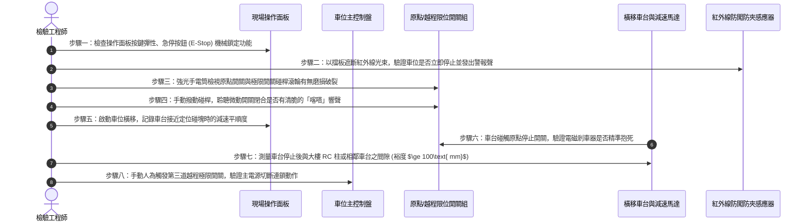

# 全案購屋實戰第六百零六部：中古大樓社區地下室機械停車設備車位限位極限開關碰桿變形接點氧化短路與橫移車台衝撞邊柱體檢工序全書

---

## 壹、前言與核心體檢宗旨

在都會區高房價與基地面積受限之環境下，中古集合住宅（屋齡 20～35 年）普遍於地下室配置二層或多層「昇降橫移式機械停車設備（Puzzle Mechanical Parking System）」。機械車位以極高之空間利用率，解決了上百戶家庭之泊車需求。

然而，機械停車設備長年置身於通風不良、潮濕多塵且微帶油氣的地下室底層，其運轉仰賴數十個精密之「限位極限開關（Limit Switch / Micro Switch）」與「防撞碰桿（Actuator Roller Lever）」作為車台空間定位之唯一眼睛與剎車信號源。

諸多中古社區因缺乏預防性體檢，導致機械車位暗藏以下致命風險：
1. **限位開關金屬碰桿疲勞變形與偏角**：車台在長期受載橫移過程中，因軌道磨損晃動衝擊碰桿，使其角度偏折 $\ge 15^\circ$，無法準確觸發定位停止信號。
2. **微動電氣觸點受潮氧化積碳與短路失效**：地下室濕氣與油氣滲入開關內部，銀接點氧化阻抗劇增，甚至發生接點融焊黏死，控制盤無法獲知車台已達極限位置。
3. **橫移車台衝撞結構邊柱與導軌脫軌翻覆**：由於第一道減速停止極限開關失效，車台以全速衝撞機械鋼構極限阻擋器（End Stop）或大樓 RC 結構柱，造成傳動鏈條斷裂、車台扭曲變形、愛車被擠壓全損，甚至引發人身夾傷慘劇。

本工序全書旨在深入剖析機械停車設備限位防撞體系之結構力學、電氣信號反饋與日常體檢工序，守護住戶愛車與人身安全。

---

## 貳、昇降橫移機械停車設備定位與防撞控制架構

```mermaid
flowchart TD
    A["住戶操作面板 (Key Switch / IC Card)"] --> B["地下室機械車位 PLC 主控制盤"]
    B --> C["橫移馬達交流接觸器 (MC-F / MC-R)"]
    C --> D["三相減速馬達 + 傳動鏈條 + 橫移台車"]
    
    D --> E["第一道：減速定位碰塊 (Deceleration Cam)"]
    D --> F["第二道：原點停止限位開關 (Normal Stop Limit Switch)"]
    D --> G["第三道：極限越程防撞開關 (Over-travel Ultimate Limit Switch)"]
    D --> H["第四道：機械重型鋼構防衝阻擋器 (Mechanical Buffer Stop)"]
    
    E -->|減速信號反饋| B
    F -->|切斷馬達供電 + 電磁剎車抱死| B
    G -->|緊急斷開安全迴路 (NC觸點連鎖)| I["主接觸器跳脫 + 蜂鳴警報鎖死"]
    
    D -.->|開關失效衝撞| H
    H --> J["大樓地下室 RC 柱 / 鋼構立柱 (結構吸收衝擊)"]
```

---

## 參、中古社區現場五大常見致命病徵與工程成因

| 病徵分類 | 現場常見故障現象 | 工程深層成因分析 | 對家庭置產之潛在危害 |
| :--- | :--- | :--- | :--- |
| **一、碰桿變形歪斜** | 車台移動到位時劇烈「晃動、撞擊」才停下，停止位置明顯偏移中線 | 碰桿金屬滾輪遭下垂鐵鍊或住戶輪胎長期刮擦碰撞，桿體產生永久塑性彎曲。 | 車位停不進去，輪胎卡在軌道縫隙造成鋼圈刮傷或底盤受損。 |
| **二、觸點氧化拒動** | 車台橫移到位後依然持續頂推，馬達發出低頻巨大悶響，傳動鏈條緊繃抖動 | 限制開關內部微動開關常閉（NC）接點積碳氧化阻抗過大，控制盤判定開關仍處於未動作狀態。 | 鏈條瞬間拉斷、馬達線圈過載燒毀，維修停擺數週無車位可用。 |
| **三、越程衝撞邊柱** | 車台直接衝撞大樓結構柱，柱體水泥崩落、車台鋼樑嚴重凹陷變形 | 原點停止開關與越程安全開關雙重失效，且電氣安全連鎖迴路被不肖保養員私自跨接短路。 | 車輛遭結構柱直接擠壓全損，並對大樓地下室承重 RC 柱造成剪切衝擊破壞。 |
| **四、防水橡膠套龜裂** | 雨天或清洗地下室地板後，車位控制盤頻繁跳出「E-Stop / Limit Error」警報 | 限位開關之電纜密封接頭（Cable Gland）或動態滾輪橡膠防塵套老化破裂，廢水滲入短路。 | 系統全面鎖死，全區數十戶車輛受困地下室無法開出上班。 |
| **五、光電防闖失效** | 人車仍在車台內移動，設備卻逕自橫移或升降，險象環生 | 車道兩側紅外線對射式光電感應器（Photoelectric Sensor）透鏡蒙上厚重油污，或光軸偏移。 | 極其重大之人身安全危機，極易發生夾傷小孩、寵物或夾扁車門事故。 |

---

## 肆、標準限位開關與車台定位八步精密體檢工序



### 關鍵檢驗數據與判定標準表：

| 檢驗參數 | 標準合格安全值 | 臨界警告值 | 致命危險特徵（必須立即停用檢修） |
| :--- | :--- | :--- | :--- |
| **1. 碰桿自由行程與偏角** | 碰桿垂直度偏差 $\le 3^\circ$ | 偏差 $4^\circ \sim 10^\circ$ | 碰桿偏角 $>15^\circ$，或滾輪鬆動脫落卡死 |
| **2. 觸點接觸電阻** | 開關閉合電阻 $\le 0.5\ \Omega$ | 電阻 $0.6\ \Omega \sim 2.0\ \Omega$ | 電阻 $>5.0\ \Omega$ 或內部進水短路 |
| **3. 停止位置精度** | 停止位置與中心線偏差 $\le \pm 10\text{ mm}$ | 偏差 $\pm 11\sim \pm 25\text{ mm}$ | 偏差 $>30\text{ mm}$，車輪上緣與柱體直接磨擦 |
| **4. 衝撞緩衝安全裕度** | 車台與結構柱極限距離 $\ge 100\text{ mm}$ | 距離 $50\text{ mm} \sim 99\text{ mm}$ | 距離 $<30\text{ mm}$，隨時有衝撞邊柱風險 |
| **5. 光電感應遮斷時效** | 遮斷光束後 $\le 0.2$ 秒內切斷馬達 | 響應時間 $0.3 \sim 0.5$ 秒 | 遮斷後車台毫無停頓繼續移動（防夾完全失效） |
| **6. 電磁剎車抱死厚度** | 剎車來令片磨耗殘厚 $\ge 3.0\text{ mm}$ | 殘厚 $1.5\sim 2.9\text{ mm}$ | 殘厚 $<1.0\text{ mm}$，金屬鐵片直接乾磨打滑 |

---

## 伍、買方看屋現場 3 分鐘機械車位實戰快檢表

| 查驗步驟 | 操作手法與觀察重點 | 合格健康特徵 | 致命隱患警訊（高危險折價項） |
| :--- | :--- | :--- | :--- |
| **1. 柱體撞擊痕跡巡檢** | 觀察車位後方及兩側大樓 RC 水泥柱 | 水泥表面平整、油漆完好，無刮擦破損痕跡 | 柱面水泥大塊剝落、鋼筋裸露，或看到多次水泥砂漿粗糙補抹痕跡 |
| **2. 車台平整度與鏽蝕** | 檢視車台波浪底板與鋼樑接縫 | 鋼樑平直無扭曲，鍍鋅層完好無大片剝落 | 底板嚴重下陷凹陷、邊樑銹蝕穿孔、螺栓嚴重銹死斷裂 |
| **3. 傳動鏈條鬆緊度** | 輕推或目測驅動橫移鏈條下垂量 | 鏈條均勻塗抹潤滑黃油，下垂量正常（$<20\text{ mm}$） | 鏈條乾枯無油發出尖銳摩擦聲，下垂嚴重拖地或齒輪尖端磨成銳角 |
| **4. 車位限重與限高標籤** | 檢視車位前方立柱黃色警示銘牌 | 標籤清晰：長寬高限制、容許載重（如 2000kg 或 1600kg） | 銘牌完全磨損模糊，或社區私下張貼「嚴禁停放休旅車、底盤易刮傷」告示 |
| **5. 試按急停開關反應** | 在車台移動中輕按紅色「EMERGENCY STOP」 | 車台立即完全抱死靜止，警報蜂鳴器持續鳴響 | 按下後車台毫無反應慢半拍繼續滑動，或開關卡死無法旋轉復位 |

---

## 陸、購屋特約條款範本：機械停車位安全與妥善率擔保

> **機械車位安全連鎖效能與維護權責擔保特約：**  
> 「賣方保證本買賣標的所包含之機械停車位（車位編號：＿＿號），其升降橫移機構、驅動鏈條、電磁剎車器、限位極限開關及光電防夾裝置功能完全正常，符合安全法規標準，且附有主管機關核發且在有效期限內之『建築物機械停車設備使用許可證』。  
> 點交日前由雙方實車操作升降橫移點交，若經查驗發現限位開關失效、定位偏差超過標準、防撞安全距離不足或車台運轉時有衝撞結構柱之虞，賣方應於交屋日前督促管理委員會及合格維護廠商修復完畢；若未能於期限內修復改善，賣方同意提撥新台幣 **伍萬元整** 作為機械車位安全維修保留款，自本買賣尾款中扣留，待完全修復並經買方實車驗收無誤後始行結清。」

---

## 柒、結語

機械車位是現代都會置產不可忽視的硬體資產。一個定位精準、保養得宜的機械車位，能讓您在繁華市區享受歸家即泊的從容自在；反之，若忽略了微小的限位開關與防撞距離，隨之而來的可能是動輒數十萬元的修繕爭議與心愛的愛車毀損。
買房看屋務必深入機械車位底部，以精準的工程數據校驗每一個開關與煞車點，為全家人的行車安全鑄造最堅固的防線！
