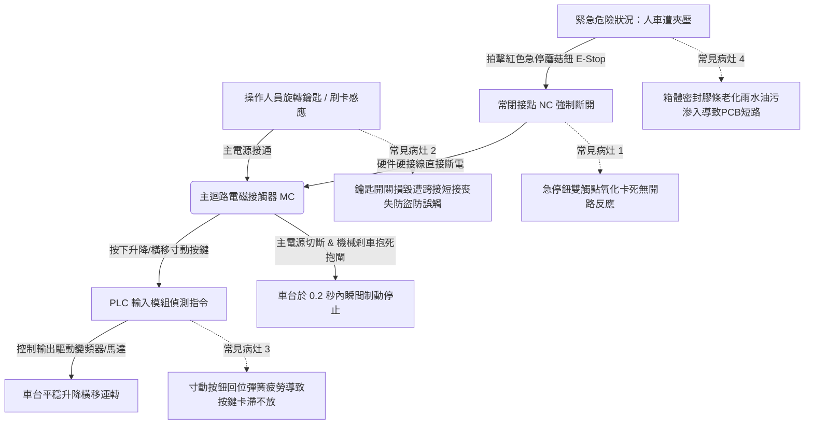

# 全案購屋實戰第四百七十一部：中古大樓社區地下室機械停車設備操作控制箱按鈕接點氧化急停蘑菇鈕開路失靈鑰匙開關防盜短接與配電保護體檢工序全書

## 壹、核心查驗宗旨與前言

大樓地下室機械立體停車設備（Mechanical Automated Parking System）之現場操作控制箱（Local Control Panel），為住戶每日停放車輛、呼叫車台升降橫移之第一線人機操作中樞。操作箱內部整合微電腦控制器（PLC）、鑰匙選擇開關（Key Switch）、寸動方向按鈕（Jog Buttons）、以及性命交關之「紅色急停蘑菇鈕（Emergency Stop Pushbutton, E-Stop）」。

於二十年至三十年屋齡之中古大樓中，因地下室常年通風不良、濕度高達 80%~90% RH、車輛排氣之二氧化硫與未完全燃燒碳氫化合物沉積，導致控制箱金屬外殼密封條老化粉化、按鈕微動開關銀接點嚴重硫化黑化、接觸電阻激增。更致命者，急停蘑菇鈕內部雙金屬彈片鏽斷形成常閉（NC）開路、或鑰匙開關損壞後遭無良保養廠商直接將內部線路「常閉短接」，使任何人無需鑰匙即可隨意操作，甚至當車輛或人員遭車台橫移推擠夾壓時，猛按急停鈕卻毫無制動反應，釀成骨折甚至車毀人亡之慘劇。

本工序全書旨在建立標準化、非破壞性與電氣雙軌體檢工序，指導購屋家庭在實地檢驗社區機械車位時，深入查驗現場操作箱之按鍵物理特性、急停反饋速度與防護電路完整性，杜絕交屋後陷入高額修繕公攤及人車安全風險。

---

## 貳、機械停車設備操作箱電氣迴路架構與物理病灶

### 一、急停蘑菇鈕（E-Stop）機械卡阻與電氣觸點失靈機制
1. **安全法規強制規範（CNS 13350 / ISO 13850）**：機械停車設備之緊急停止裝置，必須具備「直接斷開操作（Positive Break Operation）」機制，且外觀必須為紅色突起之蘑菇型自鎖按鈕。拍下後必須機械鎖定（Latch-in），需旋轉或拔出方能復位。
2. **氧化膜阻抗與彈簧斷裂**：地下室酸性濕氣滲透進入按鈕底座，內部銅合金彈簧在應力與腐蝕雙重作用下產生「應力腐蝕破裂（SCC）」。當操作者拍擊急停鈕時，機械卡鉤滑脫無法鎖住，或內部微動開關接點被油泥黏死，無法在第一時間切斷電磁接觸器（MC）之控制迴路，導致馬達持續運轉拖行擠壓。

### 二、鑰匙選擇開關（Key Switch）內部短接弊端
1. **鑰匙齒排磨損與鎖芯滑脫**：機械車位鑰匙常年由不同車主反覆旋轉插拔，黃銅鎖芯彈子磨耗嚴重，產生卡匙或鑰匙拔出後開關依然通電。
2. **惡意跨接（Jumper Bypass）隱憂**：因更換專用防爆鑰匙開關需耗費數千元並重新配發各車主鑰匙，部分大樓管委會為圖省事，竟指示機電廠商在箱內端子排使用短接線（Jump Wire），將鑰匙開關之 NO 常開接點永久短路。此舉導致孩童或無關人員可隨意按動按鈕，極易引發車台上方車輛因誤操作被頂撞樑柱壓毀之事故。

### 三、寸動按鍵（Jog Buttons）黏結卡滯與微動開關碳化
1. **彈簧疲勞與粉塵咬死**：操作箱外殼防塵橡膠套（Rubber Boot）若因紫外線或油氣脆化破裂，地下室砂塵進入按鈕導柱間隙。當車主按下「降」或「左移」按鈕後，按鍵無法自主彈回，控制信號持續輸出，直到車台撞擊極限開關或超載跳脫。
2. **微動開關電弧碳化**：直流 24V 控制迴路頻繁寸動啟閉時產生感應反電動勢電弧，接點表面形成絕緣碳化層，導致按壓數次皆無反應，誤導車主以為系統斷電，在車身尚未駛入定位時貿然進入引發危險。

---

## 參、實地現場逐項體檢工序與安全量測指引

### 步驟一：控制箱外觀防護與結構密封性檢驗
1. **IP 防護等級與箱門氣密檢查**：
   - 檢視操作箱外殼防護等級（標準應達 IP54 以上，戶外或半戶外地下室應達 IP65）。
   - 檢查箱門邊緣發泡密封膠條（Gasket）是否硬化、粉化脫落或被油泥腐蝕；檢查箱體金屬底部是否有受潮生鏽穿孔。
2. **銘牌與操作說明標示辨識度**：
   - 檢查控制箱表面之「車輛尺寸限制（長/寬/高/重）」銘牌是否清晰完整，車位編號是否對應正確。
   - 檢視急停鈕周圍是否有黃色底襯與醒目之「緊急停止」警告字樣。

### 步驟二：物理按鍵手感與機械回彈測試（不啟動設備下之靜態測試）
1. **急停蘑菇鈕自鎖與旋轉復位測試**：
   - 用掌心垂直用力拍下紅色急停鈕。
   - **檢驗標準**：按鈕必須發出清脆「卡嗒」聲並牢固鎖定於下凹位置；嘗試用手指輕輕拉扯，按鈕不得自行彈起。
   - 順時針旋轉按鈕頭部，確認復位彈簧是否能在瞬間俐落將按鈕彈回初始狀態，無任何卡頓、遲滯或歪斜。
2. **升降/橫移方向按鍵寸動行程檢測**：
   - 逐一按壓「升」、「降」、「左移」、「右移」按鈕。
   - 感受行程阻力與回彈速度，按下深度約 3~5mm，手放開後必須在 **0.1 秒內極速回位**。若有黏手、卡滯或按鈕傾斜未回彈現象，判定為微動彈簧疲勞或雜質卡死。
3. **鑰匙開關插拔與角度旋轉測試**：
   - 插入原廠鑰匙，旋轉至「ON」與「OFF」檔位，確認定位檔位手感分明（通常為 45° 或 90° 定位）。
   - 測試於「ON」狀態下鑰匙是否能被輕易拔出（安全設計通常規定「ON」狀態下鑰匙鎖定不可拔除，防止車台運轉時無人看管）。

### 步驟三：通電動態制動與反饋時間實測（需管理員或原車主同意操作）
1. **急停制動距離與時間量測**：
   - 於車台空載運轉升降過程中，突發用力拍擊急停蘑菇鈕。
   - **判定標準**：車台必須在 **0.2 秒內完全停止運轉**，機械抱閘必須瞬間發出抱死撞擊聲；滑行慣性距離不得超過 20mm。
2. **急停連鎖復位防重啟測試**：
   - 在急停鈕維持按下鎖定狀態下，嘗試按壓任何升降或橫移按鈕。
   - **判定標準**：系統必須完全處於無電癱瘓狀態，電機不得有任何哼聲或顫動。
   - 將急停鈕旋轉復位後，車台**絕對不得自動恢復運轉**，必須重新轉動鑰匙開關或按壓「故障復歸鈕」後方能重新啟動，確保符合安全防暴衝規範。

---

## 肆、評估判定基準與瑕疵等級劃分

| 瑕疵等級 | 現場實測狀況與物理特性 | 潛在隱患與公共安全危害 | 預估修繕工法與費用規模 |
| :--- | :--- | :--- | :--- |
| **輕度瑕疵 (A級)** | 箱門密封條微量灰塵但有彈性；方向按鈕回彈俐落；急停鈕自鎖正常；外觀漆面完好無嚴重腐蝕。 | 控制機能健全，僅需例行性清潔與防塵套更換。 | 清潔接點、更換按鈕橡膠防塵套，每座操作箱約 **800 ~ 1,500 元**。 |
| **中度瑕疵 (B級)** | 方向按鍵按壓後回彈遲緩（超過 0.5 秒）；鑰匙開關檔位鬆動；外殼密封條粉化導致箱內受潮結露；急停制動距離超過 50mm。 | 易因按鈕卡滯引發車台超程撞擊；濕氣累積可能導致 PLC 微電腦控制基板燒毀。 | 更換全新工業級金屬按鈕開關組、更新鑰匙開關總成、更換發泡耐油密封條，費用約 **3,500 ~ 8,000 元/座**。 |
| **重度瑕疵 (C級)** | 急停蘑菇鈕拍下無法自鎖或斷電失靈；鑰匙開關遭內部違規跳線短接；箱體嚴重鏽蝕穿孔進水；運轉中按急停馬達無反應！ | 致命安全危害！遇突發夾人或車輛卡住事故時毫無剎車急停能力，極易造成斷肢截斷或人員被輾壓致死！ | 全面更換全套 IP65 防爆型微電腦操作控制箱總成、重新配置安全繼電器與電氣配線，單座費用達 **25,000 ~ 50,000 元以上**。 |

---

## 伍、買賣合約保障特約條款與談判折價策略

### 一、談判折價依據與議價話術
若買方勘查機械車位現場，發現操作箱急停鈕失靈、按鍵黏住或鑰匙開關遭短接，買方應當場錄影並嚴正向賣方主張安全風險：
> 「本買賣標的物所屬之地下室機械停車設備，其現場操作箱急停蘑菇鈕已喪失即時自鎖斷電功能，鑰匙開關亦遭違規跨接。此屬於極度危險之重大公安瑕疵，一旦家屬或孩童在場誤觸或發生夾人意外，後果不堪設想，且此設備不符建築法機械停車安全規範。請賣方於成交總價中直接折讓新台幣 3 萬至 5 萬元之專用修繕安全基金，或由社區機電廠商於交屋日前完成控制箱原廠更換與合格簽證。」

### 二、成屋買賣契約專用法律特約條款（範本）

> **【不動產買賣契約書——機械停車設備安全控制設施點交特約條款】**
>
> 1. **機械車位安全控制機能保證**：賣方保證本買賣標的物所隨附之機械停車位（含所屬車台、驅動馬達及操作控制箱），於交屋日前均處於符合內政部《建築物附設停車空間機械停車設備安全標準》之完好堪用狀態。
> 2. **急停與防誤觸機制驗收承諾**：雙方約定於交屋點交時實地測試操作箱功能，賣方保證急停蘑菇鈕具備拍擊自鎖即刻切斷動力電源之功能（制動反應時間 $\le 0.2$ 秒），鑰匙選擇開關無任何私自短接或旁路跳線之情事，方向按鍵回彈正常無卡滯。
> 3. **修繕款抵扣與瑕疵擔保責任**：若點交實測發現操作控制箱存在急停失靈、按鍵卡死或線路短接等缺陷，賣方應負責於交屋日前修復並出具合格維保單據；若逾期未修復，買方得自行委請專業機械停車設備廠商更換全新控制箱，相關費用（以新台幣參萬元整為上限）得逕由買賣尾款中全額扣抵，賣方不得異議。
