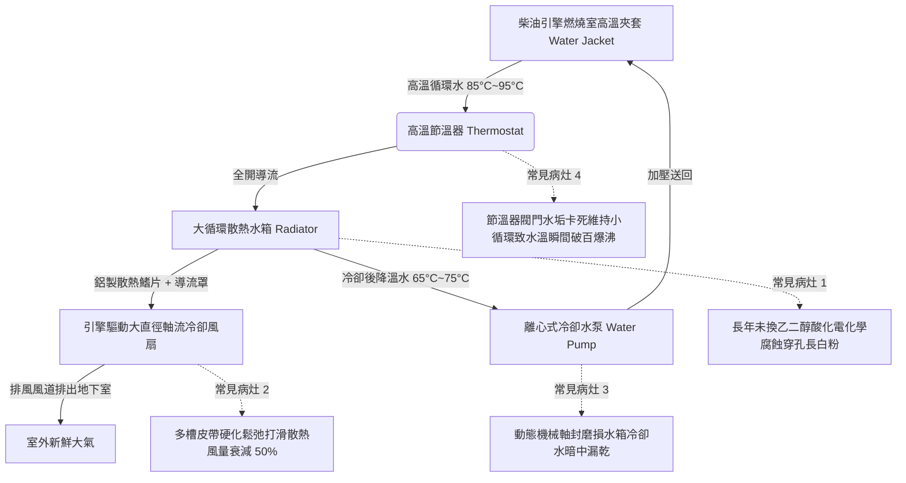

# 全案購屋實戰第四百七十九部：中古大樓社區地下室緊急柴油發電機冷卻水箱散熱鰭片鋁蝕淤塞冷卻風扇皮帶打滑水泵軸封滲漏與過熱高溫抱死體檢工序全書

## 壹、核心查驗宗旨與前言

大樓地下室常設之緊急柴油發電機組（Emergency Diesel Generator, EDG），係全社區面臨市政電網跳電、強烈地震引致變壓器爆炸、或突發火災斷電時，維持全棟「消防防排煙抽風機、室內消防栓加壓泵、緊急昇降機（消防員電梯）、避難弱電通訊及地下室抽水泵」運轉之唯一終極後備動力心臟。發電機引擎於滿載運轉時產生極為驚人之燃燒廢熱，全賴發電機水箱散熱系統進行閉路循環冷卻。

於二十年至三十年屋齡之中古電梯大樓中，因長年處於待機冷機狀態且管委會僅做「無負載發動 3 分鐘」之敷衍保養，普遍存在「水箱冷卻液（Coolant）十年未換酸化」、「散熱鰭片（Radiator Fins）鋁蝕氧化長滿白粉淤塞」、「橡膠皮帶（V-Belt）硬化龜裂打滑導致風扇轉速腰折」、「水泵（Water Pump）機械軸封老化持續滴漏」以及「節溫器（Thermostat）水垢卡死」等重大機械暗礁。一旦真正發生大停電或火災強行全載運轉，冷卻水溫在 5 至 8 分鐘內瞬間衝破 105°C 高溫上限，引擎微電腦保護跳脫停機，或活塞在高溫下劇烈膨脹引致「引擎抱死拉缸（Piston Seizure）」徹底報廢，使全棟陷入一片漆黑與消防癱瘓之滅頂死局。

本工序全書旨在建立標準化、非破壞性之緊急發電機冷卻水箱與水泵散熱系統體檢工序，指導購屋家庭在實地檢驗大樓發電機房時，精準查核散熱系統真實抗熱能耐，防範交屋後承擔數十萬至百萬元發電機大修更換之鉅額公攤修繕費用。

---

## 貳、緊急發電機水箱散熱冷卻系統架構與物理病灶

### 一、散熱鰭片鋁蝕氧化與防凍冷卻液（Antifreeze）酸化沉積
1. **電化學原電池腐蝕機制**：水箱散熱管芯多為紫銅或鋁合金，散熱鰭片則為薄鋁片。標準冷卻水應為 50% 乙二醇（Ethylene Glycol）防凍防蝕冷卻液。老舊大樓常年為節省開銷，隨意添加未經純化之自來水或井水。乙二醇在長期高溫氧化後分解為甲酸與乙醇酸，pH 值自弱鹼性（pH 8.5~10.5）暴跌為酸性（pH < 6.0），引發劇烈之電化學「點蝕（Pitting）」與「晶間腐蝕」。
2. **氧化鋁白粉（Alumina Powder）堵死風道**：鋁鰭片表面析出厚重白色氫氧化鋁與碳酸鈣結晶粉末，牢牢黏附於厚度僅 0.1mm 之鰭片縫隙間；配合地下室油煙粉塵，散熱風道透風截面積衰減 60% 以上，風扇抽送之冷風完全無法穿透水箱，散熱熱交換效率徹底瓦解。

### 二、傳動皮帶（V-Belt）老化打滑與風量衰減
1. **橡膠彈性疲勞與齒形磨損**：風扇與水泵共用引擎曲軸皮帶輪驅動，採用包布 V 型皮帶或多楔帶。皮帶在長年拉伸張力與地下室機油蒸汽侵蝕下，橡膠硬化、底膠龜裂、側壁磨耗變薄，皮帶下沉深入皮帶輪槽底（Bottoming Out）。
2. **動態打滑與轉速腰折**：當引擎突發滿載升速至 1800 RPM（60Hz）時，傳動阻力暴增，打滑率自標準之 $< 2\%$ 激增至 $25\% \sim 40\%$，發出尖銳刺耳之「唧唧」打滑尖叫聲。風扇轉速嚴重不足，風量直接腰折，且水泵轉速不足導致水流循環流速腰折，引擎熱量積聚無法排出。

### 三、冷卻水泵機械軸封滲漏與軸承抱死
1. **陶瓷/石墨密封環乾磨磨耗**：冷卻水泵軸心旋轉密封依賴水潤滑之機械軸封。水中若含有水垢硬質砂石顆粒，鏡面密封環被磨出無數環狀溝槽。冷卻液經由泵體下方之「洩漏檢知孔（Weep Hole）」滲漏滴落。
2. **軸承油脂乳化與瞬間抱死**：滲漏之熱水侵入水泵前端之深溝滾珠軸承，高溫潤滑脂被乳化沖刷殆盡。滾珠在無潤滑狀態下高速旋轉，數分鐘內產生高熱（超過 300°C）並直接與內外圈融焊「抱死（Bearing Seizure）」，瞬間扯斷傳動皮帶，水泵完全停止轉動，冷卻循環瞬間阻斷。

---

## 參、實地現場逐項體檢工序與精確量測指引

### 步驟一：發電機冷卻水箱與外部管路靜態檢驗
1. **水箱散熱鰭片外觀透光度檢測**：
   - 使用高流明強光手電筒，由水箱後方（風扇側）緊貼照射，人員於水箱前方觀察透光率。
   - **判定標準**：光線應能均勻、清晰地穿透整個散熱矩陣網格。若大面積呈現暗黑、表面附著厚重白色白粉白華、或鰭片有大面積被外力壓倒倒伏倒褶（Bent Fins），判定為散熱不良需梳整更換。
2. **冷卻水箱蓋與副水箱液位檢測**：
   - 於冷機狀態下，逆時針旋開水箱加水口金屬高壓水箱蓋（Pressure Cap）。
   - 檢視水箱蓋內部不鏽鋼彈簧與黃銅真空閥門，橡膠密封墊片是否硬化開裂。
   - 觀察主水箱內部液位：冷卻液必須滿溢至溢流管頸口，顏色應呈「透亮之亮綠色、粉紅色或藍色」；若液位大幅見底、或液體呈現「鐵鏽紅褐色」、「泥漿渾濁狀」或水面浮有一層黑油花，代表水箱內部嚴重鏽蝕且汽缸床墊片（Head Gasket）恐有漏氣破裂。
   - 檢視塑膠副水箱（Expansion Bottle）液位是否處於「COLD / MIN」與「HOT / MAX」刻度之間。

### 步驟二：傳動皮帶張力與水泵軸心物理手感檢測
1. **皮帶張力（Tension）與撓度精密測量**：
   - 於曲軸皮帶輪與發電機/風扇皮帶輪跨距之中間點。
   - 使用拇指以約 10 公斤（98N）之力道垂直向下按壓皮帶表面。
   - **標準撓度（Deflection）**：正常按壓下沉位移量應在 **10mm ~ 15mm** 之間。若下沉量超過 20mm，判定為皮帶嚴重鬆弛；若下沉量小於 5mm，代表張力過大將提早毀損軸承。
2. **水泵軸心游隙與洩漏孔檢查**：
   - 伸手搖動冷卻風扇葉片與水泵皮帶盤（冷機未通電狀態）。
   - 感受徑向與軸向游隙：正常應無任何微小晃動鬆曠感。
   - 使用手電筒檢查水泵下方之「洩漏洩水孔」：孔洞周圍應乾燥無任何水痕結晶；若長出一大坨粉紅/淡綠色固態化學結晶塊，代表水泵機械軸封已長期滲漏，需更換水泵總成。

### 步驟三：試機運轉動態升溫與節溫器開閉測試（需機電人員陪同手動啟動）
1. **無負載手動運轉測試（運轉 3~5 分鐘）**：
   - 將控制盤切至「手動（MANUAL）」，按壓啟動按鈕發動柴油引擎。
   - 觀察水箱風扇轉速：風扇應立即形成強大軸流吸風，導風罩前方應有強烈氣流噴出。
   - 仔細聆聽皮帶運轉聲：加速與減速瞬間絕無任何刺耳尖叫打滑聲。
2. **紅外線熱像儀監測水管進出溫差**：
   - 使用熱像儀或紅外線測溫槍，分別測量引擎出口上水管（Upper Hose）與水箱出口下水管（Lower Hose）之表面溫度：
     - **節溫器開啟前（水溫 $< 75^\circ\text{C}$）**：上水管緩慢升溫，下水管維持低溫（小循環模式）。
     - **節溫器全開後（水溫達 $82^\circ\text{C} \sim 85^\circ\text{C}$）**：下水管溫度應迅速上升，進出水溫差應保持在 **$5^\circ\text{C} \sim 8^\circ\text{C}$** 之健康熱交換範圍。
     - 若引擎儀表水溫已飆破 $95^\circ\text{C}$，但下水管依然冰冷，鐵證**節溫器已經鏽死卡死無法開啟**，引擎即刻面臨爆沸危險！

---

## 肆、評估判定基準與瑕疵等級劃分

| 瑕疵等級 | 現場實測狀況與機械數值 | 潛在隱患與公共安全危害 | 預估修繕工法與費用規模 |
| :--- | :--- | :--- | :--- |
| **輕度瑕疵 (A級)** | 散熱鰭片透光良好；皮帶撓度 10~15mm 無裂紋；水箱冷卻液澄澈亮綠；水泵無滴漏；節溫器溫控正常。 | 冷卻機能健全優良，維持定期巡檢即可。 | 例行性補充標準 50% 乙二醇冷卻液、清理鰭片表面灰塵，每季保養約 **2,000 ~ 4,000 元**。 |
| **中度瑕疵 (B級)** | 散熱鰭片表面有局部白粉白華（透光率 70%）；皮帶表面有細微龜裂（下沉 $> 18\text{mm}$）；水泵洩漏孔有微量乾涸結晶痕跡；冷卻水顏色微黃變濁。 | 滿載運轉時散熱裕度嚴重不足；夏季高溫停電時運轉超過 15 分鐘恐發生水溫過高跳機警報。 | 化學藥劑全系統水垢清洗、更換全套耐熱耐油傳動皮帶、更換原廠節溫器及水箱壓力蓋，費用約 **15,000 ~ 35,000 元**。 |
| **重度瑕疵 (C級)** | 散熱鰭片大面積腐蝕碎爛堵死（完全不透光）；冷卻水嚴重漏光或呈濃稠黑泥狀；皮帶打滑尖叫；水泵持續滴漏；試車 5 分鐘水溫破百爆沸！ | 致命毀滅性風險！火災或大停電時後備電力瞬間中斷；引擎隨時發生拉缸抱死，全大樓消防抽水抽風全部癱瘓！ | 發電機水箱拆卸重新解體通管或更換全新加大重型銅水箱、更換全新原廠循環水泵總成，修繕費用達 **8萬 ~ 20萬元以上**。 |

---

## 伍、買賣合約保障特約條款與談判折價策略

### 一、談判折價依據與議價話術
若買方在勘查地下室發電機房時，發現冷卻水箱散熱鰭片發白堵死、水箱內已乾涸無冷卻液、或試車時皮帶劇烈打滑尖叫，買方應當場錄影存證並嚴正向賣方主張權益：
> 「本買賣標的物所屬社區之緊急柴油發電機，其散熱水箱鰭片已產生嚴重氧化鋁蝕淤塞，冷卻水嚴重漏光酸化，水泵亦有洩漏滴水痕跡。此為涉及全棟高樓層消防排煙、火災逃生電梯與停電抽水之重大生命線公設瑕疵。一旦遭遇停電或火災，發電機必將於數分鐘內過熱抱死跳脫，使全大樓陷入致命危險，且更換重型發電機散熱水箱與水泵需耗費十餘萬元。請賣方於成交總價中實質折讓新台幣 3 萬至 6 萬元之公設發電機修繕補償款，或由賣方督促管委會於交屋日前完成發電機水箱清洗更新、更換水泵軸封並出具滿載試車合格證明。」

### 二、成屋買賣契約專用法律特約條款（範本）

> **【不動產買賣契約書——大樓緊急發電機散熱冷卻系統安全點交特約條款】**
>
> 1. **發電機冷卻機能完好承諾**：賣方保證本買賣標的物所屬社區大樓地下室之緊急柴油發電機組（包含散熱水箱、循環冷卻水泵、傳動皮帶、節溫器及排風風道），於交屋日前均處於正常堪用狀態，散熱鰭片通風良好無嚴重鋁蝕阻塞，冷卻液充足未酸化變質，且於無負載試車運轉時引擎水溫穩定維持在 85°C 以下，無任何過熱高溫警報跳脫之重大缺陷。
> 2. **消防後備動力安全保證**：賣方保證發電機組具備市電斷電後 15 秒內自動點火起走並承接消防排煙與緊急電梯動力之連鎖機能，最近一期消防設備安全申報檢驗中，發電機負載測試項目列為「合格」且無列管缺失。
> 3. **公攤大修費用免責追索約定**：若於交屋日起六個月內，因交屋前已存在之發電機冷卻水箱破裂腐蝕、水泵軸承抱死或引擎過熱拉缸，經區分所有權人會議決議開徵全棟發電機大修或水箱更新特別修繕公攤款者，賣方同意按其持有房屋產權期間比例無條件全額負擔該筆公攤款項，買方得憑繳款通知單向賣方全額追討。
