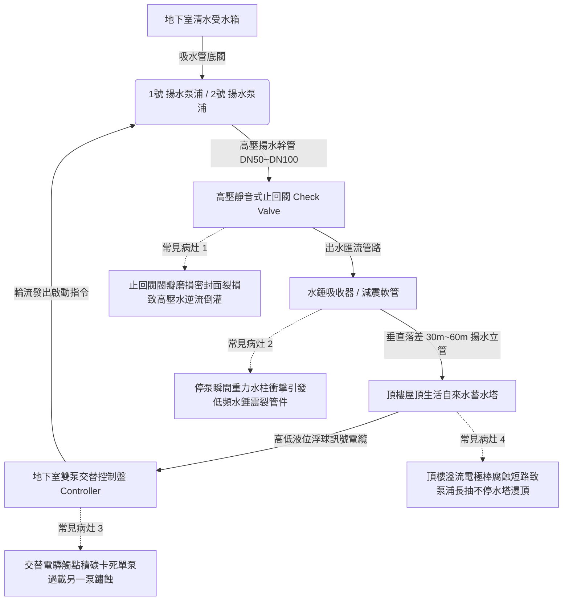

# 全案購屋實戰第四百七十八部：中古大樓社區地下室生活自來水雙泵揚水系統止回閥逆向洩漏低頻水錘震盪雙泵自動交替控制器故障與高樓層水塔溢流體檢工序全書

## 壹、核心查驗宗旨與前言

大樓地下室生活自來水揚水系統（Domestic Water Lifting System），擔負著將地下受水箱暫存之數十噸自來水，克服數十公尺垂直重力落差，強行加壓抽送至各棟頂樓蓄水塔（Rooftop Water Tanks）之核心重任。為確保大樓 24 小時供水不中斷，標準機電工程皆採用「一用一備」或「雙泵並聯自動輪流交替（Alternating Dual Pump System）」架構，並於泵浦吐出端配置高壓靜音式止回閥（Silent Check Valve）與水錘吸收器（Water Hammer Arrestor）。

於二十年至三十年屋齡之中古電梯大樓中，因每日高頻率重載揚水運轉，吐出端高壓止回閥內部銅閥瓣、不鏽鋼回位彈簧與橡膠密封圈嚴重磨損碎裂，產生隱蔽性「高壓逆向洩漏」。當揚水馬達驟停瞬間，管內數十公尺水柱挾帶巨大重力位能強烈反衝倒灌，激發劇烈之「低頻水錘震盪（Low-Frequency Hydraulic Shock）」，引發整棟垂直幹管強烈搖晃與管夾拉脫；此外，雙泵交替電驛（Alternating Relay / PLC）因觸點氧化故障鎖死單一馬達，或頂樓水塔高液位浮球信號斷線，導致揚水泵浦通電長抽不息，頂樓水塔漫頂溢流化為瀑布，造成電梯機房淹水及高額自來水費公攤浩劫。

本工序全書旨在建立標準化、專業化之揚水雙泵系統實體機械與電氣控制體檢工序，指導購屋家庭在實地檢驗地下室機房與頂樓水塔時，精準判別止回閥逆止性能、交替控制器邏輯及溢流防護真實狀態，杜絕交屋後陷入高額維修公攤與居住水錘噪音噩夢。

---

## 貳、揚水雙泵系統核心架構與常見物理病灶

### 一、高壓止回閥逆向洩漏與水錘衝擊破壞機制
1. **密封面磨損與彈簧疲勞失效**：高壓靜音式止回閥多採用彈簧預緊之滑塊或升降式閥瓣。在歷經數萬次開閉衝擊後，不鏽鋼彈簧彈力衰減 $30\%$ 以上，NBR/EPDM 橡膠密封墊圈遭砂石劃傷剝落。停泵時閥瓣無法迅速貼合閥座，原本應在 0.1 秒內封閉之逆止斷面產生延遲，管路中數十噸重之垂直水柱向下回沖倒灌。
2. **水錘 Joukowsky 破壞力**：依據流體力學 Joukowsky 方程式 $\Delta P = \rho \cdot c \cdot \Delta v$，當高速回流之水流撞擊遲閉之止回閥瓣時，管內動能瞬間轉化為超高壓壓力波（可達標稱工作壓力之 3~5 倍，即 $15 \sim 30\text{ kgf/cm}^2$）。管網劇烈爆發「轟！轟！」巨響，垂直立管吊架螺栓被強烈剪力扯斷，低樓層轉向彎頭直接震裂噴水。

### 二、雙泵自動交替控制器（Alternator Relay）邏輯失控
1. **微電腦步進電驛接點氧化鎖死**：標準控制盤採用棘輪式機械交替電驛或電子式雙泵控制器。老舊大樓地下室高濕環境引致內部繼電器銀觸點氧化發黑或微動開關機械卡死，失去每次運轉後「1號泵 $\rightarrow$ 2號泵」之切換功能，將運轉負載永久鎖定於 1 號泵。
2. **單泵過載燒毀與備用泵鏽死抱死**：長期單打獨鬥之 1 號泵浦馬達軸承高溫磨損、線圈過熱絕緣劣化；而常年停擺之 2 號備用泵，其不鏽鋼軸心與黃銅葉輪在水垢堆積下與泵體完全「鏽死抱死」。一旦 1 號泵燒毀跳脫，控制盤自動切換至 2 號泵時，轉子無法旋轉直接堵轉，瞬間燒毀備用馬達，全大樓陷入全面斷水停擺。

### 三、頂樓水塔溢流管防護失效與長抽淹水
1. **液位浮球電極棒水垢短路**：頂樓生活水塔多採用三棒或五棒式不鏽鋼電極棒液位控制器（E1 溢流、E2 停泵、E3 啟泵、E4 缺水、E5 接地）。電極棒表面常年沉積碳酸鈣結晶水垢或懸浮蛛網，導致 E2 停泵電極與共通接地端絕緣失效，控制盤無法偵測到「水滿停機信號」。
2. **高樓層水塔瀑布漫頂災難**：地下室揚水馬達持續強行運轉長抽數小時，數十公噸自來水由頂樓水塔溢流管狂暴噴出。若溢流管口排水不及或頂樓落水孔阻塞，水流瞬間沿樓梯間傾瀉而下，直灌各樓層住戶室內、更會滲入電梯機房使電梯控制主機泡水報廢，造成百萬元以上之驚人損失。

---

## 參、實地現場逐項體檢工序與精確量測指引

### 步驟一：揚水泵浦機組與止回閥靜態外觀檢驗
1. **止回閥型式與防震軟管配置檢查**：
   - 檢視每台揚水泵浦出水端是否配置「高壓靜音式止回閥（Silent Check Valve）」，嚴禁採用低階易產生水錘之「旋啟式搖擺止回閥（Swing Check Valve）」。
   - 檢查止回閥前後是否安裝耐高壓橡膠或不鏽鋼編織「防震軟管（Flexible Joint）」，確認橡膠表面無鼓泡、無裂紋。
2. **高壓壓力錶與壓力波動檢驗**：
   - 檢視吐出端安裝之耐震甘油壓力錶（量程應達 $0 \sim 15\text{ kgf/cm}^2$）。
   - 在停泵待機狀態下，讀取管內殘留靜水壓：該數值應精確等於「地下室至頂樓水塔之垂直幾何落差高程（例如 15 層樓約 45 公尺，錶壓應維持在 $4.5\text{ kgf/cm}^2$）」。若停機後數分鐘內壓力錶指針緩慢跌落至零，即鐵證**止回閥嚴重逆向洩漏漏水**！

### 步驟二：雙泵啟停動態運轉與水錘震盪實測（需機電或管理員陪同操作）
1. **1號泵手動啟動與停止水錘檢測**：
   - 於地下室給水控制盤將 1 號泵切至「手動（MANUAL）」運轉 10 秒後切斷停止。
   - **判定標準**：停機瞬間，仔細聆聽止回閥動作聲。
     - 正常狀態：止回閥發出極微弱清脆之閉合聲，管線輕微顫動即恢復平靜。
     - 故障狀態：停泵後 0.5~1.0 秒爆發一聲沉悶劇烈之「碰！轟！」重擊巨響，出水鋼管劇烈橫向晃動超過 10mm，代表止回閥嚴重遲閉逆漏，水錘衝擊破壞性極高。
2. **2號泵啟動與轉向順暢度檢驗**：
   - 手動啟動 2 號備用泵，確認電機是否能瞬間平順啟動運轉，運轉聲音平穩無高頻金屬刮碰聲或軸承嗡嗡聲。
   - 檢視馬達本體旋轉方向是否與泵殼標示之箭頭方向一致。

### 步驟三：自動交替控制器功能實測
1. **模擬啟抽交替切換測試**：
   - 將控制盤切換至「自動（AUTO）」模式。
   - 於控制盤內手動短接觸發「水塔低水位啟抽信號」：觀察 1 號泵是否啟動；隨後斷開模擬水滿停機。
   - 再次短接觸發啟抽信號：
     - **判定標準**：控制盤必須自動切換輪替，改由 **2 號泵啟動運轉**。
     - 若連續兩次啟動皆為同一台馬達運轉，判定為交替控制器電驛故障或 PLC 邏輯失常，喪失雙泵互備功能。

### 步驟四：頂樓水塔防溢流與排水間隙檢查
1. **頂樓溢流管口與排水落差檢查**：
   - 登上大樓頂樓水塔，檢視溢流排放管管徑是否「大於進水管至少一級規格」（例如進水管 DN50，溢流管至少應為 DN65 或 DN80）。
   - 檢視溢流管出水口是否確實導向頂樓排水明溝，管口與地面落水孔是否保持空氣斷隙，防止虹吸倒灌。

---

## 肆、評估判定基準與瑕疵等級劃分

| 瑕疵等級 | 現場實測狀況與水錘數值 | 潛在隱患與公共安全危害 | 預估修繕工法與費用規模 |
| :--- | :--- | :--- | :--- |
| **輕度瑕疵 (A級)** | 停泵時無水錘異音，管路微顫；止回閥持壓完好；雙泵自動輪替正常；壓力錶靜水壓穩定。 | 揚水系統機能健全優良，維持定期巡檢。 | 例行性壓力錶校正、止回閥內部雜質排污，每季機組維保約 **1,500 ~ 3,000 元**。 |
| **中度瑕疵 (B級)** | 停泵瞬間有輕微水錘聲（管路晃動 5~8mm）；止回閥停機後 10 分鐘內壓力緩慢洩漏；雙泵交替偶發性失效卡在單泵；備用泵軸承運轉稍有異音。 | 幹管長年承受疲勞衝擊，接頭處容易產生裂縫微漏；單泵長期過載有提早燒毀風險。 | 更換全新高壓靜音式不鏽鋼止回閥（DN50~DN80）、更換工業級雙泵自動交替控制器、備用馬達軸承保養更換，費用約 **18,000 ~ 38,000 元**。 |
| **重度瑕疵 (C級)** | 停泵時爆發劇烈震耳炸裂水錘巨響（晃動超過 15mm）；止回閥完全無逆止功能；備用泵鏽死卡死無法啟動；頂樓溢流控制失靈長抽淹水！ | 致命毀滅性風險！幹管隨時可能直接震裂引發地下室大淹水；全棟面臨全面停水浩劫與百萬電梯主機泡水賠償！ | 揚水幹管加裝重型水錘吸收器、全面換新雙台多段高壓不鏽鋼揚水泵浦、重拉頂樓水塔液位信號電纜與控制盤，費用達 **12萬 ~ 28萬元以上**。 |

---

## 伍、買賣合約保障特約條款與談判折價策略

### 一、談判折價依據與議價話術
若買方在勘查地下室給水機房時，發現揚水泵浦停機時發出震耳欲聾之水錘撞擊聲、幹管劇烈晃動、或備用泵已生鏽卡死無法交替運轉，買方應當場錄影存證並嚴正向賣方主張權益：
> 「本買賣標的物所屬社區之生活自來水揚水系統，其高壓止回閥已完全喪失逆止功能，停泵瞬間爆發強烈低頻水錘震盪，整根垂直揚水幹管劇烈位移，且備用泵浦已故障鏽死無法交替運轉。此屬於涉及全棟供水安全與幹管爆裂淹水之重大公設機電瑕疵，一旦立管震裂將造成地下室淹水與全棟數日大斷水，全面更換止回閥與泵浦需耗費管委會高額基金。請賣方於成交總價中實質折讓新台幣 3 萬至 6 萬元之公設水利修繕補償款，或由賣方督促管委會於交屋日前完成揚水止回閥更新、雙泵交替修復並出具試車合格證明。」

### 二、成屋買賣契約專用法律特約條款（範本）

> **【不動產買賣契約書——大樓自來水揚水系統與防水錘設施點交保證特約條款】**
>
> 1. **揚水雙泵與防逆止機能保證**：賣方保證本買賣標的物所屬社區大樓地下室至頂樓水塔之生活自來水揚水系統（包含揚水泵浦機組、高壓靜音止回閥、水錘吸收器及雙泵交替控制盤），於交屋日前均處於運轉平順、停泵無破壞性水錘巨響、止回閥無逆向洩漏且雙泵能自動輪流交替運轉之良好堪用狀態。
> 2. **頂樓水塔液位與防溢流承諾**：賣方保證頂樓水塔之液位控制電極棒及防溢流警報系統運作正常，水滿時能確實自動切斷地下室揚水馬達動力，無任何漫頂溢流致使公共走道或電梯機房受潮泡水之隱患。
> 3. **全棟揚水系統公攤修繕免責約定**：若於交屋日起六個月內，因交屋前已存在之揚水幹管水錘破裂、止回閥全面損毀或雙揚水泵浦同時燒毀，經區分所有權人會議決議開徵全棟揚水系統專案特別修繕公攤款者，賣方同意按其持有房屋產權期間比例無條件全額負擔該筆公攤款項，買方得憑繳款通知單向賣方全額追討。
