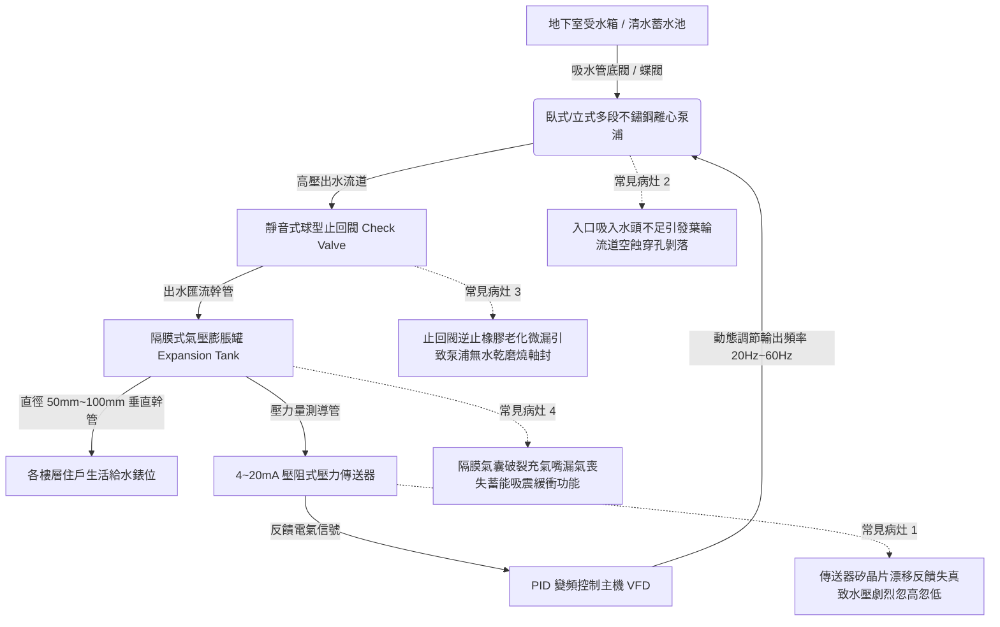

# 全案購屋實戰第四百七十六部：中古大樓社區地下室生活自來水二次加壓變頻泵浦PID控制恆壓傳送器漂移葉輪氣蝕剝落與機械軸封高溫乾磨體檢工序全書

## 壹、核心查驗宗旨與前言

大樓高樓層及中高樓層之生活飲用水穩定供應，仰賴地下室蓄水池或中間水箱旁配置之「全自動變頻恆壓二次加壓泵浦機組（Variable Frequency Drive Booster Pump Set）」。該系統整合變頻控制盤（VFD/Inverter）、比例積分微分控制器（PID Controller）、高精度壓力傳送器（Pressure Transmitter）、多級離心式不鏽鋼泵浦（Multistage Centrifugal Pumps）以及隔膜式氣壓緩衝壓力桶（Diaphragm Expansion Tank）。

於二十年至三十年屋齡之中古電梯大樓中，因長期高頻率運轉（每日數千次起停與調速變頻），系統普遍存在「4~20mA 壓力傳送器零點漂移」、「PID 頻繁震盪引發管網低頻水錘與共振」、「葉輪流道局部氣蝕（Cavitation）蜂窩狀剝落致揚程暴跌」、以及「止回閥微漏造成泵浦高頻無水乾磨（Dry Running）燒毀軸封」等嚴重物理病灶。此類暗礁輕則導致住戶洗澡時冷熱水忽冷忽熱、出水微弱如涓滴，重則造成整棟垂直幹管反覆劇烈震盪爆管淹水，甚至泵浦馬達過熱燒毀引致整棟大停水。

本工序全書旨在建立標準化、數據化之加壓泵浦實體與電氣體檢標準，指導購屋家庭在實地檢驗公設機房時，精準判別加壓供水機組之真實健康度，杜絕交屋後承擔高額機電更新公攤及居家生活水壓不足之長期困擾。

---

## 貳、加壓變頻泵浦系統核心架構與常見物理病灶

### 一、壓力傳送器（Pressure Transmitter）信號漂移與 PID 控制震盪
1. **壓阻晶片零點漂移（Zero Drift）**：變頻系統多採用 2 線制 DC 24V、4~20mA 輸出之壓阻式壓力傳送器（標稱量程例如 0~10 kgf/cm²）。在水錘衝擊與水垢雜質沉積侵蝕下，傳感器內部金屬隔離膜片產生塑性微形變，零點電流由標準 4.0mA 漂移至 5.5mA 或 2.8mA。
2. **PID 調節極端震盪**：當傳送器回傳失真數據時，變頻器微電腦誤判管網嚴重欠壓或超壓，導致輸出頻率在 25Hz 與 60Hz 之間極端劇烈來回跳躍（Hunting Oscillation）。住戶水龍頭水流產生規律性噴射跳動，變頻器 IGBT 模組在極高開關頻率與衝擊電流下急遽發熱，大幅縮短電子元件壽命。

### 二、不鏽鋼多段葉輪氣蝕（Cavitation）與流道剝落
1. **有效淨正吸入水頭（NPSHa）不足**：地下室加壓泵吸水管路若配置過長、吸水管徑過小、或底閥濾網遭水垢鐵鏽淤塞，泵浦吸入口之局部絕對壓力降至當時水溫之飽和蒸氣壓以下。水流中瞬間析出無數微小蒸氣氣泡（Vapor Cavities）。
2. **微射流微觀衝擊破壞**：氣泡隨水流被帶入葉輪高壓區時，瞬間以數萬個大氣壓之微射流（Micro-jet）崩塌破裂，劇烈轟擊 SUS304/SUS316 不鏽鋼葉輪流道金屬表面。長期轟擊導致葉片邊緣出現蜂窩狀海綿孔洞（Pitting Corrosion）、流道邊緣脆化剝落，泵浦出水量衰減 40% 以上，伴隨如「金屬碎石在管內劇烈攪拌」之強烈破壞性噪音。

### 三、機械軸封（Mechanical Seal）高溫乾磨與碳化矽面碎裂
1. **碳化矽動靜環摩擦機制**：離心泵軸心旋轉密封依賴動環（SiC 碳化矽）與靜環（Carbon 石墨）極致拋光鏡面之微米級水膜進行潤滑與降溫。
2. **失水乾磨熱衝擊（Thermal Shock）**：當出水止回閥磨損微漏或大樓停水時，泵體內部高壓水倒流排空，若保護電驛（防乾抽無水開關）故障未跳脫，葉輪高速空轉運轉超過 60 秒，密封端面因無水潤滑，摩擦溫度瞬間飆升至 200°C 以上。此時冷水突然湧入，脆性陶瓷碳化矽環瞬間因熱脹冷縮熱應力爆裂粉碎，高壓水由泵軸噴射直灌馬達軸承，引發短路跳電。

---

## 參、實地現場逐項體檢工序與精確量測指引

### 步驟一：加壓泵浦機房靜態外觀與管件檢驗
1. **泵體與馬達外觀檢查**：
   - 檢視加壓泵浦基座防震彈簧（Spring Isolators）是否嚴重鏽蝕下陷、橡膠避震墊是否硬化破裂。
   - 檢查立式/臥式泵浦馬達冷卻風扇罩是否有厚重灰塵油垢，軸心旋轉部位是否有生鏽滲水痕跡。
2. **軸封處漏水與水漬殘留檢驗**：
   - 使用手電筒近距離照射泵體與馬達交接處之機械軸封洩漏孔（Weep Hole）。
   - **判定標準**：正常機械軸封運轉時容許有極微量水氣揮發，滴漏量應小於 5 滴/分鐘。若洩漏孔下方長滿厚重白色碳酸鈣鐘乳石結晶、鐵鏽泥、或有連續水流滴落，代表軸封密封環已全面刮傷磨損。
3. **隔膜式氣壓緩衝桶氣嘴檢查**：
   - 檢視緩衝桶頂部 Schrader 氣門嘴（如汽車輪胎氣嘴）。
   - 用手指輕壓氣門嘴閥芯瞬間釋放少許氣體：
     - 若噴出「乾燥壓縮氣體」，代表橡膠氣囊完整。
     - 若噴出「高壓水滴或大量水霧」，判定為**內部橡膠氣囊已經破裂穿孔**，氣壓桶完全喪失蓄壓避震功能，已形同死鐵桶一個！

### 步驟二：變頻控制盤電氣參數與動態運轉實測（需管理員或機電陪同）
1. **控制面板輸出頻率與壓力顯示讀數核對**：
   - 檢視變頻控制箱面板上 LCD 顯示之「設定壓力（SV）」與「反饋壓力（PV）」。
   - **判定標準**：在全大樓無人大量用水時，反饋壓力值應極度穩定錨定於設定值（例如 $4.5 \pm 0.1 \text{ kgf/cm}^2$），變頻輸出頻率應維持在最低休眠頻率（約 20~25Hz）或進入完全休眠停機（Sleep Mode）。
   - 若面板數值每隔數秒在 $3.0 \sim 5.5 \text{ kgf/cm}^2$ 間劇烈跳動，變頻頻率瘋狂升降，代表壓力傳送器損壞或 PID 參數嚴重發散失調。
2. **多用電表 4~20mA 輸出信號電流精確量測**：
   - 將數位萬用電表切換至 DC mA 檔位，串聯接入壓力傳送器信號迴路。
   - 對照出水管指針式精密甘油壓力錶之機械讀數：
     - 機械錶讀數 $P$ 對應之標準電流理論值：$I = 4 + 16 \times (P / P_\text{max}) \text{ mA}$。
     - 若實測電流值偏差超過 $\pm 0.8\text{ mA}$，判定為壓阻傳感器零點與線性度嚴重漂移，需全面更換。

### 步驟三：住戶端用水終端水壓與龍頭出水測試
1. **目標樓層室內水壓實測（水壓計測試）**：
   - 於目標看屋戶之廚房或後陽台洗衣機水龍頭，裝上附帶甘油之指針式水壓測試錶。
   - 關閉全室龍頭量測「靜水壓（Static Pressure）」：標準生活水壓應維持在 $2.0 \sim 3.5 \text{ kgf/cm}^2$ 之間。
2. **動態壓降測試（Dynamic Pressure Drop）**：
   - 同時全開浴室淋浴蓮蓬頭與廚房水龍頭。
   - 觀察水壓錶之動態壓力降幅（$\Delta P$）：
   - **判定標準**：動態出水壓力不得低於 $1.5 \text{ kgf/cm}^2$，壓降值 $\Delta P \le 0.8 \text{ kgf/cm}^2$。若多處龍頭齊開時水壓驟降至 $0.8 \text{ kgf/cm}^2$ 以下，洗澡熱水器瞬間熄火，代表公共加壓泵組馬力不足、管線淤塞或變頻升頻反應過度遲緩。

---

## 肆、評估判定基準與瑕疵等級劃分

| 瑕疵等級 | 現場實測狀況與機械數值 | 潛在隱患與公共安全危害 | 預估修繕工法與費用規模 |
| :--- | :--- | :--- | :--- |
| **輕度瑕疵 (A級)** | 變頻調速平順休眠正常；壓力誤差 $\le 0.2\text{ kgf/cm}^2$；氣壓桶充氣正常；軸封無滴漏；住戶水壓充足稳定。 | 供水機能健全優良，維持例行性維護即可。 | 傳感器調零校準、清理泵浦吸水濾網，每季機組保養約 **1,500 ~ 3,000 元**。 |
| **中度瑕疵 (B級)** | 壓力傳送器數值微幅漂移跳動；軸封處輕微滴水（每分鐘超過 10 滴）；氣壓桶氣囊滲水蓄壓減退；終端水壓偶有脈衝波動。 | 軸封加速磨損，隨時有噴水燒馬達風險；水錘衝擊管件容易引發接頭滲漏。 | 更換全新進口碳化矽機械軸封、更換進口隔膜式氣壓罐（100L）、校正 PID 參數，費用約 **15,000 ~ 35,000 元**。 |
| **重度瑕疵 (C級)** | 葉輪流道嚴重空蝕穿孔，運轉有金屬碎石碎裂巨響；軸封大量漏水馬達絕緣不良；變頻器故障跳脫無法恆壓供水；高樓層嚴重停水！ | 供水心臟機能全面崩潰！住戶無法正常生活洗沐；幹管強烈共振水錘隨時引發立管大爆裂！ | 整座多段式加壓泵浦組全面換新、更換全新智慧變頻控制盤、重新配管與做動平衡校準，費用達 **12萬 ~ 25萬元以上**。 |

---

## 伍、買賣合約保障特約條款與談判折價策略

### 一、談判折價依據與議價話術
若買方在勘查地下室供水機房時，發現加壓泵浦運轉劇烈震動發出碎石異音、軸封漏水成灘、或目標樓層多開龍頭水壓暴跌熱水器熄火，買方應當場錄影記錄並嚴正主張權益：
> 「本物件所屬大樓之高樓層生活加壓變頻泵浦機組，現場運轉出現嚴重葉輪空蝕金屬摩擦聲與軸封噴漏，控制壓力顯示失常，導致室內水壓嚴重不足且忽冷忽熱。加壓供水機組為全棟住戶之生活動脈，若整體機組老化燒毀，換新費用高達數十萬元且涉及長時間停水。請屋主就此公共設施供水機能重大缺陷，於成交總價中直接折讓新台幣 3 萬至 6 萬元修繕補償款，或由管委會機電廠商於交屋日前完成加壓泵浦軸封更換與壓力校準合格並出具證明。」

### 二、成屋買賣契約專用法律特約條款（範本）

> **【不動產買賣契約書——大樓供水加壓系統與室內水壓穩定保證特約條款】**
>
> 1. **全棟供水加壓機能完好承諾**：賣方保證本買賣標的物所屬社區大樓地下室（或中繼水箱）之生活自來水二次加壓變頻泵浦機組、變頻控制盤、恆壓傳送器及氣壓膨脹桶，於交屋日前均處於運轉平順、無異常震動噪音、無軸封漏水且能全自動恆壓供水之正常堪用狀態。
> 2. **室內用水終端水壓驗收標準**：雙方約定於交屋點交驗收時，由買賣雙方於本買賣標的物室內進行多點同時出水測試。賣方保證廚房與浴室蓮蓬頭同時全開時，動態供水水壓不得低於 1.5 kgf/cm²，水流穩定順暢無劇烈水錘脈衝，瓦斯熱水器能正常點火加熱且不熄火。
> 3. **公共機組修繕公攤責任追索**：若於交屋日起六個月內，因交屋前已存在之公共加壓泵浦組全面損壞或控制系統癱瘓，經區分所有權人會議決議開徵全棟加壓機組汰舊換新特別修繕公攤款者，賣方應按其持有房屋產權期間比例無條件負擔該筆公攤費用，買方得憑繳款通知單向賣方全額追討。
