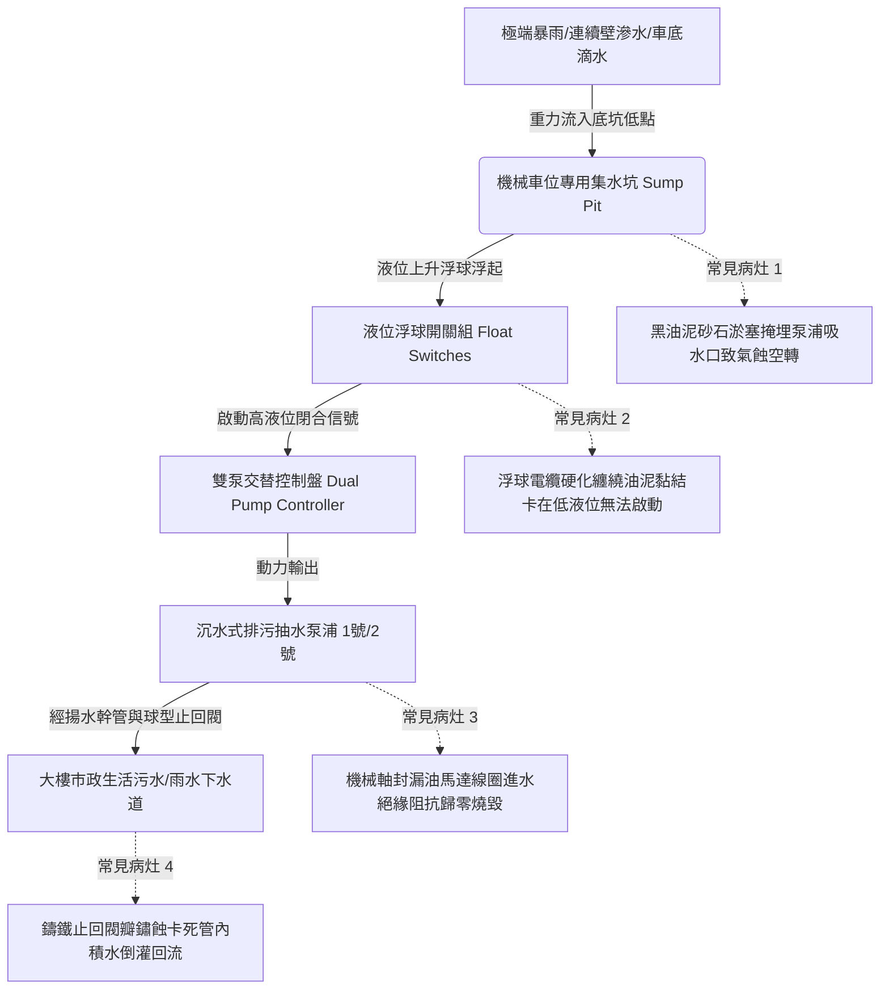

# 全案購屋實戰第四百七十四部：中古大樓社區地下室機械停車設備集水坑污水滲透底坑鏽蝕沉水抽水泵浦故障與暴雨積水車台泡水體檢工序全書

## 壹、核心查驗宗旨與前言

大樓地下室機械停車設備之底坑（Pit，深達 1.8 至 3.5 公尺之鋼構基坑），係下層車台停放沉潛以及懸吊重錘配重運作之最底部受力基座。因其標高為整座大樓全結構體之最低點，極易匯集地下連續壁微滲水、地坪清潔廢水、車輛雨天帶入之底盤滴水、以及極端暴雨時市政排水管倒灌之洪流。因此，機械停車底坑旁必須依建築技術規則配置專用之「深水集水坑（Sump Pit）」與「雙迴路自動沉水式排污抽水泵浦（Submersible Sump Pumps）」。

於二十年至三十年屋齡之中古電梯大樓中，因長年缺乏清淤保養，沉水泵浦機械軸封（Mechanical Seal）被細沙割破進水燒毀、液位浮球開關（Float Switch）纏繞塑膠袋與油泥卡死、止回閥逆向洩漏失效；更致命者，底坑長期積水淹沒機械鋼構地腳螺栓（Anchor Bolts）、下層轉向滑輪（Idler Sheaves）軸承及配電極限開關，導致整座底坑化為鏽蝕泥濘之「水牢」。一旦夏季午後雷陣雨或颱風暴雨來襲，抽水系統停擺，下層數百萬進口房車瞬間滅頂泡水，機械鋼構嚴重腐蝕強度腰折，釀成巨大財產損失與修繕公攤風暴。

本工序全書旨在建立標準化、系統性之地下室機械車位底坑防水防汛體檢工序，指導購屋家庭在實地檢驗地下室車位時，深入查核集水坑液位控制、泵浦抽水效能及基坑鋼構鏽蝕度，捍衛資產安全並杜絕鉅額公攤修繕風險。

---

## 貳、機械停車底坑排水防汛系統架構與物理病灶

### 一、沉水抽水泵浦軸封進水燒毀與葉輪卡死機制
1. **碳化矽機械軸封（Mechanical Seal）砂石刮傷**：底坑集水坑長年沉積洗車廢水沖下之細石英砂與車底泥土。沉水泵運轉時，硬質顆粒捲入雙端面機械軸封動靜環縫隙，鏡面被刮出溝槽，潤滑機油乳化外洩，高壓污水長驅直入馬達定子線圈內部，絕緣電阻瞬間跌破 $0.1\text{ M}\Omega$，引發匝間短路並跳脫無熔絲斷路器（NFB）。
2. **渦流葉輪（Vortex Impeller）油泥抱死**：汽車滴落之廢機油與地坪落葉、棉絮在坑底形成高黏度瀝青狀污泥。沉水泵長期待機未啟動（例如冬季枯水期），油泥乾涸硬化黏住葉輪邊緣，當雨季水位暴漲強行通電時，轉子堵轉（Locked Rotor）電流激增 5~7 倍，熱過載電驛（Thermal Overload Relay）跳脫或線圈直接燒成焦炭。

### 二、液位浮球開關纏繞卡阻與假性信號
1. **浮球纜線老化硬化與纏繞**：標準雙泵控制系統至少配置 3 至 4 支不同標高之水銀或微動浮球（停止水位、單泵啟動、雙泵並聯啟動、極高溢流警報水位）。PVC 電纜在長期浸泡含油污水中增塑劑析出，護套硬化僵直。水流翻滾時，多支浮球電纜互相扭結纏繞，使啟動浮球懸空卡在垂直向下狀態，水位漫頂時依然發不出啟動信號。
2. **常閉接點氧化與油泥包覆**：浮球外殼被厚重黑油泥附著，自重增加無法隨水位上浮；內部微動開關接點受潮氧化，造成高水位時電氣信號斷路，控制盤誤判坑內乾涸無水，釀成「水滿金山」卻不排水之窘境。

### 三、底坑積水引致機械鋼構電化學腐蝕破壞
1. **地腳錨栓（Anchor Bolts）截面削弱**：機械車位承受數十噸動態載重之關鍵，在於基座鋼樑藉由 $\phi 24\text{mm} \sim \phi 30\text{mm}$ 高強度地腳螺栓鎖固於底坑混凝土基礎。底坑若常年積水或處於 100% 飽和濕度下，螺栓根部發生劇烈「電化學氧濃差腐蝕（Oxygen Concentration Cell Corrosion）」，螺牙完全化為鐵鏽粉末，有效受力截面積衰減 50% 以上，隨時可能在強烈地震時連根拔起。
2. **底層轉向鏈輪與滑輪軸承鏽死**：下層車台沉入水坑時，懸吊鋼索滑輪浸泡於污泥污水中。軸承雙面橡膠防塵蓋無法阻絕污水滲入，高黏度潤滑脂被乳化沖刷殆盡，滾珠與滾道點蝕生鏽，運轉阻力暴增數倍，引發鋼索劇烈跳動或馬達超載燒毀。

---

## 參、實地現場逐項體檢工序與精確檢測指引

### 步驟一：機械車位底坑現場外觀與積水狀況勘查
1. **底坑底部積水與水痕高線檢驗**：
   - 使用高流明防爆強光手電筒，照射機械停車設備最下層鋼構底板與混凝土基坑。
   - 檢視底坑表面是否有未退之積水、污泥厚度、是否有刺鼻死水惡臭味。
   - 仔細檢查鋼柱立柱表面是否有「淹水高線水痕（High Water Stain）」：若立柱離地 30~50 公分處有一圈明顯之黑色泥巴油污線，即鐵證此車位曾發生過嚴重淹水滅頂事故！
2. **基座螺栓與滑輪生鏽狀況檢測**：
   - 檢視底角鋼板、地腳螺栓、配重塊導軌下端是否有片狀紅斑層層剝落（Flaking Rust）。
   - 檢視下層轉向滑輪是否浸在水中，表面是否長滿厚重黃褐色鐵鏽泥垢。

### 步驟二：集水坑與沉水抽水泵浦物理檢驗（需管委會或機電人員陪同）
1. **掀開集水坑格柵蓋板檢查**：
   - 檢視集水坑內污泥淤積深度：正常污泥厚度應 $< 100\text{mm}$；若污泥已淤塞超過泵浦濾網進水口，判定為嚴重缺乏清淤保養。
   - 檢查各浮球開關是否自由懸垂，彼此有無交叉纏繞，外表是否潔淨無油泥包裹。
2. **抽水泵手動強制運轉測試（手動/自動切換開關）**：
   - 於地下室專用排水控制盤上，將切換開關由「AUTO」撥至「MANUAL（手動）」。
   - 分別手動啟動 1 號泵與 2 號泵運轉 10~20 秒：
     - **運轉聲音判定**：沉水泵運轉聲音應平穩低沉，無刺耳金屬摩擦聲、劇烈振動或空轉尖叫聲。
     - **出水管壓力震盪**：觀察鍍鋅出水鋼管，在水泵啟動瞬間管路應有明顯水流震顫感，排水溝處應有大量水柱噴出。
3. **止回閥防倒灌功能檢驗**：
   - 泵浦手動停止瞬間，仔細聆聽集水坑內出水管之「球型污水止回閥（Ball Check Valve）」動作聲。
   - 正常應有清脆「碰」之一聲關閉撞擊聲，且立管上方水流不得反向狂噴回坑內。若停止後大量水流伴隨氣泡持續逆灌數秒，代表止回閥橡膠球卡死或腐蝕漏水。

### 步驟三：浮球水位手動抬起模擬測試
1. **浮球觸發靈敏度測試**：
   - 使用長絕緣竹竿或掛鉤，輕輕將集水坑內之「啟動浮球」由垂直懸垂向上挑起翻轉約 $45^\circ$。
   - **判定標準**：控制盤電磁接觸器必須在 **0.5 秒內即時吸合**，對應之沉水泵浦立即啟動運轉；控制箱面板「1號泵運轉」綠燈點亮。
   - 繼續挑起最高之「警報浮球」：控制箱警報蜂鳴器必須立刻尖銳鳴叫，「高水位警報紅燈」亮起，驗證超極限防汛安全迴路 100% 健全。

---

## 肆、評估判定基準與瑕疵等級劃分

| 瑕疵等級 | 現場實測狀況與機械數值 | 潛在隱患與公共安全危害 | 預估修繕工法與費用規模 |
| :--- | :--- | :--- | :--- |
| **輕度瑕疵 (A級)** | 底坑乾燥無積水；鋼柱表面僅微量浮鏽漆面完好；手動啟動泵浦排水順暢；浮球反應俐落；止回閥無倒灌。 | 防汛機能健全，結構受力安全無虞。 | 例行性集水坑掏清淤泥、泵浦軸承潤滑，單坑保養約 **1,500 ~ 3,000 元**。 |
| **中度瑕疵 (B級)** | 底坑地面局部潮濕泥濘有淺積水；鋼構地腳螺栓表面生鏽但未分層剝落；單顆沉水泵故障無法啟動（另一顆堪用）；浮球表面油泥嚴重。 | 喪失雙泵互備防線，一旦暴雨來襲單泵過載跳脫隨時淹水；地腳螺栓強度開始劣化。 | 人工徹底清淤挖泥、更換故障沉水排污泵浦（1HP~2HP）、更換全套耐油浮球開關，費用約 **15,000 ~ 30,000 元**。 |
| **重度瑕疵 (C級)** | 底坑常年積水淹沒下層車台輪胎；雙沉水泵皆燒毀短路無反應；地腳螺栓鏽爛斷裂；鋼構立柱有明顯歷史淹水水痕！ | 毀滅性風險！暴雨時下層車輛 100% 滅頂泡水報廢；基座鋼構嚴重腐蝕隨時有整座立體車台坍塌撕裂之危險！ | 底坑全面高壓抽水與泥漿清洗、連續壁止水灌漿、更換全新雙不鏽鋼絞碎型沉水泵、重鑄高強度化學錨栓，費用達 **8萬 ~ 20萬元以上**。 |

---

## 伍、買賣合約保障特約條款與談判折價策略

### 一、談判折價依據與議價話術
若買方勘查機械車位現場，發現底坑積水泥濘、鋼構基座螺栓鏽蝕嚴重或集水坑抽水泵已故障停擺，買方應當場錄影存證並由仲介向屋主嚴正主張權益：
> 「本買賣標的物所屬之地下室機械車位底坑，現場積水嚴重且沉水抽水泵浦已呈現故障不運轉狀態，基座鋼構螺栓已產生大面積腐蝕剝落，此屬於涉及設備坍塌與車輛泡水之重大結構及防汛瑕疵。若夏季暴雨來襲，下層車台隨時有滅頂滅車之重大風險，且更換沉水泵浦與結構除鏽加固涉及高額修繕費用。請賣方於成交總價中實質折讓新台幣 5 萬至 8 萬元之設備防汛修復款，或由賣方督促管委會於交屋日前完成底坑排乾、雙泵更新及基座安全防蝕處理並出具工程保固單。」

### 二、成屋買賣契約專用法律特約條款（範本）

> **【不動產買賣契約書——機械車位底坑防汛防水與排水設施點交保證特約條款】**
>
> 1. **機械車位底坑無積水與防汛機能保證**：賣方保證本買賣標的物隨附之機械停車位（車位編號：______），其所屬井道底坑及專用排水集水坑，於交屋日前均處於乾燥無不明積水、無連續壁湧水滲漏之良好狀態，且底坑配置之雙迴路自動沉水式排污抽水泵浦與液位浮球控制系統運作正常，能確實自動感應排水。
> 2. **鋼構基座結構強度承諾**：賣方保證機械車台四角立柱、受力橫樑及地面固定地腳螺栓，無因長期泡水引致之嚴重電化學鏽蝕、層狀剝落或截面削弱等結構性安全缺陷。
> 3. **泡水瑕疵擔保與修復賠償約定**：若於交屋點交時，發現底坑積水嚴重、抽水泵故障或立柱有歷史泡水痕跡者，賣方應負責於交屋日前自費完成泵浦修復更換與底坑抽水清淤；若交屋後六個月內，因交屋前已存在之公共排水泵浦故障導致買方停放該車位之車輛發生泡水受損情事，除大樓公共意外險理賠外，不足之損害賠償金額由賣方負連帶賠償責任。
