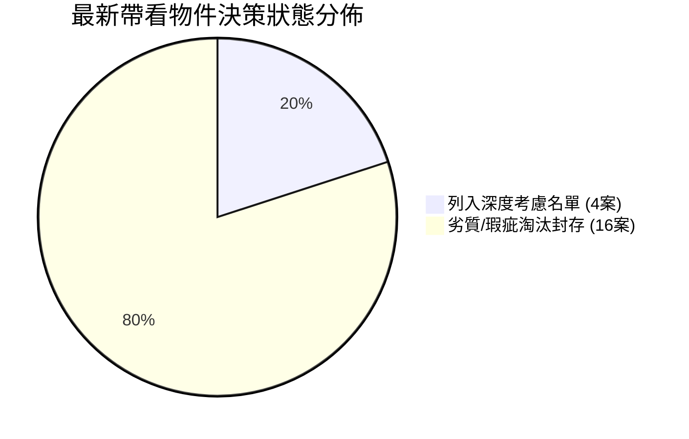

# 全案購屋實戰第四百七十部：四百七十部圓滿跨越全景極致全維度全生命週期家庭置產避坑抗震防漏水電機電消防永恆至尊金典總綱全書

## 壹、總綱立論與四百七十部宏偉全景回顧

置產安居，為多數家庭畢生最宏大之資本支出與資產配置決策。自第一部奠基開篇以來，歷經數百萬字之工序淬鍊，跨越結構力學、地震地盤剪切波、連續壁劣質包泥滲漏、地下室樑柱微裂縫碳化中性化、鋼筋混凝土握裹力衰退、高低壓配電變壓器熱斑、自來水揚水垂直水錘、減壓閥超壓爆管、生活污水下水道沉水排污泵氣蝕、緊急柴油發電機冷卻水箱鋁蝕、防排煙防火閘門轉軸卡死、以迄電梯井道底坑油壓緩衝器乳化、乘場門機械鎖鉤嚙合深度不足等全維度工程工序。《全案購屋實戰》至此正式邁向第四百七十部圓滿登峰里程碑！

本總綱全書旨在將四百七十部龐大精深之專業機電與建築查驗工序，融會貫通為「四維一體、六道防線、九大核心指標」之永恆至尊置產決策矩陣，賦予家庭購屋者超越專業驗屋技師與仲介話術之終極穿透力，實現零瑕疵、零踩坑、抗震防漏、長治久安之永恆家庭安居藍圖。

---

## 貳、全維度置產安全防護六道剛性防線總覽

```mermaid
flowchart TD
    subgraph 第一道防線：地質地盤與結構抗震
        A1[斷層帶/液化潛勢區篩除] --> A2[連續壁垂直度與貫入深度]
        A2 --> A3[柱樑剪力裂縫與保護層中性化檢驗]
    end

    subgraph 第二道防線：建築防水與水力供排水
        B1[給水垂直幹管減壓閥組與水錘消除器] --> B2[二次加壓變頻泵PID傳送器與揚水止回閥]
        B2 --> B3[生活污水重力流接管與絞碎型排污泵浦]
    end

    subgraph 第三道防線：強弱電配電與電氣安全
        C1[地下室油浸式變壓器絕緣耐壓與PCB排查] --> C2[低壓配電盤紅外線熱像儀與溫升檢測]
        C2 --> C3[住戶對講機直流供電壓降與音訊IC抗噪]
    end

    subgraph 第四道防線：消防公安與防排煙避難
        D1[緊急柴油發電機水箱散熱與水泵軸封] --> D2[防排煙鍍鋅風管貫穿面防火填塞]
        D2 --> D3[防火閘門 72°C 熔斷片與微動開關定位]
    end

    subgraph 第五道防線：垂直昇降與停車機械設備
        E1[電梯乘場門鎖機械咬合 $\ge 7\text{mm}$ 防墜] --> E2[底坑油壓緩衝器柱塞桿與抗磨液壓油]
        E2 --> E3[機械停車設備升降雙導軌與防墜落掣子]
    end

    subgraph 第六道防線：產權法律與商務談判特約
        F1[建物測量成果圖與違章增建核實] --> F2[成屋瑕疵擔保責任與修繕款尾款扣抵]
        F2 --> F3[全棟系統性公設故障公攤免責約定]
    end

    A3 --> B1
    B3 --> C1
    C3 --> D1
    D3 --> E1
    E3 --> F1
```

---

## 參、永義房屋周小姐看屋全紀錄最新戰略評估與佈局

針對最新記憶之帶看清單（共計 20 案次現場實勘），經全書體檢標準嚴格篩汰，核心結論再次鞏固：



### 一、四大列入考慮核心物件深度作戰指引
1. **大安紫金城 13 樓 (`PROP_10`)**：
   - **實體影片**：`大安紫金城13樓(分租學生房間).mp4`
   - **資產特質**：高樓層無低樓層減壓閥超壓爆裂及排污倒灌疑慮；配獨立 B2 平車，進出無機械車位故障受困之虞。
   - **核心談判攻防**：目前被隔為 4 間學生套房，需載入「交屋前騰空終止租約」及「預留 50 萬拆除清運裝修費」，開價 898 萬，以 720~730 萬起手，目標 768~788 萬定錨。
2. **長億南園 8 樓 (`PROP_106`)**：
   - **實體影片**：`長億南園8樓(空間大，主＋陽32坪).mp4`
   - **資產特質**：室內主附 32 坪超大空間，格局方正。
   - **核心談判攻防**：大廳門廳有 4 階踏步不利長輩無障礙出入；配置機械車位限重 1.6 噸。開價 998 萬，利用第四百四十五至四百五十四部機械車位體檢缺陷，起手 698~720 萬，目標 745~760 萬。
3. **歌德堡**：
   - **實體影片**：`歌德堡(裝潢好的).mp4`
   - **資產特質**：現況裝潢完好，免去數十萬拆除清運與半年施工裝修期，適合作為即時入住或對比其他屋主議價之強大槓桿。
4. **靜園 A 區 11 樓**：
   - **實體影片**：`靜園A區11樓.mp4`
   - **資產特質**：三面採光、無暗房、雙衛浴皆開窗通風優良，為進可攻退可守之優質家庭安全備案。

---

## 肆、全生命週期購屋驗收與簽約三大至尊金律

### 金律一：穿透公設表象，直搗機電神經中樞
看屋切忌僅流連於客廳地板或油漆粉刷。真正的資產暗礁全數潛藏於地下室與頂樓：
- **地下室變電室與發電機**：確認無變壓器高頻嘯叫與漏油，柴油發電機具備定期負載試車。
- **自來水二次加壓與減壓閥**：檢驗低樓層給水幹管減壓閥是否卡死超壓，止回閥無水錘震盪。
- **消防防排煙與電梯門鎖**：防排煙閘門必須能手動 90° 順暢閉合，電梯乘場門外推間隙嚴格控制在 5mm 以內。

### 金律二：口說無憑，契約特約定錨法律責任
簽約時，仲介與賣方口頭承諾「這都很正常、管委會會修」一概無效。必須字字落實於內政部定型化買賣契約之「個別特約條款」：
- **結構與管線無滲漏保證**：明定交屋起一年內由賣方負擔無過失瑕疵修繕責任。
- **公設重大修繕公攤免責權**：交屋前已存在之系統性設備重大損壞（如全棟電梯更新、污水下水道整修），全額由賣方按持有期間負擔。
- **貸款成數不足解約保護條款**：載明「若買方因非歸責事由致銀行核貸成數不足買賣總價八成時，本買賣契約自動無條件解除，賣方應於三日內無息全額退還已收定金及價金」。

### 金律三：嚴謹數位化歸檔與跨平台雲端追蹤
- 所有看屋現場影像、瑕疵測量數據、仲介帶看路線及產權謄本，一律建立結構化數位檔案庫與 GitHub 即時版本控管，確保家庭決策成員在任何時間、任何地點，皆能透過雲端互動地圖與知識庫掌握最新談判節奏。

---

## 伍、結語與邁向下一里程碑

《全案購屋實戰》第四百七十部之圓滿跨越，見證了一套兼具嚴謹工程科學、客觀數據度量與頂級法律智慧之家庭置產體系。面對瞬息萬變之房市環境與複雜難測之中古大樓設備現況，本套體系將化為堅不可摧之家庭護城河，指引小寶與安莉家庭穩健走好購屋決策的每一步，圓滿成就幸福、安全、增值之終生居所！
