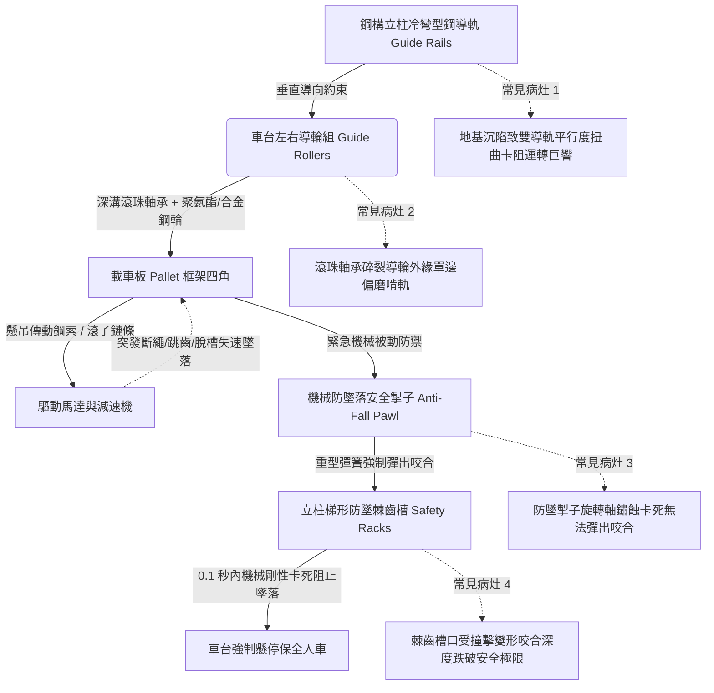

# 全案購屋實戰第四百九十一部：中古大樓社區地下室機械停車設備車台升降雙導軌垂直度偏差導輪偏磨滾珠軸承碎裂與防墜落掣子咬合失靈體檢工序全書

## 壹、核心查驗宗旨與前言

立體機械停車設備中，升降橫移車台（Shifting & Elevating Pallet）在承載 1.6 至 2.2 公噸之家庭車輛進行垂直升降動作時，完全仰賴兩側對稱配置之「立體鋼柱導軌（Guide Rails）」提供垂直剛性導向，並透過車台四角之「高強度導輪組（Guide Rollers）」吸收偏載力矩。為防止鋼索或鏈條意外斷裂時車台自由落體墜毀，法規強制要求車台兩側必須裝設由彈簧或電磁鐵驅動之「機械防墜落阻擋掣子（Mechanical Anti-Fall Safety Pawl / Safety Catch）」。

於二十年至三十年屋齡之中古電梯大樓中，因長年車輛偏心停放（左右重量不均）、地下室地坪不均勻沉降、地震水平剪力拉扯，鋼柱雙導軌普遍產生「垂直度偏差（Plumb Deviation）超標」與「軌道開口幾何扭曲」；導致聚氨酯導輪或鑄鋼滾輪產生嚴重偏磨、內部滾珠軸承在劇烈偏載應力下碎裂卡死；更致命者，防墜落安全掣子轉軸在長年缺乏潤滑下與油泥鐵鏽融合卡滯，一旦升降傳動鋼索斷股跳脫，掣子無法在 0.1 秒內彈出咬合鎖死於鋼構棘齒孔內，導致車台連人帶車直接砸向底坑，造成車體粉碎甚至人命傷亡之滅頂浩劫。

本工序全書旨在建立標準化、專業化之機械車位導軌垂直度、導輪軸承及防墜掣子機械咬合體檢工序，指導購屋家庭在實地檢驗隨附機械車位之社區時，精準判別導軌結構幾何精度與終端防墜機構之真實可靠度，防範交屋後陷入高額修繕公攤與致命工安風險。

---

## 貳、升降導軌與防墜落掣子系統架構與常見物理病灶

### 一、鋼構雙導軌垂直度偏差與軌距畸變
1. **結構幾何公差極限（CNS 13350 規範）**：機械停車設備垂直導軌在全行程（通常高程 3~6 公尺）之垂直度偏差，**絕對不得大於 1/1000**，雙側導軌之軌距（Track Gauge）平行度偏差必須控制在 $\pm 2\text{mm}$ 以內。
2. **偏心載重與剪切變形機制**：現代休旅車駕駛座與引擎偏置，車台長期承受單側重壓。角鋼立柱或槽鋼導軌在反覆彎矩作用下產生塑性「側向內凹（Bowing）」；雙軌間隙隨高度變化忽大忽小，車台升降時產生強烈卡阻，馬達電流急遽飆升，並引發全座鋼構劇烈劇顫與「金屬刮削金屬」之刺耳尖叫。

### 二、導輪偏磨與內部滾珠軸承碎裂
1. **聚氨酯輪面包膠脫落（Delamination）**：低噪音車台多採用外包聚氨酯（PU）彈性體之導輪。在偏載擠壓與地下室機油蒸汽腐蝕下，PU 輪面老化硬化，與內側金屬輪轂發生脫膠剝離，形成「啃軌（Track Chewing）」現象，車台升降時大幅度左右擺動晃蕩超過 20mm。
2. **滾珠軸承接觸應力疲勞剝落**：導輪內部深溝球軸承（Deep Groove Ball Bearing）長年承受軌道偏角帶來之巨大軸向推力（Thrust Force）。軸承滾珠受集中應力衝擊產生「表面點蝕剝落（Spalling）」，最終碎裂成數塊，導輪徹底卡死停止轉動，直接在導軌鋼面硬生生磨擦刮出深深溝槽。

### 三、防墜落掣子（Safety Pawl）機構卡阻與咬合失靈
1. **旋轉銷軸（Pivot Pin）油泥結晶卡死**：防墜掣子平時隨車台升降，其擺動關節銷軸依賴防鏽黃油潤滑。二十年未曾清洗之黃油與空氣中灰塵、鐵粉結合成高黏度硬塊，將轉動銷軸死死咬住。
2. **防墜咬合深度跌破法規極限**：依國家標準，防墜掣子完全伸出時，其凸爪與立柱棘齒槽口之「有效咬合深度（Engaging Depth $D$）」**絕對不得小於 20mm**。實務上因轉軸卡阻或連桿變形，掣子僅伸出 5mm~8mm，一旦發生斷繩衝擊，微弱的咬合邊緣瞬間被數噸衝擊力剪斷打滑，車台如斷頭台般直接墜毀砸爛底坑。

---

## 參、實地現場逐項體檢工序與精確量測指引

### 步驟一：導軌結構垂直度與軌距雷射測量
1. **雷射垂直儀投射檢驗**：
   - 於機械車位立柱底座架設綠光雷射垂直儀，向上投射垂直基準線。
   - 分別測量下部、中部及頂部導軌內緣至雷射線之垂直偏差量（$\Delta X$）：
     - **合格標準**：全行程垂直度偏差 $\Delta X \le 3\text{mm}$。若偏差超過 $8\text{mm}$，代表鋼構已明顯傾斜扭曲。
2. **跨距平行度測量**：
   - 使用內徑千分尺或雷射測距儀，測量雙側導軌滑動面之間的水平淨距離（軌距 $W$）：
   - 上中下三點軌距變異量不得超過 $\pm 3\text{mm}$。

### 步驟二：導輪組磨耗與軸承運轉手感檢測
1. **導輪外觀與間隙檢測（靜態停機狀態）**：
   - 檢視車台四角之導輪：外圈包膠應平整無啃咬凹痕、無缺角、無脫膠。
   - 用手指推動導輪：感受其與導軌之側向游隙，正常配合間隙應在 **1mm ~ 2mm** 之間。若間隙超過 5mm 或導輪嚴重傾斜，代表軸承已嚴重磨損鬆曠。
2. **動態升降噪音與震顫監聽**：
   - 請車主或管理員啟動車台升降運轉。
   - 人員於安全護欄外仔細聆聽導軌摩擦聲：
     - 正常運轉：平穩低沉之滾輪滾動聲。
     - 軸承碎裂：連續刺耳之「喀啦喀啦」碎裂撞擊聲或金屬乾磨尖叫聲，車台伴隨規律性跳動震顫。

### 步驟三：防墜落掣子機構動作與咬合深度實測
1. **手動扳動防墜掣子回彈測試（不通電狀態）**：
   - 伸手扳動防墜掣子擺臂，使其克服彈簧阻力向內收縮，隨後瞬間放手。
   - **判定標準**：掣子必須在 **0.1 秒內極速彈出**，撞擊棘齒槽底發出清脆之「鏗」金屬撞擊聲，彈簧彈力飽滿緊繃，擺動關節無任何乾澀阻滯。
2. **有效咬合深度精密測量（鋼尺量測）**：
   - 在掣子完全彈入棘齒槽之鎖定狀態下，使用鋼直尺測量掣子凸爪伸入槽內的「垂直深度（$D$）」：
     - **法規剛性底線**：有效咬合深度 $D \ge 20\text{mm}$。若實測咬合深度小於 $12\text{mm}$，代表齒槽或掣子爪面已嚴重磨損滑角，防墜功能完全喪失！

---

## 肆、評估判定基準與瑕疵等級劃分

| 瑕疵等級 | 現場實測狀況與機械數值 | 潛在隱患與公共安全危害 | 預估修繕工法與費用規模 |
| :--- | :--- | :--- | :--- |
| **輕度瑕疵 (A級)** | 導軌垂直度偏差 $\le 2\text{mm}$；導輪運轉平順無雜音；防墜掣子彈力飽滿回彈迅速；咬合深度 $\ge 20\text{mm}$。 | 導向與安全防墜機能健全優良，維持定期潤滑。 | 例行性導軌清洗加注低溫抗磨潤滑脂、調整防墜彈簧，單車位約 **800 ~ 1,500 元**。 |
| **中度瑕疵 (B級)** | 雙導軌軌距偏差 3~5mm；導輪外緣輕微單邊偏磨啃軌（升降有微弱摩擦雜音）；防墜掣子轉軸油泥微卡（回彈稍慢）；咬合深度 15~18mm。 | 導輪加速磨損，馬達負載增加；防墜機構靈敏度減退，需儘速校正軌距並更換導輪。 | 更換全套耐磨高分子聚氨酯導輪組（4~8顆）、更換防墜不鏽鋼拉伸彈簧、校正導軌水平，費用約 **8,000 ~ 16,000 元/座**。 |
| **重度瑕疵 (C級)** | 導軌垂直度嚴重扭曲偏差 $> 8\text{mm}$；導輪滾珠軸承碎裂卡死（強烈金屬尖叫）；防墜掣子鏽死無法彈出；咬合深度 $< 10\text{mm}$！ | 致命毀滅性風險！車台隨時卡軌拉斷鋼索，且防墜阻擋完全失靈引發車台連車垂直墜毀砸扁底坑！ | 重立鋼構立柱校正雙導軌垂直度、全面換新重型高強度防墜落安全掣子總成與齒條，修繕費用達 **25,000 ~ 55,000 元以上/座**。 |

---

## 伍、買賣合約保障特約條款與談判折價策略

### 一、談判折價依據與議價話術
若買方在勘查機械車位時，發現車台升降劇烈晃動尖叫、導輪碎裂偏磨、或防墜落安全掣子已經鏽死無法回彈咬合，買方應當場錄影存證並嚴正向賣方主張重大結構安全瑕疵：
> 「本買賣標的物所隨附之機械車位，其升降雙導軌已產生嚴重垂直度偏差與扭曲，導輪軸承磨損碎裂引發劇烈震動，且最關鍵之防墜落安全掣子已鏽蝕卡死無法彈出咬合。防墜掣子為防止鋼索斷裂時車台連人帶車墜毀之唯一被動保命屏障，此重大機械缺陷直接危及使用者生命財產安全，且校正鋼柱導軌與更換防墜機構需耗費數萬元。請賣方於成交總價中實質折讓新台幣 3 萬至 6 萬元之機械車位安全修繕補償款，或由賣方督促社區特約機械停車廠商於交屋日前完成雙導軌垂直度校正、更換全新導輪與防墜掣子總成並出具原廠安全保證書。」

### 二、成屋買賣契約專用法律特約條款（範本）

> **【不動產買賣契約書——機械車位導軌精度與防墜落安全設施點交保證特約條款】**
>
> 1. **機械車台升降導向與防墜機能保證**：賣方保證本買賣標的物所隨附之機械停車位（車位編號：______），其立柱升降雙導軌、車台導輪組及機械防墜落安全阻擋掣子機構，於交屋日前均處於符合內政部《建築物附設停車空間機械停車設備安全標準》之完好堪用狀態。
> 2. **導軌精度與防墜咬合深度驗收承諾**：雙方約定於交屋點交驗收時實施運轉測試。賣方保證車台垂直升降平順無劇烈卡阻金屬尖叫聲，雙導軌全行程垂直度偏差小於 3mm；且防墜落安全掣子彈簧動作靈敏，實測彈入立柱棘齒槽之有效咬合深度必須達到 20mm 以上，無任何鏽死卡滯或安全迴路旁路之重大瑕疵。
> 3. **修繕款抵扣與瑕疵擔保責任約定**：若點交實測發現導軌扭曲、導輪軸承碎裂或防墜掣子失效等缺陷，賣方應負責於交屋日前自費完成修復更換並出具專業特約維保廠商之驗收合格單；若逾期未修復，買方得自行委請專業機械停車設備廠商逕行修繕更換，相關工程費用（以新台幣肆萬元整為上限）得逕由買賣尾款中全額扣抵，賣方絕無異議。
