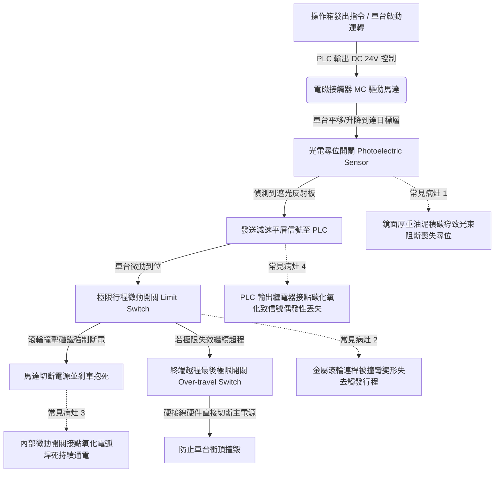

# 全案購屋實戰第四百九十三部：中古大樓社區地下室機械停車設備光電尋位開關鏡面油污極限行程開關觸桿變形短路與PLC控制盤繼電器接點氧化體檢工序全書

## 壹、核心查驗宗旨與前言

立體機械停車設備中，升降橫移車台（Shifting & Elevating Pallet）在立體鋼構空間內進行毫米級之精準平層、橫向對齊與防碰撞互鎖，完全依賴遍佈於車架四角與導軌節點之「紅外線光電尋位開關（Photoelectric Positioning Sensors）」、「極限行程微動開關（Limit Travel Switches）」以及中央「微電腦可程式邏輯控制器控制盤（PLC Control Panel & Safety Relays）」。這套弱電感測與控制網絡，係掌控整座機械車位運行順序與防撞生命線之「神經反射中樞」。

於二十年至三十年屋齡之中古電梯大樓中，因長年處於地下室潮濕、車輛尾氣油煙冷凝附著、機械強烈震動衝擊，光電感測器透鏡表面被黏稠黑油泥完全糊死引發光學盲區；機械極限行程開關之金屬滾輪擺桿（Roller Lever Arm）受車台撞擊塑性彎曲變形、內部微動開關接點受潮氧化黏死；更致命者，PLC 控制箱密封不良，箱內中繼繼電器（Relays）銀接點嚴重硫化黑化、接觸電阻飆升甚至產生高溫電弧焊死（Contact Welding）。一旦車台在升降或橫移過程中感知器信號丟失或繼電器接點黏死，系統無法在目標層自動切斷馬達，車台在強大扭矩推動下強行「超程衝頂」或「橫向猛撞立柱鋼樑」，造成車體骨架被撕裂擠爛、整座立體鋼架嚴重變形甚至倒塌之毀滅性公安慘劇。

本工序全書旨在建立標準化、專業化之光電尋位、極限行程開關與 PLC 控制盤電氣體檢工序，指導購屋家庭在實地檢驗隨附機械車位之社區時，精準查核感測器響應速度、機械行程開關幾何角度及控制盤弱電健康度，杜絕交屋後承受高額微電腦大修公攤與致命撞車事故風險。

---

## 貳、尋位感測、極限行程與 PLC 控制系統架構與物理病灶

### 一、紅外線光電尋位開關鏡面油污與光衰盲區
1. **漫反射與對射式光電感測機制**：平層尋位多採用光電感測器（標稱檢測距離 100mm~300mm），依靠車台邊緣遮光擋板（Vane）切斷紅外光束，觸發 NPN/PNP 晶體管輸出信號通知 PLC 控制馬達自高速（60Hz）平滑切換至低速（15Hz）爬行平層。
2. **油泥塗層與光學飽和/截斷失常**：地下室未充分燃燒之碳氫化合物油煙與煞車粉塵，在感測器光學透鏡表面附著硬化，形成透光率低於 $20\%$ 之黑色油泥膜。光束發射強度暴跌，接收端無法穩定捕捉反射信號，導致車台在抵達目標層時「找不到位置（Miss Position）」，車台無法平層減速，以全速直接衝撞機械極限位。

### 二、機械式極限行程開關（Limit Switch）滾輪擺桿變形與接點黏結
1. **機械碰撞金屬疲勞變形**：極限行程開關安裝於鋼柱兩端，依靠車台金屬碰鐵（Cam Track）壓迫旋轉滾輪擺臂，帶動內部速動微動開關（Snap-action Switch）分斷。在數萬次高速劇烈碰撞衝擊下，不鏽鋼擺臂產生微彎折變形（彎曲角度超過 $15^\circ$），碰鐵滑過時滾輪無法被壓入足夠深度（未達動作行程 Pre-travel），開關無法被觸發。
2. **直流感應電弧接點焊死（Contact Welding）**：直流 24V 繼電器線圈在開關斷開瞬間產生高達數百伏特之感應反電動勢電弧。微動開關銀鎢合金接點在電弧反覆燒蝕下表面金屬熔融，動靜接點直接「融焊黏死（Welded Closed）」。即使滾輪已被壓下，電氣線路依然處於 $100\%$ 導通狀態，安全連鎖防線徹底被物理擊穿。

### 三、PLC 控制盤繼電器（Relays）氧化與接地干擾
1. **中繼繼電器銀接點硫化碳化**：PLC 輸出端多透過小型插拔式繼電器（MY4N/LY2N）驅動大電流電磁接觸器。地下室高濕與微量硫化物使銀接點表面生成硫化銀（Ag₂S）絕緣黑斑，接觸電阻由 $< 0.05\Omega$ 飆升至數十歐姆，控制信號時有時無（Intermittent Fault），車台運轉至半途突然抽搐停擺卡在空中。
2. **變頻器高頻載波干擾（EMI Noise）**：若控制盤接地線（PE）因鏽蝕接觸不良或與動力線同槽混拉，變頻器產生的高頻 PWM 諧波雜訊透過信號線侵入 PLC 輸入模組，引發邏輯紊亂，導致車位自動判定程序錯亂，發生「下層車未橫移避開、上層車台直接往下壓」之雙車對撞輾壓慘案。

---

## 參、實地現場逐項體檢工序與精確電氣量測指引

### 步驟一：光電尋位開關與反射板光學潔淨度檢驗
1. **透鏡表面與指示燈外觀檢查**：
   - 檢視車台平層尋位點及橫移極限處之紅外線光電開關。
   - 用強光手電筒近距離照射感測器透明塑料透鏡：
     - **合格判定**：鏡面潔淨透明無油膜遮蔽。
     - **透鏡劣化判定**：若表面糊滿厚厚一層黑色油膏、鏡面發黃霧化，判定為光學感測劣化。
2. **尋位遮光指示燈響應測試（不啟動馬達狀態）**：
   - 於通電待機狀態下，拿出一張金屬擋板或不透光紙板，手動伸入光電開關感應區域（模擬遮光擋板通過）：
     - **判定標準**：感測器後方之「動作指示燈（Output LED）」必須在 **0.05 秒內** 瞬間自綠燈轉為紅燈（或亮起），且反應乾脆利落無微弱閃爍。移開擋板後立即恢復。

### 步驟二：機械極限行程開關物理幾何與電氣通斷檢測
1. **擺臂滾輪機械幾何檢驗**：
   - 檢查立柱頂部與底部之極限行程開關，用手撥動滾輪擺桿。
   - 滾輪應能順暢旋轉無卡滯，擺臂無左右歪斜、無塑性彎折變形。
   - 觀察內部復位扭力彈簧：放手後擺臂必須在 **0.1 秒內** 強力反彈回原點。
2. **萬用電表歐姆檔量測微動觸點通斷**：
   - 將萬用電表切換至歐姆檔（$\Omega$ 檔）或蜂鳴檔，表筆接於行程開關常閉（NC）接點端子。
   - 初始狀態：應呈現完全導通，接觸電阻 $\le 0.3\Omega$。
   - 用手指將擺臂推至動作位置：
     - **判定標準**：接點必須在壓下角度達 $15^\circ \sim 20^\circ$ 時瞬間清脆「卡嗒」一聲跳脫斷開，電表顯示開路（$\text{OL}$）。
     - 若擺臂壓到底電表依然發出蜂鳴聲（接點持續導通），鐵證**內部接點已經熔焊黏死**，屬於最高等級危險！

### 步驟三：PLC 控制箱外觀、繼電器熱斑與動態動作檢測（需專業人員陪同開啟箱門）
1. **控制箱防護等級與內部清潔度檢視**：
   - 檢查控制箱門發泡橡膠密封條是否完好有彈性，箱底進出線口是否以防火膠泥或橡膠塞嚴密封堵。
   - 檢視箱內 PLC 主機、中繼繼電器及電磁接觸器：內部應乾燥潔淨無蛛網灰塵、無凝結水滴、無焦黑痕跡。
2. **紅外線熱像儀掃描繼電器與端子排溫升**：
   - 在車台連續運轉操作過程中，使用紅外線熱像儀掃描控制盤內部：
     - 檢查各繼電器線圈與觸點端子：正常表面溫度應 $\le 55^\circ\text{C}$。
     - 若某一繼電器接點溫度飆高超過 **$80^\circ\text{C}$**，代表該接點嚴重積碳氧化、接觸阻抗過鉅，隨時面臨燒毀或失靈！

---

## 肆、評估判定基準與瑕疵等級劃分

| 瑕疵等級 | 現場實測狀況與電氣數值 | 潛在隱患與公共安全危害 | 預估修繕工法與費用規模 |
| :--- | :--- | :--- | :--- |
| **輕度瑕疵 (A級)** | 光電鏡面潔淨響應即刻；極限擺臂角度正常回彈俐落；NC 接點接觸電阻 $\le 0.3\Omega$；控制箱乾燥整潔。 | 控制與感知網絡健全優良，維持定期除塵。 | 酒精清潔光學鏡面、行程開關滾輪注油潤滑，單車位約 **600 ~ 1,200 元**。 |
| **中度瑕疵 (B級)** | 光電透鏡表面有薄油泥（響應延遲 0.2 秒）；極限擺臂輕微傾斜（接觸電阻 $1 \sim 3\Omega$）；控制箱繼電器表面微溫（60°C~70°C）。 | 感知訊號偶發性丟失，車台平層有微幅落差（10~20mm）；行程開關接觸不良易引發誤跳停機。 | 更換全新高耐油型對射光電開關、更換重型鑄鋁極限行程開關、更換全套工業級插拔繼電器，費用約 **6,000 ~ 15,000 元/座**。 |
| **重度瑕疵 (C級)** | 光電鏡面完全被厚黑油膏糊死（遮光無反應）；極限行程開關擺臂被撞彎卡死；內部接點電弧熔焊黏死；PLC 繼電器燒焦！ | 致命毀滅性風險！車台失去平層與極限防護，升降時將高速衝頂砸爛天花樑柱，或橫向輾壓相鄰車輛！ | 全面更換 IP67 防水防油型雷射光電感測系統、重設終端極限微動安全迴路、重構 PLC 控制箱邏輯電路，費用達 **22,000 ~ 48,000 元以上/座**。 |

---

## 伍、買賣合約保障特約條款與談判折價策略

### 一、談判折價依據與議價話術
若買方在勘查機械車位時，發現車台平層定位忽高忽低、感測器被油泥糊死、極限開關被撞歪卡死、或控制箱繼電器發黑過熱，買方應當場錄影存證並嚴正向賣方主張重大安全控制瑕疵：
> 「本買賣標的物所隨附之機械車位，其光電尋位開關與極限行程開關已嚴重老化卡死，控制箱內繼電器接點氧化嚴重，車台運轉時無法精確平層到位，甚至極限行程防撞連鎖已呈現接觸不良狀態。感測與控制網絡為防止車台衝頂撞毀與雙車互撞之唯一智慧神經系統，此項缺陷若未修復，車輛隨時面臨被車台擠壓報廢或人員被夾傷之重大風險，且更換全套光電感測器與控制箱元件需耗費數萬元。請賣方於成交總價中直接折讓新台幣 3 萬至 5 萬元修繕補償款，或由賣方委請專業特約機械停車廠商於交屋日前完成全套開關更新、行程校正並出具精準平層運轉檢驗報告。」

### 二、成屋買賣契約專用法律特約條款（範本）

> **【不動產買賣契約書——機械車位感測尋位與安全極限控制設施點交保證特約條款】**
>
> 1. **機械車位尋位與極限防撞機能保證**：賣方保證本買賣標的物所隨附之機械停車位（車位編號：______），其升降及橫移平層光電尋位開關、極限行程開關、超程終端開關及 PLC 控制盤內之繼電器安全迴路，於交屋日前均處於符合國家安全標準之完好堪用狀態。
> 2. **精確平層與安全切斷驗收承諾**：雙方約定於交屋點交驗收時實施全行程運轉測試。賣方保證車台升降至目標層停妥時，載車板與出入地坪之高低落差必須控制在 $\pm 5\text{mm}$ 以內，極限開關觸發靈敏，無任何接點黏死、感測器被油泥遮蔽或車台衝頂過程之重大缺陷。
> 3. **修繕款抵扣與瑕疵擔保責任約定**：若點交實測發現光電感測器失靈、極限行程開關損壞卡滯或控制盤繼電器故障，賣方應負責於交屋日前自費完成修復更換並出具專業特約維保廠商之驗收合格單；若逾期未修復，買方得自行委請專業機械停車設備廠商逕行修繕更換，相關工程費用（以新台幣參萬伍仟元整為上限）得逕由買賣尾款中全額扣抵，賣方絕無異議。
