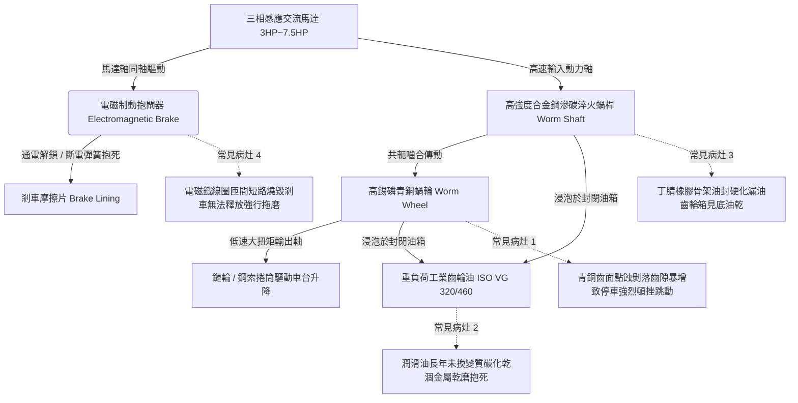

# 全案購屋實戰第四百九十二部：中古大樓社區地下室機械停車設備減速機蝸輪蝸桿齒隙磨損潤滑油乾涸抱死油封硬化漏油與剎車制動電磁鐵線圈燒毀體檢工序全書

## 壹、核心查驗宗旨與前言

大樓地下室立體機械停車設備之升降與橫移動力傳動總成，其核心動脈在於配置於頂部或底座之「重型蝸輪蝸桿減速機（Worm Gear Reducer）」與「電磁斷電制動抱閘（Electromagnetic Brake）」。減速機負責將三相感應馬達之高速旋轉動能，藉由 1:30 至 1:60 之大減速比，轉換為驅動數噸重載車板平穩升降之超大低速扭矩，並利用蝸輪蝸桿之幾何角度具備部分「反向自鎖（Self-locking）」特性；而電磁制動剎車器則負責在馬達停止通電瞬間，依靠強效彈簧強制抱死制動盤，精準鎖定車台水平高度。

於二十年至三十年屋齡之中古電梯大樓中，因長年處於高溫封閉地下室、頻繁重載寸動啟閉（每日數十次停放衝擊）、以及社區管委會維保預算常年遭挪用，減速機普遍存在「重負荷極壓齒輪油（EP Gear Oil）數十年未換乳化乾涸」、「青銅蝸輪齒面嚴重磨損齒側間隙（Backlash）暴增數倍」、「輸入與輸出軸骨架油封硬化漏油成災」、以及「交流/直流制動電磁鐵線圈過熱燒毀絕緣短路」等重大致命暗礁。一旦減速機齒輪崩齒打滑或剎車電磁鐵無法抱死，升降車台將在重力失控下拉扯下墜砸向底坑，造成車毀人亡之毀滅性公安慘劇。

本工序全書旨在建立標準化、專業化之機械停車設備減速機齒隙精度、潤滑油質與剎車電磁鐵電氣體檢工序，指導購屋家庭在實地檢驗隨附機械車位之社區時，深入查核驅動傳動心臟之真實健康狀態，杜絕交屋後承擔數十萬元主機更換大修公攤與致命車台滑脫墜落風險。

---

## 貳、減速機傳動與電磁制動系統架構與常見物理病灶

### 一、青銅蝸輪（Bronze Gear）齒面磨損與齒側間隙（Backlash）擴大
1. **異種金屬摩擦配對機制**：為降低摩擦係數並防止咬死，蝸桿多採用 20CrMo 滲碳淬火合金鋼（硬度達 HRC 58~62），而蝸輪齒圈則採用較軟之離心鑄造高錫磷青銅（如 ZCuSn10Pb1）。運轉中主要磨損集中於青銅蝸輪表面。
2. **齒隙超標與重力反向衝擊**：標準全新減速機之嚙合齒側間隙通常控制在 $0.15\text{mm} \sim 0.25\text{mm}$。歷經二十餘年數十萬次車輛進出與起停衝擊，青銅齒厚因磨粒磨損（Abrasive Wear）削薄超過 30%，齒側間隙暴增至 $1.5\text{mm} \sim 2.5\text{mm}$。當車台承載重車停止時，齒隙過大導致車台產生顯著垂直下陷溜滑（Slippage $\ge 15\text{mm}$），且啟動與停止瞬間爆發金屬撞擊巨響。

### 二、齒輪潤滑油劣化乾涸與熱膠合（Scuffing）抱死
1. **極壓添加劑熱分解機制**：減速機箱內必須充填具備抗極壓耐磨性能之合成烴或硫磷型重負荷齒輪油（如 ISO VG 320 或 VG 460）。地下室常年高溫，加上蝸輪副高達 $40\% \sim 50\%$ 之滑動摩擦生熱，油溫常突破 90°C。極壓添加劑在高溫下迅速氧化分解，生成黑褐色黏稠油泥（Sludge），黏度指數崩潰。
2. **油膜破裂瞬時融焊（Welding & Galling）**：當齒輪油乾涸或乳化發白失去潤滑能力時，鋼蝸桿與青銅蝸輪表面微觀凸起直接產生金屬乾摩擦，接觸面瞬間溫度衝破 1000°C，發生嚴重點蝕與金屬撕脫膠合（Galling），減速機在升降半途中瞬間咬死卡死，引發驅動馬達堵轉燒毀或傳動鏈條被巨大拉力瞬間扯斷。

### 三、骨架旋轉油封（Radial Oil Seal）硬化與漏油噴濺
1. **NBR 橡膠唇口老化開裂**：輸入軸（高轉速 1750 RPM）與輸出軸端部採用丁腈橡膠（NBR）旋轉骨架油封。在長期高溫烘烤與軸心表面微震盪磨損下，橡膠唇口硬化塑化、不鏽鋼箍緊彈簧（Garter Spring）鏽蝕鬆弛，失去自緊密封補償功能。
2. **油液漏光引發齒輪箱「乾燒」**：齒輪油順著軸頸大面積滲漏滴落於地下室地面，減速機油位窗（Oil Sight Glass）見底。許多老舊大樓維保甚至不知需補充專用齒輪油，齒輪長期在近乎全乾狀態下高速運轉，齒輪箱外殼燙得無法觸摸（表面溫度 $> 100^\circ\text{C}$）。

### 四、剎車制動電磁鐵（Brake Solenoid）線圈燒毀與拖磨
1. **電磁解鎖與機械抱死原理**：安全煞車器係「通電解鎖（Energize to Release）、斷電制動（De-energize to Brake）」之常閉型設計。馬達運轉時，電磁鐵線圈通電產生磁力吸合銜鐵，克服多組重型煞車彈簧阻力，使煞車來令片（Brake Lining）與煞車輪脫離（單邊間隙約 0.3mm~0.5mm）；停電時彈簧瞬間抱死。
2. **銜鐵卡阻引致線圈過熱燒燬**：地下室潮濕使動鐵芯滑動面生鏽卡阻。通電時動鐵芯無法完全吸合到位，交流電磁鐵線圈處於數倍衝擊電流狀態，數分鐘內漆包線絕緣燒焦短路，冒出刺鼻白煙。線圈燒毀後煞車器無法打開，馬達強行拖拽被抱死之煞車盤旋轉，摩擦片劇烈高溫起火燃燒，煞車盤退火變形報廢。

---

## 參、實地現場逐項體檢工序與精確量測指引

### 步驟一：減速機外觀油封與油位靜態檢驗
1. **齒輪箱油位與油質視窗檢測**：
   - 檢視減壓主機傳動減速機側壁之圓形玻璃油位計（Oil Sight Glass）。
   - **判定標準**：在停機冷機狀態下，油位必須維持在油鏡中心紅點或中線刻度之間。
   - 觀察油液顏色：
     - **正常油質**：應呈透亮金黃色或透明琥珀色。
     - **嚴重變質判定**：若油鏡內部呈現「發白混濁之牛奶狀（嚴重進水乳化）」、或呈「濃稠發黑瀝青焦炭狀」，鐵證齒輪油已數年未換，潤滑機能崩潰。
2. **軸封處滲油與地面漏油檢查**：
   - 使用手電筒檢視馬達與減速機交接端之輸入軸封、以及大鏈輪側之輸出軸封。
   - 檢查軸承蓋四周是否有黑色油泥堆積、懸掛滴落油珠。
   - 檢查減速機下方地坪：若地面積滿厚重陳年油垢成水塘，判定為油封破裂漏油嚴重。

### 步驟二：齒側間隙與手動旋轉游隙物理量測
1. **斷電手動盤車測量齒隙（Backlash）**：
   - 在主電源完全切斷鎖定（LOTO）狀態下。
   - 用雙手握住馬達後端之冷卻風扇或手動盤車輪，順時針微幅旋轉至受力點，再逆時針反向旋轉至受力點。
   - **判定標準**：外圈圓周游隙（Free Play）應 $\le 5^\circ$（對應輸出端幾乎無肉眼可見晃動）。若盤車輪可輕鬆自由轉動超過 $15^\circ \sim 30^\circ$ 方感受到齒輪咬合，代表內部青銅蝸輪已嚴重磨損削薄，齒側間隙嚴重超標！
2. **車台垂直下陷量測量（實車駛入測試）**：
   - 觀察空載升起之車台，當實車慢速開上載車板瞬間。
   - 使用鋼尺測量載車板邊緣因傳動齒隙產生的瞬間下墜位移量（$\Delta H_\text{drop}$）：
     - **合格標準**：$\Delta H_\text{drop} \le 3\text{mm}$。若車台下沉超過 $10\text{mm}$ 且伴隨齒輪箱內部傳出沉重撞擊震動，代表減速機齒隙磨耗已達報廢邊緣。

### 步驟三：剎車制動電磁鐵動態釋放與溫升實測（需機電或原車主操作）
1. **煞車間隙塞尺精密量測**：
   - 在停機抱死狀態下，使用金屬塞尺（Feeler Gauge）測量煞車摩擦片與煞車盤之接觸面：應 $100\%$ 緊密貼合無任何間隙。
   - 啟動運轉瞬間：電磁鐵通電吸合，測量解鎖張開間隙（Air Gap）：
     - **標準解鎖間隙**：兩側淨間隙應均勻對稱，數值應在 **0.3mm 至 0.5mm** 之間。若一側間隙為 0（持續摩擦拖磨）、或間隙超過 1.2mm（吸合無力），需立即調整煞車螺栓。
2. **電磁線圈紅外線熱像儀溫升檢測**：
   - 於車台連續升降運轉 3~5 次後。
   - 使用紅外線熱像儀測量煞車電磁鐵線圈外殼表面溫度：
     - **安全極限**：連續運轉後線圈表面溫度應 $\le 65^\circ\text{C}$。若測得溫度飆升超過 **$85^\circ\text{C}$**，且伴隨絕緣漆焦糊味，代表線圈內部已有局部短路過熱，隨時面臨燒毀斷電鎖死！

---

## 肆、評估判定基準與瑕疵等級劃分

| 瑕疵等級 | 現場實測狀況與機械數值 | 潛在隱患與公共安全危害 | 預估修繕工法與費用規模 |
| :--- | :--- | :--- | :--- |
| **輕度瑕疵 (A級)** | 油位正常金黃透亮；無滲漏油；盤車齒隙 $\le 5^\circ$；煞車解鎖間隙 0.3~0.5mm 均勻；線圈溫升正常。 | 傳動與制動系統健全優良，維持定期油品更換。 | 例行性補充標準 ISO VG 320 合成齒輪油、調整煞車摩擦片間隙，單台維保約 **1,000 ~ 2,000 元**。 |
| **中度瑕疵 (B級)** | 油位偏低（靠近下限）；油色發黑微濁；軸封處有輕微滲油滴痕；盤車齒隙 $8^\circ \sim 15^\circ$（升降有輕微震動）；煞車片磨損厚度剩一半。 | 齒輪磨損加快，運轉效率衰減；煞車力道減退，遇重車有緩慢溜滑風險。 | 全系統洩放舊油、煤油清洗油箱、加注全新重負荷極壓齒輪油、更換全新骨架油封與煞車摩擦片，費用約 **12,000 ~ 25,000 元/座**。 |
| **重度瑕疵 (C級)** | 齒輪箱油液漏光乾涸（油鏡全空）；運轉有震耳欲聾之金屬刮削咆哮巨響；齒隙 $> 25^\circ$（車台嚴重頓挫溜滑）；煞車電磁鐵燒焦冒煙！ | 致命毀滅性風險！減速機隨時齒輪崩碎抱死扯斷鏈條，或煞車完全失靈引發車台連車垂直墜毀砸扁底坑！ | 整座馬達減速機傳動總成全面吊裝更換（更換全新硬齒面減速機）、更換全套直流電磁安全制動器，工程費用達 **45,000 ~ 95,000 元以上/座**。 |

---

## 伍、買賣合約保障特約條款與談判折價策略

### 一、談判折價依據與議價話術
若買方在勘查隨附之機械車位時，發現減速機油箱漏油見底、運轉時發出強烈金屬乾磨異音、車台進出劇烈下陷頓挫、或煞車電磁鐵高溫散發焦味，買方應當場錄影存證並嚴正向賣方主張重大機械安全瑕疵：
> 「本買賣標的物所隨附之機械車位，其動力核心減速機已嚴重漏油乾涸，內部青銅齒輪磨損超標導致車台大幅度溜滑頓挫，且剎車電磁鐵線圈已有過熱燒毀跡象。減速機與制動器為防止車輛墜落與平穩承載之唯一動力源，此項重大機械瑕疵若未立即整修，隨時可能在運轉中崩齒抱死或煞車失靈引發車台墜毀之毀滅性事故，且更換全新重型減速機總成費用高達數萬元。請賣方於成交總價中實質折讓新台幣 4 萬至 7 萬元之機械車位傳動心臟大修補償款，或由賣方委請專業特約機械停車廠商於交屋日前完成減速機翻新更換、更換電磁煞車器並出具原廠負載運轉檢驗合格單據。」

### 二、成屋買賣契約專用法律特約條款（範本）

> **【不動產買賣契約書——機械車位減速機傳動與電磁制動安全點交特約條款】**
>
> 1. **機械車位驅動主機機能完好保證**：賣方保證本買賣標的物所隨附之機械停車位（車位編號：______），其升降及橫移驅動馬達、蝸輪蝸桿減速機、電磁制動抱閘器及傳動鏈輪組，於交屋日前均處於符合國家安全標準之完好堪用狀態，運轉平順無劇烈金屬摩擦異音，油箱齒輪油充足無嚴重乾涸滲漏。
> 2. **煞車制動與防溜滑安全標準承諾**：雙方約定於交屋點交驗收時實施實車進出運轉測試。賣方保證車台於停止定位狀態下，電磁制動抱閘器能確實剛性抱死，車輛駛入時載車板垂直下陷溜滑位移量不得超過 3mm，煞車電磁鐵線圈無過熱短路或持續拖磨冒煙之重大缺陷。
> 3. **修繕款抵扣與瑕疵擔保責任約定**：若點交實測發現減速機齒隙磨損超標、箱體乾燒漏油或電磁煞車器故障損壞，賣方應負責於交屋日前自費完成修復更換並出具專業特約維保廠商之驗收合格單；若逾期未修復，買方得自行委請合格機械停車設備廠商逕行修繕更換，相關工程費用（以新台幣伍萬元整為上限）得逕由買賣尾款中全額扣抵，賣方絕無異議。
