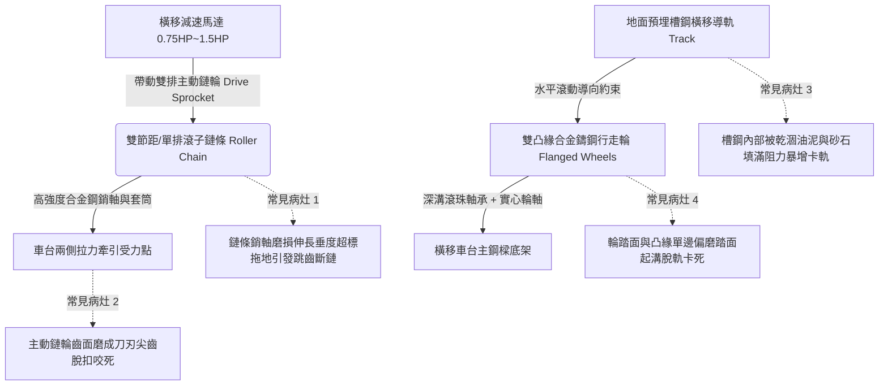

# 全案購屋實戰第四百九十四部：中古大樓社區地下室機械停車設備橫移車台傳動鏈條垂度超標橫移導軌積垢跳齒卡軌與行走輪踏面偏磨體檢工序全書

## 壹、核心查驗宗旨與前言

立體機械停車設備中，升降橫移式（Puzzle Parking System）在地面層或中層之車台交換，完全仰賴載車板底部配置之「橫移傳動滾子鏈條（Roller Chain Drive）」與「橫移鋼軌行走輪組（Traverse Track & Wheels）」。橫移車台必須在極其狹窄之左右立柱縫隙間，以公釐級之平穩度平移滑動，以釋放下方垂直升降之穿越井道通道。

於二十年至三十年屋齡之中古電梯大樓中，因長年承受車輛輪胎帶入之雨水滴漏、砂石研磨、高強度交變拉力衝擊，橫移鏈條普遍存在「金屬銷軸磨損導致鏈條塑性拉長、垂度（Sag）嚴重超標」、「鏈輪（Sprockets）齒厚削薄形成尖峰齒」、「地面預埋橫移槽鋼導軌內部積滿固化黑油泥與小石子」、以及「行走輪踏面（Wheel Tread）單邊偏磨踏面崩角」等重大機械暗礁。一旦鏈條在橫移過程中發生「跳齒（Tooth Skipping）」或車輪「脫軌卡死（Derailment）」，傳動軸被瞬間強大反扭矩扭斷，重達數噸之載車板將在兩側立柱間劇烈歪斜卡死，進退不得，甚至導致整排機械車位全面癱瘓停擺。

本工序全書旨在建立標準化、專業化之橫移傳動鏈條垂度、導軌異物積垢與行走輪踏面偏磨體檢工序，指導購屋家庭在實地檢驗隨附機械車位之社區時，精準查核橫移機械系統之真實抗磨耐用度與對齊精度，防範交屋後陷入高額傳動大修公攤與愛車受困無法取車之痛苦深淵。

---

## 貳、橫移車台傳動鏈條與導軌走輪架構與物理病灶

### 一、傳動鏈條銷軸磨損伸長與垂度（Chain Sag）超標
1. **銷軸與套筒鉸鏈副磨損機制**：傳動鏈條（通常為 RS60 或 RS80 高強度碳鋼或合金鋼滾子鏈）之伸長，並非金屬鏈板單純受拉變長，而是金屬銷軸（Pin）與套筒（Bushing）表面在極限接觸面壓下產生之摩擦磨損，使每一鏈節之節距（Pitch）微幅增大。
2. **垂度超標與跳齒（Sprocket Jumping）**：依機械工程標準，鏈條在兩鏈輪跨距（Span $L$）中間之自然垂度，必須嚴格維持在跨距之 **$1\% \sim 2\%$**（即跨距 2 公尺時，垂度應為 20mm~40mm）。老舊大樓鏈條磨損伸長率超過 $3\%$ 時，鬆邊鏈條下垂超過 100mm 甚至直接拖擦地面。當馬達正反轉切換瞬間，鬆弛之鏈條發生劇烈波浪狀抖動甩動，鏈滾子無法滑入鏈輪齒槽，產生「騎齒」與「跳齒」，強大衝擊力瞬間將鏈板拉斷扯裂。

### 二、鏈輪（Sprockets）齒形磨削與脫扣咬死
1. **齒面衝擊磨損變形**：鏈輪輪齒長期承受滾子嚙入時之衝擊力與滑動磨損，齒厚逐漸變薄。
2. **「鯊魚鰭（Shark-fin）」刀刃化**：嚴重磨耗之鏈輪齒面由圓滑漸開線齒形，被削磨成銳利尖銳之「鉤狀鯊魚鰭」。此時鏈條滾子在嚙出時無法順暢脫開，反而被鉤狀齒尖強行咬住向上捲入（Hooking），引發鏈條死死卡死於鏈輪護罩內，造成減速機外殼破裂、馬達過載燒毀。

### 三、橫移導軌槽鋼內油泥石子沉積與阻力飆升
1. **凹型槽鋼沉砂效應**：橫移導軌多採用預埋於混凝土車道地坪之 [100 或 [120 槽鋼（Channel Steel）。槽鋼凹槽口朝上，車輛輪胎帶入之碎石、泥沙、洗車廢水及車底滴落之廢機油，全數匯集於槽底。
2. **油泥混合物硬化阻軌**：機油與細砂混合固化為堅硬之油泥塊，將軌道有效深度填平。行走輪在行經積垢處時，輪緣（Flange）被硬石頂起，車台瞬間懸空失去水平；行走阻力激增數倍，橫移馬達發出沉重哼聲，電流衝破額定跳脫值。

### 四、行走輪（Traverse Wheels）踏面偏磨與輪緣崩裂
1. **雙凸緣輪（Double-flanged Wheel）導向偏磨**：為防止橫向脫軌，車台走輪多採用雙凸緣鑄鋼輪。若雙側導軌安裝平行度偏差或車台對角線扭曲，行走輪長期偏向單側擠壓軌道側壁。
2. **金屬疲勞剝落與啃軌脫軌**：輪緣內側受到強烈剪切摩擦，厚度被磨薄超過 $50\%$，邊緣起毛刺；踏面滾動表面產生「接觸疲勞剝落（Spalling）」，甚至在輪緣根部產生微裂紋並整塊崩裂。失去輪緣約束之走輪瞬間滑出鋼軌，沉重的載車板金屬底樑直接摔落砸在地面水泥槽上，卡死動彈不得。

---

## 參、實地現場逐項體檢工序與精確量測指引

### 步驟一：橫移傳動鏈條垂度與伸長率量測
1. **跨距自然垂度（Chain Sag）精確測量**：
   - 找到車台底部或頂部之橫移傳動鏈條水平跨距段（跨距長度 $L$）。
   - 在停機狀態下，拉直一條水平細繩作為基準線，使用鋼尺測量鏈條鬆邊中點向下彎曲之垂直距離（垂度 $S$）：
     - **合格標準**：垂度 $S \le 0.02 \times L$（例如跨距 1.5 公尺，垂度應 $\le 30\text{mm}$）。
     - **嚴重鬆弛判定**：若垂度超過 $60\text{mm}$、鏈條幾乎垂搭在結構橫樑或地面上，鐵證鏈條已過度伸長，隨時面臨跳齒脫落。
2. **鏈條 10 節節距伸長率計算**：
   - 使用游標卡尺測量連續 10 個鏈節之銷軸中心距（$L_{10}$）：
     - 標準 RS80 鏈條 10 節標稱長度為 $254.0\text{mm}$。
     - 伸長率公式：$\epsilon = \frac{L_{10} - 254.0}{254.0} \times 100\%$。
     - **報廢極限標準**：若伸長率 $\epsilon \ge 2.5\%$，代表銷軸與套筒已磨穿，鏈條必須立即全數報廢更換！

### 步驟二：鏈輪齒形磨耗與潤滑狀態檢驗
1. **鏈輪齒厚與尖角目視檢驗**：
   - 使用強光手電筒照射主動鏈輪與從動鏈輪齒面。
   - 檢視輪齒兩側工作面：齒廓應保持飽滿弧形。
   - 若齒頂已被磨平變尖、齒面呈現明顯凹陷凹坑、或齒尖呈現尖銳「鯊魚鰭鉤狀」，判定為嚴重磨損需更換鏈輪。
2. **鏈條潤滑油脂檢測**：
   - 用戴手套的手指擦拭鏈條滾子與鏈板縫隙：
     - **正常狀態**：縫隙內應有足量黏稠潤滑油膜。
     - **乾磨狀態**：若鏈條表面呈現乾燥紅褐色鐵鏽粉末（無任何油潤感），且運轉時關節無法自然屈伸（結節硬化 stiff links），代表鏈條內部銷軸早已乾磨毀損。

### 步驟三：橫移導軌槽鋼與行走輪踏面檢測
1. **導軌槽鋼內部異物淤塞檢驗**：
   - 沿著地面橫移導軌槽鋼全長進行手電筒勘查。
   - 檢視槽鋼兩側滑行面：槽底油泥砂石沉積厚度不得超過 **5mm**。若槽鋼被泥沙填滿成平地、或槽內卡有小碎石硬幣，需立即清淤。
2. **行走輪踏面與輪緣厚度精密量測**：
   - 檢視車台四個合金鑄鋼行走輪：
   - 用游標卡尺測量雙凸緣輪之輪緣厚度（$T_\text{flange}$）：正常新輪緣厚度約 10~12mm；若單邊輪緣磨損後厚度小於 **5mm**，或踏面有深度超過 1.5mm 之環狀深溝，代表嚴重偏磨啃軌。
3. **動態橫移動作與卡軌實測**：
   - 請管理員操作車台進行橫移運轉。
   - 觀察車台滑行姿態：車台應維持水平平穩滑行，左右晃動量應 $\le 5\text{mm}$。若橫移時車台劇烈抖動跳躍、伴隨金屬擠壓刺耳尖叫聲、或在某一定點突然卡頓停滯，代表導軌嚴重變形或輪軸碎裂。

---

## 肆、評估判定基準與瑕疵等級劃分

| 瑕疵等級 | 現場實測狀況與機械數值 | 潛在隱患與公共安全危害 | 預估修繕工法與費用規模 |
| :--- | :--- | :--- | :--- |
| **輕度瑕疵 (A級)** | 鏈條垂度在標準範圍內（$\le 2\%$）；油脂充盈無銹斑；鏈輪無尖角；導軌槽鋼潔淨；行走輪踏面光滑無偏磨。 | 橫移傳動系統健全優良，維持定期潤滑清潔。 | 導軌清理浮砂、鏈條噴塗專用高黏度抗磨鏈條油，單車位約 **600 ~ 1,200 元**。 |
| **中度瑕疵 (B級)** | 鏈條垂度偏大（$3\% \sim 5\%$）；節距伸長率達 1.5%；鏈輪齒面有輕微磨耗；槽鋼內有局部油泥結塊；行走輪緣輕度單邊發亮偏磨。 | 運轉阻力與噪音增大；正反轉切換時有頓挫衝擊；需調整鏈條張緊度並清淤。 | 調節馬達底座張緊螺栓（張緊鏈條）、人工徹底刮除槽鋼硬化油泥、更換受損鏈節，費用約 **3,500 ~ 8,000 元/座**。 |
| **重度瑕疵 (C級)** | 鏈條垂度超過 80mm 拖擦地面；伸長率 $\ge 2.5\%$；鏈輪齒磨成鯊魚鰭尖刀；導軌被油石填死；行走輪緣碎裂脫軌卡死！ | 致命毀滅性風險！橫移時隨時爆發跳齒斷鏈，車台卡死在跨道中央導致整排車位全面癱瘓，甚至翻車！ | 全面更換全套工業級高強度合金鋼滾子鏈條、更換主從動淬火鏈輪組、全面換新雙凸緣鑄鋼行走輪，費用達 **18,000 ~ 38,000 元以上/座**。 |

---

## 伍、買賣合約保障特約條款與談判折價策略

### 一、談判折價依據與議價話術
若買方在勘查機械車位時，發現橫移車台滑動時劇烈發出金屬尖叫卡頓、傳動鏈條垂軟拖地、鏈輪磨成尖刀、或導軌槽內積滿硬石油泥，買方應當場錄影存證並嚴正向賣方主張重大機械瑕疵：
> 「本買賣標的物所隨附之機械車位，其橫移傳動鏈條已嚴重磨損伸長垂度嚴重超標，鏈輪齒形已磨成刀刃狀隨時面臨斷鏈脫扣，且地面橫移槽鋼導軌淤塞嚴重導致車台滑動卡阻。橫移系統為升降橫移車位騰出通道之唯一水平動力，此重大機械缺陷若未修復，車台隨時可能在半途中脫軌咬死，導致整排車位癱瘓且愛車受困無法開出，更換全套鏈條鏈輪與走輪費用高昂。請賣方於成交總價中實質折讓新台幣 3 萬至 5 萬元修繕補償款，或由賣方委請專業特約機械停車廠商於交屋日前完成全套橫移鏈條更換、導軌高壓水刀清淤校正，並出具運轉平穩合格保證書。」

### 二、成屋買賣契約專用法律特約條款（範本）

> **【不動產買賣契約書——機械車位橫移傳動鏈條與導軌設施點交保證特約條款】**
>
> 1. **機械車位橫移傳動機能完好保證**：賣方保證本買賣標的物所隨附之機械停車位（車位編號：______），其橫移傳動馬達、雙排滾子鏈條、主從動鏈輪、預埋槽鋼導軌及行走雙凸緣輪組，於交屋日前均處於符合國家安全標準之完好堪用狀態。
> 2. **鏈條張力與平穩滑動驗收承諾**：雙方約定於交屋點交驗收時實施橫移全行程滑行測試。賣方保證傳動鏈條自然垂度維持在標準公差範圍內（垂度不得超過跨距之 2%），運轉中無跳齒、卡軌或刺耳金屬摩擦劇顫，導軌槽鋼潔淨無雜物阻塞，行走輪無脫軌或嚴重偏磨崩角之重大缺陷。
> 3. **修繕款抵扣與瑕疵擔保責任約定**：若點交實測發現傳動鏈條過度伸長鬆弛、鏈輪齒形刀刃化磨損或橫移卡死，賣方應負責於交屋日前自費完成更換修復並出具專業特約維保廠商之驗收合格單；若逾期未修復，買方得自行委請合格機械停車設備廠商逕行修繕更換，相關工程費用（以新台幣參萬伍仟元整為上限）得逕由買賣尾款中全額扣抵，賣方絕無異議。
