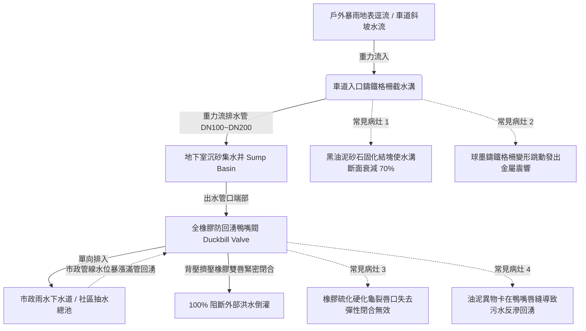

# 全案購屋實戰第四百八十一部：中古大樓社區地下室截水溝重油污泥沉積堵塞防回湧鴨嘴閥橡膠硬化與高壓水刀清淤體檢工序全書

## 壹、核心查驗宗旨與前言

大樓地下室停車場車道出入口及各分區通道交界處設置之「地面截水溝（Trench Drain / Interceptor Channel）」與「防回湧鴨嘴閥（Duckbill Check Valve / Elastomeric Backflow Preventer）」，係攔截暴雨地表逕流、車輛進出雨水、洗車廢水，並防止市政雨水幹管或下水道滿管時污水逆向倒灌地下室之第一道實體水力防線。

於二十年至三十年屋齡之中古電梯大樓中，因長年車輛輪胎帶入之泥沙、底盤滴落之廢機油與煞車粉塵沉積，截水溝槽體常年被瀝青狀黏稠「黑油泥」嚴重淤塞，過水斷面縮減 70% 以上；且排水出風口安裝之橡膠鴨嘴閥因長期浸泡油污酸蝕，彈性體（Elastomer）發生嚴重老化硬化、唇口變形卡死或開裂。一旦夏季極端強降雨來襲，截水溝無法即刻洩洪，外部雨水挾帶泥砂直接漫過車道截水溝直灌地下室二層、三層，甚至順著排風管道淹入機械車位底坑與發電機房，造成數百萬至千萬元財物損失與鉅額修繕公攤。

本工序全書旨在建立標準化、專業化之地下室截水溝槽體與防回湧鴨嘴閥體檢工序，指導購屋家庭在實地檢驗地下室公設環境時，精準穿透排水設施之淤積程度與防回湧真實效能，防範交屋後陷入地下室淹水與高額管線清淤公攤之風險。

---

## 貳、地下室截水溝與防回湧橡膠鴨嘴閥系統架構與物理病灶

### 一、重油污泥沉積硬化與截水斷面萎縮
1. **沉降與黏結硬化機制**：車輛輪胎自室外帶入之石英微砂、黏土顆粒，與引擎滴落之碳氫化合物廢機油、防鏽蠟在高溫高濕地下室混合。在截水溝平緩坡度（通常僅 0.5%~1%）下，泥砂迅速沉降於溝底，油質充當黏著劑，數年間固化為堅硬如石之「高黏度瀝青油泥塊」，溝底有效深度自 200mm 劇烈壓縮至 30~50mm。
2. **極端降雨表面張力越位**：當強降雨每小時雨量達 80mm 以上時，狹窄的截水溝瞬間滿溢。水流由於動能與表面張力作用，直接「飛越」鍍鋅格柵上方，沿車道斜坡狂暴衝向地下室最深處，使截水溝完全喪失截流功能。

### 二、全橡膠防回湧鴨嘴閥（Duckbill Valve）物理老化與唇口卡阻
1. **彈性體橡膠老化硬化機制**：鴨嘴閥採用氯丁橡膠（Neoprene）或三元乙丙橡膠（EPDM）一體成型。長期接觸含油污水與空氣中之硫化氫氣體，橡膠內部塑化劑流失、交聯密度異常增高，導致橡膠「硫化硬化（Embrittlement）」。其順向開啟所需水頭由標準之 25mm 飆升至 200mm 以上（排水受阻），而在承受逆向回水背壓時，硬化之唇口無法自然貼合，產生巨大逆向縫隙。
2. **砂石油泥咬唇破壞**：當排水中夾帶小石子、落葉或油泥塊時，異物恰好夾在鴨嘴唇口閉合縫隙處。外側下水道水位上漲時，高壓污水順著縫隙狂暴倒灌，鴨嘴閥瞬間失去逆止功能。

### 三、車道球墨鑄鐵格柵蓋板變形與跳動噪音
1. **重車輪胎反覆衝擊剪切**：車道截水溝上方鋪設之球墨鑄鐵（Ductile Iron）格柵，每日承受數百輛車重 1.5~2.5 噸之輪胎動態輾壓衝擊。角鋼座框架若施工未充填無收縮水泥砂漿，角鋼下陷變形，格柵板產生翹曲。
2. **跳動金屬撞擊噪聲（Clatter Noise）**：每當車輛經過時，格柵板與邊框劇烈撞擊發出刺耳之「匡噹！匡噹！」巨響，聲音透過建築結構樑柱傳導至低樓層住戶室內，形成全天候低頻噪音污染；嚴重變形者更會翻轉卡進車胎底盤，引發重大事故。

---

## 參、實地現場逐項體檢工序與清淤測試指引

### 步驟一：車道截水溝槽體與格柵蓋板靜態檢驗
1. **格柵平整度與受壓跳動測試**：
   - 檢視車道出入口之截水溝格柵，表面應平整無凹陷，格柵縫隙不得大於 20mm（防止卡住行人鞋跟或腳踏車輪胎）。
   - 請陪同車輛以時速 10~15 公里駛過截水溝：
     - **判定標準**：格柵必須穩固平貼於底座，車輛壓過時僅有沉悶輪胎滾動聲，**絕對不得有金屬跳動翹起或刺耳之撞擊匡噹聲**。
2. **溝底油泥淤塞厚度測量**：
   - 掀開車道中央與兩側最低點之鑄鐵格柵板（使用專用鉤棒）。
   - 使用鋼捲尺或直尺垂直插至溝底混凝土面，測量淤泥厚度（$H_\text{mud}$）與淨過水深度（$H_\text{clear}$）：
     - **標準規範**：淨過水斷面深度應 $\ge 150\text{mm}$，油泥沉積厚度應 $\le 30\text{mm}$。
     - 若淤泥厚度超過 80mm，或用螺絲起子戳刺溝底感覺如硬質橡膠石塊，代表管委會已數年未進行專業水刀高壓清淤。

### 步驟二：防回湧鴨嘴閥物理彈性與閉合密封性檢測
1. **鴨嘴閥安裝位置與外觀檢查**：
   - 於沉砂池或排水出口處檢視鴨嘴閥體（外形如扁平鴨嘴狀）。
   - 檢查橡膠外表是否有龜裂紋、硬化白化、脫膠或卡箍（Clamps）不鏽鋼帶鏽斷鬆脫現象。
2. **唇口手動擠壓與自閉彈性測試（非破壞性實測）**：
   - 戴上防水手套，用雙手擠壓鴨嘴閥兩側唇邊，使其順向張開，隨後瞬間放手。
   - **判定標準**：放手後，雙唇必須在 **0.1 秒內極速自然回彈閉合**，唇縫貼合緊密且無任何透光縫隙。
   - 若擠壓時橡膠硬如木板無法按動，或放手後唇縫呈現 10mm 以上開口無法自主閉合，判定為橡膠硬化失效，已徹底喪失防回湧功能。

### 步驟三：排水順暢度現場實體注水測試（需管理員或仲介陪同）
1. **大流量灌水流通測試**：
   - 取大樓地下室消防清洗水管（或接自來水龍頭大流量水管），向車道截水溝最高端連續注水 3~5 分鐘（流量約 50~100 L/min）。
   - 觀察溝內水流排洩動態：
     - 水流應順暢迅速匯入集水井，溝內不得有明顯湧水蓄積或倒流現象。
     - 觀察鴨嘴閥出口：水流應能順暢頂開鴨嘴雙唇均勻噴出，無局部受阻阻水現象。

---

## 肆、評估判定基準與瑕疵等級劃分

| 瑕疵等級 | 現場實測狀況與機械數值 | 潛在隱患與公共安全危害 | 預估修繕工法與費用規模 |
| :--- | :--- | :--- | :--- |
| **輕度瑕疵 (A級)** | 格柵平整無跳動；溝底僅有少量浮砂（厚度 $\le 20\text{mm}$）；鴨嘴閥彈性優良回彈緊密；注水排水順暢。 | 截流防回湧機能健全，維持例行性清掃。 | 例行性人工刮除溝底沉砂、格柵上防鏽漆，每半年維保約 **1,500 ~ 3,000 元**。 |
| **中度瑕疵 (B級)** | 車輛壓過格柵有輕微金屬敲擊聲；溝底黑油泥沉積厚度達 50~80mm；鴨嘴閥唇口有少量砂石卡阻微開；排水速度稍慢。 | 暴雨時截流不及恐有局部溢流；排水管長年淤積引發地下室散發廢油惡臭。 | 工業高壓水刀（250 bar）管線全線貫通沖洗、更換不鏽鋼防震橡膠墊條、清洗鴨嘴閥唇口，費用約 **15,000 ~ 30,000 元**。 |
| **重度瑕疵 (C級)** | 截水溝完全被硬化油泥填平（淤泥 $> 100\text{mm}$）；格柵變形翹起斷裂；鴨嘴閥橡膠硬化龜裂或脫落；暴雨時雨水直灌地下室！ | 致命毀滅性風險！颱風暴雨時地下室瞬間變水塘，下層機械車位與配電設備全面泡水報廢！ | 重做車道截水溝角鋼框架、全線開挖重設球墨鑄鐵重型格柵、全面換新全橡膠法蘭式鴨嘴閥，修繕費用達 **8萬 ~ 18萬元以上**。 |

---

## 伍、買賣合約保障特約條款與談判折價策略

### 一、談判折價依據與議價話術
若買方在勘查地下室車道截水溝時，發現溝底積滿硬化黑油泥、格柵跳動震響、或防回湧鴨嘴閥已經硬化破爛，買方應當場錄影存證並嚴正向賣方主張權益：
> 「本買賣標的物所屬社區大樓地下室車道截水溝，其溝槽已被厚重廢油泥完全淤塞，排水截面縮減過半，車輛輾過格柵發出劇烈撞擊噪音，且防回湧鴨嘴閥已硬化開裂失去逆止防洪功能。此為涉及全棟地下室暴雨防汛與車輛防泡水之重大公共設施缺陷。一旦暴雨來襲，外部洪水直灌地下室將造成無可挽回之重大財損，且全線高壓水刀清淤及更新格柵需耗費高額經費。請賣方於成交總價中實質折讓新台幣 2 萬至 5 萬元之公設防汛修繕補貼，或由賣方督促管委會於交屋日前完成截水溝高壓水刀疏通清淤、更換防回湧鴨嘴閥並出具驗收單據。」

### 二、成屋買賣契約專用法律特約條款（範本）

> **【不動產買賣契約書——大樓地下室車道截水溝與防回湧設施安全點交特約條款】**
>
> 1. **截水溝排水通暢與防汛機能保證**：賣方保證本買賣標的物所屬社區大樓地下室車道出入口及各分區之地面截水溝、沉砂池及排水管網，於交屋日前均處於通暢無重油污泥阻塞、無結構性淤死之良好堪用狀態，車道格柵平整固定無異常跳動鬆脫噪音。
> 2. **防回湧逆止裝置完好承諾**：賣方保證地下室排水出口端安裝之全橡膠防回湧鴨嘴閥（或逆水閥），橡膠彈性體無硬化龜裂、唇縫貼合緊密，能確實發揮順向暢通排水、逆向完全阻絕外部市政下水道洪水倒灌之防汛功能。
> 3. **公攤清淤大修費用承擔約定**：若於交屋日起六個月內，因交屋前已存在之截水溝嚴重淤塞、鴨嘴閥失效或管線結構破損，導致管委會決議啟動全棟地下室截水溝高壓水刀清淤貫通或格柵全面換新專案並開徵特別公攤款者，賣方同意按其持有房屋產權期間比例無條件承擔該筆公攤費用，買方得憑繳款通知單向賣方全額追討。
