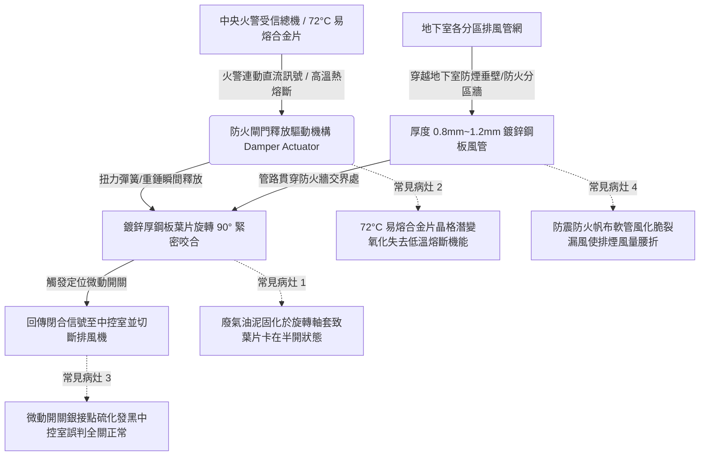

# 全案購屋實戰第四百八十七部：中古大樓社區地下室機械通風防排煙風管防火閘門熔斷手動復位卡死微動開關定位失效與風量衰減體檢工序全書

## 壹、核心查驗宗旨與前言

大樓地下室密閉空間（包含地下停車場、垃圾儲藏室、蓄水池機房與發電機室）之機械通風與消防防排煙系統（Mechanical Ventilation & Smoke Control System），擔負著平時排出車輛一氧化碳廢氣、引入室外新鮮空氣，以及火災突發時以高強度負壓迅速抽離致命高溫濃煙、阻絕毒氣沿垂直管道間蔓延至各樓層住戶室內之核心救命防線。其中，貫穿各防火區劃（Fire Compartments）防火牆之風管咽喉節點，必須依法配置「防火閘門（Fire Damper, FD）」與「防排煙閘門（Smoke Damper, SD）」。

於二十年至三十年屋齡之中古電梯大樓中，因長年處於地下室潮濕、車輛尾氣油煙附著、機電維保流於表面形式，普遍存在「72°C 易熔合金片（Fusible Link）表面嚴重油泥包覆引發熱感應失靈」、「閘門旋轉軸銷鏽蝕卡死無法自動閉合」、「手動復位棘輪齒條卡阻滑牙」、「微動行程開關（Micro Limit Switch）接點氧化導致中央火警受信總機回報虛假定位」、以及「鍍鋅鐵皮風管法蘭接頭漏氣與帆布軟管脆化破裂導致有效排煙風量衰減 50% 以上」等重大公安致命隱患。一旦地下室車輛自燃或配電盤起火，防火閘門無法即刻閉鎖，毒煙將順著通風管路直灌各棟大樓梯廳，造成整棟大樓居民避難逃生完全受阻之毀滅性慘劇。

本工序全書旨在建立標準化、專業化之機械通風防排煙風管與防火閘門實體體檢工序，指導購屋家庭在實地檢驗地下室公設時，精準查核防排煙區劃完整性與閘門動作可靠度，防範交屋後陷入高額消防安檢開罰與公共安全失守之深淵。

---

## 貳、防排煙風管與防火閘門系統架構與常見物理病灶

### 一、易熔合金熔斷片（Fusible Link）金屬潛變與油泥隔熱失效
1. **低熔點共晶合金物理機制**：標準防火閘門依據 CNS 15816 標準，平時藉由標稱熔點為 $72^\circ\text{C}$（一般通風管路）或 $280^\circ\text{C}$（排煙抽風管路）之鉍-鉛-錫-鎘四元共晶易熔合金片，拉緊強力回位彈簧以維持葉片常開。
2. **油泥包覆與熱傳導阻絕**：地下室常年匯集汽車引擎未完全燃燒之重質碳氫化合物與輪胎粉塵，黏稠油煙在熔斷合金表面沉積形成厚達 1mm~2mm 之「油泥隔熱層」。火災高溫氣流通過時，合金片受油泥阻隔無法及時吸收熱量，熔斷反應時間由法規規定的 60 秒以內延遲至 300 秒以上，錯失阻斷火煙延燒之黃金時間。

### 二、葉片軸銷（Blade Pivot Axles）腐蝕卡死與復位棘輪損壞
1. **黃銅/碳鋼轉軸接觸電化學腐蝕**：閘門葉片兩側旋轉軸心裝設於風管框架之銅襯套或不鏽鋼軸承內。在地下室 85% RH 高濕環境下，碳鋼軸心與黃銅襯套發生異種金屬電化學腐蝕，生成的氫氧化鐵紅鏽（體積膨脹數倍）將軸承縫隙完全脹死填滿。當熔斷片斷開時，彈簧彈力無法克服生鏽摩擦力，葉片卡在 $30^\circ \sim 45^\circ$ 之半開狀態，完全失去防火遮斷功能。
2. **手動復位機構齒輪滑牙**：外部手動拉桿與復位棘輪（Ratchet & Pawl）機構長期缺乏潤滑油保養，金屬疲勞脆化。每年消防檢驗技師進行「手動觸發試驗」後，嘗試將閘門復位時，棘爪齒條受硬力扭曲磨損，發生滑牙脫扣，導致閘門無法重新鎖定在全開位置，長期垂掉在半空中阻擋通風。

### 三、微動定位開關（Limit Switch）接點氧化與虛假反饋
1. **銀接點硫化絕緣化**：閘門旋轉軸旁設置微動開關，用於在閘門 $100\%$ 完全閉合時導通，向中央監控室發送「閘門已就位關閉」信號並連鎖跳脫通風送風機（避免持續向火場鼓風灌氧助燃）。老舊大樓開關外殼防護等級未達 IP54，內部銀合金觸點暴露於硫化氣體環境中氧化黑化，接觸電阻暴增至兆歐級。
2. **中央受信總機信號盲區**：即使現場閘門早已因鏽蝕卡在全開位置，中控室面板卻因線路電容干擾或接觸不良誤亮綠燈，消防維保紀錄長期勾選「正常」，形成致命之監控失明死角。

### 四、防震帆布軟管風化破裂與風量衰減
1. **氯丁橡膠帆布老化機制**：為隔絕排煙風機高速運轉之劇烈振動，風機出入口與鍍鋅風管之間必須配置「耐高溫防火防震帆布軟管（Flexible Duct Connector）」。橡膠塗層在地下室高溫震盪與機油蒸汽長期侵蝕下，橡膠分子鏈斷裂硬化，帆布布層撕裂粉化。
2. **排風量嚴重腰折與短路**：排煙風機高速抽風時，破裂之帆布縫隙狂暴吸入機房周邊空氣（產生氣流短路），而遠端地下室車道及停車位之吸風口實測風速自設計之 $5.0\text{ m/s}$ 暴跌至 $1.5\text{ m/s}$ 以下，排煙有效風量衰減超過 50%，火災發生時濃煙根本無法抽出室外。

---

## 參、實地現場逐項體檢工序與風量精確量測指引

### 步驟一：風管管路與防火區劃貫穿面靜態檢驗
1. **穿牆處防火填塞（Firestopping）檢驗**：
   - 檢視鍍鋅排風管貫穿地下室各防煙分區牆、防火分區牆或防煙垂壁之孔洞。
   - **法規剛性門檻**：風管與混凝土牆體間之環形縫隙，**絕對必須使用通過 CNS 14514 認證之不燃性岩棉（Rockwool）與防火膨脹密封泥（Firestop Sealant）嚴密封堵**。若現場僅以一般黃色發泡填縫劑（PU Foam）或一般水泥砂漿胡亂填抹，遇火將瞬間被高溫燒穿，判定為嚴重公共安全瑕疵！
2. **防震帆布軟管完好度檢查**：
   - 使用手電筒近距離照射排煙風機前後之防震帆布軟管。
   - 用戴手套的手指輕壓帆布表面：帆布應維持柔韌彈性；若表面硬脆如紙板、有明顯撕裂縫隙、大面積破洞、或用手輕捏即碎裂剝落，代表軟管已完全風化失效。

### 步驟二：防火閘門實體動作與手動復位測試（需機電或管理員陪同）
1. **外部易熔合金片與安全插銷檢視**：
   - 使用手電筒檢視風管外側之防火閘門驅動機構。
   - 檢視易熔片表面是否潔淨無油泥覆蓋，銘牌標示溫度（$72^\circ\text{C}$ 或 $280^\circ\text{C}$）是否清晰。
2. **手動釋放閉合動作測試（非破壞性實測）**：
   - 撥動手動測試釋放拉柄，切斷鎖定連動機構。
   - **判定標準**：內部厚鋼板葉片必須在 **1 秒內** 依靠強效扭力彈簧迅速旋轉至 $90^\circ$ 全閉位置，閉合撞擊聲清脆有力，葉片四邊氣密橡膠條緊密咬合，無任何卡滯縫隙。
3. **手動復位流暢度實測**：
   - 轉動復位手柄或鏈條，將葉片拉回 $0^\circ$ 全開狀態。
   - **判定標準**：齒輪咬合均勻平順，到達全開定位後棘爪能確實自鎖，放手後葉片穩固不回彈。若旋轉卡死或滑牙，代表機構已鏽蝕損壞。
4. **微動定位開關導通量測（萬用電表歐姆檔）**：
   - 於閘門閉合狀態下，測量微動開關信號端子接觸電阻：
     - **合格標準**：接觸電阻應 $\le 0.5\Omega$。若測得阻抗超過 $5\Omega$ 或呈開路，代表接點氧化失效。

### 步驟三：排煙風機連動抽風風量實測（風速儀量測）
1. **吸風口動態風速實測**：
   - 請機電人員手動啟動地下室排煙風機。
   - 使用葉輪式或熱線式數位風速計（Anemometer），於目標分區之排煙吸風口金屬格柵表面，採「五點取樣法」測量平均表面風速（$V_\text{avg}$，單位：$\text{m/s}$）。
2. **實得風量計算與核對**：
   - 測量吸風口有效淨過水斷面積（$A$，單位：$\text{m}^2$）。
   - 計算實時抽風量：$Q = V_\text{avg} \times A \times 3600 \text{ (m}^3\text{/h)}$。
   - **合格標準**：實測風量應達大樓原始竣工機電圖標稱排煙量之 **80% 以上**，各吸風口平均風速不得低於 **$3.0\text{ m/s}$**。若實測風速低於 $1.5\text{ m/s}$，代表管線嚴重漏風或風機皮帶打滑。

---

## 肆、評估判定基準與瑕疵等級劃分

| 瑕疵等級 | 現場實測狀況與風量電氣數值 | 潛在隱患與公共安全危害 | 預估修繕工法與費用規模 |
| :--- | :--- | :--- | :--- |
| **輕度瑕疵 (A級)** | 易熔片潔淨；手動釋放 1 秒內全閉；復位順暢；微動開關電阻 $\le 0.5\Omega$；實測排風量達標示值 85% 以上；帆布完好。 | 防排煙機能健全優良，維持定期申報巡檢。 | 例行性機械轉軸潤滑除塵、噴塗二硫化鉬防卡潤滑劑，單組維保約 **800 ~ 1,500 元**。 |
| **中度瑕疵 (B級)** | 易熔片表面有輕微油泥；釋放後葉片閉合在 75°~80°（未完全緊閉）；帆布接頭表面有細微風化裂紋；排風量衰減至 60%~75%。 | 火災時有微量漏煙風險；排煙風量不足導致火災蓄煙擴散加快，需限期改善。 | 更換全新標準 $72^\circ\text{C}$ 不鏽鋼易熔片組、更換耐高溫矽膠玻纖防震帆布接頭、調整微動開關，費用約 **8,000 ~ 18,000 元/處**。 |
| **重度瑕疵 (C級)** | 防火閘門轉軸完全鏽死（釋放後動彈不得）；風管穿防火牆未作防火泥填塞；帆布撕裂大破洞；排風量衰減大於 50%；中控室信號斷線！ | 致命毀滅性風險！防火區劃完全瓦解，火災時地下室毒煙直接順著通風管直灌各棟住戶安全梯；消防安檢列為重大不合格！ | 全面更換全自動電動防火防煙閘門總成（含 UL 認證電動執行器 Actuator）、重新施作標準岩棉防火填塞，修繕費用達 **15萬 ~ 35萬元以上**。 |

---

## 伍、買賣合約保障特約條款與談判折價策略

### 一、談判折價依據與議價話術
若買方在勘查地下室機械通風設施時，發現排風管防震軟管破裂漏風、防火閘門轉軸鏽斑斑駁卡死、或風管穿牆孔洞空空如也未做防火泥填塞，買方應當場錄影存證並嚴正向賣方主張重大公共安全瑕疵：
> 「本買賣標的物所屬社區大樓地下室防排煙風管系統，其穿越防火區劃之防火閘門已完全鏽蝕卡死無法自動閉鎖，排風帆布軟管風化破裂導致有效排煙抽力大幅腰折，且風管穿牆處未依消防法規施作防火填塞。此為涉及全棟住戶火災逃生與阻絕致命濃煙之重大公安缺陷。一旦失火，毒煙直灌安全梯將釀成重大傷亡，且主管機關消防安檢將開具限期改善罰單，全面更換閘門與重做防火填塞需耗費管委會高額基金。請賣方於買賣總價中實質折讓新台幣 3 萬至 6 萬元之公設消防安全修繕準備金，或由賣方督促管委會於交屋日前完成全棟地下室防火閘門檢修測試、更換防震軟管並出具合格消防申報簽證單。」

### 二、成屋買賣契約專用法律特約條款（範本）

> **【不動產買賣契約書——大樓地下室防排煙風管與防火閘門設施點交保證特約條款】**
>
> 1. **防排煙公設機能法定合格保證**：賣方保證本買賣標的物所屬社區大樓地下室之機械通風與防排煙設備（包含排煙風機、鍍鋅風管、防震軟管、防火閘門及穿牆防火填塞），於交屋日前均處於符合內政部《各類場所消防安全設備設置標準》之完好堪用狀態，最近一期消防設備安全申報檢驗項目均列為「合格」無列管缺失。
> 2. **防火區劃閘門動作承諾**：賣方保證地下室各分區之防火防煙閘門機構運作正常，手動釋放時葉片能於 1 秒內完全閉合鎖定，微動定位信號能即時回傳中央監控室，管路貫穿防火牆處均依規範施作標準防火泥填塞，無任何火煙沿風管跨區蔓延之隱患。
> 3. **公攤更換大修費用責任追索約定**：若於交屋日起六個月內，因交屋前已存在之地下室排煙風管破裂、防火閘門全面卡死損壞或消防主管機關稽查開具重大公安缺失改善通知單，經區分所有權人會議決議開徵全棟防排煙設備修繕專案特別公攤款者，賣方同意按其持有房屋產權期間比例無條件全額負擔該筆公攤費用，買方得憑繳款通知單向賣方全額追討。
