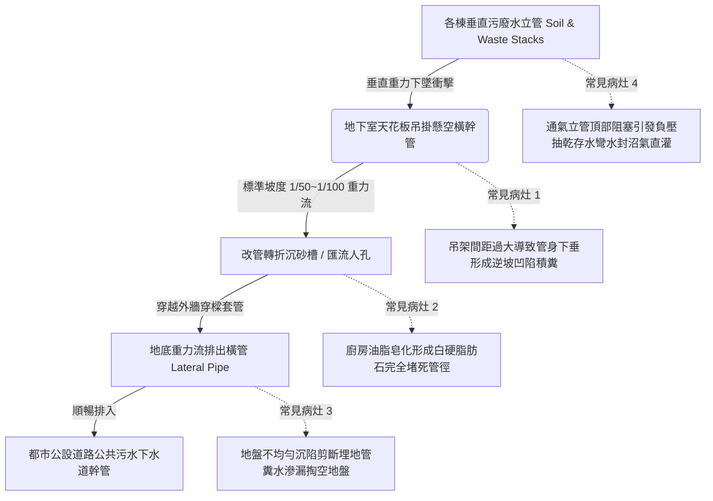

# 全案購屋實戰第四百八十三部：中古大樓社區地下室生活污水下水道用戶接管重力流破管滲漏地盤掏空沉砂淤塞逆坡回沖與惡臭毒氣逆灌室內體檢工序全書

## 壹、核心查驗宗旨與前言

大樓地下室生活污水下水道用戶排水設備（Building Sewer Lateral System），擔負著全社區數十戶乃至上百戶家庭每日排放之馬桶糞水（黑水）與廚衛洗滌廢水（灰水），藉由地下室重力流橫管及沉水排污泵，無害匯整並順暢排入公設污水下水道幹管之核心衛生動脈。在早期未完成衛生下水道接管前，大樓依靠地下室化糞池進行厭氧沉澱處理；而近十年各縣市政府推動「公共污水下水道用戶接管工程（Sewer Lateral Connection）」時，多數老舊大樓經歷了「廢除化糞池、改設污水轉管或重力流重力槽」之重大工程改造。

於二十年至三十年屋齡之中古電梯大樓中，因長年承受建築物不均勻沉陷（Differential Settlement）、重型車輛輾壓、地震剪切應力、油脂皂化結垢、以及改管施工品質低劣，普遍存在「PVC/鑄鐵污水橫管接頭脫節斷裂」、「坡度不足或逆坡沉陷引發重力流倒灌回沖」、「滲漏污水掏空地下室地盤基礎」、以及「防臭存水彎水封被抽乾引致劇毒沼氣（硫化氫、甲烷）沿垂直管道逆灌各樓層室內」等恐怖暗礁。

本工序全書旨在建立標準化、專業化之地下室生活污水下水道接管與重力流管系體檢工序，指導購屋家庭在實地檢驗公設地下室與室內衛浴時，精準穿透排污管系之密閉性、流向坡度與結構健康度，杜絕交屋後忍受惡臭毒氣熏天、糞水倒灌客廳及數十萬元開挖改管之鉅額公攤修繕浩劫。

---

## 貳、地下室污水下水道用戶接管架構與常見物理病灶

### 一、排污橫管沉陷逆坡（Back-fall / Inverse Slope）與結垢沉砂
1. **重力流流體動力學法則**：依據建築技術規則，口徑 $\phi 100\text{mm} \sim \phi 150\text{mm}$ 之污水橫幹管，其自然重力排水坡度絕對不得小於 **1/100 至 1/50**（即每延伸 1 公尺需下降 1 至 2 公分），流速需維持在 $0.6 \sim 3.0\text{ m/s}$ 之間，以確保「自清流速（Self-cleansing Velocity）」，防止固體懸浮物沉降。
2. **吊架疲勞下垂形成逆坡死水彎**：老舊大樓地下室懸吊排污橫管長達數十公尺，鑄鐵吊卡或角鋼吊架因受潮生鏽變形，中間跨距下垂 30mm~50mm，形成幾何「U 型逆坡口袋」。固體糞便、衛生紙、菜渣沉積於凹陷處，流速降為零；長年累積形成堅硬沉砂床，導致整根管路實質過水截面積縮減 80% 以上，隨時引發上游低樓層（特別是 2 樓）馬達噴糞大倒灌。

### 二、廚房高溫油脂皂化結塊（Fatberg）阻塞
1. **皂化反應與鈣化硬化機制**：全棟住戶廚房洗碗排放之動物油脂、棕櫚油，在高溫乳化狀態下排入污水管。進入陰冷之地下室管線後迅速凝固，並與自來水中的鈣、鎂離子發生「皂化反應（Saponification）」，生成如大理石般堅硬之白色不溶性「鈣化脂肪石（Fatberg）」。
2. **管壁環狀縮徑與完全窒息**：脂肪石沿著 PVC 管壁由外向內環狀增生，通管條（Snake Auger）鑽入時往往只能戳出一個小洞，數週後立刻再次被油脂黏結封死，只能依賴高噸位高壓水刀車（200~300 bar）進行全管段旋轉切削方能清除。

### 三、地盤不均勻沉陷剪斷埋地管與地下水掏空
1. **穿牆接頭剪力破壞（Shear Fracture）**：污水管自地下室側壁穿越連續壁或基礎地樑，延伸埋設於戶外土壤中連接市政人孔。大樓本體結構重量龐大（沉陷極微），而周邊回填土受雨水沖刷與交通震動產生顯著自然沉降。在交界面上產生巨大垂直剪切應力，將未裝設可撓性防震接頭（Flexible Sleeve）之 PVC 污水管硬生生剪斷撕裂。
2. **糞水長期淘空地基流失災難**：斷裂後之生活污水未排入市政下水道，而是每日數公噸持續滲入大樓基礎土壤中。細砂泥土被水流長年掏空帶走，地底形成巨大暗坑空洞，地下室底板失去土壤支撐，引發底板開裂湧水、地面塌陷之致命結構安全危機。

### 四、氣壓平衡瓦解與室內惡臭沼氣逆灌
1. **伸頂通氣管（Vent Stack）功能崩潰**：污水立管於頂樓必須伸出屋頂排氣，以平衡管內水流下墜時產生之正負氣壓。若頂樓通氣管被加蓋違建遮蔽、雜物堵塞或防蟲網封死，垂直立管排水時在管內引發強大「負壓抽吸（Siphonage）」。
2. **存水彎水封被抽乾（Loss of Trap Seal）**：住戶室內馬桶、洗臉盆、地排下方之存水彎水封（通常深度為 50~100mm）瞬間被吸入立管排空。污水管內聚集之劇毒「硫化氫（H₂S，具臭蛋味）、氨氣、甲烷（可燃爆炸氣體）」長驅直入室內，長者幼童長期吸入引致慢性頭暈、呼吸道黏膜損傷，更是社區性疫情（如 SARS、諾羅病毒）沿垂直管道垂直擴散之罪魁禍首。

---

## 參、實地現場逐項體檢工序與精確檢測指引

### 步驟一：地下室天花板吊掛污水管靜態物理檢驗
1. **懸吊橫幹管坡度與下垂目視檢驗**：
   - 使用雷射水平儀（Laser Level）投射水平基準線，量測地下室排污橫幹管起點、中段及終點至雷射線之垂直距離。
   - **判定標準**：管路必須維持 **全程單向向下傾斜（坡度 $\ge 1\%$）**。若中段管身下垂超過基準線，出現局部「逆坡（起伏波浪狀）」，判定為嚴重下垂積糞缺失！
2. **管壁接縫與清潔口（Cleanout）滲漏檢查**：
   - 檢視每隔 15 公尺或彎頭處設置之管路清潔口（CO）。
   - 檢查清潔口螺紋蓋是否有鐵鏽、生料帶外翻、或垂掛發霉之黑色污水結晶滴痕。
   - 檢視管件承插膠合處（PVC 接頭）或鑄鐵無承口壓夾管箍（No-Hub Coupling）橡膠套環，確認無龜裂、無黑水滲滴。

### 步驟二：外牆穿牆管與地盤沉陷斷管檢驗
1. **連續壁穿樑套管交界處檢驗**：
   - 找到污水管貫穿地下室外壁通往戶外公共下水道之位置。
   - 檢查穿牆縫隙是否使用「止水法蘭套管與防震軟管」連接。
   - 檢視穿牆管周圍混凝土牆面：牆面必須乾燥；若有大面積放射狀裂痕、湧水痕跡、泥砂堆積、或散發濃烈糞臭味，鐵證**室外埋地管已剪斷破裂，糞水正反滲掏空地盤**！
2. **公共下水道銜接人孔（Connecting Manhole）開蓋勘查**：
   - 於大樓基地退縮人行道或車道旁，尋找標註「市府污水下水道」或「用戶接管」之鑄鐵人孔蓋。
   - 在管理員陪同下開啟蓋板：
     - 觀察管口水流動態：大樓內部用水時，管口應有清澈或灰白色水流順暢湧出，管底無大量黑沉砂淤積。
     - 若管口完全乾涸無水，但地下室排污馬達持續運轉，代表管路中途已徹底斷裂破漏滲入地底！

### 步驟三：目標戶室內水封保持力與沼氣臭味實測
1. **室內地排與馬桶存水彎水封深度測量**：
   - 檢視浴室地面落水孔、乾濕分離落水頭與洗衣機排水管。
   - 用細刻度尺測量地排內部防臭存水彎水封深度：
     - **法定標準**：有效水封深度（Trap Seal Depth）必須在 **50mm 至 100mm** 之間。若無存水彎或水封深度 $< 30\text{mm}$，極易乾涸蒸發。
2. **樓上沖水動態抽吸實測（水封破壞測試）**：
   - 請陪同人員至樓上鄰戶或目標戶自身，連續按下馬桶全開沖水 2 次。
   - 觀察浴室地排落水頭內部水面變化：
     - **正常狀態**：地排內部水面僅有微幅波紋（晃動 $\le 5\text{mm}$），隨即靜止。
     - **通氣不良負壓抽吸狀態**：管內發出「咕嚕！咕嚕！」劇烈吞咽巨響，地排內部水封在數秒內被完全吸入管道排空，隨後一股刺鼻之硫化氫惡臭撲鼻而來！
3. **可燃性氣體與硫化氫氣體探測器量測**：
   - 將四合一氣體檢測儀探頭置於地排落水頭口上方 1 公分處。
   - **安全極限標準**：硫化氫（H₂S）濃度必須為 **0.0 ppm**，可燃性氣體（LEL）必須為 **0%**。若測得硫化氫 $> 1.0\text{ ppm}$，判定為室內防臭屏障全面崩潰！

---

## 肆、評估判定基準與瑕疵等級劃分

| 瑕疵等級 | 現場實測狀況與氣體數值 | 潛在隱患與公共衛生危害 | 預估修繕工法與費用規模 |
| :--- | :--- | :--- | :--- |
| **輕度瑕疵 (A級)** | 橫管坡度均勻無下垂；清潔口密封良好；地排存水彎水封深度 $\ge 50\text{mm}$；無沼氣臭味（H₂S = 0.0 ppm）。 | 排水與防臭機能健全優良，維持定期保養。 | 例行性定期清理地排毛髮濾網、加注存水彎清水，每季維保約 **500 ~ 1,000 元**。 |
| **中度瑕疵 (B級)** | 橫管局部輕微下垂（坡度不足 0.5%）；清潔口螺紋處有微量白色皂化結晶；沖水時地排水面劇烈波動但未全抽乾；室內偶有輕微異味。 | 沉砂與油脂逐步累積，隨時有局部堵塞風險；通氣立管局部受阻需疏通。 | 工業高壓水刀通管清洗切除油脂結石、重新校正調整懸吊吊架拉桿、加裝高水封防臭地排芯，費用約 **15,000 ~ 35,000 元**。 |
| **重度瑕疵 (C級)** | 外牆穿管剪斷破裂，糞水掏空地下室地基；橫管嚴重逆坡積糞堵死；沖水時水封瞬間抽乾，硫化氫毒氣狂灌（H₂S $> 5\text{ ppm}$）；2樓馬桶噴糞！ | 致命毀滅性風險！地基淘空引致大樓沉陷傾斜；劇烈惡臭毒氣損害中樞神經致病；全棟污水管隨時全面癱瘓爆裂！ | 開挖地下室地面與戶外人行道、重新更換沉陷管段並加裝防震可撓接頭、通氣管頂部全面疏通重設，修繕費用達 **18萬 ~ 45萬元以上**。 |

---

## 伍、買賣合約保障特約條款與談判折價策略

### 一、談判折價依據與議價話術
若買方在勘查目標物件時，發現室內衛浴散發濃烈水溝臭味、沖水時地排咕嚕作響被抽乾、或地下室天花板排污橫管嚴重逆坡滴漏，買方應當場錄影記錄並嚴正向賣方主張重大衛生安全瑕疵：
> 「本買賣標的物所屬之生活污水排污管網與通氣系統，存在嚴重結構性缺陷：沖水時室內防臭存水彎被管內負壓完全抽乾，劇毒硫化氫沼氣直灌室內，且地下室天花板排污幹管已呈現嚴重逆坡沉陷與油泥滲漏。此為涉及全家居住健康與大樓排污隨時倒灌癱瘓之重大機能瑕疵，若日後發生糞水倒灌或需開挖改管，工程浩大且費用高昂。請賣方於成交總價中實質折讓新台幣 5 萬至 8 萬元之管線修繕補償款，或由賣方負責委請專業合格衛生下水道工程廠商於交屋日前完成通氣立管疏通、全棟排污幹管高壓水刀清洗並出具水封無負壓抽吸之驗收合格報告。」

### 二、成屋買賣契約專用法律特約條款（範本）

> **【不動產買賣契約書——大樓污水下水道排水系統與室內防臭安全保證特約條款】**
>
> 1. **排污重力流與下水道接管通暢保證**：賣方保證本買賣標的物所屬社區大樓之生活污水下水道用戶接管橫幹管、通風管及沉水排污泵浦系統，於交屋日前均處於重力流排水順暢、無逆坡積糞、無油脂皂化堵死、且無任何穿牆管斷裂滲漏掏空地基之良好堪用狀態。
> 2. **室內衛浴存水彎水封防臭承諾**：賣方保證本房屋室內所有馬桶、浴室地排、浴缸及廚衛排水孔之存水彎防臭水封，於全大樓任何住戶正常排水沖水時，均能維持 50mm 以上之有效水封深度，絕無因通氣不良引致水封被負壓抽乾或劇毒硫化氫、甲烷沼氣逆灌室內之重大衛生缺陷。
> 3. **污水管線重大瑕疵公攤責任追索**：若於交屋日起六個月內，因交屋前已存在之全棟排污幹管嚴重逆坡沉陷、油脂結石完全堵死或外牆穿牆管斷裂，經區分所有權人會議決議開徵地下室污水下水道開挖重配或高壓水刀清淤專案特別公攤款者，賣方同意按其持有房屋產權期間比例無條件承擔該筆公攤費用，買方得憑繳款通知單向賣方全額追索。
