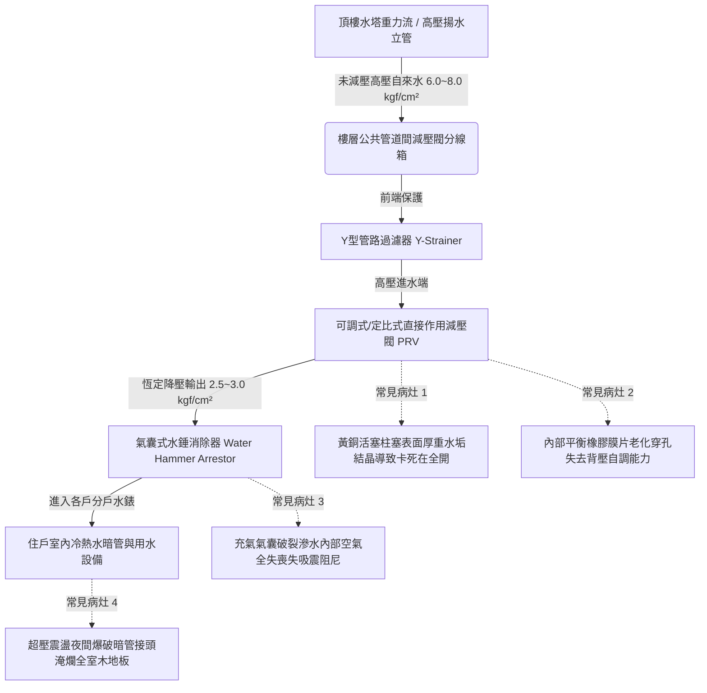

# 全案購屋實戰第四百八十二部：中古大樓社區各樓層生活給水垂直幹管減壓閥組閥芯水垢卡死超壓震盪水錘消除器氣囊破裂與低樓層水管爆裂體檢工序全書

## 壹、核心查驗宗旨與前言

現代十五層至三十層之中高樓層電梯大樓，其生活自來水供水系統多由頂樓蓄水塔或地下室高壓加壓泵浦經由「垂直給水立管（Riser Pipe）」向下重力輸送。依據水力靜水壓原理（每下降 10 公尺增加約 $1\text{ kgf/cm}^2$ 水壓），在缺乏降壓手段下，位於 1 樓至 6 樓之低樓層管道靜水壓將高達 $5.0 \sim 8.0\text{ kgf/cm}^2$ 以上。為防止過高水壓損毀住戶室內水龍頭、熱水器水箱、逆滲透 RO 濾殼及洗衣機進水電磁閥，大樓必須於中低樓層管道間配置「生活給水定比式或可調式減壓閥組（Pressure Reducing Valve, PRV）」及「隔膜式氣囊水錘消除器（Water Hammer Arrestor）」。

於二十年至三十年屋齡之中古電梯大樓中，因自來水管線長期輸送之碳酸鈣水垢結晶、管壁鐵鏽微粒沉積，減壓閥內部活塞（Piston）或膜片導向軸芯嚴重卡死，導致減壓功能完全失靈，產生「靜壓與動壓完全擊穿（Blow-by）」直通高壓；且配對之水錘消除器內部丁基橡膠氣囊（Butyl Bladder）早已疲勞破裂漏氣，整顆消除器灌滿死水。當高樓層或低樓層住戶突然關閉快開式陶瓷水龍頭瞬間，狂暴之反射水錘壓力波（高達 $12 \sim 18\text{ kgf/cm}^2$）無處吸收，低樓層室內冷熱水暗管接頭在夜間瞬間爆裂噴湧，造成數百萬元裝潢泡水、電梯井淹水及樓下鄰損之慘重浩劫。

本工序全書旨在建立標準化、數據化之減壓閥組與水錘消除器實體體檢工序，指導購屋家庭在實地檢驗目標物件（特別是 2 樓至 6 樓低樓層物件）及公共管道間時，精確量測動靜態水壓與消除器健康度，杜絕交屋後承受室內爆管淹水與高額賠償之深淵。

---

## 貳、低樓層給水減壓閥組與水錘消除器系統架構與物理病灶

### 一、減壓閥芯（Valve Spool）水垢碳化卡死與壓力擊穿
1. **碳酸鈣水垢結晶沉積機制**：減壓閥通常為直接作用膜片式或活塞式結構，內部閥芯柱塞與導向滑套之機械間隙僅數十微米。自來水中微溶之碳酸氫鈣在局部高流速與減壓節流摩擦熱下分解，析出堅硬之白色碳酸鈣結晶（Calcite Scale）。水垢顆粒卡在柱塞縫隙間，將閥芯死死卡在最大開啟位置。
2. **靜水壓完全擊穿（Static Pressure Creep）**：白天有住戶用水時，由於管流動態壓降，低樓層壓力錶可能暫時顯示在 $3.5\text{ kgf/cm}^2$。然而，深夜全大樓無人用水時，高壓水流沿卡阻之閥芯微縫持續滲透，住戶室內管網靜水壓在數小時內緩慢攀升至與立管相同的 $7.0 \sim 8.0\text{ kgf/cm}^2$ 之「頂部全壓」！老舊熱水器冷水進水軟管與塑膠三通瞬間在深夜承受極限超壓而爆開。

### 二、隔膜式水錘消除器（Water Hammer Arrestor）氣囊破裂失效
1. **橡膠氣囊微觀疲勞破裂**：水錘消除器內部採用丁基橡膠（Butyl Rubber）將不鏽鋼罐體分隔為「壓縮空氣腔」與「水流緩衝腔」。歷經二十餘年數萬次快開快關水龍頭之高頻強烈水錘震盪衝擊，氣囊橡膠分子鏈斷裂，在折疊彎曲處產生微小裂孔。
2. **水擊能完全喪失與剛性衝擊**：壓縮空氣自裂孔溶入自來水流失，消除器內部被不可壓縮之死水完全灌滿（Water-logged）。此時消除器完全喪失任何彈性蓄能作用，形同一截死鐵管。當陶瓷閥芯水龍頭在 0.1 秒內關閉時，回彈水波直接衝擊管壁，室內牆壁內部發出「咚！磅！」如同鐵鎚重擊之劇烈金屬震顫聲。

### 三、減壓閥組前置 Y 型過濾器（Strainer）堵塞與水流微弱
1. **不鏽鋼濾網泥沙鐵鏽淤塞**：減壓閥前方必須設置 40~60 目不鏽鋼 Y 型過濾器以保護精密閥芯。若大樓管委會從未拆卸排污清洗，濾網內部被大樓給水鍍鋅鋼管剝落之黃褐色氧化鐵皮（Iron Rust Flakes）與砂石完全糊死，導致水流斷面大幅受阻。
2. **假性水壓不足與誤判**：開單一水龍頭水壓尚可，但洗澡與廚房同時用水時水流瞬間縮減成涓滴細流，住戶常誤以為「大樓水壓不夠」而盲目加裝室內加壓馬達，反而加劇管路超壓爆管風險。

---

## 參、實地現場逐項體檢工序與精確量測指引

### 步驟一：管道間減壓閥組箱體外觀與壓力錶比對檢驗
1. **尋找該樓層減壓閥專用管道間**：
   - 位於梯廳或公共走廊之管道間金屬門（通常標註「給水管道間」或「減壓閥箱」）。
   - 檢視減壓閥組銘牌：確認閥體材質（應為耐脫鋅黃銅 DZR Brass 或不鏽鋼 SUS304/SUS316），標稱耐壓（PN16 或 PN20）。
2. **進出水雙甘油壓力錶即時讀數比對**：
   - 檢視減壓閥前後安裝之精密液體壓力錶：
     - **一次側（進水端高壓錶 $P_1$）**：讀數應反映垂直高程壓力（低樓層通常為 $5.0 \sim 8.0\text{ kgf/cm}^2$）。
     - **二次側（出水端降壓錶 $P_2$）**：標準設定值應落在 **$2.0 \sim 3.0\text{ kgf/cm}^2$** 之間。
     - **判定標準**：若二次側壓力錶讀數超過 **$4.0\text{ kgf/cm}^2$**，或出水端壓力幾乎等同進水端壓力，鐵證**減壓閥內部閥芯已卡死或膜片破裂完全失效**！

### 步驟二：目標戶室內靜態持壓與深夜超壓模擬量測
1. **分戶水龍頭甘油壓力錶靜態量測**：
   - 於目標看屋戶之廚房龍頭或陽台洗衣機水龍頭，裝上帶洩壓閥之指針式水壓測試錶。
   - 關閉室內所有用水設備，靜置觀察水壓錶指針 10~15 分鐘：
     - **合格標準**：指針必須穩固錨定於 $2.5 \pm 0.2\text{ kgf/cm}^2$。
     - **超壓爬升（Creep）判定**：若指針每隔數十秒緩慢微幅向上爬升，最終爬升至 $4.5 \sim 6.0\text{ kgf/cm}^2$ 以上，代表減壓閥閉合不嚴，存在致命之「深夜超壓爬升爆管隱患」！
2. **陶瓷快開水龍頭關閉水錘震盪實測**：
   - 全開面盆水龍頭，隨後以最快速度（$< 0.2$ 秒）猛烈將手柄向下按壓關閉。
   - 仔細聆聽管道間與室內牆壁內部聲響：
     - 正常狀態：僅有輕微水流截斷聲，水壓錶指針輕微抖動 $\le 0.5\text{ kgf/cm}^2$ 即回穩。
     - 消除器失效狀態：牆內發出清脆沉悶之「咚！碰！」金屬撞擊巨響，水壓錶指針瞬間暴衝彈跳超過 $8.0\text{ kgf/cm}^2$，代表水錘消除器氣囊已破裂灌滿死水。

### 步驟三：水錘消除器氣嘴物理按壓檢測
1. **氣囊完整性快速檢測法**：
   - 找到水錘消除器頂部之 Schrader 充氣閥嘴（附帶金屬或塑膠防塵蓋）。
   - 旋開防塵蓋，使用原子筆尖或細起子輕輕點壓氣門芯閥針（釋放極微量氣體）：
     - **合格判定**：瞬間噴出「乾燥高壓空氣」，證明內部氣囊彈性良好且有預充壓力（預充氣壓應為 $2.0 \sim 2.5\text{ kgf/cm}^2$）。
     - **破裂判定**：**若直接噴出液體水珠、水霧或大量黑水**，100% 證明內部橡膠氣囊已經破裂穿孔，整顆水錘消除器完全報廢，形同虛設！

---

## 肆、評估判定基準與瑕疵等級劃分

| 瑕疵等級 | 現場實測狀況與水壓數值 | 潛在隱患與公共安全危害 | 預估修繕工法與費用規模 |
| :--- | :--- | :--- | :--- |
| **輕度瑕疵 (A級)** | 二次側水壓穩定在 $2.5\text{ kgf/cm}^2$；無深夜壓力爬升；消除器氣嘴噴出乾燥空氣；快速關水無震響巨音。 | 減壓與防震機能健全優良，維持定期巡檢。 | 例行性拆卸 Y 型過濾器排砂除鏽、校對壓力錶，每樓層維保約 **1,000 ~ 2,000 元**。 |
| **中度瑕疵 (B級)** | 二次側水壓偏高（$3.8 \sim 4.5\text{ kgf/cm}^2$）；靜置時有輕微爬升現象（$< 5.0\text{ kgf/cm}^2$）；關水時牆內有輕度水錘震顫；消除器預充氣壓偏低。 | 閥芯微卡或橡膠膜片微硬化；長期震動容易引發熱水器安全閥（洩壓閥）滴水不止與暗管疲勞。 | 更換可調式減壓閥內部原廠閥芯維修包（Seal Kit）、重新充填氮氣至消除器，單組費用約 **6,000 ~ 12,000 元**。 |
| **重度瑕疵 (C級)** | 減壓閥完全擊穿失靈，出水壓力飆破 $6.0 \sim 8.0\text{ kgf/cm}^2$；水錘消除器氣嘴直接噴水（氣囊破裂）；猛烈關水時爆發鐵鎚重擊巨響！ | 致命爆管危機！隨時於深夜爆裂室內暗管或軟管，導致全家百萬裝潢泡湯滅頂，更面臨樓下鄰損巨額求償！ | 全面更換全不鏽鋼可調式直接作用減壓閥組、更換全新不鏽鋼隔膜式水錘消除器（充氮 2.5 bar），費用達 **18,000 ~ 35,000 元/戶**。 |

---

## 伍、買賣合約保障特約條款與談判折價策略

### 一、談判折價依據與議價話術
若買方在勘查目標物件（特別是低樓層 2~6 樓）時，發現室內水壓高達 $5.0\text{ kgf/cm}^2$ 以上、管道間減壓閥失效或水錘消除器氣嘴噴水，買方應當場錄影存證並嚴正向賣方主張重大結構安全權益：
> 「本買賣標的物位於大樓低樓層，經現場專業水壓實測，公共管道間之減壓閥組已完全失效擊穿，室內靜水壓高達 $6.5\text{ kgf/cm}^2$ 以上，且水錘消除器氣囊破裂噴水完全喪失吸震功能，關水時牆內水管劇烈撞擊震動。此屬於極度危險之管路超壓爆管隱患，一旦深夜水管接頭爆裂將造成全室裝潢泡水與數十萬鄰損賠償。請屋主就此重大管路安全缺陷，於成交總價中直接折讓新台幣 3 萬至 5 萬元修繕補償款，或由賣方委請合格甲級水電廠商於交屋日前更換全新不鏽鋼減壓閥組與隔膜水錘消除器，並出具完工壓力檢驗單（二次側水壓穩定於 $2.5\text{ kgf/cm}^2$）。」

### 二、成屋買賣契約專用法律特約條款（範本）

> **【不動產買賣契約書——大樓給水減壓閥組與水管防爆安全保證特約條款】**
>
> 1. **給水減壓與供水壓力安全標準承諾**：賣方保證本買賣標的物所屬之各樓層生活給水垂直幹管減壓閥組（包含減壓閥體、壓力錶、過濾器及水錘消除器），於交屋日前均處於正常調壓降壓之堪用狀態。點交驗收時，本房屋室內所有水龍頭關閉狀態下之靜水壓，二次側壓力必須恆定維持在 2.0 至 3.0 kgf/cm² 之間，絕無因閥芯卡死引致之深夜超壓爬升（超過 3.5 kgf/cm²）情事。
> 2. **水錘消除器機能完好保證**：賣方保證所屬之水錘消除器內部隔膜氣囊完整充氣，無穿孔滲漏死水現象，室內快速開關水龍頭時，管路內部無金屬撞擊巨響與劇烈震盪水錘。
> 3. **室內爆管滲漏瑕疵擔保責任約定**：若交屋點交時，實測出水壓力超過 3.5 kgf/cm² 或減壓閥故障，賣方應負責於交屋日前自費完成更換修復；若交屋後六個月內，因交屋前已存在之減壓閥組失效超壓或水錘衝擊，引發本房屋室內暗管或進水設備破裂漏水致裝潢損壞者，賣方同意負擔全部室內修繕與第三人損害賠償責任，買方得憑實際支出單據向賣方追討。
