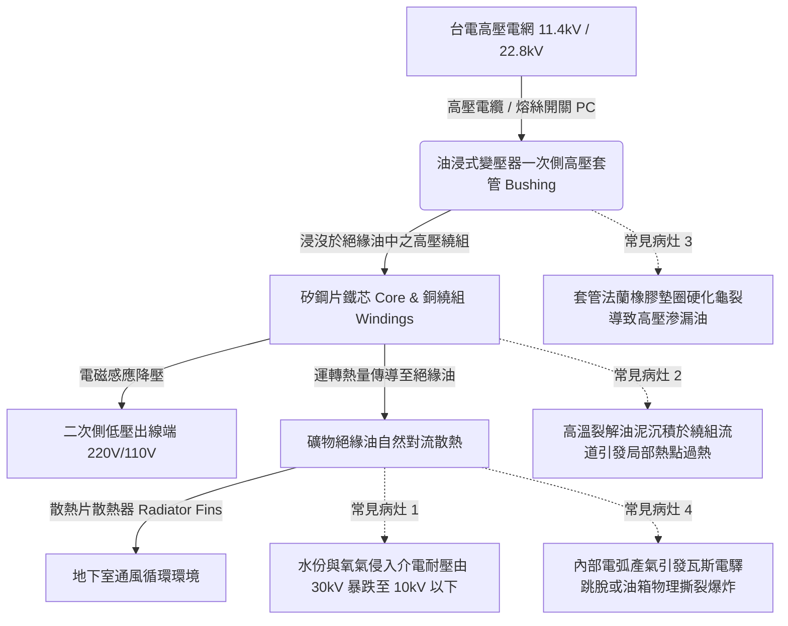

# 全案購屋實戰第四百八十八部：中古大樓社區地下室變電室油浸式變壓器絕緣油耐壓劣化油泥碳化PCB多氯聯苯殘留油封滲漏與高溫爆炸體檢工序全書

## 壹、核心查驗宗旨與前言

大樓地下室受電變電室（Substation Room）內配置之電力變壓器（Power Transformers），係將台灣電力公司 11.4kV 或 22.8kV 高壓交流電，降壓轉換為社區住戶生活所需之 380V/220V（動力公設用）及 220V/110V（單相三線住戶用）之大樓總電氣中樞心臟。早期（民國八十至九十年代）中古電梯大樓多廣泛採用「油浸式變壓器（Oil-immersed Transformer）」，利用絕緣油（Mineral Insulating Oil）充填於密閉鋼槽內兼具高壓絕緣與循環導熱冷卻雙重機能。

於二十年至三十年屋齡之中古電梯大樓中，因長年處於高溫封閉地下室、高負載運轉與交變電磁應力衝擊，絕緣油普遍存在「水分侵入介電耐壓擊穿強度暴跌」、「局部放電（Partial Discharge）致油分子裂解碳化產生沉積油泥」、「丁腈橡膠油封（NBR Gaskets）老化硬化滲油」、更隱蔽者為「早期歷史遺留劇毒致癌物多氯聯苯（PCB）殘留超標」等重大致命暗礁。一旦變壓器內部繞組絕緣破壞引發匝間短路電弧，密閉油箱內部壓力在數毫秒內急遽飆升破千千帕，瞬間引發毀滅性「變壓器高溫爆炸與烈火焚燒」，濃烈劇毒濃煙沿垂直管道間直灌各樓層，全棟斷電癱瘓，釀成無法挽回之重大傷亡浩劫。

本工序全書旨在建立標準化、專業化之地下室油浸式變壓器實體外觀、絕緣油劣化分析與熱成像體檢工序，指導購屋家庭在實地檢驗大樓受電室公設時，精準查核變壓器之防爆安全性、絕緣壽命與歷史維保記錄，防範交屋後承擔數十萬至百萬元變壓器吊裝更新公攤費用與致命電氣火災風險。

---

## 貳、油浸式變壓器核心架構與常見物理電氣病灶

### 一、絕緣油介電擊穿強度（Dielectric Breakdown Voltage）劣化機制
1. **水份侵入與微觀極化擊穿**：標準新礦物絕緣油依據 CNS 1326 / ASTM D877 標準，其工頻介電擊穿耐壓強度必須 $\ge 30\text{ kV}$。地下室潮濕水氣透過老化之呼吸器（Silica Gel Breather）或法蘭油封縫隙滲入油箱。水分子具極高介電常數，在高壓電場作用下，懸浮微水滴與纖維雜質沿電場線排列成「雜質導電橋（Conductive Bridge）」，絕緣油耐壓強度在短短數年間暴跌至 $12\text{ kV}$ 以下，隨時可能在雷擊突波或開關操作過電壓下被電弧直接擊穿。
2. **酸價升高與化學氧化**：在高溫（繞組溫度達 70°C~90°C）與銅金屬催化下，絕緣油與空氣中的氧氣發生自催化氧化反應，生成有機酸、過氧化物及極性沉澱物。酸價（Neutralization Number）由 $< 0.03\text{ mg KOH/g}$ 飆升至 $0.4\text{ mg KOH/g}$ 以上，酸性油液進一步腐蝕絕緣紙與銅排，使纖維素絕緣紙聚合度（DP 值）急遽下降脆化。

### 二、油泥（Sludge）沉積與高溫散熱死循環
1. **油泥沉積包覆繞組**：氧化反應後期生成高分子聚合物及瀝青狀油泥。油泥附著於矽鋼片表面及繞組線圈散熱流道內壁，形成一層低熱傳導係數之保溫層（油泥熱阻為銅之數百倍）。
2. **熱點溫度失控（Thermal Runaway）**：散熱受阻引致鐵芯內部局部熱點（Hot Spot）溫度衝破 130°C 以上，高溫又反過來加速絕緣油裂解碳化，析出更多油泥，陷入致命「過熱 $\rightarrow$ 油泥 $\rightarrow$ 更熱」之熱失控死循環，直至絕緣紙炭化穿孔引發相間金屬短路。

### 三、橡膠油封硬化與變壓器滲漏油危機
1. **NBR 橡膠高溫硫化硬化**：套管法蘭、油箱上蓋、油位計、洩油閥等銜接部位多採用丁腈橡膠（NBR）或軟木橡膠墊圈密封。在長達二十年浸油與 60°C~80°C 連續烘烤下，增塑劑完全析出，墊圈硬化脆裂如硬塑膠，失去彈性恢復力。
2. **油位見底引發套管沿面閃絡**：滲漏之絕緣油滴落於變壓器基座及防溢油槽（Sump）。油位逐漸降至安全標線以下，使套管下部金屬帶電體露出油面、暴露於空氣中。在地下室高濕環境下，高壓端子瞬間發生「空氣沿面放電閃絡（Surface Flashover）」，激發猛烈金屬電弧火花。

### 四、歷史毒物 PCB（多氯聯苯）殘留與法規列管
1. **PCB 劇毒致癌背景**：民國六十八年以前生產之早期電容器與特殊變壓器曾廣泛使用不燃性多氯聯苯（PCB）作為絕緣液。後因發生米糠油中毒事件遭環保署全面列管禁止使用。
2. **歷史污染檢驗責任**：依行政院環保署毒性及關注化學物質管理法規，老舊油浸式變壓器油樣必須進行氣相層析儀（GC-ECD）檢驗，其 PCB 含量**絕對不得超過 50 ppm**（嚴格管制標準為不得檢出）。若大樓仍殘留 PCB 變壓器，一旦洩漏或報廢，將面臨數十萬元環保重罰及極度昂貴之甲級有害事業廢棄物高溫焚化清運成本（每台清運處理費高達數十萬元）。

---

## 參、實地現場逐項體檢工序與精確檢測指引

### 步驟一：變電室環境與變壓器外觀靜態檢驗（嚴格遵守高壓安全距離）
> [!CAUTION]
> **高壓電弧防護警告**：變電室內部存在 11.4kV/22.8kV 高壓帶電設備，實地檢驗**必須由社區專任電氣技術人員（主任電氣技術人員）陪同**，檢驗人員必須穿戴絕緣鞋，**絕對嚴禁跨越黃色安全警戒線**，嚴禁以手或導電工具觸碰變壓器本體及任何裸露端子！

1. **防溢油槽（Oil Containment Sump）與油漬檢驗**：
   - 檢視變壓器底座下方是否依消防及建築法規設置高出地面 10 公分之「擋油堰」或集油槽。
   - 使用手電筒檢視變壓器鋼構基座與周邊地坪：地面應乾燥潔淨；若地坪積滿黃褐色黏稠絕緣油、或油槽內有大量陳年發黑油污，鐵證**變壓器法蘭油封已嚴重滲漏**！
2. **油位計（Oil Level Gauge）視窗檢驗**：
   - 在安全距離外，使用強光手電筒照射變壓器側壁之玻璃管或指針式油位計。
   - **判定標準**：在常溫（約 20°C~30°C）待機狀態下，油位必須精確位於標示之「常溫刻度線（NORMAL / 25°C）」之間。若油位指針已跌落至「最低極限標線（LOW / MIN）」以下，代表油量嚴重短缺，隨時有冷卻不足與內部閃絡爆裂之致命危險！
3. **矽膠呼吸器（Dehydrating Breather）乾燥劑顏色檢測**：
   - 檢視變壓器頂部外接之吸濕呼吸器透明玻璃盅。
   - 觀察內部矽膠乾燥劑顆粒顏色：
     - **健康乾燥狀態**：應呈現**鮮艷藍色**（或新型橙色）。
     - **吸濕飽和失效狀態**：若乾燥劑已轉變為**淡粉紅色、乳白色或黑褐色**，代表乾燥劑早已吸水飽和完全失效，大氣中的潮濕水氣正長驅直入油箱內部，導致絕緣油急遽劣化。

### 步驟二：紅外線熱成像儀（Thermal Imager）動態負載溫升量測
1. **箱體表面與散熱散熱片溫度分佈檢測**：
   - 在社區尖峰用電時段（例如晚間 19:00~21:00 住戶大量開冷氣時）。
   - 使用工業級紅外線熱像儀（解析度 $\ge 160\times 120$）對準變壓器油箱主體及散熱片進行全景掃描。
   - **判定標準**：
     - 油箱上部溫度通常高於下部，熱對流梯度應平緩均勻。
     - 正常滿載運轉下，變壓器頂部最高油溫（Top Oil Temp）不得超過 **65°C**（溫升不得超過 55°C）。若局部散熱管路溫度異常冰冷，代表該散熱管內部已遭沉積油泥完全堵死，失去了循環散熱功能。
2. **高低壓套管接線端子接點熱斑（Hot Spot）排查**：
   - 使用熱像儀對準一次側高壓套管及二次側低壓銅排鎖固螺栓接頭。
   - 檢查三相接點之間是否有顯著溫差：
     - **三相溫差安全極限**：各相接點溫差應 $\le 5^\circ\text{C}$。
     - 若某一相端子接點溫度飆高超過 **$90^\circ\text{C}$**，且與其他兩相溫差超過 **$15^\circ\text{C}$**，判定為「嚴重接觸不良電氣熱斑」，隨時可能引發端子融焊發弧或火災！

### 步驟三：調閱管委會法定電氣檢驗報告與油質分析數據
1. **主任電氣技術人員申報紀錄核實**：
   - 依電業法及《用戶用電設備檢驗維護辦法》，大樓每年必須由登記合格之電氣檢驗維護業出具「用電設備定期檢驗報告表」。
   - 核對報告中變壓器項目：
     - **繞組絕緣電阻（Megger 測試）**：一次側對二次側及對地絕緣電阻在 1000V/2500V 測試下，必須 $\ge 100\text{ M}\Omega$。
2. **絕緣油耐壓試驗（Dielectric Test）數據查核**：
   - 查驗最近三年之「絕緣油油質試驗分析報告」：
     - **擊穿耐壓（Breakdown Voltage）**：必須 $\ge 25\text{ kV}$（合格底線為 $20\text{ kV}$）。若報告數值低於 $15\text{ kV}$ 且未見更換絕緣油單據，代表系統正帶病冒險運轉。
     - **PCB 檢測合格證明**：確認報告載明「多氯聯苯含量未檢出或 $< 50\text{ ppm}$」。

---

## 肆、評估判定基準與瑕疵等級劃分

| 瑕疵等級 | 現場實測狀況與油質電氣數值 | 潛在隱患與公共安全危害 | 預估修繕工法與費用規模 |
| :--- | :--- | :--- | :--- |
| **輕度瑕疵 (A級)** | 油位處於正常刻度；無滲漏油痕跡；呼吸器矽膠呈現鮮艷藍色；熱像儀溫升正常（最高油溫 $\le 55^\circ\text{C}$）；絕緣油耐壓 $\ge 30\text{ kV}$。 | 變壓器機能健全優良，維持例行性高低壓維護巡檢。 | 定期取樣化驗油質、烘烤或更換吸濕呼吸器矽膠，每年度維護費用約 **2,000 ~ 5,000 元/台**。 |
| **中度瑕疵 (B級)** | 法蘭接縫處有輕微油漬滲漏；呼吸器矽膠已變淡粉紅；絕緣油耐壓介於 $15 \sim 22\text{ kV}$；熱像儀測得接線端子溫差 5~10°C。 | 絕緣油開始吸濕水解，散熱效率減退；端子氧化增溫，隨時有局部放電短路風險。 | 安排社區停電計畫，執行現場高壓濾油真空脫水脫氣工程、更換全套耐油法蘭墊圈，費用約 **35,000 ~ 75,000 元/台**。 |
| **重度瑕疵 (C級)** | 油位跌破下限刻度；油箱底部大量積油漏成水塘；絕緣油耐壓 $< 12\text{ kV}$（油質酸化嚴重）；端子熱斑突破 $95^\circ\text{C}$；甚至檢出 PCB 超標！ | 致命毀滅性風險！內部隨時發生匝間短路電弧引發高溫爆裂大火，全棟大停電癱瘓；PCB 污染面臨環保天價重罰！ | 全面吊裝淘汰油浸式變壓器，改裝更換全新一級能效低噪音「乾式澆鑄型變壓器（Cast Resin Transformer）」，工程費用達 **25萬 ~ 60萬元以上/台**。 |

---

## 伍、買賣合約保障特約條款與談判折價策略

### 一、談判折價依據與議價話術
若買方在勘查地下室變電室時，發現變壓器油位見底、周邊嚴重滲油積垢、呼吸器變色發霉、或調閱管委會報告發現絕緣油耐壓嚴重不足且數十年未曾濾油更換，買方應當場拍照記錄並嚴正向賣方主張重大公共安全瑕疵：
> 「本買賣標的物所屬社區大樓地下室受電室之高壓油浸式變壓器，現場已出現嚴重滲漏油痕跡，油位嚴重偏低，且呼吸器完全失效受潮，絕緣油介電強度已有嚴重擊穿爆炸隱憂。高壓變壓器為全棟供電心臟，一旦內部電弧擊穿爆炸，全社區將面臨數日全黑斷電、電梯停擺，且重型變壓器吊裝更新或更換乾式變壓器需耗費百萬元以上之全棟專案大額公攤。請賣方就此涉及全棟電氣安全與鉅額維護之重大公設隱患，於買賣成交總價中直接折讓新台幣 3 萬至 6 萬元之公設電氣修繕準備金，或由賣方督促管委會於交屋日前委請特約主任電氣技術人員完成變壓器真空濾油、油封更換並出具經濟部檢驗合格試驗報告。」

### 二、成屋買賣契約專用法律特約條款（範本）

> **【不動產買賣契約書——大樓地下室受電室高壓變壓器電氣安全保證特約條款】**
>
> 1. **變壓器高壓設備法定合格保證**：賣方保證本買賣標的物所屬社區大樓地下室受電室之油浸式變壓器（包含高低壓套管、油箱冷卻片、油位計及呼吸器），於交屋日前均處於符合經濟部《用戶用電設備檢驗維護辦法》之安全堪用狀態，油位充足正常，無結構性嚴重滲漏油，且最近一期年度電氣技術人員定期檢驗項目均列為「合格」無列管缺失。
> 2. **絕緣油耐壓安全標準承諾**：賣方保證變壓器內部之礦物絕緣油介電擊穿耐壓強度符合法定安全規範（耐壓強度不得低於 20kV），且無多氯聯苯（PCB）超標殘留（符合環保署管制標準），無內部高溫放電或瓦斯產氣之爆炸危險。
> 3. **公攤更換大修費用免責追索約定**：若於交屋日起一年內，因交屋前已存在之變壓器絕緣油嚴重劣化擊穿、油箱滲漏燒毀或環保法規強制淘汰老舊油浸式變壓器，經區分所有權人會議決議開徵全棟受電室變壓器吊裝更新專案特別公攤款者，賣方同意按其持有房屋產權期間比例無條件承擔該筆公攤費用，買方得憑繳款通知單向賣方全額追討。
