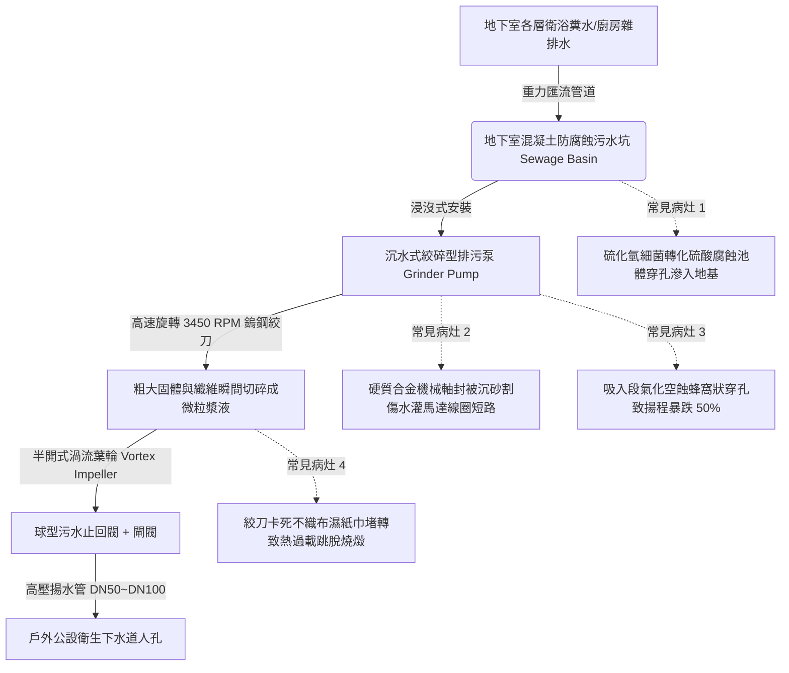

# 全案購屋實戰第四百八十四部：中古大樓社區地下室生活污水下水道用戶接管沉水式絞碎型排污泵浦氣化空蝕機械軸封砂石刮傷與化糞池槽體酸化滲漏體檢工序全書

## 壹、核心查驗宗旨與前言

大樓地下室生活污水下水道接管工程中，對於標高低於室外市政下水道幹管之地下室各樓層廁所、垃圾冷藏室及地坪排水，無法依靠重力自然流出，必須匯集於地下室最低處之「污水收集槽（Sewage Sump Basin）」或「既有化糞池改裝之污水坑」，並依靠重型「沉水式絞碎型排污泵浦（Submersible Grinder Sewage Pumps）」將含有衛生紙、糞便及纖維雜質之污水強制絞碎加壓，透過垂直揚程幹管打入市政污水下水道。

於二十年至三十年屋齡之中古電梯大樓中，因長年浸泡於 pH 值 4.5~5.5 之強酸性、含硫化氫腐蝕環境中，未改管之化糞池或污水槽鋼筋混凝土結構普遍產生「混凝土酸化剝落與鋼筋銹蝕穿孔」，引發地下污水滲漏淘空地基；且沉水式排污泵之高硬度鎢鋼旋轉絞刀（Tungsten Carbide Cutter）鈍化缺角、硬質合金機械軸封（Mechanical Seal）被細沙割破進水燒毀、泵浦吸入口流道因有效汽蝕餘量（NPSHa）不足產生劇烈「氣化空蝕（Cavitation）」。一旦污水泵損毀停擺，黑臭糞水在數小時內漫過污水槽頂蓋，淹沒地下室停車場並沿電梯井逆流，造成高達數十萬元之機電毀損與極度可怕之環境衛生浩劫。

本工序全書旨在建立標準化、專業化之沉水式絞碎型排污泵與污水槽體實體體檢工序，指導購屋家庭在實地檢驗地下室機電衛生設施時，精準查核排污動力核心之磨損度、氣密性與槽體耐腐蝕壽命，杜絕交屋後陷入高額修繕公攤與地下室糞水漫溢之夢魘。

---

## 貳、沉水式絞碎排污泵浦與污水槽體架構與物理病灶

### 一、鎢鋼絞刀機構磨耗鈍化與纖維纏繞卡死
1. **剪切絞碎動力學（Grinder Mechanism）**：絞碎型排污泵在葉輪吸入口前端配備由高鉻鋼或碳化鎢（Tungsten Carbide）鑄造之「旋轉動刀（Rotating Cutter）」與「固定剪切環（Stationary Shredder Ring）」，兩者配合間隙僅為 0.05mm~0.1mm，以 2 極高速馬達（約 3450 RPM）實現每秒數千次之剪切。
2. **現代濕紙巾與纖維纏繞死機**：現代家庭大量使用之不織布濕紙巾（Wet Wipes）、衛生棉條及口罩，其合成纖維抗拉強度極高。當絞刀刃口歷經十年使用磨損變鈍、配合間隙擴大至 0.3mm 以上時，纖維物質無法被利落切斷，反而緊密絞結纏繞於刀軸與機械密封護套外圍，阻力瞬間超越馬達額定扭矩，引發堵轉（Locked Rotor）。馬達線圈電流暴衝 6 倍，若控制盤無熔絲開關或熱動過載電驛（O/L）未即刻跳脫，線圈將在數分鐘內燒成焦炭。

### 二、機械軸封（Mechanical Seal）進水與油室（Oil Chamber）乳化
1. **雙端面碳化矽/碳化鎢軸封保護**：沉水馬達依靠位於馬達室與泵殼之間的「潤滑油室」及雙組機械軸封隔絕高壓污水。
2. **石英微砂刮傷與絕緣阻抗崩潰**：生活污水中含有住戶沖洗地坪、蔬菜洗滌殘留之石英砂粒。微小砂粒在渦流帶動下侵入下端面機械密封鏡面，形成深度刮痕（Grooving）。高壓污水滲透進入潤滑油室，使 ISO VG 32 冷卻絕緣油水解乳化發白；隨著水份進一步突破上端面軸封進入乾式馬達腔，馬達定子線圈之絕緣電阻自標準之 $> 100\text{ M}\Omega$ 暴跌至 $0\text{ M}\Omega$，引發瞬間漏電跳掣甚至馬達外殼帶電之致命工安危險。

### 三、低水位氣化空蝕（Cavitation）與葉輪穿孔
1. **有效汽蝕餘量不足**：為防止污水坑長年積存糞便發酵惡臭，控制盤通常將浮球停止水位設定在較低標高。當液位降至泵體上半部裸露於空氣中時，泵浦吸入口之淹沒深度過淺（Submergence Depth 不足），在吸入口水流表面形成高速「吸入旋渦（Intake Vortex）」，將空氣強烈吸入泵腔內。
2. **微射流空蝕蜂窩破壞**：氣液混合流進入渦流葉輪高壓區時，無數氣泡在數微秒內猛烈閉合破裂，產生局部超過 $1000\text{ MPa}$ 之強烈微衝擊波。鑄鐵或不鏽鋼葉輪葉片表面金屬被反覆疲勞剝蝕，形成密密麻麻之蜂窩狀穿孔（Spongy Cavitation Erosion），泵浦揚程與出水量劇烈暴跌 50% 以上，伴隨如開水沸騰及碎石撞擊之震耳雜音。

### 四、化糞池/污水坑池體酸化與結構性滲漏
1. **硫酸鹽微生物化學侵蝕（Microbiologically Induced Corrosion, MIC）**：密閉污水坑內部厭氧環境中，硫酸鹽還原菌（SRB）將污水中的硫化物轉化為硫化氫（H₂S）氣體。硫化氫在池頂潮濕無水表面被硫氧化菌（Thiobacillus）進一步氧化生成高濃度「硫酸（H₂SO₄）」。
2. **混凝土鈣質溶出與掏空**：強酸腐蝕混凝土表面之水化矽酸鈣（C-S-H 膠體），生成鬆散脆弱之石膏（Gypsum）與鈣礬石，混凝土保護層在數年間被層層剝蝕化為爛泥，內部鋼筋骨架裸露鏽爛。污水透過結構性腐蝕孔洞長年向外滲漏，嚴重污染地下水層並掏空大樓基礎地盤。

---

## 參、實地現場逐項體檢工序與精確量測指引

### 步驟一：污水坑人孔蓋與槽體結構外觀檢驗
1. **人孔蓋氣密性與外殼腐蝕檢驗**：
   - 檢視地下室污水坑或改裝化糞池之檢修人孔蓋（應採用附橡膠氣密條之防臭防爆球墨鑄鐵人孔蓋）。
   - 檢查蓋板邊緣是否有黃褐色污漬外溢、螺栓是否鏽死脫落、周圍空氣是否有濃烈刺鼻之阿摩尼亞或硫化氫惡臭。
2. **通氣管道配置檢驗**：
   - 檢視污水坑頂部是否具備獨立配置之「DN80 以上排氣管」，且該管路必須獨立拉至大樓頂樓戶外排氣，嚴禁將排氣管直接開口於地下室室內！

### 步驟二：沉水式排污泵手動強制運轉與電氣絕緣量測（需機電人員配合）
1. **控制箱電氣絕緣電阻精密量測（高阻計量測）**：
   - 在斷電狀態下，使用 500V 數位高阻計（Megger）量測馬達動力電纜 U/V/W 三相對地（GND）之絕緣電阻：
     - **合格標準**：絕緣電阻值應 $\ge 20\text{ M}\Omega$。
     - **受潮進水判定**：若測得數值低於 **$2\text{ M}\Omega$**，代表機械軸封已經漏水、馬達內部受潮，隨時可能在運轉中短路跳脫。
2. **手動啟動運轉與運轉電流實測（勾錶量測）**：
   - 將控制箱撥至「手動（MANUAL）」運轉 10~15 秒，使用交流數位鉤錶（Clamp Meter）測量運轉運轉電流：
     - 實測運轉電流不得超過馬達銘牌額定滿載電流（FLA）之 **1.1 倍**。若空載運轉電流即已接近或超過額定電流，代表鎢鋼絞刀已被纖維卡阻或軸承磨損嚴重。
   - **聆聽運轉聲響**：正常運轉聲音應為均勻沉悶之水流旋轉聲；若有劇烈尖叫摩擦聲、金屬碎裂聲或強烈機體震動，代表葉輪氣蝕穿孔或軸承碎裂。

### 步驟三：沉砂池淤積度與止回閥防倒灌實測
1. **沉砂淤泥厚度探測**：
   - 開啟人孔蓋，使用長量水尺探入污水坑底。
   - 測量坑底固體硬沉砂與油脂厚度：
     - **標準規範**：沉泥厚度不得掩沒泵浦吸水口（通常離底應保留至少 30 公分淨空）。若測得硬泥厚度超過 40 公分，代表已數年未進行沉水抽泥清淤，極易引發泵浦氣蝕。
2. **污水球型止回閥（Ball Check Valve）動作檢驗**：
   - 觀察揚水出水立管上安裝之球型止回閥。
   - 停泵瞬間：止回閥必須能發出沉穩之「碰」一聲完全閉合，出水管上方水流不得回灌反沖。若停泵後水流持續反向狂瀉回池內，代表閥內橡膠球卡死或磨損，每次抽出的污水全數倒流，引發泵浦頻繁起停空轉。

---

## 肆、評估判定基準與瑕疵等級劃分

| 瑕疵等級 | 現場實測狀況與機械電氣數值 | 潛在隱患與公共衛生危害 | 預估修繕工法與費用規模 |
| :--- | :--- | :--- | :--- |
| **輕度瑕疵 (A級)** | 絕緣電阻 $\ge 20\text{ M}\Omega$；絞刀剪切有力無異音；人孔蓋氣密良好無臭味；止回閥閉合俐落；坑底沉砂厚度 $\le 10\text{cm}$。 | 系統健全優良，維持定期保養巡檢。 | 例行性定期撈除浮渣、清理液位浮球油泥，每半年保養約 **2,000 ~ 4,000 元**。 |
| **中度瑕疵 (B級)** | 絕緣電阻偏低（$2 \sim 5\text{ M}\Omega$）；運轉電流偏高（達額定值 95%）；絞刀刃口磨損微鈍有少量纖維纏繞；人孔蓋邊緣有輕微惡臭逸出。 | 軸封已有輕微滲水跡象，絞碎能力退化；遇大量濕紙巾極易引發堵轉跳掣燒馬達。 | 吊出泵浦更換碳化矽機械軸封、研磨或更換鎢鋼旋轉絞刀、重新加注絕緣潤滑油，單台費用約 **12,000 ~ 25,000 元**。 |
| **重度瑕疵 (C級)** | 馬達絕緣電阻歸零（$< 0.5\text{ M}\Omega$）；絞刀卡死堵轉；池體混凝土嚴重酸化掏空滲漏；止回閥完全失效；黑臭糞水溢流淹沒地下室！ | 致命毀滅性風險！地下室糞水漫溢造成全棟機電設備與車輛毀滅性污染；地盤淘空引致大樓下陷傾斜！ | 槽體高壓清洗抽乾、環氧砂漿抗酸防蝕重塗、全面換新雙台重型絞碎型沉水排污泵（2HP~5HP）、更新球型止回閥，費用達 **12萬 ~ 28萬元以上**。 |

---

## 伍、買賣合約保障特約條款與談判折價策略

### 一、談判折價依據與議價話術
若買方在勘查地下室公設環境時，發現污水坑周邊臭氣熏天、人孔蓋溢出污泥、或排污泵浦運轉劇烈尖叫抖動且電流過載，買方應當場錄影存證並嚴正向賣方主張重大公共衛生瑕疵：
> 「本買賣標的物所屬社區大樓地下室之生活污水下水道沉水式排污泵浦機組，其鎢鋼絞刀已磨損卡滯，馬達絕緣電阻嚴重衰退有漏電燒毀隱憂，且污水槽周邊散發強烈硫化氫惡臭，顯示池體防腐蝕防水層已酸化劣化。沉水排污系統為地下室不淹水之唯一排泄心臟，一旦故障停擺，整座地下室停車場將在數小時內被黑臭糞水滅頂淹沒，更換絞碎泵浦及槽體除鏽防腐費用高昂。請賣方於成交總價中實質折讓新台幣 3 萬至 6 萬元之公設排污修繕補貼款，或由賣方督促管委會於交屋日前委請專業合格廠商完成排污泵更換檢修、污水槽清淤防漏並出具合格保固驗收單據。」

### 二、成屋買賣契約專用法律特約條款（範本）

> **【不動產買賣契約書——大樓地下室污水下水道排污泵浦與衛生安全保證特約條款】**
>
> 1. **沉水排污泵浦運轉與絞碎機能保證**：賣方保證本買賣標的物所屬社區大樓地下室之生活污水排污坑、沉水式絞碎型排污泵浦機組、球型止回閥及液位控制電驛，於交屋日前均處於正常運轉、絞碎剪切功能順暢、絕緣電阻符合安全標準（$\ge 5\text{ M}\Omega$）且雙泵能自動輪替切換之良好堪用狀態。
> 2. **污水槽體結構密閉與無滲漏承諾**：賣方保證地下室污水坑槽體結構完整，無混凝土酸化剝落、無污水滲漏掏空地基土壤情事，人孔蓋緊密閉合無刺鼻惡臭外洩，通氣管確實獨立導向頂樓戶外排放。
> 3. **公攤更換大修費用責任追索約定**：若於交屋日起六個月內，因交屋前已存在之沉水排污泵浦燒毀、鎢鋼絞刀組全面卡死損壞或污水坑槽體重大破裂滲漏，經區分所有權人會議決議開徵全棟污水設備汰換或槽體結構修繕專案特別公攤款者，賣方同意按其持有房屋產權期間比例無條件全額負擔該筆公攤費用，買方得憑繳款通知單向賣方全額追討。
