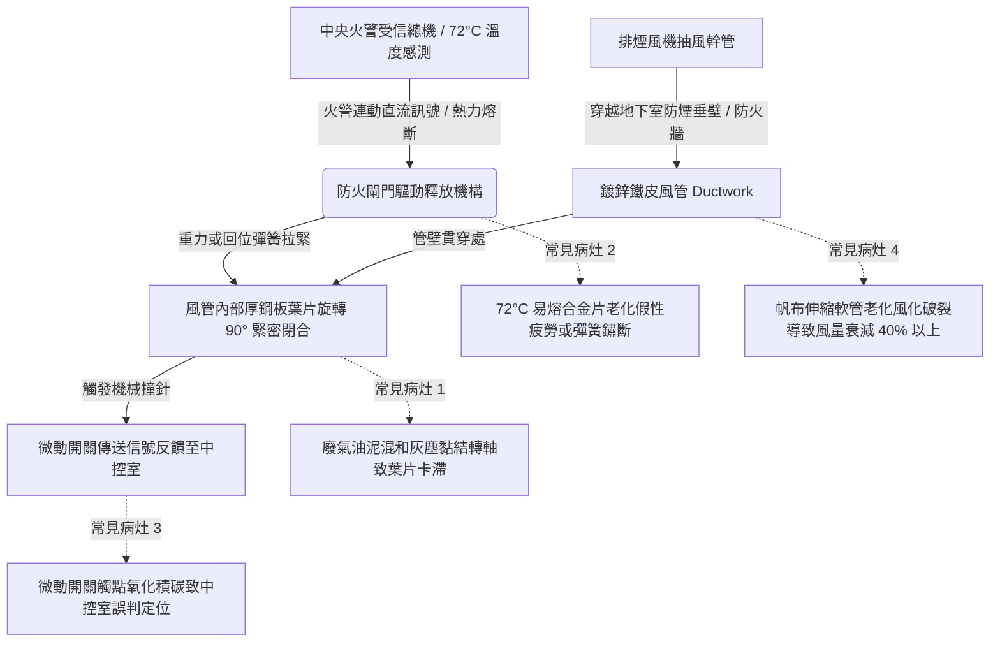

# 全案購屋實戰第四百六十七部：中古大樓社區地下室機械通風防排煙風管防火閘門熔斷手動復位卡死微動開關定位失效與風量衰減體檢工序全書

## 壹、核心查驗宗旨與前言

大樓地下室停車場與避難走廊之機械通風及防排煙系統，為火災發生時保障住戶避難逃生、排出濃煙與一氧化碳，以及防止高溫火勢沿通風管路跨防火區劃延燒之第一道防線。防火閘門（Fire Damper, FD）與防排煙閘門（Smoke Damper, SD）安裝於風管貫穿各防火區劃牆體處，平時維持常開通風，火災時利用 72°C~280°C 熔斷片（Fusible Link）熔斷或接收火警信號自動緊密關閉。

於二十年至三十年屋齡之中古電梯大樓中，因地下室潮濕、車輛廢氣重油沉積及長期缺乏潤滑檢驗，普遍存在「閘門轉軸鏽死無法關閉」、「熔斷聯動機構卡滯」、「手動復位桿脫齒」以及「關閉狀態回授微動開關（Micro Switch）氧化失效」等重大隱患。一旦失火，濃煙與劇毒氣體將沿風管直灌各棟梯廳與逃生安全梯，釀成重大傷亡；管委會亦面臨消防安檢嚴重不合格與強制開罰。

本工序全書旨在建立標準化實地查驗步驟，指導購屋家庭精準辨識地下室通風防排煙設施之維護真實現況，保障生命安全並杜絕鉅額公攤修繕風險。

---

## 貳、地下室防排煙風管與防火閘門系統核心架構與常見物理病灶

### 一、高溫熔斷合金機構與重力/彈簧閉合故障
1. **易熔合金片（Fusible Link）物理老化機制**：閘門平時藉由標稱 72°C（一般通風）或 280°C（廚房及排煙）之低熔點合金片拉緊內部扭力彈簧。長年承受排風震動與地下室高溫高濕，合金結構晶格產生潛變（Creep），可能導致「非火警狀態假性斷裂關閉」或「高溫火災時金屬氧化延遲熔斷」。
2. **葉片轉軸（Axle Pivot）油泥咬死**：地下室常年匯集汽車未充分燃燒之碳氫化合物廢氣，油煙附著於風管內部鍍鋅鋼板葉片與黃銅襯套（Brass Bushing），與環境粉塵結合成高黏度硬化油泥，阻礙葉片自由旋轉，導致熔斷後葉片卡在半開半閉狀態（30°~60°），防火防煙完全失效。

### 二、手動復位齒輪箱脫齒與卡阻
1. **連桿機構機械卡死**：手動復位閘門外部設有手動操作把柄或復位鏈條。常因長期無人維保操作，連動齒輪、偏心棘輪及拉伸彈簧氧化生鏽，現場進行「手動拉開測試」時往往產生齒輪滑牙（Stripping）、棘爪無法咬合或連桿彎曲變形。
2. **閉合密封墊片硬化龜裂**：高等級防煙防火閘門葉片周緣設有膨脹石墨或矽膠密封條。逾二十年大樓之橡膠氣密條多已硬化粉化脫落，閉合時縫隙過大，漏煙量大幅超標。

### 三、微動開關（Micro Switch）定位反饋失效與風量衰減
1. **電氣反饋訊號阻斷**：閘門軸心旁裝設 IP54 級微動開關，用於在閘門關閉時切斷通風機電源或向消防總機回報「閘門已就位關閉」。此開關內部銀合金接點長期暴露於硫化氣體環境中氧化黑化，阻抗自 0.1Ω 飆升至兆歐級，造成中央監控面板恆常顯示「故障」或「假定位」。
2. **風管接頭漏風與帆布軟管風化**：風管每節法蘭接頭之密封泥條乾裂，特別是排煙風機出風口與風管銜接之「防震防火帆布軟管（Canvas Flexible Duct）」，歷經長期高壓震盪多已脆裂穿孔，導致排煙有效吸力風量衰減 30%~50%，排煙馬達空轉卻抽不出地下室廢氣與煙霧。

---

## 參、現場實地逐項體檢工序與操作指引

### 步驟一：外觀目視與防煙區劃貫穿面檢驗
1. **管壁貫穿處填塞檢查**：檢視地下室風管穿越防火牆、梁柱或防煙垂壁處之縫隙，確認是否使用通過 CNS 14514 / UL 1479 標準之「防火填塞泥（Firestop Sealant）與岩棉」做滿貫穿密封。若僅以一般發泡填縫劑（PU Foam）或一般水泥胡亂抹平，遇火將瞬間炭化燒穿。
2. **防震帆布接頭完好度檢測**：使用強光手電筒照射排煙風機前後之帆布接頭，檢查是否有破洞、撕裂、嚴重發霉或漏風黑斑。
3. **風管表面吊架固定與鏽蝕檢測**：檢查吊桿固定螺栓膨脹螺絲是否鬆脫，每 3 公尺是否設有耐震斜撐，避免地震時風管劇烈晃動扯斷風道。

### 步驟二：防火閘門實體動作與手動復位測試（需由管委會或機電人員陪同）
1. **易熔合金連桿檢查**：確認外部手動測試釋放桿是否具備安全插銷，銘牌是否清晰標示溫度規格（如：$72^\circ\text{C}$ 或 $280^\circ\text{C}$）。
2. **手動釋放閉合測試**：
   - 輕拉手動觸發拉柄，釋放鎖定機構。
   - **判定標準**：閘門葉片必須在 **1 秒內** 藉由彈簧或重力迅速旋轉至 $90^\circ$ 全閉位置，金屬閉合撞擊聲清脆有力，葉片周緣無明顯卡滯縫隙。
3. **手動復位流暢度測試**：
   - 轉動復位把柄或轉輪將葉片拉回 $0^\circ$ 全開位置。
   - **判定標準**：復位機構齒輪咬合緊密，旋轉阻力均勻，到達定位後鎖扣機構能確實自鎖，手放開後絕不自行彈回。
4. **微動開關電氣接點量測**：
   - 使用萬用電表歐姆檔（$\Omega$ 檔），量測微動開關 COM 與 NC/NO 接點。
   - 閘門閉合狀態下，導通接觸電阻值應 $\le 0.5\Omega$；若電阻無限大或高於 $10\Omega$，代表接點嚴重氧化需全面更換。

### 步驟三：排煙風機連動抽風風量實測（風速計量測）
1. **吸風口實測**：使用熱線式或風輪式風速計，測量地下室各防煙分區排煙吸風口表面平均風速（$V$）及斷面積（$A$），計算實得風量（$Q = V \times A \times 3600 \text{ m}^3/\text{h}$）。
2. **判定標準**：實測有效排風量應達原機電竣工設計圖標稱值之 **80% 以上**；若實測風速低於 $2.5\text{ m/s}$，代表管線漏風嚴重或排煙風機皮帶鬆弛打滑。

---

## 肆、評估判定基準與瑕疵等級劃分

| 瑕疵等級 | 現場實測狀況與電氣數值 | 潛在隱患與公共安全危害 | 預估修繕工法與費用規模 |
| :--- | :--- | :--- | :--- |
| **輕度瑕疵 (A級)** | 閘門動作正常，但手動復位手柄輕微生鏽運轉稍緊；微動開關接觸電阻小於 $2\Omega$；帆布軟管表面有輕微灰塵但無破損。 | 設備機能尚稱健全，需定期上防鏽油與除塵保養。 | 轉軸除鏽潤滑、噴塗二硫化鉬防卡劑，更換微動開關，單組閘門約 **1,200 ~ 2,500 元**。 |
| **中度瑕疵 (B級)** | 手動釋放後葉片卡在半開閉狀態（無法完全緊閉）；易熔片鏽蝕變形；排風帆布接頭撕裂漏風，實測風量衰減 30%~50%。 | 火災時無法有效阻隔煙熱延燒；排風機負載增大抽風無力，通風品質劣化。 | 更換扭力彈簧、更換新合金熔斷片、更換高溫玻纖矽膠防震軟管，單點約 **6,000 ~ 15,000 元**。 |
| **重度瑕疵 (C級)** | 整棟地下室多處防火閘門軸心完全鏽死，無法手動釋放閉合；風管貫穿防火牆無防火泥填塞；中控室排煙聯動信號全斷。 | 防火區劃形同虛設，失火時地下室形同「毒氣煙囪」直接貫通各樓層安全梯；消防安檢列為嚴重不合格。 | 全面更換全自動電動防火排煙閘門（含電動執行器 Actuator）、重做防火填塞工程，全棟更新約 **30萬 ~ 80萬元以上**。 |

---

## 伍、買賣合約保障特約條款與談判折價策略

### 一、談判折價依據與議價話術
若買方在地下室勘查時發現排風管防震軟管撕裂、防火閘門轉軸鏽斑斑駁或手動復位卡死，應即刻拍照記錄並由仲介向賣方提出質疑：
> 「本大樓地下室防排煙風管與防火區劃閘門，經專業檢查發現轉軸嚴重卡死無法閉合，帆布風管亦已破裂，此屬於涉及全棟消防公安之重大隱憂。依消防法規定，一旦複檢不合格將面臨管委會高額罰鍰並啟動鉅額專案公攤。請屋主就公共設施既存之系統性消防缺陷，於買賣總價實質折讓新台幣 3 萬至 5 萬元，或由管委會機電合約廠商於交屋前完成修繕並出具合格檢驗證明。」

### 二、成屋買賣契約專用法律特約條款（範本）

> **【不動產買賣契約書——大樓地下室機械通風防排煙設施點交保證特約條款】**
>
> 1. **消防公設現況堪用保證**：賣方保證本買賣標的物所屬社區大樓地下室之機械防排煙風管、防火防煙閘門、連動釋放機構及風管防火填塞工程，於交屋日前均處於符合內政部消防安全設備設置標準之堪用狀態，且主管消防機關最近一期消防安全申報之缺失項目，均已完成改善並經核備。
> 2. **公共安全缺失之修繕與告知義務**：若於簽約日起至交屋日前，社區管理委員會接獲消防主管機關開具之「地下室防排煙設備不合格限期改善通知單」，涉及防火閘門卡死、風量不足或風管破損者，賣方應主動向買方揭露，並敦促管委會於交屋前修繕完畢。
> 3. **公攤修繕費用承擔約定**：若因交屋前已存在之全棟排煙風管或防火閘門系統重大癱瘓，導致管委會於交屋後一年內決議召開區分所有權人會議並開徵大樓消防設備專案特別修繕公攤款者，賣方同意無條件依其持有房屋產權期間負擔該筆公攤款項，買方得憑繳款單據向賣方全額追索。
