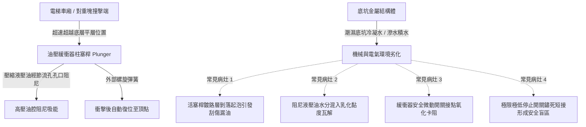

# 全案購屋實戰第四百六十八部：中古大樓社區各樓層電梯昇降路井道底坑油壓緩衝器液壓油乳化活塞桿鏽蝕微動極限開關接觸不良與安全防護體檢工序全書

## 壹、核心查驗宗旨與前言

電梯昇降設備（Elevator Traction System）為集合住宅不可或缺之高頻垂直運輸動脈。位於電梯井道最底部（底坑 Pit）之「油壓緩衝器（Hydraulic Buffer）」及「最後極限安全開關（Final Limit Switch）」，係電梯車廂或配重塊發生意外超速墜落、鋼索打滑或電氣控制失控時，防止車廂直接以重力加速度猛烈撞擊底板、吸收動能以保全乘客性命之最終被動機械安全防線。

於二十年至三十年屋齡之中古大樓中，因地下室連續壁滲水、集水坑反湧、或通風不良濕氣積聚，底坑常年淪為潮濕積水之「水牢」。油壓緩衝器之柱塞活塞桿嚴重氧化生鏽、油封（Oil Seal）龜裂導致液壓油乳化劣化、復位彈簧疲勞失效；且終端極限微動開關受潮積碳短路，形成安全防護徹底癱瘓之致命死角。

本工序全書旨在建立標準化底坑安全體檢工序，協助置產家庭穿透公設表象，掌握電梯井道底坑核心機械與電氣安全現狀，防範交屋後承擔高額電梯大修公攤費用，捍衛全家居住生命防線。

---

## 貳、電梯底坑油壓緩衝器與極限安全系統架構與物理病灶

### 一、油壓緩衝器活塞桿鍍鉻層剝落與液壓油乳化變質
1. **電鍍層毛細鏽蝕破壞**：緩衝器活塞柱塞桿表面通常鍍硬鉻（Hard Chrome Plating）。在底坑濕度超過 85% RH 或偶發性積水浸泡下，水氣穿透電鍍微孔，母材碳鋼氧化膨脹，導致表面鍍層鼓泡、剝落並形成銳利毛刺（Burrs）。當電梯偶發壓頂或衝底時，毛刺瞬間刮破聚氨酯或丁腈橡膠油封，導致液壓油大量噴濺洩漏。
2. **液壓油水解乳化與黏度瓦解**：標準緩衝器充填 ISO VG 46 或 VG 68 抗磨液壓油。潮濕水氣透過老化油封間隙滲入油腔，形成白色牛奶狀乳化液（Emulsion）。乳化後之液壓油在高壓衝擊時極易氣化空蝕（Cavitation），黏度自 46 cSt 暴跌至 10 cSt 以下，無法形成有效節流阻尼，使緩衝器喪失吸能緩衝能力，直同剛性撞擊。

### 二、復位彈簧疲勞與微動安全開關接觸不良
1. **柱塞回位不良**：緩衝器受壓縮後，必須依靠外部重型回位彈簧在 90 秒內完全復位至最大衝程頂部。長期鏽蝕與金屬疲勞常導致彈簧彈力衰減，柱塞卡在半壓縮位置無法回彈，下次衝擊時行程嚴重不足。
2. **安全連鎖微動開關失效**：法規規定油壓緩衝器柱塞下方或側邊必須設置「電氣安全開關」。若柱塞未處於全伸展正常位置，安全迴路（Safety Circuit）應即刻切斷電梯主電源防止運轉。然而，實務上維保不良之老舊大樓常因開關接點受潮氧化接觸不良頻繁跳脫，不良廠商竟直接將開關線路「短接跳線（Jumper Bypass）」，使電梯在緩衝器失效情況下帶病盲跑。

### 三、井道極限開關與底坑急停開關機械卡滯
1. **極限停止開關（Final Limit Switch）**：位於井道最下端，當車廂超越正常下端平層感應器 50mm~100mm 時，凸輪撞擊開關滾輪，強制切斷主迴路與抱閘電源。老舊大樓中滾輪軸承常因泥水積垢卡死，撞擊時無法翻轉切斷。
2. **底坑檢修急停鈕（Pit Stop Switch）**：底坑供技師進出維護之紅色蘑菇急停按鈕，內部常因濕氣侵蝕導致雙金屬片彈簧斷裂，維修人員進出時無法可靠鎖定切斷動力，存在嚴重工安夾人隱患。

---

## 肆、實地逐項體檢工序與電氣機械量測指引

### 步驟一：管委會保養紀錄與機房底坑視察確認
1. **電梯年度安全檢驗許可證查核**：檢查電梯車廂內及管理室懸掛之「中華民國昇降設備使用許可證」是否在有效期限內，檢查機構是否為內政部營建署核可之專業協會（如：中華民國升降設備安全協會）。
2. **近三年底坑保養更換紀錄**：調閱歷月保養單，確認緩衝器油位檢查項目是否勾選正常，是否有「底坑積水排乾」、「更換緩衝器液壓油」或「更換底坑安全開關」等修繕紀錄。

### 步驟二：底坑現場物理檢查（由合格技師或管理員開啟底層乘場門陪同勘查）
1. **底坑積水與滲水殘留檢查**：
   - 使用高流明手電筒照射井道底坑底部混凝土面。
   - 檢視是否有明水積聚、水面是否有浮油彩紋、牆角是否有連續壁反潮水痕或白色碳酸鈣結晶（壁癌吐白華）。
2. **油壓緩衝器本體檢查**：
   - **油位視窗確認**：檢視緩衝器油位計（Oil Sight Glass），油位必須處於上限（MAX）與下限（MIN）刻度之間；油液顏色應呈透亮金黃色，若呈現「混濁乳白色」或「焦黑沉澱」即判定為嚴重乳化變質。
   - **柱塞桿表面外觀**：檢視伸出之活塞桿圓柱表面，必須光滑如鏡，不得有鏽斑、麻點、凹痕或油封處滲油垂滴現象。
   - **防塵套（Boot）檢查**：檢查橡膠防塵伸縮護套是否龜裂、硬化脫落。
3. **電氣安全開關與線路量測**：
   - 檢查底坑急停開關、緩衝器安全開關、張力輪斷繩開關之防護等級（應達 IP54 以上）。
   - 萬用電表歐姆檔量測閉合阻抗：各安全開關在接通狀態下接觸電阻應小於 $0.3\Omega$。若測得阻抗超過 $2\Omega$ 或呈現開路，判定為氧化故障。

---

## 伍、評估判定基準與瑕疵等級劃分

| 瑕疵等級 | 現場實測狀況與油質電氣數值 | 潛在隱患與公共安全危害 | 預估修繕工法與費用規模 |
| :--- | :--- | :--- | :--- |
| **輕度瑕疵 (A級)** | 底坑乾燥無積水；柱塞桿表面微量油膜但無滴漏；油質透亮；安全開關觸發俐落，接觸電阻 $\le 0.5\Omega$。 | 處於正常維護狀態，設備機能健全。 | 定期清潔擦拭柱塞桿、補充標準 VG 46 液壓油，單座費用約 **1,500 ~ 3,000 元**。 |
| **中度瑕疵 (B級)** | 緩衝器油封滲油、油位低於下限刻度；液壓油輕微發白乳化；防塵護套破裂；底坑地面潮濕有陳年水痕。 | 緩衝吸能行程縮短，遇衝底時減速度過大可能造成乘客骨折或脊椎受傷；需立即停梯維修。 | 拆卸解體更換全套進口耐磨油封、抽換全新抗磨液壓油、更換防塵套，單台約 **8,000 ~ 18,000 元**。 |
| **重度瑕疵 (C級)** | 底坑常年積水淹沒緩衝器座；活塞桿大面積鏽蝕麻坑；彈簧卡死無法復位；安全開關被人工短接；極限開關鏽蝕動彈不得。 | 終端安全防線徹底喪失！若電梯超速衝底形同直接墜毀；底坑混凝土結構長期泡水產生碳化剝落。 | 底坑高壓灌注止水、抽水泵更新、全面更換全新油壓緩衝器總成及井道電氣安全系統，單部電梯費用達 **6萬 ~ 15萬元以上**。 |

---

## 陸、買賣合約保障特約條款與談判折價策略

### 一、談判折價依據與議價話術
若買方勘查或請驗屋技師查驗發現大樓電梯底坑嚴重潮濕、緩衝器漏油或油質乳化，買方應強烈主張設備隱患：
> 「本社區電梯井道底坑存在嚴重反潮積水，油壓緩衝器已出現油封滲漏與活塞桿生鏽，安全微動開關亦有受潮氧化跡象。此為涉及全棟乘客人身安全之重大機械瑕疵，一旦安檢被稽查出將面臨強制停梯與勒令更換。請賣方於成交總價折讓新台幣 3 萬至 6 萬元之電梯公設維護修繕準備金，或由管委會委託之合格電梯維保商於交屋日前出具底坑設備檢驗合格清單。」

### 二、成屋買賣契約專用法律特約條款（範本）

> **【不動產買賣契約書——電梯設備公設安全保障特約條款】**
>
> 1. **昇降設備法定檢驗保證**：賣方保證本買賣標的物所屬社區大樓之電梯設備，於交屋日前均領有主管建築機關核發且在有效期限內之「昇降設備使用許可證」，且於最近一次主管機關或專業檢查機構之定期安全檢查中，無任何列管未改善之嚴重缺陷。
> 2. **底坑安全防護現況承諾**：賣方保證本大樓電梯井道底坑之油壓緩衝器、急停開關及極限開關等終端安全裝置，均處於無積水浸泡、無漏油乳化、無非法跨接短路且能正常吸能復位之安全狀態。
> 3. **公攤維修責任切結**：若於交屋日起一年內，因交屋前已存在之電梯底坑積水滲漏、油壓緩衝器總成故障或井道安全線路全面汰換，經區分所有權人會議決議開徵特別修繕專案公攤費用者，賣方應依產權持有期間比例全額負擔該筆公攤款項，買方得檢具管委會繳款通知書向賣方求償。
