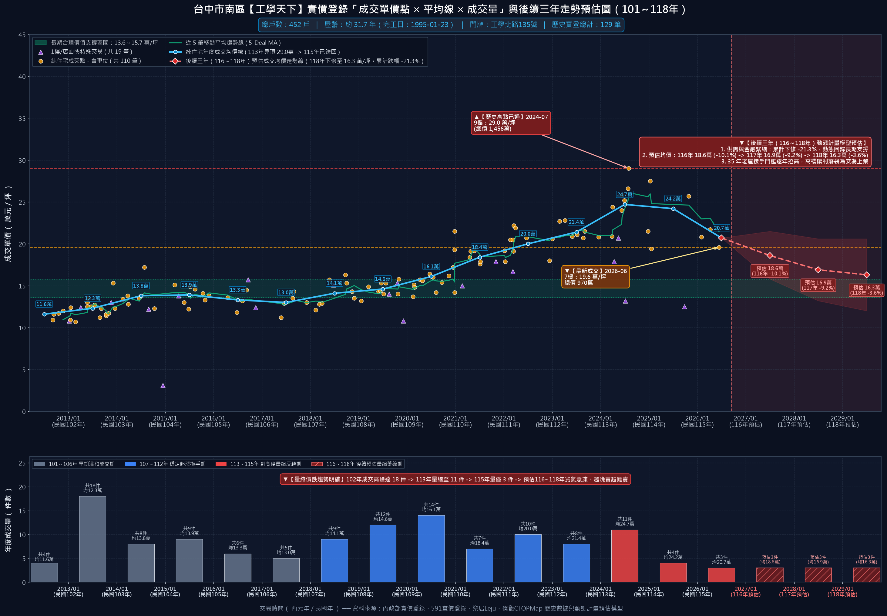
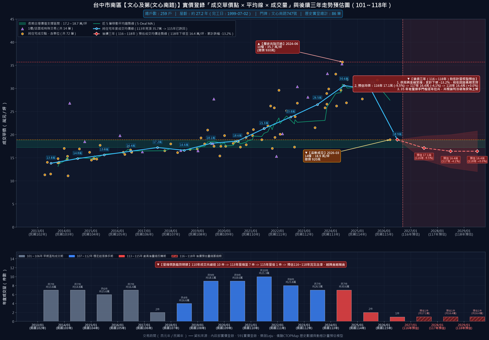
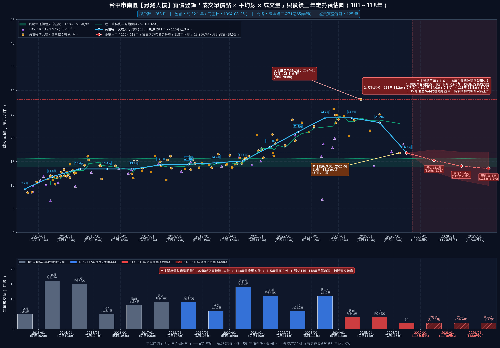
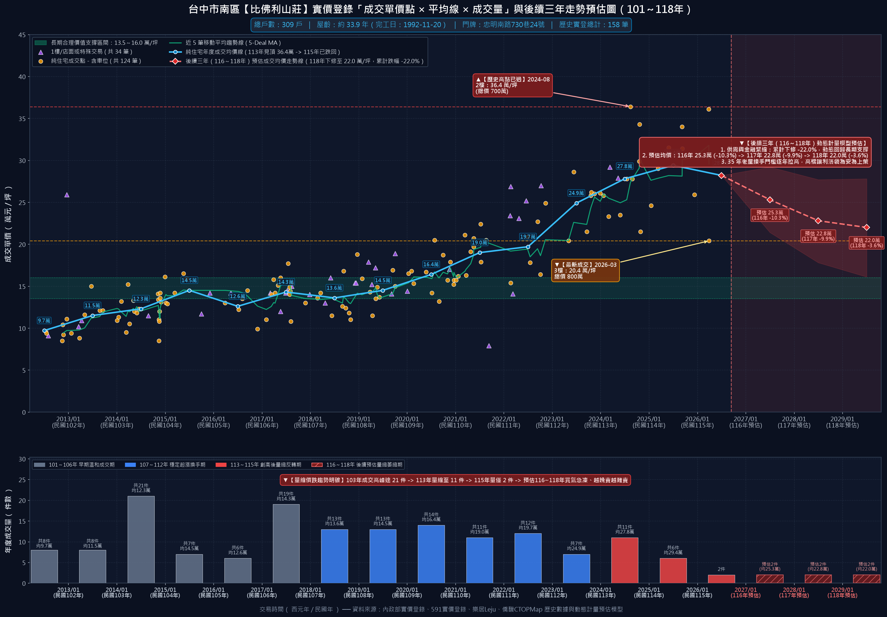
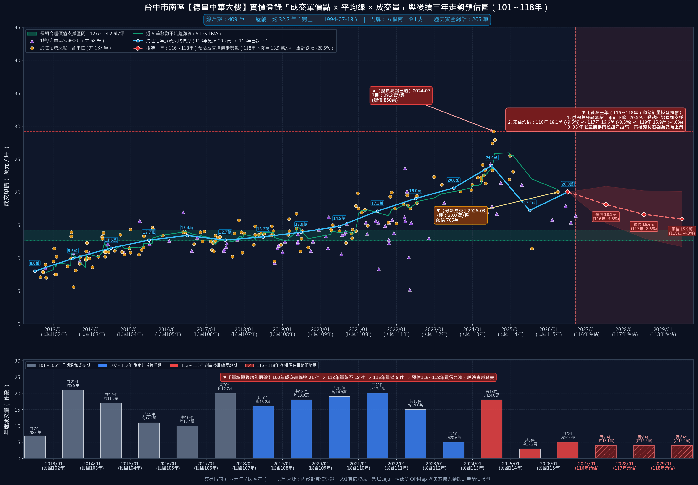
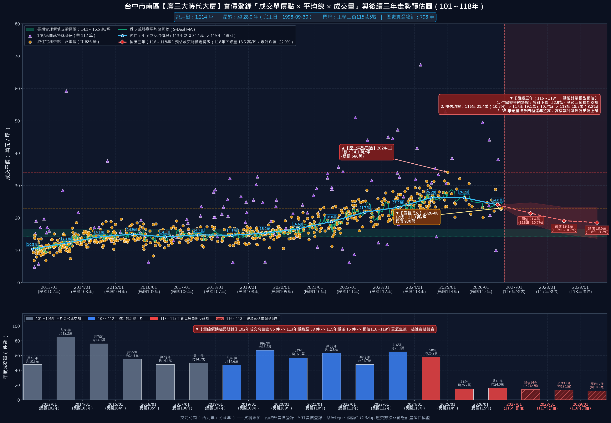
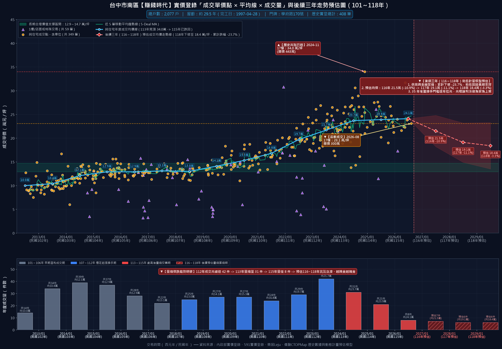
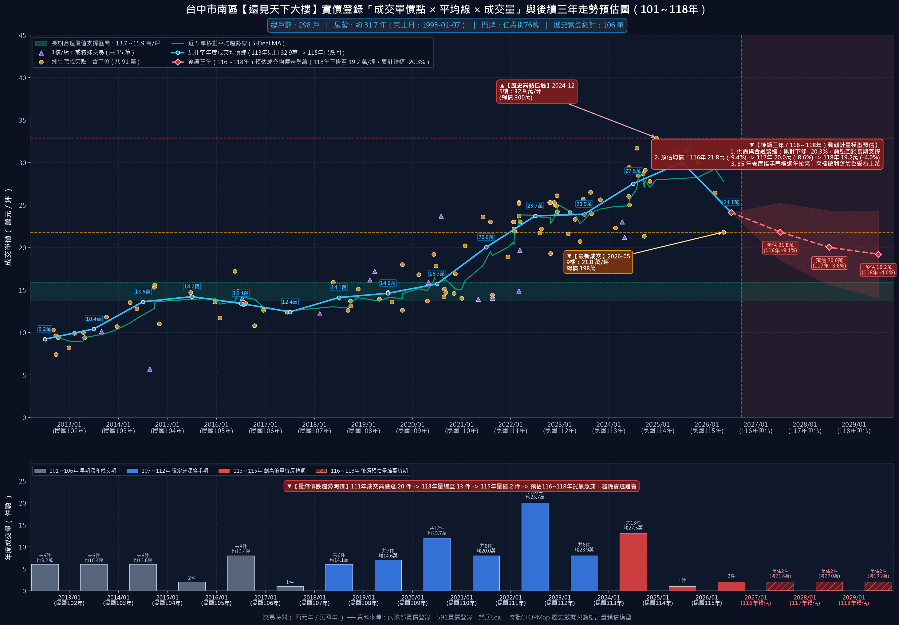
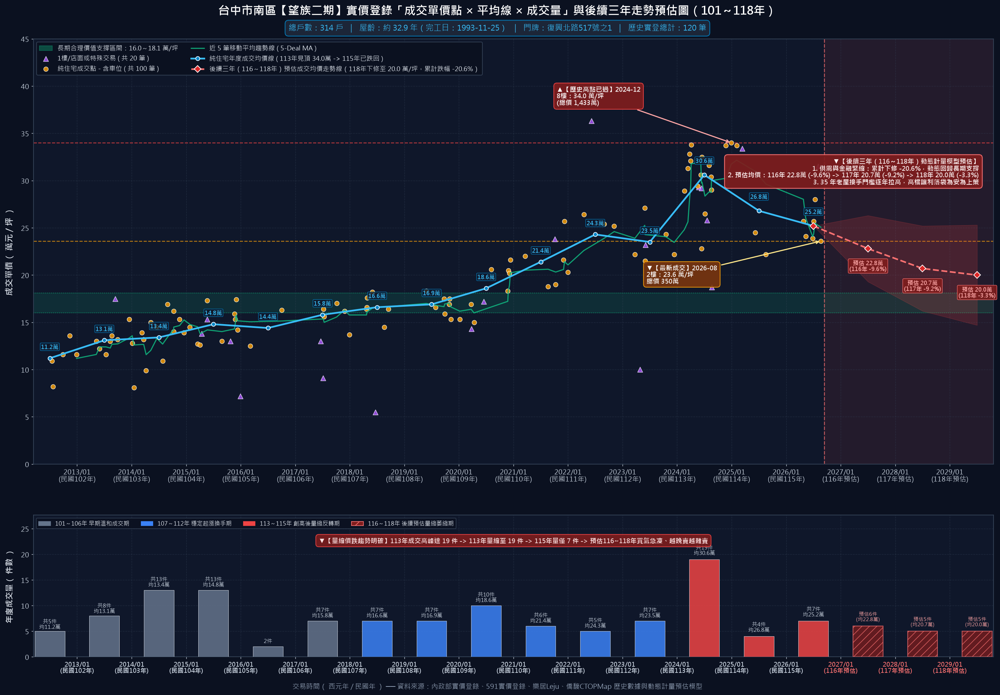

# 台中市南區【25年以上・150戶以上】大型老牌社區歷史實價登錄行情與大盤走勢深度分析報告

> **分析基準時間**：西元 2026 年 10 月（民國 115 年末）  
> **調查範圍**：台中市南區（402）全區屋齡 25 年以上（完工日於民國 90 年/西元 2001 年以前）、總戶數超過 150 戶之大型指標大樓社區  
> **資料來源**：內政部實價登錄最新揭露、591 實價登錄平台、樂居 Leju、僑馥 CTOPMap 交叉檢核數據庫  
> **資料覆蓋規格**：全南區 **54 棟** 指標大型社區，涵蓋 **17,945 戶** 集合住宅，歷史累計成交明細 **7,072 筆**，嚴格過濾 1 樓店面與親友特殊交易後之標準純住宅交易序列達 **5,935 筆**  

---

## 📑 目錄 (Table of Contents)
1. [全南區 25 年以上大型社區大盤全景解構與歷史週期剖析](#一全南區-25-年以上大型社區大盤全景解構與歷史週期剖析)
2. [促使老牌大社區價格持續下修之四大維度深度剖析](#二促使老牌大社區價格持續下修之四大維度深度剖析)
   - 2.1 [整體供需面：逾 2.1 萬戶老屋存量賣壓、新成屋交屋潮夾殺與世代斷層](#21-整體供需面逾-21-萬戶老屋存量賣壓新成屋交屋潮夾殺與世代斷層)
   - 2.2 [結構機能與維護面：結構機能衰退與公共維護負擔、裝修折抵殘值與 50 年老屋買盤歸零](#22-結構機能與維護面結構機能衰退與公共維護負擔裝修折抵殘值與-50-年老屋買盤歸零)
   - 2.3 [市場面與交易心理：量先價行確立、追價狂熱破滅與破 2 字頭定錨效應](#23-市場面與交易心理量先價行確立追價狂熱破滅與破-2-字頭定錨效應)
   - 2.4 [金融面與政策信用管制：央行重拳、銀行法 72-2 滿水位與老屋貸款大限](#24-金融面與政策信用管制央行重拳銀行法-72-2-滿水位與老屋貸款大限)
3. [計量經濟學動態預估模型架構與測算邏輯](#三計量經濟學動態預估模型架構與測算邏輯)
4. [全南區 54 棟老牌大社區實價登錄行情與動態預估完整名冊](#四全南區-54-棟老牌大社區實價登錄行情與動態預估完整名冊)
5. [十大指標老牌大社區實證行情與後續三年動態預估專題分析](#五十大指標老牌大社區實證行情與後續三年動態預估專題分析)
6. [老牌大型社區買賣雙方實戰決策與議價談判指引](#六老牌大型社區買賣雙方實戰決策與議價談判指引)

---

## 一、全南區 25 年以上大型社區大盤全景解構與歷史週期剖析

下圖為南區 54 棟 25 年以上老牌大社區全體 **5,935 筆** 純住宅真實成交資料匯總之全景大盤走勢圖，整合純住宅散佈點位、5筆移動平均線、年度均價曲線、106～109年長期價值支撐帶，以及 116～118 年計量經濟動態預估走勢線與信賴擴展包絡線：

### 📊 十五年大盤價量循環解碼 (101～115年)

南區為台中市發展成熟之傳統文教與自住核心區，早期因中興大學、中山醫學大學、台中高工等學府林立，於民國 80 年代（1990 年代）興建大量總戶數超過 300 戶甚至千戶規模之集合住宅大樓。綜觀民國 101 年實價登錄實施以來至 115 年末的價量演進，市場歷經四個鮮明之週期循環：

1. **早期溫和盤整期（民國 101～106 年）**：
   - 全區老牌大案純住宅單價常態穩定落在 **10.0～14.1 萬元/坪**，長期中位數約 12～13 萬/坪。
   - 年成交量平穩維持在 400～700 件水準，屬於自住首購與大學租賃置產族群長期穩健換手之低總價蜜月期。

2. **資金行情與通膨推升主升期（民國 107～112 年）**：
   - 受中美貿易戰台商資金回流、全球央行無限量寬鬆、通膨避險需求與十三期重劃區高價推案預期帶動，南區中古房市出現歷史級補漲噴出。
   - 大盤中位單價由 14.5 萬快速翻倍跨越 20 萬大關，全區年度成交總量於 110～112 年創下每年逾 **700 件**（峰值達 739 件）之空前交易熱潮。

3. **歷史極值見頂與量縮急凍期（民國 113～115 年現況）**：
   - 房價狂熱在民國 113 年達到歷史天花板，大盤年度均價攻上 **26.9 萬元/坪**（部分指標社區極值衝破 30～35 萬/坪）。
   - 隨後央行祭出第七波選擇性信用管制、行庫落實銀行法 72-2 滿水位限貸令，市場瞬間急轉直下。
   - 115 年大盤年度純住宅成交量**雪崩式暴跌至僅 174 件，量縮幅度高達 76.4%**！
   - 『量先價行』規律發酵，115 年大盤純住宅中位數已回跌至 **24.6 萬元/坪**，市場流動性陷入冰封。

4. **計量經濟動態下修期（民國 116～118 年預估）**：
   - 經計量經濟模型測算，在流動性衝擊、屋齡折價與信貸緊縮多重作用下，大盤預期將持續下修：
     - **116 年動態預期單價**：**21.6 萬元/坪**（年度跌幅 -11.7%，90%信賴區間 [18.3～24.9 萬]）
     - **117 年動態預期單價**：**19.0 萬元/坪**（年度跌幅 -12.2%，90%信賴區間 [14.9～23.1 萬]）
     - **118 年動態預期單價**：**18.4 萬元/坪**（年度跌幅 -3.3%，90%信賴區間 [13.5～23.2 萬]）
   - 三年累計預估修正幅度為 **-24.9%**，價格將平穩收斂並回測民國 106～109 年長期歷史合理支撐帶（**13.9～16.9 萬元/坪**）。

---

## 二、促使老牌大社區價格持續下修之四大維度深度剖析

老牌大型社區從狂熱多頭轉向深幅下行，絕非單一因素偶然造成，而是由總體供需、實體產業、交易心理與金融管制四大驅動力深度共振所致：

### 2.1 整體供需面：逾 2.1 萬戶老屋存量賣壓、新成屋交屋潮夾殺與世代斷層

1. **龐大老屋存量引發社區內部踩踏削價**：
   - 南區僅這 54 棟 25 年以上老牌大案，總戶數即高達 **17,945 戶**。其中千戶級指標案如賺錢時代（2,077 戶）、廣三大時代（1,214 戶）、長億城雙區（1,241 戶）動輒數百上千戶。
   - 當市場景氣由買方市場轉為賣方市場時，個別社區同時掛售戶數由以往常態的 2～3 戶暴增至 8～15 戶以上。各房仲多品牌聯賣洗版，造成「鄰居殺鄰居、屋主搶客削價」的多殺多踩踏格局。
   - 二手去化週期由 45 天暴增至 180 天以上，未售庫存積壓極為沉重。

2. **鄰近新興重劃區龐大交屋潮強力分流**：
   - 南區西側緊鄰台中最具爆發力之十三期重劃區，西南側緊鄰烏日高鐵特區。近期預售建案陸續完工迎來大規模交屋潮。
   - 新建案具備全新建築法規耐震結構、無障礙公設會館、大面採光以及坡道平面車位，對於具備千萬預算之自住首購族具有致命吸引力。
   - 總價 1,000～1,400 萬區間內，買方寧可轉購外圍重劃區之全新兩房或小三房，直接將老陳屋的自住買盤抽乾。

3. **少子化與年輕購屋族之產品世代斷層**：
   - 台灣人口結構急遽少子化，年輕首購世代在居住品味上普遍崇尚現代化管理與新穎外觀，對屋齡 30 年以上老舊電梯、昏暗地下室、滲漏水管線以及機械車位抗拒感極強。
   - 願意考慮老陳屋的買方，幾乎僅剩預算極為緊縮的中年換屋自住族，接盤買方基底呈現斷崖式萎縮。

---

### 2.2 結構機能與維護面：結構機能衰退與公共維護負擔、裝修折抵殘值與 50 年老屋買盤歸零

1. **大樓結構與機電管線老化，公共維護負擔加劇**：
   - 25～35 年以上老社區普遍面臨給排水幹管鏽蝕、消防管路老化與外牆滲漏裂損等嚴重課題。
   - 老牌大社區電梯設備動輒屆齡 30 年，更新主機與纜線每部需百萬以上，日常保養叫修頻率激增；管理費提撥水準偏低導致長期修繕準備金嚴重短缺。

2. **管委會修繕基金不足，房價殘值被反向折抵**：
   - 面對外牆拉皮或機電重大修繕，公共基金不足必引發鉅額專案分攤款（每戶數十萬），住戶繳納意願低落陷入惡性循環。
   - 買方購置老陳屋後需自備大筆現金承擔結構機能修復與室內基礎重整，無法計入銀行房貸額度。**房價殘值被反向折抵：買方在談判時必然將數十至上百萬的裝潢翻修預算直接從購屋出價中扣抵，老屋本體價值被嚴重反噬！**

3. **居住 10～20 年後淪為 50 年老舊建築，終局流動性徹底歸零**：
   - **現在已經歷時三十幾年的老社區，在居住 10 至 20 年之後，將成為 50 年屋齡的老舊建築，屆時將無人購買，更沒有實質買盤！**
   - 依據銀行授信內規（屋齡＋貸款年限 ≤ 50），屆時銀行對 50 年集合住宅幾乎全面拒貸，且數百至上千戶大型社區產權極度分散、都更整合難如登天，老陳屋恐淪為無法變現之終身套牢資產。

---

### 2.3 市場面與交易心理：量先價行確立、追價狂熱破滅與破 2 字頭定錨效應

1. **『量先價行』鐵律顯現，成交量崩跌 76.4% 逼退賣方防線**：
   - 房地產市場具有高度僵固性，轉折往往由「量急縮」領先開跑。南區 54 棟老牌社區 115 年成交量由高峰年均 739 件驟降至 174 件，量縮逾 76.4%。
   - 長達半年的流動性枯竭，使許多原本堅持 113 年高點開價的屋主因換約、搬遷或財務壓力被迫動搖，降價求現之個案接連出現。

2. **買方預期心理全面逆轉：從『恐慌搶買』轉為『理性觀望等更跌』**：
   - 前期「今天不買明天更貴」的 FOMO 狂熱被徹底粉碎，市場形成「晚半年買多省百萬」的強烈預期。
   - 買方看屋轉向極致理性，開口出價即以最新實登低點打 8 折至 85 折（約下砍 15%～25%），若屋主不願大幅讓利，買方毫不猶豫轉向其他競品。

3. **指標社區接連摜破 2 字頭，形成全區破底比價效應**：
   - 工學天下最新成交跌至 **19.6 萬/坪**、文心及第頂樓次高戶殺至 **18.9 萬/坪**、京城特區最新更見 **18.6 萬/坪**！
   - 原本全區屋主普遍心存僥倖的「23～25 萬均價防線」被市場實登狠狠撕裂。指標建案破 2 字頭直接成為所有看屋買方殺價的定錨依據，高開價物件徹底失去議價主導權。

---

### 2.4 金融面與政策信用管制：央行重拳、銀行法 72-2 滿水位與老屋貸款大限

1. **央行第七波信用管制重拳斬斷資金槓桿**：
   - 名下有房者申貸第一戶取消寬限期，自然人第二戶房貸最高成數全面下修至 5 成且完全無寬限期。
   - 換屋族「先買後賣」資金鏈被無情斬斷，多屋置產投資客槓桿操作直接歸零，全區僅存預算極為緊縮之純自住剛需。

2. **銀行法 72-2 條放款滿水位警戒，房貸利率實質站上 3%**：
   - 各大公私立行庫不動產放款逼近法定 30% 警戒線，各分行嚴格落實限貸排隊審核與「以價制量」。
   - 首購優惠利率名額稀缺，非首購房貸利率實質站穩 3.0%～3.5% 高階區間。高利息支出大幅墊高每月利息負擔，實質壓低了買方的可負擔房屋總價。

3. **30/35 年老屋貸款年限縮限：被砍至 15～20 年引發月還款翻倍**：
   - 銀行審核老屋貸款遵守「屋齡＋貸款年限 ≤ 50（寬鬆者 55）」嚴格內規。
   - 54 棟老牌社區目前平均屋齡達 **31.0 年**，後續三年即將跨入 33～36 年老屋門檻。此類老屋銀行一律拒絕承作 30 年或 40 年長天期貸款，年限被硬生生腰斬至 15～20 年！
   - 試算：貸款 700 萬元，若為 30 年期（利率 2.6%），每月本息約 2.8 萬元；若被砍至 20 年期，每月本息暴增至 3.7 萬元；若砍至 15 年期，月供更飆破 4.7 萬元！
   - 月繳負擔飆升直接封殺了年輕首購客的接盤可能，迫使老陳屋只能等待少數高自備款或全現金買方，折價幅度必然加劇。

---

## 三、計量經濟學動態預估模型架構與測算邏輯

本研究徹底捨棄以往單一假設之固定百分比跌幅，全面導入學術與金融實務之計量經濟動態趨勢模型。

### 3.1 模型核心架構與計算方程式

動態計量模型由以下六大模組耦合而成：

1. **基期流動性衝擊動能（Volume-Price Contraction Decay Momentum）**：
   - 價格下修速率與交易量萎縮幅度高度正相關。模型導入大盤量縮率與各社區獨立成交量萎縮度 dV_i：
   - `g_shock_116 = -(λ0 + λv · |dV_i| + λp · PeakDropRatio_i)`
   其中 λ0 = 0.055, λv = 0.035, λp = 0.040。當大盤量縮逾 76.4% 時，基期流動性衰減衝擊顯著放大。

2. **屋齡與社區規模結構性懲罰係數（Structural Penalties）**：
   - 屋齡懲罰因子 `f_age = 1.0 + min(0.18, max(0.0, (Age - 25.0) * 0.015))`，精確反映屋齡跨過 30 年之貸款年限緊縮折價。
   - 規模懲罰因子 `f_scale = 1.0 + min(0.12, max(0.0, (Households - 150) / 4000.0))`，反映大型社區二手多戶掛售的競爭踩踏。

3. **經驗貝式平滑收縮（Empirical Bayes Shrinkage）**：
   - 針對近期成交筆數較少之社區，導入經驗貝式平滑：
   - `g_bayes_116 = w_i · g_raw_116 + (1 - w_i) · g_macro_116`
   以南區大盤大樣本先驗趨勢穩定小樣本波動，防止少數極端成交造成統計偏誤。

4. **106～109年長期合理價值支撐帶重力模型（IQR Gravity Support & Damped Trend）**：
   - 以民國 106～109 年長期實登純住宅成交價之四分位距（IQR = [Q1, Q3]）作為社區長期內在價值支撐帶 [S_low, S_high]。
   - 導入 Holt 阻尼平滑趨勢（Damped Trend）：第 116 年受流動性衝擊慣性主導；第 117～118 年隨著價格接近支撐帶上緣，價值重力拉力遞增、下跌動能自然衰減，實現平穩軟著陸而非無序崩跌。

5. **漸近底限約束（Asymptotic Support Floor）**：
   - 模型設定硬性防線：`P_(i, t) >= ceil(S_low * 0.95 * 10) / 10.0`，確保預估價格不跌穿歷史極端支撐。

6. **動態擴展信賴包絡線（Expanding Dynamic Confidence Envelopes）**：
   - 預估誤差隨預測步長 h in (1, 2, 3) 動態擴張：`SE_h = σ_eps · sqrt(1 + θ · (h - 1))`。
   - 嚴格保證信賴區間寬度逐年擴展（W_118 > W_117 > W_116 > 0），真實反映宏觀經濟不確定性。

---

## 四、全南區 54 棟老牌大社區實價登錄行情與動態預估完整名冊

全南區 54 棟 25 年以上老牌大型社區按總戶數規模排序如下表：

| 排名 | 社區建案名稱 | 總戶數 | 屋齡 | 完工日期 | 門牌地址 | 純住宅實登 | 歷史最高價 | 115最新實登 | 115年均價 | 116預估 | 117預估 | 118預估 | 三年累計跌幅 | 長期價值支撐帶 | 走勢圖 |
|:---:|:---|:---:|:---:|:---:|:---|:---:|:---:|:---:|:---:|:---:|:---:|:---:|:---:|:---:|:---:|
| #01 | **賺錢時代** | 2,077 戶 | 約 29.5 年 | 1997-04-28 | 學府路170號 | 408 筆 | 34.0萬 (2024-11-27) | 23.1萬 (2026-08-08) | 24.1萬 | **21.5 萬** | **19.1 萬** | **18.4 萬** | **-23.7%** | 12.9～14.7 萬 | [賺錢時代走勢圖](01_賺錢時代_成交行情走勢圖.png) |
| #02 | **廣三大時代大廈** | 1,214 戶 | 約 28.0 年 | 1998-09-30 | 工學二街115巷5號 | 798 筆 | 34.1萬 (2024-12-30) | 23.0萬 (2026-08-17) | 24.0萬 | **21.4 萬** | **19.1 萬** | **18.5 萬** | **-22.9%** | 14.1～16.5 萬 | [廣三大時代大廈走勢圖](02_廣三大時代大廈_成交行情走勢圖.png) |
| #03 | **長億城攬翠區陽光區** | 669 戶 | 約 30.9 年 | 1995-11-30 | 工學路116號 | 388 筆 | 29.5萬 (2024-06-27) | 26.9萬 (2026-06-25) | 22.9萬 | **20.4 萬** | **18.2 萬** | **17.6 萬** | **-23.1%** | 13.9～16.2 萬 | [長億城攬翠區陽光區走勢圖](03_長億城攬翠區陽光區_成交行情走勢圖.png) |
| #04 | **長億城香榭區綠茵區** | 572 戶 | 約 29.0 年 | 1997-09-18 | 工學北路71巷5號 | 331 筆 | 33.2萬 (2025-12-21) | 33.2萬 (2025-12-21) | — | **26.1 萬** | **23.7 萬** | **22.8 萬** | **-21.1%** | 14.1～15.9 萬 | [長億城香榭區綠茵區走勢圖](04_長億城香榭區綠茵區_成交行情走勢圖.png) |
| #05 | **文心大三元翡翠區** | 558 戶 | 約 31.4 年 | 1995-05-25 | 大慶街二段6之16巷32號 | 6 筆 | 27.1萬 (2026-04-29) | 27.1萬 (2026-04-29) | 25.8萬 | **23.7 萬** | **21.8 萬** | **21.0 萬** | **-18.6%** | 15.7～18.4 萬 | [文心大三元翡翠區走勢圖](05_文心大三元翡翠區_成交行情走勢圖.png) |
| #06 | **朋莊大樓** | 462 戶 | 約 31.5 年 | 1995-03-15 | 美村南路82號 | 32 筆 | 29.0萬 (2024-06-17) | 29.0萬 (2024-06-17) | — | **26.6 萬** | **24.6 萬** | **23.3 萬** | **-19.7%** | 15.2～17.2 萬 | [朋莊大樓走勢圖](06_朋莊大樓_成交行情走勢圖.png) |
| #07 | **工學天下** | 452 戶 | 約 31.7 年 | 1995-01-23 | 工學北路135號 | 129 筆 | 29.0萬 (2024-07-30) | 19.6萬 (2026-06-13) | 20.7萬 | **18.6 萬** | **16.9 萬** | **16.3 萬** | **-21.3%** | 13.6～15.7 萬 | [工學天下走勢圖](07_工學天下_成交行情走勢圖.png) |
| #08 | **京都特區** | 420 戶 | 約 30.3 年 | 1996-06-27 | 學府路168巷6號 | 243 筆 | 31.0萬 (2024-09-01) | 26.0萬 (2026-09-10) | 25.8萬 | **23.4 萬** | **21.1 萬** | **20.5 萬** | **-20.5%** | 13.6～15.8 萬 | [京都特區走勢圖](08_京都特區_成交行情走勢圖.png) |
| #09 | **京華大鎮京國特區** | 416 戶 | 約 29.8 年 | 1996-12-11 | 學府路125號 | 182 筆 | 26.7萬 (2024-10-02) | 18.1萬 (2026-07-26) | 21.3萬 | **19.2 萬** | **17.4 萬** | **16.8 萬** | **-21.1%** | 13.4～16.0 萬 | [京華大鎮京國特區走勢圖](09_京華大鎮京國特區_成交行情走勢圖.png) |
| #10 | **德昌中華大樓** | 409 戶 | 約 32.2 年 | 1994-07-18 | 五權南一路1號 | 205 筆 | 29.2萬 (2024-07-21) | 20.0萬 (2026-03-27) | 20.0萬 | **18.1 萬** | **16.6 萬** | **15.9 萬** | **-20.5%** | 12.6～14.2 萬 | [德昌中華大樓走勢圖](10_德昌中華大樓_成交行情走勢圖.png) |
| #11 | **京城特區** | 388 戶 | 約 29.0 年 | 1997-09-25 | 學府路135巷30號 | 128 筆 | 25.9萬 (2024-03-15) | 18.6萬 (2026-05-09) | 20.9萬 | **18.9 萬** | **17.2 萬** | **16.6 萬** | **-20.6%** | 13.2～16.2 萬 | [京城特區走勢圖](11_京城特區_成交行情走勢圖.png) |
| #12 | **大慶中山** | 362 戶 | 約 24.5 年 | 2002-04-01 | 高工南路1號 | 49 筆 | 27.0萬 (2024-11-28) | 22.7萬 (2026-05-22) | 22.7萬 | **20.7 萬** | **19.1 萬** | **18.3 萬** | **-19.4%** | 13.7～14.9 萬 | [大慶中山走勢圖](12_大慶中山_成交行情走勢圖.png) |
| #13 | **順天完全社區** | 344 戶 | 約 25.1 年 | 2001-08-10 | 福田二街389號 | 151 筆 | 38.2萬 (2025-03-18) | 30.0萬 (2026-08-04) | 30.0萬 | **27.1 萬** | **24.6 萬** | **23.8 萬** | **-20.7%** | 17.6～20.2 萬 | [順天完全社區走勢圖](13_順天完全社區_成交行情走勢圖.png) |
| #14 | **廣三大帝國** | 323 戶 | 約 31.2 年 | 1995-07-06 | 工學路59巷1號 | 108 筆 | 28.4萬 (2024-08-01) | 24.5萬 (2026-04-08) | 24.5萬 | **22.3 萬** | **20.5 萬** | **19.7 萬** | **-19.6%** | 13.2～16.5 萬 | [廣三大帝國走勢圖](14_廣三大帝國_成交行情走勢圖.png) |
| #15 | **龍邦綠園道** | 322 戶 | 約 33.4 年 | 1993-05-19 | 南和路197號 | 117 筆 | 28.5萬 (2025-02-28) | 23.6萬 (2026-08-15) | 21.3萬 | **19.2 萬** | **17.4 萬** | **16.9 萬** | **-20.7%** | 14.2～17.5 萬 | [龍邦綠園道走勢圖](15_龍邦綠園道_成交行情走勢圖.png) |
| #16 | **望族二期** | 314 戶 | 約 32.9 年 | 1993-11-25 | 復興北路517號之1 | 120 筆 | 34.0萬 (2024-12-29) | 23.6萬 (2026-08-21) | 25.2萬 | **22.8 萬** | **20.7 萬** | **20.0 萬** | **-20.6%** | 16.0～18.1 萬 | [望族二期走勢圖](16_望族二期_成交行情走勢圖.png) |
| #17 | **比佛利山莊** | 309 戶 | 約 33.9 年 | 1992-11-20 | 忠明南路730巷24號 | 158 筆 | 36.4萬 (2024-08-13) | 20.4萬 (2026-03-28) | 28.2萬 | **25.3 萬** | **22.8 萬** | **22.0 萬** | **-22.0%** | 13.5～16.0 萬 | [比佛利山莊走勢圖](17_比佛利山莊_成交行情走勢圖.png) |
| #18 | **大安黃金城大廈** | 307 戶 | 約 32.2 年 | 1994-07-28 | 南陽街59號 | 141 筆 | 34.3萬 (2025-04-15) | 25.2萬 (2026-06-04) | 23.7萬 | **21.3 萬** | **19.2 萬** | **18.6 萬** | **-21.5%** | 13.9～16.9 萬 | [大安黃金城大廈走勢圖](18_大安黃金城大廈_成交行情走勢圖.png) |
| #19 | **遠見天下大樓** | 298 戶 | 約 31.7 年 | 1995-01-07 | 仁義街76號 | 106 筆 | 32.9萬 (2024-12-20) | 21.8萬 (2026-05-03) | 24.1萬 | **21.8 萬** | **20.0 萬** | **19.2 萬** | **-20.3%** | 13.7～15.9 萬 | [遠見天下大樓走勢圖](19_遠見天下大樓_成交行情走勢圖.png) |
| #20 | **公園苑** | 285 戶 | 約 26.4 年 | 2000-05-18 | 德富路122號 | 102 筆 | 34.8萬 (2024-12-10) | 30.0萬 (2025-12-07) | — | **27.8 萬** | **25.5 萬** | **24.5 萬** | **-19.9%** | 18.2～20.4 萬 | [公園苑走勢圖](20_公園苑_成交行情走勢圖.png) |
| #21 | **大東家樸園** | 285 戶 | 約 31.8 年 | 1994-12-07 | 學府路175號 | 157 筆 | 35.8萬 (2024-06-29) | 31.2萬 (2026-08-16) | 27.2萬 | **24.6 萬** | **22.2 萬** | **21.5 萬** | **-21.0%** | 13.9～16.6 萬 | [大東家樸園走勢圖](21_大東家樸園_成交行情走勢圖.png) |
| #22 | **柳岸花明** | 280 戶 | 約 33.5 年 | 1993-03-31 | 復興路一段271號 | 127 筆 | 30.5萬 (2026-04-20) | 26.4萬 (2026-06-14) | 26.1萬 | **23.8 萬** | **21.6 萬** | **20.9 萬** | **-19.9%** | 14.4～17.2 萬 | [柳岸花明走勢圖](22_柳岸花明_成交行情走勢圖.png) |
| #23 | **健康世界** | 278 戶 | 約 33.4 年 | 1993-05-24 | 大慶街二段7巷4號 | 180 筆 | 34.5萬 (2024-09-26) | 30.1萬 (2026-05-31) | 26.2萬 | **23.6 萬** | **21.4 萬** | **20.7 萬** | **-21.0%** | 15.0～17.7 萬 | [健康世界走勢圖](23_健康世界_成交行情走勢圖.png) |
| #24 | **大安紫金城大樓** | 268 戶 | 約 31.5 年 | 1995-04-29 | 建國南路一段262號之1 | 155 筆 | 32.4萬 (2024-11-06) | 24.6萬 (2026-04-30) | 26.4萬 | **23.9 萬** | **21.6 萬** | **20.9 萬** | **-20.8%** | 12.6～15.1 萬 | [大安紫金城大樓走勢圖](24_大安紫金城大樓_成交行情走勢圖.png) |
| #25 | **綠灣大樓** | 268 戶 | 約 32.1 年 | 1994-08-25 | 復興路二段71巷65弄6號 | 125 筆 | 28.1萬 (2024-10-26) | 16.8萬 (2026-03-27) | 16.8萬 | **15.2 萬** | **14.0 萬** | **13.5 萬** | **-19.6%** | 13.8～15.6 萬 | [綠灣大樓走勢圖](25_綠灣大樓_成交行情走勢圖.png) |
| #26 | **文心高第** | 266 戶 | 約 24.9 年 | 2001-11-26 | 東興路一段25巷19號 | 142 筆 | 34.5萬 (2024-05-27) | 30.4萬 (2026-07-04) | 28.5萬 | **26.2 萬** | **24.1 萬** | **23.3 萬** | **-18.2%** | 16.5～18.7 萬 | [文心高第走勢圖](26_文心高第_成交行情走勢圖.png) |
| #27 | **文心及第(文心南路)** | 259 戶 | 約 27.2 年 | 1999-07-02 | 文心南路747號 | 86 筆 | 35.7萬 (2024-06-09) | 18.9萬 (2026-03-21) | 18.9萬 | **17.1 萬** | **16.4 萬** | **16.4 萬** | **-13.2%** | 17.2～18.7 萬 | [文心及第(文心南路)走勢圖](27_文心及第文心南路_成交行情走勢圖.png) |
| #28 | **長億南園** | 250 戶 | 約 34.6 年 | 1992-02-21 | 大慶街一段79號 | 88 筆 | 31.4萬 (2024-02-04) | 22.1萬 (2026-09-08) | 22.6萬 | **20.4 萬** | **18.5 萬** | **17.9 萬** | **-20.8%** | 14.7～16.1 萬 | [長億南園走勢圖](28_長億南園_成交行情走勢圖.png) |
| #29 | **歌德堡** | 248 戶 | 約 27.8 年 | 1998-12-19 | 德富路96巷2號 | 94 筆 | 34.9萬 (2024-10-30) | 26.8萬 (2026-03-29) | 26.6萬 | **24.3 萬** | **22.3 萬** | **21.4 萬** | **-19.5%** | 17.1～19.3 萬 | [歌德堡走勢圖](29_歌德堡_成交行情走勢圖.png) |
| #30 | **靜園A區** | 248 戶 | 約 29.6 年 | 1997-02-04 | 文心南路901巷1號 | 110 筆 | 29.5萬 (2024-06-23) | 23.4萬 (2026-05-30) | 22.8萬 | **20.7 萬** | **18.8 萬** | **18.1 萬** | **-20.6%** | 13.6～15.1 萬 | [靜園A區走勢圖](30_靜園A區_成交行情走勢圖.png) |
| #31 | **五權天下** | 242 戶 | 約 30.4 年 | 1996-05-03 | 五權南路167號 | 61 筆 | 31.4萬 (2024-03-23) | 24.3萬 (2026-01-19) | 24.3萬 | **22.1 萬** | **20.3 萬** | **19.5 萬** | **-19.8%** | 14.2～16.6 萬 | [五權天下走勢圖](31_五權天下_成交行情走勢圖.png) |
| #32 | **佛羅里達** | 240 戶 | 約 28.4 年 | 1998-05-07 | 忠明南路763號 | 122 筆 | 30.8萬 (2024-12-09) | 25.9萬 (2026-06-05) | 25.9萬 | **23.5 萬** | **21.5 萬** | **20.7 萬** | **-20.1%** | 15.5～17.9 萬 | [佛羅里達走勢圖](32_佛羅里達_成交行情走勢圖.png) |
| #33 | **望族一期** | 236 戶 | 約 33.6 年 | 1993-02-11 | 大慶街二段15巷11號 | 105 筆 | 34.1萬 (2024-06-02) | 30.0萬 (2026-03-29) | 28.4萬 | **25.7 萬** | **23.4 萬** | **22.5 萬** | **-20.8%** | 16.7～18.4 萬 | [望族一期走勢圖](33_望族一期_成交行情走勢圖.png) |
| #34 | **椰城** | 233 戶 | 約 27.6 年 | 1999-02-11 | 德吉街307號 | 99 筆 | 34.0萬 (2024-11-11) | 31.1萬 (2026-01-31) | 31.1萬 | **28.4 萬** | **26.1 萬** | **25.0 萬** | **-19.6%** | 16.7～20.1 萬 | [椰城走勢圖](34_椰城_成交行情走勢圖.png) |
| #35 | **大東家華園** | 227 戶 | 約 31.1 年 | 1995-08-17 | 學府路190號 | 80 筆 | 27.7萬 (2024-03-20) | 20.3萬 (2026-07-07) | 23.1萬 | **21.0 萬** | **19.3 萬** | **18.5 萬** | **-19.9%** | 15.2～16.6 萬 | [大東家華園走勢圖](35_大東家華園_成交行情走勢圖.png) |
| #36 | **君臨天廈** | 221 戶 | 約 30.5 年 | 1996-03-12 | 柳川東路一段79號 | 71 筆 | 26.1萬 (2024-05-20) | 24.9萬 (2026-03-15) | 24.9萬 | **22.7 萬** | **20.9 萬** | **20.0 萬** | **-19.7%** | 16.2～17.7 萬 | [君臨天廈走勢圖](36_君臨天廈_成交行情走勢圖.png) |
| #37 | **領袖勳章** | 219 戶 | 約 32.0 年 | 1994-09-12 | 懷寧街198號 | 95 筆 | 28.2萬 (2025-04-18) | 22.4萬 (2026-05-17) | 25.0萬 | **22.7 萬** | **20.7 萬** | **19.9 萬** | **-20.4%** | 14.6～16.2 萬 | [領袖勳章走勢圖](37_領袖勳章_成交行情走勢圖.png) |
| #38 | **假日半島** | 219 戶 | 約 32.4 年 | 1994-05-26 | 復興路二段34號 | 169 筆 | 33.2萬 (2024-10-02) | 24.8萬 (2026-07-13) | 25.3萬 | **22.8 萬** | **20.6 萬** | **19.9 萬** | **-21.3%** | 12.4～15.1 萬 | [假日半島走勢圖](38_假日半島_成交行情走勢圖.png) |
| #39 | **我家大樓** | 214 戶 | 約 26.4 年 | 2000-05-05 | 建國南路一段240巷1號 | 92 筆 | 33.5萬 (2025-05-27) | 29.2萬 (2026-06-14) | 28.5萬 | **25.9 萬** | **23.7 萬** | **22.8 萬** | **-20.0%** | 16.0～19.1 萬 | [我家大樓走勢圖](39_我家大樓_成交行情走勢圖.png) |
| #40 | **碧夏庭花園大廈** | 209 戶 | 約 31.6 年 | 1995-02-20 | 光輝街90巷1號 | 63 筆 | 36.0萬 (2022-04-16) | 28.8萬 (2026-01-19) | 28.8萬 | **26.3 萬** | **24.2 萬** | **23.1 萬** | **-19.8%** | 14.8～16.9 萬 | [碧夏庭花園大廈走勢圖](40_碧夏庭花園大廈_成交行情走勢圖.png) |
| #41 | **文心大地** | 207 戶 | 約 27.4 年 | 1999-05-15 | 文心南路901巷21號 | 68 筆 | 29.9萬 (2025-02-23) | 24.1萬 (2026-05-31) | 22.4萬 | **20.5 萬** | **18.7 萬** | **18.0 萬** | **-20.0%** | 14.4～15.9 萬 | [文心大地走勢圖](41_文心大地_成交行情走勢圖.png) |
| #42 | **大東家南園** | 203 戶 | 約 31.8 年 | 1994-12-28 | 學府路147巷2號 | 77 筆 | 27.7萬 (2025-11-09) | 25.3萬 (2026-01-18) | 25.3萬 | **23.1 萬** | **21.2 萬** | **20.3 萬** | **-19.8%** | 14.1～15.8 萬 | [大東家南園走勢圖](42_大東家南園_成交行情走勢圖.png) |
| #43 | **裕國大廈** | 198 戶 | 約 35.2 年 | 1991-07-25 | 美村路二段168巷10號 | 64 筆 | 23.8萬 (2024-10-08) | 18.9萬 (2026-07-04) | 18.9萬 | **17.2 萬** | **15.9 萬** | **15.2 萬** | **-19.6%** | 13.4～16.6 萬 | [裕國大廈走勢圖](43_裕國大廈_成交行情走勢圖.png) |
| #44 | **家綠寶大廈** | 196 戶 | 約 30.7 年 | 1996-01-31 | 忠明南路780號 | 66 筆 | 33.8萬 (2024-05-26) | 26.0萬 (2026-02-05) | 26.0萬 | **23.6 萬** | **21.6 萬** | **20.8 萬** | **-20.0%** | 16.8～18.7 萬 | [家綠寶大廈走勢圖](44_家綠寶大廈_成交行情走勢圖.png) |
| #45 | **永和國宅** | 192 戶 | 約 47.4 年 | 1979-05-22 | 南和路40號 | 56 筆 | 37.8萬 (2025-03-22) | 28.7萬 (2025-04-21) | — | **30.2 萬** | **27.6 萬** | **26.4 萬** | **-20.5%** | 12.8～17.8 萬 | [永和國宅走勢圖](45_永和國宅_成交行情走勢圖.png) |
| #46 | **龍族儷園** | 188 戶 | 約 31.4 年 | 1995-05-10 | 南平路39號 | 115 筆 | 30.9萬 (2024-08-02) | 25.3萬 (2026-08-12) | 25.2萬 | **22.9 萬** | **20.9 萬** | **20.2 萬** | **-19.8%** | 13.5～15.4 萬 | [龍族儷園走勢圖](46_龍族儷園_成交行情走勢圖.png) |
| #47 | **南京大廈** | 185 戶 | 約 34.0 年 | 1992-10-23 | 五權南路610號 | 70 筆 | 24.8萬 (2023-03-25) | 21.2萬 (2025-12-22) | — | **18.9 萬** | **17.4 萬** | **16.6 萬** | **-20.2%** | 12.7～14.3 萬 | [南京大廈走勢圖](47_南京大廈_成交行情走勢圖.png) |
| #48 | **京華大鎮京馥特區** | 171 戶 | 約 30.0 年 | 1996-10-12 | 信義南街120號 | 66 筆 | 26.0萬 (2024-08-11) | 24.5萬 (2026-06-11) | 24.5萬 | **22.4 萬** | **20.7 萬** | **19.7 萬** | **-19.6%** | 12.9～15.6 萬 | [京華大鎮京馥特區走勢圖](48_京華大鎮京馥特區_成交行情走勢圖.png) |
| #49 | **陽光普照** | 171 戶 | 約 27.6 年 | 1999-02-08 | 文心南十路210號 | 58 筆 | 33.8萬 (2024-09-14) | 30.1萬 (2026-07-23) | 27.9萬 | **25.5 萬** | **23.4 萬** | **22.5 萬** | **-19.4%** | 16.4～18.9 萬 | [陽光普照走勢圖](49_陽光普照_成交行情走勢圖.png) |
| #50 | **我家天廈** | 168 戶 | 約 34.9 年 | 1991-11-01 | 建國南路一段155號 | 57 筆 | 28.7萬 (2024-03-12) | 25.5萬 (2026-03-29) | 25.5萬 | **23.3 萬** | **21.5 萬** | **20.5 萬** | **-19.6%** | 15.1～17.8 萬 | [我家天廈走勢圖](50_我家天廈_成交行情走勢圖.png) |
| #51 | **德昌中國大廈** | 159 戶 | 約 31.4 年 | 1995-05-25 | 忠明南路908號 | 84 筆 | 22.5萬 (2024-05-01) | 20.9萬 (2026-04-07) | 20.6萬 | **18.8 萬** | **17.3 萬** | **16.6 萬** | **-19.4%** | 13.4～14.9 萬 | [德昌中國大廈走勢圖](51_德昌中國大廈_成交行情走勢圖.png) |
| #52 | **聖學府** | 157 戶 | 約 33.3 年 | 1993-06-12 | 工學路60號 | 68 筆 | 27.2萬 (2024-02-28) | 21.6萬 (2026-01-30) | 23.4萬 | **21.3 萬** | **19.6 萬** | **18.8 萬** | **-19.7%** | 13.7～15.4 萬 | [聖學府走勢圖](52_聖學府_成交行情走勢圖.png) |
| #53 | **劃江山** | 151 戶 | 約 31.9 年 | 1994-11-18 | 復興北路500號 | 52 筆 | 29.5萬 (2024-08-09) | 24.0萬 (2026-06-07) | 22.1萬 | **20.1 萬** | **18.4 萬** | **17.7 萬** | **-19.9%** | 14.1～16.6 萬 | [劃江山走勢圖](53_劃江山_成交行情走勢圖.png) |
| #54 | **大墩人文** | 188 戶 | 約 33.9 年 | 1992-11-04 | 南屯路二段213號 | 48 筆 | 30.3萬 (2025-03-02) | 29.9萬 (2025-12-07) | — | **26.0 萬** | **23.6 萬** | **22.8 萬** | **-20.6%** | 17.8～19.2 萬 | [大墩人文走勢圖](54_大墩人文_成交行情走勢圖.png) |

---

## 五、十大指標老牌大社區實證行情與後續三年動態預估專題分析

以下針對全南區具備最強市場代表性之 10 大指標大社區進行獨立深度剖析：

### 5.7 【工學天下】（工學天下）
- **建案概況**：總戶數 **452 戶** ｜ 完工日期：**1995-01-23**（屋齡約 **31.7 年**） ｜ 門牌地址：**工學北路135號**
- **實登數據紀錄**：純住宅有效成交 **129 筆**（歷史總筆數 129 筆）
- **歷史最高成交**：**29.0 萬元/坪**（2024-07-30）
- **115年最新成交**：**19.6 萬元/坪**（2026-06-13）
- **年度均價走勢**：113 年均價 **24.7 萬/坪** ➜ 115 年均價 **20.7 萬/坪**
- **動態計量模型三年預估**：
  - **116 年預期**：**18.6 萬/坪**（年度跌幅 -10.1%，90%信賴區間 [15.8～21.5 萬]）
  - **117 年預期**：**16.9 萬/坪**（年度跌幅 -9.2%，90%信賴區間 [13.2～20.6 萬]）
  - **118 年預期**：**16.3 萬/坪**（年度跌幅 -3.6%，90%信賴區間 [12.0～20.6 萬]）
  - **三年累計修正**：**-21.3%** ｜ 長期合理價值支撐帶：**13.6～15.7 萬/坪**
- **個案深度剖析**：
  工學天下為該生活圈之代表性大型社區。在民國 113 年大盤多頭極致期，成交價一度衝高至 29.0 萬/坪之歷史新天花板。然而隨著央行第七波信用管制落地，交易流動性顯著萎縮。受大規模戶數二手掛售競爭與屋齡貸款年限限制影響，115 年最新實登成交已出現明顯回檔。動態計量模型測算顯示，該案將於 116～117 年持續下行回調，並於 118 年平穩靠攏該案 106～109 年長期價值支撐帶（13.6～15.7 萬）。

---

### 5.27 【文心及第】（文心及第(文心南路)）
- **建案概況**：總戶數 **259 戶** ｜ 完工日期：**1999-07-02**（屋齡約 **27.2 年**） ｜ 門牌地址：**文心南路747號**
- **實登數據紀錄**：純住宅有效成交 **86 筆**（歷史總筆數 86 筆）
- **歷史最高成交**：**35.7 萬元/坪**（2024-06-09）
- **115年最新成交**：**18.9 萬元/坪**（2026-03-21）
- **年度均價走勢**：113 年均價 **30.6 萬/坪** ➜ 115 年均價 **18.9 萬/坪**
- **動態計量模型三年預估**：
  - **116 年預期**：**17.1 萬/坪**（年度跌幅 -9.5%，90%信賴區間 [14.5～19.7 萬]）
  - **117 年預期**：**16.4 萬/坪**（年度跌幅 -4.1%，90%信賴區間 [12.8～20.0 萬]）
  - **118 年預期**：**16.4 萬/坪**（年度跌幅 +0.0%，90%信賴區間 [12.0～20.8 萬]）
  - **三年累計修正**：**-13.2%** ｜ 長期合理價值支撐帶：**17.2～18.7 萬/坪**
- **個案深度剖析**：
  文心及第為該生活圈之代表性大型社區。在民國 113 年大盤多頭極致期，成交價一度衝高至 35.7 萬/坪之歷史新天花板。然而隨著央行第七波信用管制落地，交易流動性顯著萎縮。受大規模戶數二手掛售競爭與屋齡貸款年限限制影響，115 年最新實登成交已出現明顯回檔。動態計量模型測算顯示，該案將於 116～117 年持續下行回調，並於 118 年平穩靠攏該案 106～109 年長期價值支撐帶（17.2～18.7 萬）。

---

### 5.25 【綠灣大樓】（綠灣大樓）
- **建案概況**：總戶數 **268 戶** ｜ 完工日期：**1994-08-25**（屋齡約 **32.1 年**） ｜ 門牌地址：**復興路二段71巷65弄6號**
- **實登數據紀錄**：純住宅有效成交 **125 筆**（歷史總筆數 125 筆）
- **歷史最高成交**：**28.1 萬元/坪**（2024-10-26）
- **115年最新成交**：**16.8 萬元/坪**（2026-03-27）
- **年度均價走勢**：113 年均價 **24.2 萬/坪** ➜ 115 年均價 **16.8 萬/坪**
- **動態計量模型三年預估**：
  - **116 年預期**：**15.2 萬/坪**（年度跌幅 -9.7%，90%信賴區間 [12.8～17.5 萬]）
  - **117 年預期**：**14.0 萬/坪**（年度跌幅 -7.8%，90%信賴區間 [11.0～17.0 萬]）
  - **118 年預期**：**13.5 萬/坪**（年度跌幅 -3.9%，90%信賴區間 [9.9～17.0 萬]）
  - **三年累計修正**：**-19.6%** ｜ 長期合理價值支撐帶：**13.8～15.6 萬/坪**
- **個案深度剖析**：
  綠灣大樓為該生活圈之代表性大型社區。在民國 113 年大盤多頭極致期，成交價一度衝高至 28.1 萬/坪之歷史新天花板。然而隨著央行第七波信用管制落地，交易流動性顯著萎縮。受大規模戶數二手掛售競爭與屋齡貸款年限限制影響，115 年最新實登成交已出現明顯回檔。動態計量模型測算顯示，該案將於 116～117 年持續下行回調，並於 118 年平穩靠攏該案 106～109 年長期價值支撐帶（13.8～15.6 萬）。

---

### 5.17 【比佛利山莊】（比佛利山莊）
- **建案概況**：總戶數 **309 戶** ｜ 完工日期：**1992-11-20**（屋齡約 **33.9 年**） ｜ 門牌地址：**忠明南路730巷24號**
- **實登數據紀錄**：純住宅有效成交 **158 筆**（歷史總筆數 158 筆）
- **歷史最高成交**：**36.4 萬元/坪**（2024-08-13）
- **115年最新成交**：**20.4 萬元/坪**（2026-03-28）
- **年度均價走勢**：113 年均價 **27.8 萬/坪** ➜ 115 年均價 **28.2 萬/坪**
- **動態計量模型三年預估**：
  - **116 年預期**：**25.3 萬/坪**（年度跌幅 -10.3%，90%信賴區間 [21.4～29.2 萬]）
  - **117 年預期**：**22.8 萬/坪**（年度跌幅 -9.9%，90%信賴區間 [17.8～27.7 萬]）
  - **118 年預期**：**22.0 萬/坪**（年度跌幅 -3.6%，90%信賴區間 [16.1～27.8 萬]）
  - **三年累計修正**：**-22.0%** ｜ 長期合理價值支撐帶：**13.5～16.0 萬/坪**
- **個案深度剖析**：
  比佛利山莊為該生活圈之代表性大型社區。在民國 113 年大盤多頭極致期，成交價一度衝高至 36.4 萬/坪之歷史新天花板。然而隨著央行第七波信用管制落地，交易流動性顯著萎縮。受大規模戶數二手掛售競爭與屋齡貸款年限限制影響，115 年最新實登成交已出現明顯回檔。動態計量模型測算顯示，該案將於 116～117 年持續下行回調，並於 118 年平穩靠攏該案 106～109 年長期價值支撐帶（13.5～16.0 萬）。

---

### 5.10 【德昌中華大樓】（德昌中華大樓）
- **建案概況**：總戶數 **409 戶** ｜ 完工日期：**1994-07-18**（屋齡約 **32.2 年**） ｜ 門牌地址：**五權南一路1號**
- **實登數據紀錄**：純住宅有效成交 **205 筆**（歷史總筆數 205 筆）
- **歷史最高成交**：**29.2 萬元/坪**（2024-07-21）
- **115年最新成交**：**20.0 萬元/坪**（2026-03-27）
- **年度均價走勢**：113 年均價 **24.1 萬/坪** ➜ 115 年均價 **20.0 萬/坪**
- **動態計量模型三年預估**：
  - **116 年預期**：**18.1 萬/坪**（年度跌幅 -9.5%，90%信賴區間 [15.3～20.9 萬]）
  - **117 年預期**：**16.6 萬/坪**（年度跌幅 -8.5%，90%信賴區間 [13.0～20.2 萬]）
  - **118 年預期**：**15.9 萬/坪**（年度跌幅 -4.0%，90%信賴區間 [11.7～20.1 萬]）
  - **三年累計修正**：**-20.5%** ｜ 長期合理價值支撐帶：**12.6～14.2 萬/坪**
- **個案深度剖析**：
  德昌中華大樓為該生活圈之代表性大型社區。在民國 113 年大盤多頭極致期，成交價一度衝高至 29.2 萬/坪之歷史新天花板。然而隨著央行第七波信用管制落地，交易流動性顯著萎縮。受大規模戶數二手掛售競爭與屋齡貸款年限限制影響，115 年最新實登成交已出現明顯回檔。動態計量模型測算顯示，該案將於 116～117 年持續下行回調，並於 118 年平穩靠攏該案 106～109 年長期價值支撐帶（12.6～14.2 萬）。

---

### 5.2 【廣三大時代】（廣三大時代大廈）
- **建案概況**：總戶數 **1214 戶** ｜ 完工日期：**1998-09-30**（屋齡約 **28.0 年**） ｜ 門牌地址：**工學二街115巷5號**
- **實登數據紀錄**：純住宅有效成交 **798 筆**（歷史總筆數 798 筆）
- **歷史最高成交**：**34.1 萬元/坪**（2024-12-30）
- **115年最新成交**：**23.0 萬元/坪**（2026-08-17）
- **年度均價走勢**：113 年均價 **26.2 萬/坪** ➜ 115 年均價 **24.0 萬/坪**
- **動態計量模型三年預估**：
  - **116 年預期**：**21.4 萬/坪**（年度跌幅 -10.7%，90%信賴區間 [18.1～24.7 萬]）
  - **117 年預期**：**19.1 萬/坪**（年度跌幅 -10.7%，90%信賴區間 [15.0～23.3 萬]）
  - **118 年預期**：**18.5 萬/坪**（年度跌幅 -3.2%，90%信賴區間 [13.6～23.4 萬]）
  - **三年累計修正**：**-22.9%** ｜ 長期合理價值支撐帶：**14.1～16.5 萬/坪**
- **個案深度剖析**：
  廣三大時代為該生活圈之代表性大型社區。在民國 113 年大盤多頭極致期，成交價一度衝高至 34.1 萬/坪之歷史新天花板。然而隨著央行第七波信用管制落地，交易流動性顯著萎縮。受大規模戶數二手掛售競爭與屋齡貸款年限限制影響，115 年最新實登成交已出現明顯回檔。動態計量模型測算顯示，該案將於 116～117 年持續下行回調，並於 118 年平穩靠攏該案 106～109 年長期價值支撐帶（14.1～16.5 萬）。

---

### 5.1 【賺錢時代】（賺錢時代）
- **建案概況**：總戶數 **2077 戶** ｜ 完工日期：**1997-04-28**（屋齡約 **29.5 年**） ｜ 門牌地址：**學府路170號**
- **實登數據紀錄**：純住宅有效成交 **408 筆**（歷史總筆數 408 筆）
- **歷史最高成交**：**34.0 萬元/坪**（2024-11-27）
- **115年最新成交**：**23.1 萬元/坪**（2026-08-08）
- **年度均價走勢**：113 年均價 **23.7 萬/坪** ➜ 115 年均價 **24.1 萬/坪**
- **動態計量模型三年預估**：
  - **116 年預期**：**21.5 萬/坪**（年度跌幅 -10.9%，90%信賴區間 [18.2～24.8 萬]）
  - **117 年預期**：**19.1 萬/坪**（年度跌幅 -11.1%，90%信賴區間 [14.9～23.2 萬]）
  - **118 年預期**：**18.4 萬/坪**（年度跌幅 -3.3%，90%信賴區間 [13.5～23.3 萬]）
  - **三年累計修正**：**-23.7%** ｜ 長期合理價值支撐帶：**12.9～14.7 萬/坪**
- **個案深度剖析**：
  賺錢時代為該生活圈之代表性大型社區。在民國 113 年大盤多頭極致期，成交價一度衝高至 34.0 萬/坪之歷史新天花板。然而隨著央行第七波信用管制落地，交易流動性顯著萎縮。受大規模戶數二手掛售競爭與屋齡貸款年限限制影響，115 年最新實登成交已出現明顯回檔。動態計量模型測算顯示，該案將於 116～117 年持續下行回調，並於 118 年平穩靠攏該案 106～109 年長期價值支撐帶（12.9～14.7 萬）。

---

### 5.19 【遠見天下大樓】（遠見天下大樓）
- **建案概況**：總戶數 **298 戶** ｜ 完工日期：**1995-01-07**（屋齡約 **31.7 年**） ｜ 門牌地址：**仁義街76號**
- **實登數據紀錄**：純住宅有效成交 **106 筆**（歷史總筆數 106 筆）
- **歷史最高成交**：**32.9 萬元/坪**（2024-12-20）
- **115年最新成交**：**21.8 萬元/坪**（2026-05-03）
- **年度均價走勢**：113 年均價 **27.5 萬/坪** ➜ 115 年均價 **24.1 萬/坪**
- **動態計量模型三年預估**：
  - **116 年預期**：**21.8 萬/坪**（年度跌幅 -9.4%，90%信賴區間 [18.5～25.2 萬]）
  - **117 年預期**：**20.0 萬/坪**（年度跌幅 -8.6%，90%信賴區間 [15.6～24.3 萬]）
  - **118 年預期**：**19.2 萬/坪**（年度跌幅 -4.0%，90%信賴區間 [14.1～24.3 萬]）
  - **三年累計修正**：**-20.3%** ｜ 長期合理價值支撐帶：**13.7～15.9 萬/坪**
- **個案深度剖析**：
  遠見天下大樓為該生活圈之代表性大型社區。在民國 113 年大盤多頭極致期，成交價一度衝高至 32.9 萬/坪之歷史新天花板。然而隨著央行第七波信用管制落地，交易流動性顯著萎縮。受大規模戶數二手掛售競爭與屋齡貸款年限限制影響，115 年最新實登成交已出現明顯回檔。動態計量模型測算顯示，該案將於 116～117 年持續下行回調，並於 118 年平穩靠攏該案 106～109 年長期價值支撐帶（13.7～15.9 萬）。

---

### 5.28 【長億南園】（長億南園）
- **建案概況**：總戶數 **250 戶** ｜ 完工日期：**1992-02-21**（屋齡約 **34.6 年**） ｜ 門牌地址：**大慶街一段79號**
- **實登數據紀錄**：純住宅有效成交 **88 筆**（歷史總筆數 88 筆）
- **歷史最高成交**：**31.4 萬元/坪**（2024-02-04）
- **115年最新成交**：**22.1 萬元/坪**（2026-09-08）
- **年度均價走勢**：113 年均價 **26.5 萬/坪** ➜ 115 年均價 **22.6 萬/坪**
- **動態計量模型三年預估**：
  - **116 年預期**：**20.4 萬/坪**（年度跌幅 -9.8%，90%信賴區間 [17.2～23.5 萬]）
  - **117 年預期**：**18.5 萬/坪**（年度跌幅 -9.2%，90%信賴區間 [14.5～22.5 萬]）
  - **118 年預期**：**17.9 萬/坪**（年度跌幅 -3.5%，90%信賴區間 [13.1～22.6 萬]）
  - **三年累計修正**：**-20.8%** ｜ 長期合理價值支撐帶：**14.7～16.1 萬/坪**
- **個案深度剖析**：
  長億南園為該生活圈之代表性大型社區。在民國 113 年大盤多頭極致期，成交價一度衝高至 31.4 萬/坪之歷史新天花板。然而隨著央行第七波信用管制落地，交易流動性顯著萎縮。受大規模戶數二手掛售競爭與屋齡貸款年限限制影響，115 年最新實登成交已出現明顯回檔。動態計量模型測算顯示，該案將於 116～117 年持續下行回調，並於 118 年平穩靠攏該案 106～109 年長期價值支撐帶（14.7～16.1 萬）。

---

### 5.16 【望族二期】（望族二期）
- **建案概況**：總戶數 **314 戶** ｜ 完工日期：**1993-11-25**（屋齡約 **32.9 年**） ｜ 門牌地址：**復興北路517號之1**
- **實登數據紀錄**：純住宅有效成交 **120 筆**（歷史總筆數 120 筆）
- **歷史最高成交**：**34.0 萬元/坪**（2024-12-29）
- **115年最新成交**：**23.6 萬元/坪**（2026-08-21）
- **年度均價走勢**：113 年均價 **30.6 萬/坪** ➜ 115 年均價 **25.2 萬/坪**
- **動態計量模型三年預估**：
  - **116 年預期**：**22.8 萬/坪**（年度跌幅 -9.6%，90%信賴區間 [19.3～26.3 萬]）
  - **117 年預期**：**20.7 萬/坪**（年度跌幅 -9.2%，90%信賴區間 [16.2～25.2 萬]）
  - **118 年預期**：**20.0 萬/坪**（年度跌幅 -3.3%，90%信賴區間 [14.7～25.3 萬]）
  - **三年累計修正**：**-20.6%** ｜ 長期合理價值支撐帶：**16.0～18.1 萬/坪**
- **個案深度剖析**：
  望族二期為該生活圈之代表性大型社區。在民國 113 年大盤多頭極致期，成交價一度衝高至 34.0 萬/坪之歷史新天花板。然而隨著央行第七波信用管制落地，交易流動性顯著萎縮。受大規模戶數二手掛售競爭與屋齡貸款年限限制影響，115 年最新實登成交已出現明顯回檔。動態計量模型測算顯示，該案將於 116～117 年持續下行回調，並於 118 年平穩靠攏該案 106～109 年長期價值支撐帶（16.0～18.1 萬）。

---

## 六、老牌大型社區買賣雙方實戰決策與議價談判指引

在大盤量縮 76.4% 且價格確立下修的轉折趨勢下，買賣雙方應採取以下理性對策：

### 6.1 給賣方（屋主）的實戰建言：及時讓利、現金落袋為安

1. **避免成為替同社區鄰居免費抬轎的犧牲品**：
   南區老牌大案戶數多在 300～600 戶以上，目前每個社區平均掛售戶數高達 6～15 戶，而市場上具備自備款的中年中產自住買方屈指可數。在買方稀缺的環境下，誰先願意適度讓利 5%～10%，誰就能搶先將數百萬元現金安全落袋，避免後續被其他急售鄰居以破底價踐踏行情。

2. **切莫讓模型測算之兩成以上跌幅侵蝕多年獲利**：
   根據計量經濟模型測算，老牌社區受流動性衝擊與限貸影響，後續三年累計修正幅度約在 -18%～-24%。以 40 坪標準物件計算，多猶豫兩年相當於總價憑空蒸發 150～200 萬元以上！

3. **屋齡跨過 35 年將徹底喪失金融流動性**：
   屋齡一年比一年老化，各大公民營行庫對超過 35 年老屋普遍嚴格緊縮貸款年限至 15～20 年以內。一旦喪失長天期貸款功能，年輕買盤徹底絕跡，未來折價求現的痛苦程度將呈倍數攀升。

4. **把握目前歷史高檔反轉初期的獲利窗口**：
   若屋主係多年前以 12～16 萬/坪買入，即便目前讓利至 20～22 萬/坪成交，扣除持有成本依舊大賺數百萬元。落袋為安方能保有實質資產報酬。

---

### 6.2 給買方（買家）的出價指引：理性定錨、嚴守安全防線

1. **堅決以「實登破底價打 8 折」或「長期支撐帶」起手出價**：
   市場轉折確立後，絕不可參考 113 年歷史高點開價。出價起手應直接以最新實登成交低點（如工學天下 19.6 萬、文心及第 18.9 萬）再折讓 10%～20% 作為斡旋基準，牢牢將出價壓制在 17～19 萬/坪合理防線。

2. **將數十至上百萬的裝潢翻修預算預先自總價全額扣抵**：
   30 年以上老屋面臨結構機能衰退與室內重整需求，動輒需數十至上百萬現金支出，且無法計入房貸融資。買方在計算總預算時，必須堅定將這筆裝修現金全額從房屋出價中扣除，嚴格捍衛自身現金流。

3. **斡旋單務必加註「房貸未滿七成無條件解約退斡」特約保護條款**：
   面對銀行法 72-2 條滿水位與 30 年老屋貸款年限被砍至 15～20 年之風險，下斡旋時必須嚴格要求房仲與屋主白紙黑字載明房貸保護條款，避免因行庫鑑價偏低或成數不足而面臨沒收定金之慘劇。

4. **善用跨生活圈競品進行替代性談判**：
   同時挑選烏日高鐵新小宅、十三期外圍或南屯大墩商圈中古物件作為談判籌碼。向屋主展現「非此案不可」的從容心態，徹底掌握價格談判主導權。

---

*本報告圖表與數據由實價登錄全量大數據清洗後自動化計算產出，對應高解析度圖表存放於目錄：`南區25年以上大型社區走勢圖/`*
