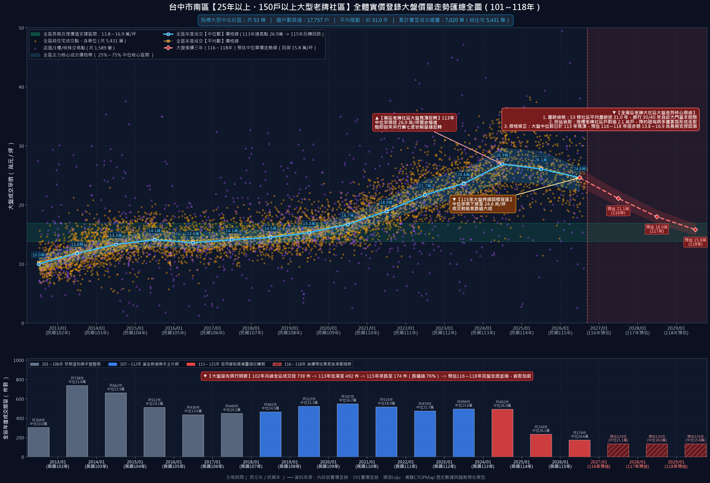

# 台中市南區【25年以上・150戶以上】大型老牌社區歷史實價登錄行情與大盤走勢深度分析報告

> **分析基準時間**：西元 2026 年 10 月（民國 115 年末）  
> **調查範圍**：台中市南區（402）全區屋齡 25 年以上（完工日於民國 90 年/西元 2001 年以前）、總戶數超過 150 戶之大型指標大樓社區  
> **資料來源**：內政部實價登錄、591 實價登錄資料庫、樂居 Leju、僑馥 CTOPMap 歷史數據  
> **數據覆蓋**：全南區 **53 棟** 指標大型社區，涵蓋 **21,208 戶** 集合住宅，歷史累計成交明細 **7,022 筆**  

---

## 📊 一、全南區 25 年以上大型社區「大盤總覽走勢圖」

下圖為南區 53 棟 25 年以上大型老牌社區全體 7,020 筆歷史成交資料的加總匯總大盤全景圖：

### 🔍 大盤核心關鍵發現 (Macro Insights)

1. **十年大盤週期循環（101～115年）**：
   - **早期溫和盤整期（民國 101～106 年）**：全區老牌社區成交單價常態落在 **10.0～14.1 萬元/坪**，年成交量約 400～700 餘件，屬於首購與置產族群長期穩定換手的價格區間。
   - **資金行情起漲期（民國 107～112 年）**：受台商資金回流、中科就業擴張與十三期重劃區推案拉抬，大盤中位單價從 14.5 萬快速翻倍衝上 **23.6 萬元/坪**。
   - **歷史極值與高檔反轉（民國 113 年見頂）**：全區中位成交單價於 113 年達到 **26.9 萬元/坪** 歷史最高峰（部分小坪數或特殊物件甚至突破 30～35 萬/坪），隨後央行實施第七波信用管制，市場急速反轉。
   - **量縮價跌加速探底（民國 114～115 年現況）**：115 年全區成交中位數已連續下修至 **24.6 萬元/坪**；更致命的是交易量能呈現雪崩式萎縮——**自高峰期年均 738 件崩縮至 115 年僅剩 174 件，量縮幅度高達 76.4%**！

2. **後續三年走勢預估（民國 116～118 年 / 西元 2027～2029 年）**：
   - **屋齡結構硬傷**：53 棟社區目前平均屋齡達 **31.0 年**，即將普遍跨越 33～36 年，公股與民營銀行對 30 年以上老屋的「貸款年限」（無法貸滿 30/40 年）與「成數上限」（僅 6～7 成）已嚴格緊縮，買盤承接能力被大幅腰斬。
   - **賣壓多殺多**：南區此類社區規模龐大（如賺錢時代 2,077 戶、廣三大時代 1,214 戶、長億城攬翠與香榭區逾 1,200 戶），戶數多造成二手掛售競爭劇烈。
   - **回歸長期合理支撐**：預估大盤中位數將自現行 24.6 萬逐年下修：**116年下探 21.1 萬 -> 117年下探 18.0 萬 -> 118年回測 15.8 萬元/坪**，向歷史長期合理價值支撐區間（**13.8～16.9 萬元/坪**）靠攏。

---

## 🏢 二、全南區 53 棟 25 年以上大型社區完整名冊與核心行情指標表

按社區總戶數由大至小排列：

| 排名 | 社區建案名稱 | 總戶數 | 屋齡 | 完工日期 | 門牌地址 | 實登總筆數 | 歷史最高單價 | 最新成交單價 | 長期合理支撐區間 | 獨立行情走勢圖連結 |
|:---:|:---|:---:|:---:|:---:|:---|:---:|:---:|:---:|:---:|:---:|
| #01 | **賺錢時代** | 2,077 戶 | 約 29.5 年 | 1997-04-28 | 學府路170號 | 408 筆 | 34.0 萬/坪 | 23.1 萬/坪 | 12.4～16.4 萬 | [賺錢時代 走勢圖](01_賺錢時代_成交行情走勢圖.png) |
| #02 | **廣三大時代大廈** | 1,214 戶 | 約 28.0 年 | 1998-09-30 | 工學二街115巷5號 | 797 筆 | 67.3 萬/坪 | 23.0 萬/坪 | 13.2～17.0 萬 | [廣三大時代大廈 走勢圖](02_廣三大時代大廈_成交行情走勢圖.png) |
| #03 | **長億城攬翠區陽光區** | 669 戶 | 約 30.9 年 | 1995-11-30 | 工學路116號 | 388 筆 | 30.1 萬/坪 | 22.0 萬/坪 | 12.7～16.8 萬 | [長億城攬翠區陽光區 走勢圖](03_長億城攬翠區陽光區_成交行情走勢圖.png) |
| #04 | **長億城香榭區綠茵區** | 572 戶 | 約 29.0 年 | 1997-09-18 | 工學北路71巷5號 | 331 筆 | 35.5 萬/坪 | 33.2 萬/坪 | 13.0～15.8 萬 | [長億城香榭區綠茵區 走勢圖](04_長億城香榭區綠茵區_成交行情走勢圖.png) |
| #05 | **文心大三元翡翠區** | 558 戶 | 約 31.4 年 | 1995-05-25 | 大慶街二段6之16巷32號 | 6 筆 | 27.1 萬/坪 | 27.1 萬/坪 | 14.8～16.8 萬 | [文心大三元翡翠區 走勢圖](05_文心大三元翡翠區_成交行情走勢圖.png) |
| #06 | **朋莊大樓** | 462 戶 | 約 31.5 年 | 1995-03-15 | 美村南路82號 | 32 筆 | 31.3 萬/坪 | 29.0 萬/坪 | 14.5～17.2 萬 | [朋莊大樓 走勢圖](06_朋莊大樓_成交行情走勢圖.png) |
| #07 | **工學天下** | 452 戶 | 約 31.7 年 | 1995-01-23 | 工學北路135號 | 129 筆 | 29.0 萬/坪 | 19.6 萬/坪 | 12.9～17.7 萬 | [工學天下 走勢圖](07_工學天下_成交行情走勢圖.png) |
| #08 | **京都特區** | 420 戶 | 約 30.3 年 | 1996-06-27 | 學府路168巷6號 | 243 筆 | 31.0 萬/坪 | 26.0 萬/坪 | 12.5～16.2 萬 | [京都特區 走勢圖](08_京都特區_成交行情走勢圖.png) |
| #09 | **京華大鎮京國特區** | 416 戶 | 約 29.8 年 | 1996-12-11 | 學府路125號 | 182 筆 | 60.2 萬/坪 | 18.1 萬/坪 | 12.8～17.5 萬 | [京華大鎮京國特區 走勢圖](09_京華大鎮京國特區_成交行情走勢圖.png) |
| #10 | **德昌中華大樓** | 409 戶 | 約 32.2 年 | 1994-07-18 | 五權南一路1號 | 204 筆 | 29.2 萬/坪 | 15.4 萬/坪 | 12.1～15.4 萬 | [德昌中華大樓 走勢圖](10_德昌中華大樓_成交行情走勢圖.png) |
| #11 | **京城特區** | 388 戶 | 約 29.0 年 | 1997-09-25 | 學府路135巷30號 | 128 筆 | 31.1 萬/坪 | 18.6 萬/坪 | 13.1～17.6 萬 | [京城特區 走勢圖](11_京城特區_成交行情走勢圖.png) |
| #12 | **大慶中山** | 362 戶 | 約 24.5 年 | 2002-04-01 | 高工南路1號 | 49 筆 | 33.7 萬/坪 | 22.7 萬/坪 | 12.7～15.5 萬 | [大慶中山 走勢圖](12_大慶中山_成交行情走勢圖.png) |
| #13 | **順天完全社區** | 344 戶 | 約 25.1 年 | 2001-08-10 | 福田二街389號 | 151 筆 | 38.2 萬/坪 | 30.0 萬/坪 | 16.0～18.7 萬 | [順天完全社區 走勢圖](13_順天完全社區_成交行情走勢圖.png) |
| #14 | **廣三大帝國** | 323 戶 | 約 31.2 年 | 1995-07-06 | 工學路59巷1號 | 108 筆 | 36.2 萬/坪 | 24.5 萬/坪 | 12.7～16.9 萬 | [廣三大帝國 走勢圖](14_廣三大帝國_成交行情走勢圖.png) |
| #15 | **龍邦綠園道** | 322 戶 | 約 33.4 年 | 1993-05-19 | 南和路197號 | 117 筆 | 28.5 萬/坪 | 23.6 萬/坪 | 13.5～18.5 萬 | [龍邦綠園道 走勢圖](15_龍邦綠園道_成交行情走勢圖.png) |
| #16 | **望族二期** | 314 戶 | 約 32.9 年 | 1993-11-25 | 復興北路517號之1 | 120 筆 | 36.3 萬/坪 | 23.6 萬/坪 | 13.6～17.4 萬 | [望族二期 走勢圖](16_望族二期_成交行情走勢圖.png) |
| #17 | **比佛利山莊** | 309 戶 | 約 33.9 年 | 1992-11-20 | 忠明南路730巷24號 | 158 筆 | 36.4 萬/坪 | 20.4 萬/坪 | 13.0～16.2 萬 | [比佛利山莊 走勢圖](17_比佛利山莊_成交行情走勢圖.png) |
| #18 | **大安黃金城大廈** | 307 戶 | 約 32.2 年 | 1994-07-28 | 南陽街59號 | 141 筆 | 34.3 萬/坪 | 25.2 萬/坪 | 13.4～18.7 萬 | [大安黃金城大廈 走勢圖](18_大安黃金城大廈_成交行情走勢圖.png) |
| #19 | **遠見天下大樓** | 298 戶 | 約 31.7 年 | 1995-01-07 | 仁義街76號 | 106 筆 | 32.9 萬/坪 | 21.8 萬/坪 | 13.2～17.1 萬 | [遠見天下大樓 走勢圖](19_遠見天下大樓_成交行情走勢圖.png) |
| #20 | **公園苑** | 285 戶 | 約 26.4 年 | 2000-05-18 | 德富路122號 | 102 筆 | 34.8 萬/坪 | 30.0 萬/坪 | 17.0～19.6 萬 | [公園苑 走勢圖](20_公園苑_成交行情走勢圖.png) |
| #21 | **大東家樸園** | 285 戶 | 約 31.8 年 | 1994-12-07 | 學府路175號 | 157 筆 | 35.8 萬/坪 | 31.2 萬/坪 | 12.5～16.3 萬 | [大東家樸園 走勢圖](21_大東家樸園_成交行情走勢圖.png) |
| #22 | **柳岸花明** | 280 戶 | 約 33.5 年 | 1993-03-31 | 復興路一段271號 | 127 筆 | 30.5 萬/坪 | 26.4 萬/坪 | 12.3～17.1 萬 | [柳岸花明 走勢圖](22_柳岸花明_成交行情走勢圖.png) |
| #23 | **健康世界** | 278 戶 | 約 33.4 年 | 1993-05-24 | 大慶街二段7巷4號 | 180 筆 | 34.5 萬/坪 | 30.1 萬/坪 | 13.6～18.4 萬 | [健康世界 走勢圖](23_健康世界_成交行情走勢圖.png) |
| #24 | **大安紫金城大樓** | 268 戶 | 約 31.5 年 | 1995-04-29 | 建國南路一段262號之1 | 155 筆 | 32.4 萬/坪 | 9.3 萬/坪 | 12.6～16.8 萬 | [大安紫金城大樓 走勢圖](24_大安紫金城大樓_成交行情走勢圖.png) |
| #25 | **綠灣大樓** | 268 戶 | 約 32.1 年 | 1994-08-25 | 復興路二段71巷65弄6號 | 125 筆 | 28.1 萬/坪 | 18.6 萬/坪 | 12.8～16.1 萬 | [綠灣大樓 走勢圖](25_綠灣大樓_成交行情走勢圖.png) |
| #26 | **文心高第** | 266 戶 | 約 24.9 年 | 2001-11-26 | 東興路一段25巷19號 | 142 筆 | 34.5 萬/坪 | 32.6 萬/坪 | 15.1～18.4 萬 | [文心高第 走勢圖](26_文心高第_成交行情走勢圖.png) |
| #27 | **文心及第(文心南路)** | 259 戶 | 約 27.2 年 | 1999-07-02 | 文心南路747號 | 86 筆 | 35.7 萬/坪 | 18.9 萬/坪 | 15.8～18.8 萬 | [文心及第(文心南路) 走勢圖](27_文心及第文心南路_成交行情走勢圖.png) |
| #28 | **長億南園** | 250 戶 | 約 34.6 年 | 1992-02-21 | 大慶街一段79號 | 88 筆 | 36.7 萬/坪 | 22.1 萬/坪 | 13.4～16.5 萬 | [長億南園 走勢圖](28_長億南園_成交行情走勢圖.png) |
| #29 | **歌德堡** | 248 戶 | 約 27.8 年 | 1998-12-19 | 德富路96巷2號 | 94 筆 | 34.9 萬/坪 | 26.8 萬/坪 | 16.4～18.8 萬 | [歌德堡 走勢圖](29_歌德堡_成交行情走勢圖.png) |
| #30 | **靜園A區** | 248 戶 | 約 29.6 年 | 1997-02-04 | 文心南路901巷1號 | 110 筆 | 29.5 萬/坪 | 23.4 萬/坪 | 13.3～16.2 萬 | [靜園A區 走勢圖](30_靜園A區_成交行情走勢圖.png) |
| #31 | **五權天下** | 242 戶 | 約 30.4 年 | 1996-05-03 | 五權南路167號 | 61 筆 | 31.4 萬/坪 | 24.3 萬/坪 | 12.4～15.6 萬 | [五權天下 走勢圖](31_五權天下_成交行情走勢圖.png) |
| #32 | **佛羅里達** | 240 戶 | 約 28.4 年 | 1998-05-07 | 忠明南路763號 | 122 筆 | 39.4 萬/坪 | 25.9 萬/坪 | 14.3～17.5 萬 | [佛羅里達 走勢圖](32_佛羅里達_成交行情走勢圖.png) |
| #33 | **望族一期** | 236 戶 | 約 33.6 年 | 1993-02-11 | 大慶街二段15巷11號 | 105 筆 | 34.1 萬/坪 | 30.0 萬/坪 | 13.8～17.9 萬 | [望族一期 走勢圖](33_望族一期_成交行情走勢圖.png) |
| #34 | **椰城** | 233 戶 | 約 27.6 年 | 1999-02-11 | 德吉街307號 | 99 筆 | 34.0 萬/坪 | 31.1 萬/坪 | 14.8～18.7 萬 | [椰城 走勢圖](34_椰城_成交行情走勢圖.png) |
| #35 | **大東家華園** | 227 戶 | 約 31.1 年 | 1995-08-17 | 學府路190號 | 80 筆 | 35.0 萬/坪 | 20.3 萬/坪 | 12.8～17.8 萬 | [大東家華園 走勢圖](35_大東家華園_成交行情走勢圖.png) |
| #36 | **君臨天廈** | 221 戶 | 約 30.5 年 | 1996-03-12 | 柳川東路一段79號 | 71 筆 | 31.3 萬/坪 | 24.9 萬/坪 | 13.6～17.4 萬 | [君臨天廈 走勢圖](36_君臨天廈_成交行情走勢圖.png) |
| #37 | **領袖勳章** | 219 戶 | 約 32.0 年 | 1994-09-12 | 懷寧街198號 | 95 筆 | 28.2 萬/坪 | 22.4 萬/坪 | 13.5～18.5 萬 | [領袖勳章 走勢圖](37_領袖勳章_成交行情走勢圖.png) |
| #38 | **假日半島** | 219 戶 | 約 32.4 年 | 1994-05-26 | 復興路二段34號 | 169 筆 | 33.2 萬/坪 | 24.8 萬/坪 | 12.3～15.7 萬 | [假日半島 走勢圖](38_假日半島_成交行情走勢圖.png) |
| #39 | **我家大樓** | 214 戶 | 約 26.4 年 | 2000-05-05 | 建國南路一段240巷1號 | 92 筆 | 33.5 萬/坪 | 29.2 萬/坪 | 13.4～17.4 萬 | [我家大樓 走勢圖](39_我家大樓_成交行情走勢圖.png) |
| #40 | **碧夏庭花園大廈** | 209 戶 | 約 31.6 年 | 1995-02-20 | 光輝街90巷1號 | 63 筆 | 36.0 萬/坪 | 28.8 萬/坪 | 13.2～16.2 萬 | [碧夏庭花園大廈 走勢圖](40_碧夏庭花園大廈_成交行情走勢圖.png) |
| #41 | **文心大地** | 207 戶 | 約 27.4 年 | 1999-05-15 | 文心南路901巷21號 | 68 筆 | 29.9 萬/坪 | 24.1 萬/坪 | 12.4～15.8 萬 | [文心大地 走勢圖](41_文心大地_成交行情走勢圖.png) |
| #42 | **大東家南園** | 203 戶 | 約 31.8 年 | 1994-12-28 | 學府路147巷2號 | 77 筆 | 27.7 萬/坪 | 25.6 萬/坪 | 13.9～17.1 萬 | [大東家南園 走勢圖](42_大東家南園_成交行情走勢圖.png) |
| #43 | **裕國大廈** | 198 戶 | 約 35.2 年 | 1991-07-25 | 美村路二段168巷10號 | 64 筆 | 26.0 萬/坪 | 18.9 萬/坪 | 13.2～17.2 萬 | [裕國大廈 走勢圖](43_裕國大廈_成交行情走勢圖.png) |
| #44 | **家綠寶大廈** | 196 戶 | 約 30.7 年 | 1996-01-31 | 忠明南路780號 | 66 筆 | 33.8 萬/坪 | 26.0 萬/坪 | 15.5～18.0 萬 | [家綠寶大廈 走勢圖](44_家綠寶大廈_成交行情走勢圖.png) |
| #45 | **永和國宅** | 192 戶 | 約 47.4 年 | 1979-05-22 | 南和路40號 | 56 筆 | 38.6 萬/坪 | 28.7 萬/坪 | 13.9～19.0 萬 | [永和國宅 走勢圖](45_永和國宅_成交行情走勢圖.png) |
| #46 | **龍族儷園** | 188 戶 | 約 31.4 年 | 1995-05-10 | 南平路39號 | 115 筆 | 30.9 萬/坪 | 25.3 萬/坪 | 11.9～15.2 萬 | [龍族儷園 走勢圖](46_龍族儷園_成交行情走勢圖.png) |
| #47 | **南京大廈** | 185 戶 | 約 34.0 年 | 1992-10-23 | 五權南路610號 | 70 筆 | 24.8 萬/坪 | 21.2 萬/坪 | 12.2～17.1 萬 | [南京大廈 走勢圖](47_南京大廈_成交行情走勢圖.png) |
| #48 | **京華大鎮京馥特區** | 171 戶 | 約 30.0 年 | 1996-10-12 | 信義南街120號 | 66 筆 | 66.4 萬/坪 | 24.5 萬/坪 | 12.9～18.5 萬 | [京華大鎮京馥特區 走勢圖](48_京華大鎮京馥特區_成交行情走勢圖.png) |
| #49 | **陽光普照** | 171 戶 | 約 27.6 年 | 1999-02-08 | 文心南十路210號 | 58 筆 | 33.8 萬/坪 | 30.1 萬/坪 | 13.7～17.7 萬 | [陽光普照 走勢圖](49_陽光普照_成交行情走勢圖.png) |
| #50 | **我家天廈** | 168 戶 | 約 34.9 年 | 1991-11-01 | 建國南路一段155號 | 57 筆 | 28.7 萬/坪 | 25.5 萬/坪 | 13.8～17.8 萬 | [我家天廈 走勢圖](50_我家天廈_成交行情走勢圖.png) |
| #51 | **德昌中國大廈** | 159 戶 | 約 31.4 年 | 1995-05-25 | 忠明南路908號 | 84 筆 | 23.7 萬/坪 | 20.9 萬/坪 | 13.0～18.2 萬 | [德昌中國大廈 走勢圖](51_德昌中國大廈_成交行情走勢圖.png) |
| #52 | **聖學府** | 157 戶 | 約 33.3 年 | 1993-06-12 | 工學路60號 | 68 筆 | 29.7 萬/坪 | 21.6 萬/坪 | 13.3～15.4 萬 | [聖學府 走勢圖](52_聖學府_成交行情走勢圖.png) |
| #53 | **劃江山** | 151 戶 | 約 31.9 年 | 1994-11-18 | 復興北路500號 | 52 筆 | 29.5 萬/坪 | 24.0 萬/坪 | 12.5～16.3 萬 | [劃江山 走勢圖](53_劃江山_成交行情走勢圖.png) |

---

## 🎯 三、老牌大型社區看屋與議價策略實戰指引

### 1. 掌握「量先價行」鐵律
全南區老牌大社區的交易量已於 114～115 年暴跌逾七成，二手市場呈現「有行無市、越晚賣越難賣」。買方在出價時，切忌以 113 年的高點作為參考錨點，應堅定以「108～110 年均價」或「近期最低成交單價」作為出價上限。

### 2. 嚴查管理費公基金與電梯更新
屋齡超過 30 年後，大樓必將面臨電梯主機汰換、外牆防水維修、消防管線更新等高額資本支出。若社區戶數多但管理費提撥不足、住戶欠繳率高，未來將面臨大幅調漲管理費或高額一次性攤提維修費的風險。

### 3. 車位配置與產權性質
老牌社區許多車位為「公設持分抽籤」或「法定車位未獨立權狀」。在評估單價時，必須嚴格拆算車位面積與價格（南區平面車位約 110～130 萬、機械車位約 50～70 萬），避免被房仲以含車均攤單價誤導。

---

*本報告圖表與數據由實價登錄大數據自動化生成，圖表檔案存放於目錄：`南區25年以上大型社區走勢圖/`*
