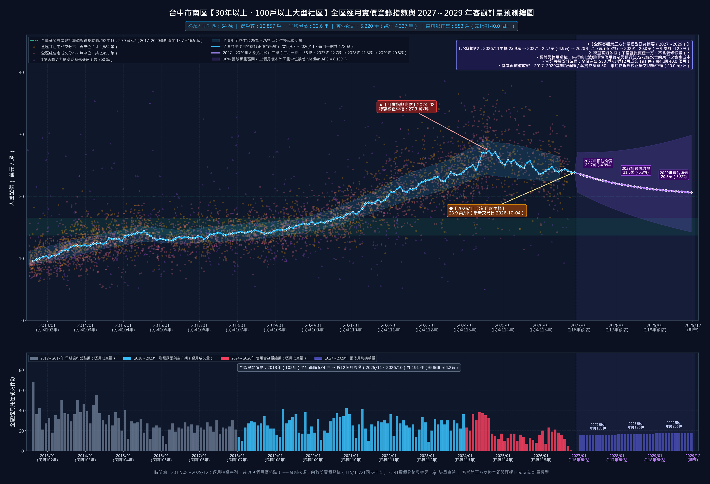

# 台中市南區【30年以上・100戶以上大型社區】逐月實價登錄價格序列與 2027～2029 年計量預測報告

> **研究立場聲明**：本報告採獨立第三方客觀計量經濟研究立場撰寫，不偏袒買方或賣方任一立場，亦不納入主觀室內裝修費用假設。全數歷史實價登錄資料同步至內政部 **115 年 11 月 21 日** 公開批次（最新交易日 `2026-10-04`），並經 **591 實價登錄** 與 **樂居 Leju（115.11.24 更新批次）** 雙平台交叉查驗。

- **研究母體**：台中市南區屋齡 ≥ 30 年（1996 年及以前完工）且總戶數 ≥ 100 戶之集合住宅社區（並依指定納入歌德堡、大慶中山〔大慶國宅〕兩處指標社區），共 **54 棟**（合計 **12,857 戶**，平均屋齡 **32.6 年**）
- **交易樣本**：累計實價登錄 **5,220 筆**（經五重清洗後之標準純住宅交易 **4,337 筆**）
- **微觀在售庫存**：當前線上在售掛牌合計 **553 戶**（整體待售率 **4.30%**，庫存去化月數 **MOI = 40.0 個月**）
- **時間序列精度**：歷史序列 `2012-08`～`2026-11`（172 個月點）＋ 預測序列 `2027-01`～`2029-12`（36 個月點），**每一個月份皆具備明確之單價推估點**

---

## 一、全區大盤逐月價格週期與 2027～2029 年預測摘要

1. **歷史逐月指數軌跡（2012/08～2026/11）**：
   - 2017～2020 年（民國 106～109 年）剛需穩定期，全區純住宅四分位核心價格帶位於 **13.7～16.5 萬/坪**。
   - 隨總體資金寬鬆與重劃區比價效應帶動，全區逐月特徵校正指數於 **`2024-08`** 達歷史高點 **27.3 萬/坪**。
   - 2024 年下半年起受央行第七波選擇性信用管制與銀行授信水位影響，交易量顯著收斂：歷史年度成交高峰（2013年）為 **534 件**，近 12 個月滾動（2025/11～2026/10）成交量為 **191 件**（較高峰變動 **-64.2%**）；`2026-11` 最新月度特徵校正中樞為 **23.9 萬/坪**。
2. **2027～2029 年（民國 116～118 年）客觀計量預測結果**：
   - **2027 年（116 年）預估年均價**：**22.7 萬/坪**（年變動 `-4.9%`，90% 預測區間 `[19.1～27.2 萬]`）
   - **2028 年（117 年）預估年均價**：**21.5 萬/坪**（年變動 `-5.3%`，90% 預測區間 `[16.7～27.8 萬]`）
   - **2029 年（118 年）預估年均價**：**20.8 萬/坪**（年變動 `-3.3%`，90% 預測區間 `[14.9～29.1 萬]`）
   - **三年累計變動幅度**：**`-12.8%`**，逐步朝經通膨／名目所得成長與屋齡折舊雙向調整後之基本面均衡中樞（**20.0 萬/坪**）溫和收斂。

---

## 二、影響未來三年價格走勢之四大客觀結構機制（不含裝修費用假設）

### 2.1 微觀供需與在售庫存去化結構（Inventory & Absorption Microstructure）
- 不動產經濟學以「庫存去化月數（Months of Inventory, MOI = 當前在售戶數 ÷ 月均成交件數）」衡量微觀供需鬆緊，一般以 **6～9 個月** 為供需均衡基準。
- 南區 54 棟大型社區目前線上在售共 **553 戶**，全區整體 MOI 為 **40.0 個月**。掛售戶數較多、MOI 顯著高於均衡值之社區存在同社區比價調節壓力；反之在售稀少（MOI < 8 個月）之社區則具備價格支撐韌性。

### 2.2 建物自然物理折舊與高齡集合住宅生命週期（Physical Depreciation & Lifecycle）
- 研究母體平均屋齡為 **32.6 年**。依據不動產估價實證，30 年以上 RC 集合住宅每年自然物理折舊率約為 **0.6%～0.8%**。
- 大型社區公共機電、電梯與外牆管理維護基金之健全度，決定其抗折舊能力；而隨持有時間推進 10～20 年邁向 45～50 年高齡建築時，因大型社區產權人數眾多、都更整合門檻較高，次級市場流動性隨屋齡遞減屬客觀規律。

### 2.3 總體貨幣信用政策與高屋齡房貸授信準則（Credit Regime & Mortgage Underwriting）
- 央行第七波選擇性信用管制與銀行法 72-2 條不動產放款比率約束，使高槓桿需求退場並回歸剛性自住定價。
- 金融機構對 30～35 年以上住宅普遍適用「屋齡＋貸款年限 ≤ 50～55 年」內規，貸款期限較新成屋短，買方對總價與每月本息負擔之精算更趨嚴謹。

### 2.4 名目通膨、薪資成長與基本面均衡錨定（Nominal Growth & Equilibrium Cointegration）
- 客觀評估不可忽略 2019～2026 年台灣消費者物價指數（CPI）、營建重置成本與名目薪資之累積成長。將 2017～2020 年基期價格依名目經濟成長率正向調整並扣除建物屋齡折舊後，南區大型老牌社區之合理基本面均衡中樞約為 **20.0 萬/坪**，構成中長期實質底部支撐。

---

## 三、雙平台資料檢核、面板 Hedonic 校正與狀態空間逐月計量模型

1. **591 × 樂居 Leju 雙重查驗**：優先採用內政部原始申報車位拆分數據；針對國宅分管協議車位（如大慶國宅、博愛國宅）比照樂居規範不強行二次拆算；並排除未拆車位估算異常與親友特殊交易。
2. **面板固定效應 Hedonic 特徵校正（樣本數 N = 4,022）**：估計相對樓層高度係數 `+0.0446`、頂樓係數 `-0.0516`、四樓係數 `-0.0202` 與面積彈性 `-0.0513`，消除單月成交特定高低樓層造成之價格雜訊。
3. **Rauch-Tung-Striebel（RTS）卡爾曼平滑器逐月序列**：結合社區觀測成交與所屬生活圈月度動能，推估 `2012-08`～`2026-11` 每一個月份之連續價格點（共 172 點），並外推 `2027-01`～`2029-12` 未來三年逐月預測點（共 36 點）。
4. **12 個月樣本外滾動回測驗證（Walk-Forward Backtest）**：以 `2012-08 ~ 2025-10` 訓練並預測 `2025-11 ~ 2026-10 (12個月樣本外滾動測試)` 共 **166 筆** 實際純住成交，實測絕對誤差中位數 **Median APE = 8.15%**（MAPE = 9.39%，RMSE = 2.83 萬/坪，90% 預測區間覆蓋率 = 84.3%）。

---

## 四、十大指標大型社區（依總戶數規模 Top 10）實證與 2027～2029 預估對照表

| 規模排名 | 社區名稱 | 生活圈 | 戶數 / 屋齡 | 在售 (MOI) | 歷史最高 | 最新純住 (年月) | 2026/11月度中樞 | 2027預估 | 2028預估 | 2029預估 | 三年累計變動 |
|:---:|:---|:---|:---:|:---:|:---:|:---:|:---:|:---:|:---:|:---:|:---:|
| #01 | **長億城攬翠區陽光區** | 美村工學商圈 | 669戶 / 31.0年 | 47戶 (56月) | 31.7萬 | 22.5萬 (2026-08) | **23.8萬** | 23.0萬 | 21.9萬 | **21.2萬** | **-11.0%** |
| #02 | **文心大三元翡翠區** | 大慶共構站 | 558戶 / 31.5年 | 32戶 (96月) | 30.4萬 | 28.8萬 (2026-04) | **25.4萬** | 24.1萬 | 22.9萬 | **22.3萬** | **-12.3%** |
| #03 | **朋莊大樓** | 美村工學商圈 | 462戶 / 31.7年 | 9戶 (45月) | 29.0萬 | 29.0萬 (2024-06) | **25.0萬** | 24.0萬 | 22.8萬 | **22.0萬** | **-12.1%** |
| #04 | **工學天下** | 美村工學商圈 | 452戶 / 31.8年 | 17戶 (68月) | 29.0萬 | 19.6萬 (2026-06) | **22.1萬** | 21.2萬 | 20.2萬 | **19.6萬** | **-11.2%** |
| #05 | **京都特區** | 中興大學 | 420戶 / 30.4年 | 8戶 (7月) | 31.0萬 | 26.0萬 (2026-09) | **24.5萬** | 23.6萬 | 22.7萬 | **22.1萬** | **-9.8%** |
| #06 | **京華大鎮京國特區** | 中興大學 | 416戶 / 29.9年 | 31戶 (62月) | 28.5萬 | 17.9萬 (2026-07) | **21.1萬** | 20.2萬 | 19.3萬 | **18.8萬** | **-11.1%** |
| #07 | **德昌中華大樓** | 中興大學 | 409戶 / 32.3年 | 17戶 (85月) | 30.3萬 | 20.0萬 (2026-03) | **18.5萬** | 17.8萬 | 17.1萬 | **16.8萬** | **-9.3%** |
| #08 | **大慶中山(大慶國宅)** | 大慶共構站 | 362戶 / 24.6年 | 5戶 (25月) | 27.0萬 | 22.7萬 (2026-05) | **21.7萬** | 20.6萬 | 19.5萬 | **19.0萬** | **-12.4%** |
| #09 | **廣三大帝國** | 美村工學商圈 | 323戶 / 31.3年 | 7戶 (35月) | 28.4萬 | 24.5萬 (2026-04) | **23.9萬** | 23.0萬 | 21.9萬 | **21.1萬** | **-11.9%** |
| #10 | **龍邦綠園道** | 美村工學商圈 | 322戶 / 33.5年 | 18戶 (43月) | 28.8萬 | 23.6萬 (2026-08) | **22.4萬** | 21.6萬 | 20.7萬 | **20.2萬** | **-9.9%** |

---

## 五、全南區 54 棟大型社區完整實價登錄與三年預估總名冊

| 排名 | 社區名稱 | 戶數 | 屋齡 | 門牌地址 | 純住/總實登 | 在售(MOI) | 歷史高點 | 最新成交 | 26/11中樞 | 2027預估 | 2028預估 | 2029預估 | 三年累計 | 走勢圖 |
|:---:|:---|---:|---:|:---|:---:|:---:|---:|---:|---:|---:|---:|---:|---:|:---:|
| #01 | **長億城攬翠區陽光區** | 669 | 31.0年 | 工學路116號 | 305/390 | 47戶(56m) | 31.7萬 | 22.5萬 (2026-08) | 23.8萬 | 23.0萬 | 21.9萬 | **21.2萬** | `-11.0%` | [圖表](01_長億城攬翠區陽光區_成交行情走勢圖.png) |
| #02 | **文心大三元翡翠區** | 558 | 31.5年 | 大慶街二段6之16巷32號 | 25/28 | 32戶(96m) | 30.4萬 | 28.8萬 (2026-04) | 25.4萬 | 24.1萬 | 22.9萬 | **22.3萬** | `-12.3%` | [圖表](02_文心大三元翡翠區_成交行情走勢圖.png) |
| #03 | **朋莊大樓** | 462 | 31.7年 | 美村南路82號 | 26/32 | 9戶(45m) | 29.0萬 | 29.0萬 (2024-06) | 25.0萬 | 24.0萬 | 22.8萬 | **22.0萬** | `-12.1%` | [圖表](03_朋莊大樓_成交行情走勢圖.png) |
| #04 | **工學天下** | 452 | 31.8年 | 工學北路135號 | 109/128 | 17戶(68m) | 29.0萬 | 19.6萬 (2026-06) | 22.1萬 | 21.2萬 | 20.2萬 | **19.6萬** | `-11.2%` | [圖表](04_工學天下_成交行情走勢圖.png) |
| #05 | **京都特區** | 420 | 30.4年 | 學府路168巷6號 | 225/243 | 8戶(7m) | 31.0萬 | 26.0萬 (2026-09) | 24.5萬 | 23.6萬 | 22.7萬 | **22.1萬** | `-9.8%` | [圖表](05_京都特區_成交行情走勢圖.png) |
| #06 | **京華大鎮京國特區** | 416 | 29.9年 | 學府路125號 | 139/182 | 31戶(62m) | 28.5萬 | 17.9萬 (2026-07) | 21.1萬 | 20.2萬 | 19.3萬 | **18.8萬** | `-11.1%` | [圖表](06_京華大鎮京國特區_成交行情走勢圖.png) |
| #07 | **德昌中華大樓** | 409 | 32.3年 | 五權南一路1號 | 136/205 | 17戶(85m) | 30.3萬 | 20.0萬 (2026-03) | 18.5萬 | 17.8萬 | 17.1萬 | **16.8萬** | `-9.3%` | [圖表](07_德昌中華大樓_成交行情走勢圖.png) |
| #08 | **大慶中山(大慶國宅)** | 362 | 24.6年 | 高工南路1號 | 37/49 | 5戶(25m) | 27.0萬 | 22.7萬 (2026-05) | 21.7萬 | 20.6萬 | 19.5萬 | **19.0萬** | `-12.4%` | [圖表](08_大慶中山(大慶國宅)_成交行情走勢圖.png) |
| #09 | **廣三大帝國** | 323 | 31.3年 | 工學路59巷1號 | 82/108 | 7戶(35m) | 28.4萬 | 24.5萬 (2026-04) | 23.9萬 | 23.0萬 | 21.9萬 | **21.1萬** | `-11.9%` | [圖表](09_廣三大帝國_成交行情走勢圖.png) |
| #10 | **龍邦綠園道** | 322 | 33.5年 | 南和路197號 | 110/118 | 18戶(43m) | 28.8萬 | 23.6萬 (2026-08) | 22.4萬 | 21.6萬 | 20.7萬 | **20.2萬** | `-9.9%` | [圖表](10_龍邦綠園道_成交行情走勢圖.png) |
| #11 | **望族二期** | 314 | 33.0年 | 復興北路517號之1 | 100/120 | 4戶(8m) | 37.1萬 | 23.6萬 (2026-08) | 25.0萬 | 24.5萬 | 23.9萬 | **23.5萬** | `-6.0%` | [圖表](11_望族二期_成交行情走勢圖.png) |
| #12 | **比佛利山莊** | 309 | 34.0年 | 忠明南路730巷24號 | 124/158 | 27戶(108m) | 36.4萬 | 20.4萬 (2026-03) | 27.9萬 | 26.5萬 | 24.6萬 | **23.4萬** | `-16.2%` | [圖表](12_比佛利山莊_成交行情走勢圖.png) |
| #13 | **大安黃金城大廈** | 307 | 32.3年 | 南陽街59號 | 121/141 | 40戶(120m) | 34.3萬 | 27.0萬 (2026-06) | 25.3萬 | 23.8萬 | 22.4萬 | **21.7萬** | `-14.1%` | [圖表](13_大安黃金城大廈_成交行情走勢圖.png) |
| #14 | **遠見天下大樓** | 298 | 31.8年 | 仁義街76號 | 91/106 | 22戶(110m) | 32.9萬 | 21.8萬 (2026-05) | 24.3萬 | 23.0萬 | 21.7萬 | **21.0萬** | `-13.7%` | [圖表](14_遠見天下大樓_成交行情走勢圖.png) |
| #15 | **大東家樸園** | 285 | 31.9年 | 學府路175號 | 147/157 | 8戶(16m) | 35.8萬 | 31.2萬 (2026-08) | 27.0萬 | 25.9萬 | 24.7萬 | **24.0萬** | `-11.1%` | [圖表](15_大東家樸園_成交行情走勢圖.png) |
| #16 | **柳岸花明** | 280 | 33.7年 | 復興路一段271號 | 106/127 | 5戶(8m) | 30.5萬 | 26.4萬 (2026-06) | 24.8萬 | 24.0萬 | 23.0萬 | **22.2萬** | `-10.4%` | [圖表](16_柳岸花明_成交行情走勢圖.png) |
| #17 | **健康世界** | 278 | 33.5年 | 大慶街二段7巷4號 | 149/180 | 17戶(85m) | 34.5萬 | 30.1萬 (2026-05) | 25.2萬 | 23.8萬 | 22.4萬 | **21.6萬** | `-14.4%` | [圖表](17_健康世界_成交行情走勢圖.png) |
| #18 | **綠灣大樓** | 268 | 32.2年 | 復興路二段71巷65弄6號 | 97/125 | 7戶(35m) | 28.1萬 | 16.6萬 (2026-03) | 19.6萬 | 19.2萬 | 18.7萬 | **18.6萬** | `-5.1%` | [圖表](18_綠灣大樓_成交行情走勢圖.png) |
| #19 | **大安紫金城大樓** | 268 | 31.6年 | 建國南路一段262號之1 | 143/155 | 21戶(50m) | 35.5萬 | 25.5萬 (2026-04) | 25.8萬 | 23.9萬 | 22.0萬 | **21.0萬** | `-18.5%` | [圖表](19_大安紫金城大樓_成交行情走勢圖.png) |
| #20 | **長億南園** | 250 | 34.7年 | 大慶街一段79號 | 72/88 | 11戶(44m) | 31.4萬 | 22.3萬 (2026-09) | 22.5萬 | 21.2萬 | 19.9萬 | **19.3萬** | `-14.2%` | [圖表](20_長億南園_成交行情走勢圖.png) |
| #21 | **歌德堡** | 248 | 27.9年 | 德富路96巷2號 | 83/94 | 22戶(66m) | 35.5萬 | 28.1萬 (2026-03) | 27.0萬 | 25.6萬 | 24.4萬 | **23.9萬** | `-11.4%` | [圖表](21_歌德堡_成交行情走勢圖.png) |
| #22 | **五權天下** | 242 | 30.5年 | 五權南路167號 | 51/61 | 1戶(5m) | 31.4萬 | 24.3萬 (2026-01) | 25.2萬 | 24.4萬 | 23.5萬 | **23.1萬** | `-8.2%` | [圖表](22_五權天下_成交行情走勢圖.png) |
| #23 | **望族一期** | 236 | 33.7年 | 大慶街二段15巷11號 | 84/105 | 10戶(40m) | 36.5萬 | 30.0萬 (2026-03) | 26.7萬 | 25.0萬 | 23.4萬 | **22.5萬** | `-15.7%` | [圖表](23_望族一期_成交行情走勢圖.png) |
| #24 | **大東家華園** | 227 | 31.2年 | 學府路190號 | 69/81 | 18戶(54m) | 27.7萬 | 19.8萬 (2026-10) | 21.4萬 | 20.5萬 | 19.7萬 | **19.5萬** | `-8.9%` | [圖表](24_大東家華園_成交行情走勢圖.png) |
| #25 | **君臨天廈** | 221 | 30.7年 | 柳川東路一段79號 | 52/72 | 2戶(10m) | 26.1萬 | 25.9萬 (2026-03) | 23.8萬 | 23.3萬 | 22.8萬 | **22.4萬** | `-5.7%` | [圖表](25_君臨天廈_成交行情走勢圖.png) |
| #26 | **假日半島** | 219 | 32.5年 | 復興路二段34號 | 149/169 | 2戶(6m) | 33.2萬 | 24.8萬 (2026-07) | 24.7萬 | 24.1萬 | 23.3萬 | **22.7萬** | `-8.2%` | [圖表](26_假日半島_成交行情走勢圖.png) |
| #27 | **領袖勳章** | 219 | 32.2年 | 懷寧街198號 | 80/95 | 8戶(32m) | 28.2萬 | 22.6萬 (2026-05) | 23.5萬 | 22.5萬 | 21.4萬 | **20.8萬** | `-11.6%` | [圖表](27_領袖勳章_成交行情走勢圖.png) |
| #28 | **碧夏庭花園大廈** | 209 | 31.7年 | 光輝街90巷1號 | 55/63 | 5戶(25m) | 36.0萬 | 28.8萬 (2026-01) | 27.5萬 | 26.1萬 | 24.6萬 | **23.8萬** | `-13.5%` | [圖表](28_碧夏庭花園大廈_成交行情走勢圖.png) |
| #29 | **大東家南園** | 203 | 31.9年 | 學府路147巷2號 | 64/78 | 5戶(20m) | 29.0萬 | 25.3萬 (2026-01) | 25.8萬 | 24.6萬 | 23.3萬 | **22.5萬** | `-12.8%` | [圖表](29_大東家南園_成交行情走勢圖.png) |
| #30 | **裕國大廈** | 198 | 35.3年 | 美村路二段168巷10號 | 51/65 | 6戶(30m) | 24.8萬 | 24.8萬 (2026-08) | 22.0萬 | 21.3萬 | 20.5萬 | **19.9萬** | `-9.5%` | [圖表](30_裕國大廈_成交行情走勢圖.png) |
| #31 | **家綠寶大廈** | 196 | 30.8年 | 忠明南路780號 | 61/66 | 5戶(20m) | 33.8萬 | 26.4萬 (2026-02) | 28.2萬 | 27.3萬 | 26.1萬 | **25.3萬** | `-10.3%` | [圖表](31_家綠寶大廈_成交行情走勢圖.png) |
| #32 | **永和國宅** | 192 | 47.5年 | 南和路40號 | 33/56 | 2戶(10m) | 37.8萬 | 28.7萬 (2025-04) | 26.1萬 | 24.9萬 | 23.3萬 | **22.1萬** | `-15.3%` | [圖表](32_永和國宅_成交行情走勢圖.png) |
| #33 | **龍族儷園** | 188 | 31.5年 | 南平路39號 | 114/119 | 6戶(6m) | 30.9萬 | 25.6萬 (2026-09) | 25.4萬 | 24.9萬 | 24.2萬 | **23.7萬** | `-6.8%` | [圖表](33_龍族儷園_成交行情走勢圖.png) |
| #34 | **南京大廈** | 185 | 34.1年 | 五權南路610號 | 56/71 | 10戶(50m) | 25.3萬 | 21.2萬 (2025-12) | 20.4萬 | 19.5萬 | 18.7萬 | **18.3萬** | `-10.1%` | [圖表](34_南京大廈_成交行情走勢圖.png) |
| #35 | **京華大鎮京馥特區** | 171 | 30.1年 | 信義南街120號 | 43/67 | 7戶(35m) | 26.0萬 | 22.4萬 (2026-09) | 23.2萬 | 21.9萬 | 20.6萬 | **19.8萬** | `-14.5%` | [圖表](35_京華大鎮京馥特區_成交行情走勢圖.png) |
| #36 | **我家天廈** | 168 | 35.0年 | 建國南路一段155號 | 49/57 | 9戶(45m) | 28.7萬 | 27.0萬 (2026-03) | 25.6萬 | 24.0萬 | 22.5萬 | **21.7萬** | `-15.1%` | [圖表](36_我家天廈_成交行情走勢圖.png) |
| #37 | **德昌中國大廈** | 159 | 31.5年 | 忠明南路908號 | 77/84 | 6戶(18m) | 22.5萬 | 21.4萬 (2026-04) | 20.3萬 | 19.8萬 | 19.2萬 | **18.8萬** | `-7.3%` | [圖表](37_德昌中國大廈_成交行情走勢圖.png) |
| #38 | **聖學府** | 157 | 33.4年 | 工學路60號 | 51/68 | 6戶(30m) | 27.2萬 | 22.2萬 (2026-01) | 24.9萬 | 24.1萬 | 23.0萬 | **22.3萬** | `-10.6%` | [圖表](38_聖學府_成交行情走勢圖.png) |
| #39 | **劃江山** | 151 | 32.0年 | 復興北路500號 | 48/53 | 11戶(33m) | 29.5萬 | 22.8萬 (2026-06) | 22.7萬 | 22.0萬 | 21.1萬 | **20.6萬** | `-9.3%` | [圖表](39_劃江山_成交行情走勢圖.png) |
| #40 | **興大學府城** | 144 | 31.2年 | 建成路1629號 | 110/123 | 20戶(100m) | 34.5萬 | 18.6萬 (2026-03) | 19.6萬 | 18.7萬 | 17.8萬 | **17.5萬** | `-10.7%` | [圖表](40_興大學府城_成交行情走勢圖.png) |
| #41 | **復興園中園** | 140 | 34.5年 | 工學二街231號 | 21/30 | 0戶 | 22.7萬 | 21.3萬 (2026-06) | 21.9萬 | 21.7萬 | 21.3萬 | **21.0萬** | `-4.1%` | [圖表](41_復興園中園_成交行情走勢圖.png) |
| #42 | **中國小莊** | 138 | 32.0年 | 德富路270號 | 41/55 | 2戶(10m) | 28.6萬 | 24.8萬 (2026-07) | 23.6萬 | 22.7萬 | 21.7萬 | **21.3萬** | `-9.9%` | [圖表](42_中國小莊_成交行情走勢圖.png) |
| #43 | **得意之居** | 137 | 31.4年 | 公理街101號 | 81/85 | 9戶(36m) | 32.3萬 | 25.5萬 (2026-07) | 25.7萬 | 24.8萬 | 23.6萬 | **22.7萬** | `-11.8%` | [圖表](43_得意之居_成交行情走勢圖.png) |
| #44 | **園緣** | 133 | 32.1年 | 忠明南路720號 | 48/53 | 0戶 | 27.4萬 | 27.4萬 (2025-12) | 25.6萬 | 25.2萬 | 24.5萬 | **24.0萬** | `-6.1%` | [圖表](44_園緣_成交行情走勢圖.png) |
| #45 | **大學之道** | 130 | 31.8年 | 建成路1713巷2號 | 87/92 | 0戶 | 32.9萬 | 23.7萬 (2026-03) | 23.5萬 | 23.0萬 | 22.6萬 | **22.5萬** | `-4.4%` | [圖表](45_大學之道_成交行情走勢圖.png) |
| #46 | **寶三縱橫天廈** | 128 | 32.3年 | 工學路113號 | 38/48 | 7戶(28m) | 33.7萬 | 33.0萬 (2026-06) | 26.9萬 | 26.0萬 | 24.8萬 | **24.0萬** | `-10.8%` | [圖表](46_寶三縱橫天廈_成交行情走勢圖.png) |
| #47 | **學園巧居公寓** | 118 | 31.3年 | 建成路1567號 | 25/25 | 0戶 | 29.5萬 | 27.7萬 (2026-05) | 26.6萬 | 25.6萬 | 24.4萬 | **23.5萬** | `-11.8%` | [圖表](47_學園巧居公寓_成交行情走勢圖.png) |
| #48 | **大安國王大樓** | 116 | 32.9年 | 忠明南路787號 | 35/85 | 3戶(12m) | 17.8萬 | 14.2萬 (2026-06) | 15.7萬 | 15.4萬 | 14.9萬 | **14.6萬** | `-7.2%` | [圖表](48_大安國王大樓_成交行情走勢圖.png) |
| #49 | **中興大學城** | 112 | 32.2年 | 國光路81號 | 30/36 | 5戶(25m) | 25.7萬 | 22.8萬 (2026-01) | 22.2萬 | 21.4萬 | 20.7萬 | **20.3萬** | `-8.6%` | [圖表](49_中興大學城_成交行情走勢圖.png) |
| #50 | **老爺大廈** | 109 | 45.2年 | 復興路三段1號 | 54/55 | 1戶(4m) | 32.1萬 | 22.5萬 (2026-05) | 20.7萬 | 20.1萬 | 19.3萬 | **18.7萬** | `-9.6%` | [圖表](50_老爺大廈_成交行情走勢圖.png) |
| #51 | **寶璽祥園** | 108 | 35.2年 | 南平路226號 | 44/48 | 7戶(35m) | 26.8萬 | 21.7萬 (2024-05) | 23.5萬 | 22.5萬 | 21.2萬 | **20.4萬** | `-13.1%` | [圖表](51_寶璽祥園_成交行情走勢圖.png) |
| #52 | **天下一家2** | 103 | 33.7年 | 福田路228號 | 29/35 | 0戶 | 22.3萬 | 22.3萬 (2026-01) | 21.3萬 | 20.6萬 | 20.1萬 | **19.8萬** | `-7.0%` | [圖表](52_天下一家2_成交行情走勢圖.png) |
| #53 | **恩寵一生** | 101 | 32.6年 | 三民西路241號 | 43/47 | 4戶(20m) | 29.1萬 | 29.1萬 (2024-07) | 26.1萬 | 25.1萬 | 23.9萬 | **23.1萬** | `-11.4%` | [圖表](53_恩寵一生_成交行情走勢圖.png) |
| #54 | **英棋雅築** | 101 | 31.0年 | 忠明南路1300號 | 37/39 | 1戶(5m) | 31.6萬 | 31.6萬 (2026-04) | 28.4萬 | 27.3萬 | 25.7萬 | **24.6萬** | `-13.4%` | [圖表](54_英棋雅築_成交行情走勢圖.png) |

---

## 六、資產持有方與購屋評估方之客觀對稱評估參考

- **對資產持有方（屋主）之客觀評估**：建議對照社區當前 `MOI` 去化月數與 `2026/11` 月度特徵校正中樞設定合理定價區間；若社區掛售量低（MOI < 8 個月）可維持穩健定價，若同社區競售戶數偏高則適度貼近月度均衡值有助於提升成交效率。
- **對購屋評估方（買方）之客觀評估**：建議以面板 Hedonic 標準樓層校正價及車位拆算淨單價作為客觀衡量基準，實地檢視社區管委會公共基金與設備維護紀錄，並於簽約前先行向銀行確認高屋齡標的之實際核貸成數與年限，確保財務穩健。
