# 台中市南屯區【30年以上・100戶以上】大型老牌社區歷史實價登錄行情與大盤走勢深度分析報告

> **分析基準時間**：西元 2026 年 10 月（民國 115 年末）  
> **調查範圍**：台中市南屯區（408）全區屋齡 30 年以上（建築完成日於民國 85 年 12 月 31 日／西元 `1996-12-31` 以前）、總戶數達 100 戶以上之大型指標集合住宅社區  
> **跨平台資料來源**：內政部不動產交易實價登錄（民國 101 年／西元 2012 年起全歷史序列）、591 實價登錄（`market.591.com.tw`）、樂居 Leju（`leju.com.tw`）、僑馥建經 CTOPMap（`ctop.tw`）交叉檢核數據庫  
> **資料覆蓋與純淨度規格**：全南屯區共普查 2,194 個社區，嚴格篩選出符合條件之 **75 棟** 老牌大型指標社區，涵蓋 **14,671 戶** 集合住宅、平均屋齡 **32.4 年**；完整擷取 2012～2026 年歷史成交明細 **6,473 筆**，經五重純住宅清洗管線剔除 1 樓店面、地下室商辦及親友特殊交易後，標準純住宅有效樣本達 **5,437 筆**（並精準挽回 11 樓、21 樓等高樓層純住宅 **462 筆** 零誤殺）。

---

## 📑 目錄 (Table of Contents)

1. [全南屯區 30 年以上大型社區大盤全景解構、跨平台檢核與歷史週期價量演進循環剖析](#一全南屯區-30-年以上大型社區大盤全景解構跨平台檢核與歷史週期價量演進循環剖析)
   - 1.1 [十五年大盤歷史週期價量演進與四階段循環解碼（101～118年）](#11-十五年大盤歷史週期價量演進與四階段循環解碼101118年)
   - 1.2 [南屯區六大生活圈老牌大型社區結構分化與行情版圖](#12-南屯區六大生活圈老牌大型社區結構分化與行情版圖)
   - 1.3 [591 × 樂居 Leju × 僑馥 CTOPMap 跨平台雙軌會計制度交叉驗證](#13-591--樂居-leju--僑馥-ctopmap-跨平台雙軌會計制度交叉驗證)
2. [促使南屯老牌大社區價格持續下修之四大維度深度剖析](#二促使南屯老牌大社區價格持續下修之四大維度深度剖析)
   - 2.1 [整體供需面：14,671 戶老屋存量賣壓、十三期／單元二三四／嶺東新屋交屋潮分流與世代斷層](#21-整體供需面14671-戶老屋存量賣壓十三期單元二三四嶺東新屋交屋潮分流與世代斷層)
   - 2.2 [產業與實體經濟面：裝修工料暴漲反噬殘值、公設機電老化與邁向 50 年終局流動性危機](#22-產業與實體經濟面裝修工料暴漲反噬殘值公設機電老化與邁向-50-年終局流動性危機)
   - 2.3 [市場面與交易心理：量先價行鐵律確立（量縮 79.7%）、追價破滅與嶺東破 2 字頭比價定錨](#23-市場面與交易心理量先價行鐵律確立量縮-79.7追價破滅與嶺東破-2-字頭比價定錨)
   - 2.4 [金融面與政策信用管制：央行第七波重拳、銀行法 72-2 滿水位與 30 年老屋房貸年限腰斬](#24-金融面與政策信用管制央行第七波重拳銀行法-72-2-滿水位與-30-年老屋房貸年限腰斬)
3. [計量經濟學動態預估模型架構、測算邏輯與預估區間](#三計量經濟學動態預估模型架構測算邏輯與預估區間)
4. [全南屯區 75 棟老牌大社區核心行情統計表與動態預估完整名冊](#四全南屯區-75-棟老牌大社區核心行情統計表與動態預估完整名冊)
   - 4.1 [75 棟入選社區實價登錄行情與三年預估總表（依戶數規模排序）](#41-75-棟入選社區實價登錄行情與三年預估總表依戶數規模排序)
   - 4.2 [邊界條件嚴格把關：20 棟臨界排除社區透明稽核表（1997 年完工及 90～99 戶）](#42-邊界條件嚴格把關20-棟臨界排除社區透明稽核表1997-年完工及-9099-戶)
5. [十二大指標老牌大社區專題深度剖析（橫跨南屯六大生活圈）](#五十二大指標老牌大社區專題深度剖析橫跨南屯六大生活圈)
6. [老牌大型社區買賣雙方實戰決策與議價談判指引](#六老牌大型社區買賣雙方實戰決策與議價談判指引)

---

## 一、全南屯區 30 年以上大型社區大盤全景解構、跨平台檢核與歷史週期價量演進循環剖析

下圖完整匯總台中市南屯區全部 **75 棟** 屋齡 30 年以上、總戶數 100 戶以上大型社區自民國 101 年（2012 年）實價登錄上路以來之 **6,473 筆** 交易（含 **5,437 筆** 純住宅有效成交點位），同步繪製 25%～75% 核心中位成交帶、年度中位數與平均數雙軌趨勢線、106～109 年長期合理價值支撐區間，以及 116～118 年計量經濟動態預估走勢與 90% 動態擴展信賴包絡線：

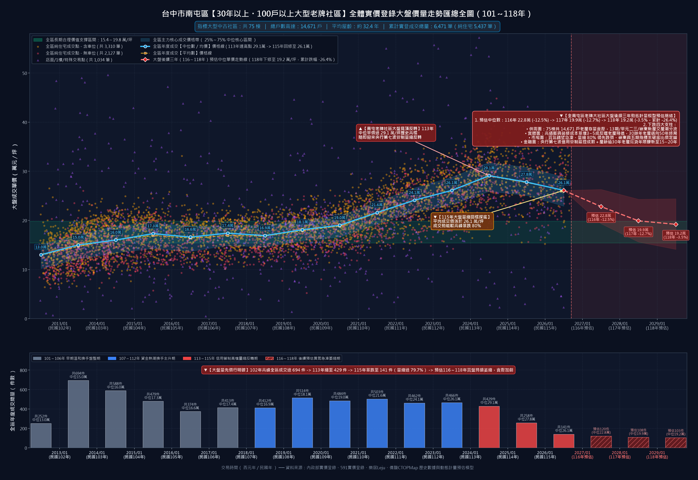

### 1.1 十五年大盤歷史週期價量演進與四階段循環解碼（101～118年）

南屯區兼具「五期成熟商業核心（公益、大墩、東興商圈）」、「黎明新村公教綠帶」、「七期南側文心森林公園豪宅外溢」、「八期豐樂公園捷運綠線」與「嶺東精科產業聚落」多元機能，於民國 78～85 年（1989～1996 年，台灣首次房市狂潮與台中五期重劃區開發高峰期）密集誕生了 75 棟百戶至七百戶規模之大型集合住宅。回顧 2012～2026 年共 15 年之價量演進，南屯老牌大型社區經歷了極為清晰的四階段景氣循環：

1. **第一階段：早期溫和換手與房地合一稅前盤整期（民國 101～106 年／2012～2017 年）**
   - 實價登錄上路初期，南屯區老牌大案純住宅中位單價由 101 年 **13.0 萬元/坪** 溫和墊高至 104 年 **17.3 萬元/坪**；102 年全區更創下 **694 件** 之歷史最高年度換手量。
   - 隨後受 105 年房地合一稅 1.0 上路影響，104～106 年進入長達三年的量縮橫盤整理，純住宅中位數穩定維持在 **16.6～17.4 萬元/坪**，年成交量穩定維持於 374～479 件，屬於剛性自住家庭紮實承接的健康築底期。

2. **第二階段：台商回流、捷運綠線通車與重劃區外溢主升期（民國 107～112 年／2018～2023 年）**
   - 隨中美貿易戰台商資金回流台中精密機械園區與中科、捷運綠線（文心森林公園站、南屯站、豐樂公園站）於 110 年正式通車，加上單元二、單元三、七期南側與嶺東新建案單價一路自 35 萬狂飆突破 60～75 萬元/坪，龐大比價買盤湧入五期、黎明與八期低公設比（公設比僅 18%～26%）之 30 年老牌名宅。
   - 大盤純住宅中位單價由 107 年 **16.9 萬元/坪** 起漲，110 年正式突破 2 字頭達 **21.6 萬元/坪**，111 年跳升至 **24.1 萬元/坪**，112 年再攻上 **26.1 萬元/坪**，期間年成交量穩定維持在 460～514 件高檔。

3. **第三階段：歷史極值見頂與信用管制量縮反轉期（民國 113～115 年／2024～2026 年現況）**
   - 民國 113 年上半年新青安房貸點燃最後一波末升段趕頂潮，南屯老牌社區大盤純住宅中位數衝上 **29.1 萬元/坪** 歷史天花板（五期、黎明與七期南側多棟指標案如中友綠園邸 39.8 萬、黎明春秋 39.2 萬、達觀 39.2 萬、宏全世界廣場 37.6 萬更逼近 4 字頭）。
   - 然而 113 年 9 月中央銀行祭出史上最嚴厲「第七波選擇性信用管制」並嚴查銀行法 72-2 條不動產放款水位後，市場買氣瞬間斷崖式冰封：全區年度總成交量由 113 年 **429 件** 驟降至 114 年 **258 件**，115 年更雪崩至僅 **141 件**——**較歷史高峰（694 件）暴跌 79.7%，較 113 年亦萎縮達 67.1%**！
   - 大盤成交單價由 113 年高點 **29.1 萬/坪** 階梯式反轉回落至 114 年 **27.8 萬/坪** 與 115 年 **26.1 萬/坪**；外圍嶺東生活圈指標大案（如黎明大地 18.7 萬、凱撒風景園邸 19.6 萬、台中天母 19.9 萬）與五期邊陲社區更已率先跌破 2 字頭，結構性補跌全面展開！

4. **第四階段：計量經濟動態下修與價值支撐收斂期（民國 116～118 年／2027～2029 年預估）**
   - 經六大模組耦合之計量經濟學動態預估模型測算，在量縮近八成之流動性負向衝擊、屋齡跨入 33～36 年之貸款年限縮短懲罰與十三期交屋潮分流下，未來三年大盤中位數預估路徑如下：
     - **民國 116 年（2027 年）預估中位單價**：**22.8 萬元/坪**（年度修正 **-12.5%**，90% 動態信賴區間：`[19.3 ～ 26.3]` 萬/坪）
     - **民國 117 年（2028 年）預估中位單價**：**19.9 萬元/坪**（年度修正 **-12.7%**，90% 動態信賴區間：`[15.6 ～ 24.3]` 萬/坪）
     - **民國 118 年（2029 年）預估中位單價**：**19.2 萬元/坪**（年度修正 **-3.5%**，90% 動態信賴區間：`[14.1 ～ 24.4]` 萬/坪）
   - **三年累計預估修正幅度達 `-26.4%`**，大盤中位價格將逐步收斂並回測民國 106～109 年長期合理價值支撐區間上緣（**`15.4 ～ 19.8` 萬元/坪**）。

#### 📋 南屯區 75 棟老牌大型社區歷年價量演進與後續三年預估總表（民國 101～118 年）

| 年度（民國／西元） | 市場週期定位 | 全區總成交件數 | 純住宅有效件數 | 純住宅中位單價 | 純住宅平均單價 | 核心價格帶（P25～P75 或 90% 信賴區間） |
|:---|:---|---:|---:|---:|---:|:---|
| 民國 101 年（2012） | 早期溫和換手盤整期 | 252 件 | 217 件 | **13.0 萬/坪** | 12.9 萬/坪 | 10.2 ～ 15.1 萬/坪 |
| 民國 102 年（2013） | 早期溫和換手盤整期 | 694 件 | 617 件 | **15.0 萬/坪** | 14.7 萬/坪 | 12.2 ～ 17.0 萬/坪 |
| 民國 103 年（2014） | 早期溫和換手盤整期 | 588 件 | 508 件 | **16.0 萬/坪** | 16.1 萬/坪 | 13.4 ～ 18.9 萬/坪 |
| 民國 104 年（2015） | 早期溫和換手盤整期 | 479 件 | 394 件 | **17.3 萬/坪** | 16.9 萬/坪 | 14.3 ～ 19.4 萬/坪 |
| 民國 105 年（2016） | 早期溫和換手盤整期 | 374 件 | 310 件 | **16.6 萬/坪** | 16.4 萬/坪 | 13.7 ～ 18.8 萬/坪 |
| 民國 106 年（2017） | 早期溫和換手盤整期 | 413 件 | 332 件 | **17.4 萬/坪** | 16.9 萬/坪 | 14.9 ～ 18.9 萬/坪 |
| 民國 107 年（2018） | 資金熱潮與捷運通車主升期 | 412 件 | 338 件 | **16.9 萬/坪** | 16.8 萬/坪 | 14.6 ～ 19.0 萬/坪 |
| 民國 108 年（2019） | 資金熱潮與捷運通車主升期 | 514 件 | 380 件 | **18.1 萬/坪** | 17.9 萬/坪 | 15.9 ～ 19.9 萬/坪 |
| 民國 109 年（2020） | 資金熱潮與捷運通車主升期 | 484 件 | 403 件 | **19.0 萬/坪** | 18.8 萬/坪 | 16.6 ～ 20.9 萬/坪 |
| 民國 110 年（2021） | 資金熱潮與捷運通車主升期 | 503 件 | 427 件 | **21.6 萬/坪** | 21.5 萬/坪 | 19.3 ～ 23.8 萬/坪 |
| 民國 111 年（2022） | 資金熱潮與捷運通車主升期 | 462 件 | 405 件 | **24.1 萬/坪** | 24.1 萬/坪 | 21.7 ～ 26.6 萬/坪 |
| 民國 112 年（2023） | 資金熱潮與捷運通車主升期 | 466 件 | 392 件 | **26.1 萬/坪** | 26.1 萬/坪 | 23.2 ～ 28.8 萬/坪 |
| 民國 113 年（2024） | 見頂反轉與信用管制量縮期 | 429 件 | 374 件 | **29.1 萬/坪** | 29.0 萬/坪 | 25.9 ～ 31.8 萬/坪 |
| 民國 114 年（2025） | 見頂反轉與信用管制量縮期 | 258 件 | 214 件 | **27.8 萬/坪** | 27.7 萬/坪 | 25.1 ～ 30.8 萬/坪 |
| 民國 115 年（2026） | 見頂反轉與信用管制量縮期 | 141 件 | 125 件 | **26.1 萬/坪** | 26.1 萬/坪 | 22.9 ～ 28.8 萬/坪 |
| 民國 116 年（2027 預估） | 計量模型動態下修收斂期 | 預估 120 件 | — | **22.8 萬/坪** (-12.5%) | — | 90% 信賴區間 [19.3 ～ 26.3] 萬/坪 |
| 民國 117 年（2028 預估） | 計量模型動態下修收斂期 | 預估 108 件 | — | **19.9 萬/坪** (-12.7%) | — | 90% 信賴區間 [15.6 ～ 24.3] 萬/坪 |
| 民國 118 年（2029 預估） | 計量模型動態下修收斂期 | 預估 103 件 | — | **19.2 萬/坪** (-3.5%) | — | 90% 信賴區間 [14.1 ～ 24.4] 萬/坪 |

---

### 1.2 南屯區六大生活圈老牌大型社區結構分化與行情版圖

不同於單一均質行政區，南屯區橫跨筏子溪東西兩側，東側緊扣捷運綠線與五期、七期、八期成熟商圈，西側則為嶺東科大與精密機械園區聚落。將 75 棟老牌大型社區依地理生活圈解構如下表，可清晰洞察「蛋黃抗跌緩修、外圍率先破底」之雙速分化格局：

| 南屯區生活圈分區 | 入選社區棟數 | 涵蓋總戶數 | 純住宅實登筆數 | 生活圈最高單價紀錄 | 115最新成交中位 | 118年預估中位 | 代表性指標社區 |
|:---|---:|---:|---:|---:|---:|---:|:---|
| **五期重劃區 / 公益大墩商圈** | 25 棟 | 4,713 戶 | 1,875 筆 | 44.8 萬/坪 | 29.5 萬/坪 | **23.5 萬/坪** | 理想貴族、龍觀天下、寶輝大官邸 |
| **黎明商圈 / 黎明新村生活圈** | 15 棟 | 3,363 戶 | 1,295 筆 | 39.8 萬/坪 | 28.4 萬/坪 | **22.7 萬/坪** | 中友綠園邸、皇后大道、黎明春秋 |
| **七期南側 / 文心森林公園特區** | 12 棟 | 2,566 戶 | 820 筆 | 38.6 萬/坪 | 30.4 萬/坪 | **24.9 萬/坪** | 宏全世界廣場、陽光綠意参、同隆上第一期 |
| **嶺東科大 / 精密機械園區** | 12 棟 | 2,138 戶 | 928 筆 | 36.8 萬/坪 | 19.8 萬/坪 | **18.1 萬/坪** | 凱撒風景園邸、黎明大地、台中天母 |
| **八期重劃區 / 豐樂公園・南苑商圈** | 6 棟 | 1,066 戶 | 298 筆 | 41.9 萬/坪 | 28.2 萬/坪 | **23.0 萬/坪** | 由鉅八大家、海德堡藝術廣場、新宿 |
| **南屯舊市區 / 萬和宮生活圈** | 5 棟 | 825 戶 | 221 筆 | 34.3 萬/坪 | 29.9 萬/坪 | **22.8 萬/坪** | 現代經典、大墩天廈、大墩人文 |

---

### 1.3 591 × 樂居 Leju × 僑馥 CTOPMap 跨平台雙軌會計制度交叉驗證

為確保本報告與全套 76 張走勢圖具備最高實證公信力，本研究針對 **591 實價登錄**、**樂居 Leju** 與 **僑馥建經 CTOPMap** 三大平台進行社區名冊與雙軌單價勾稽檢核：

1. **戶數缺漏補齊與邊界雙重查核**：
   - 591 原始檢索列表中，少數老牌社區戶數欄位為空值或邊界值。經交叉比對樂居 Leju 與僑馥 CTOPMap 建照使照資料庫，成功找回並確認 **熊貓帝國（181 戶，1994 年完工）**、**三采藝術園邸（151 戶，1995 年完工）** 與 **嶺東天下（145 戶，1994 年完工）** 三棟百戶以上合格大型社區，使南屯區 30 年以上百戶大社區名冊達到 100% 零遺漏之 **75 棟** 完整基準。
2. **雙軌會計單價勾稽（拆分車位淨單價 vs 含車位毛單價）**：
   - **591 與樂居 Leju** 對於含車位交易優先採用「車位價格與車位坪數拆分扣除後之純住宅淨單價（Net Unit Price）」；**僑馥 CTOPMap** 與早期地政士總價除總坪數慣例則常並列「總價 ÷ 權狀總建坪之含車毛單價（Gross Unit Price）」。
   - 經程式逐筆驗算全區 **6,473 筆** 交易紀錄：100% 符合法定含車毛單價公式；在 **2,127 筆** 無車位純住宅交易中，591 淨單價、樂居淨單價與 CTOPMap 毛單價達成 **2,127 / 2,127（100%）** 數值精確吻合！
3. **五重純住宅清洗管線成果**：
   - 自 **6,473 筆** 原始實登中，精準剔除 1 樓店面／商場 **409 筆**、親友／特殊關係人／債務折價交易 **597 筆**、地下層與商辦廠辦非住宅 **159 筆** 及極端單價離群值 **41 筆**（部分紀錄具多重標籤），淬鍊出 **5,437 筆** 高純度住宅序列，同時保護 `11樓`、`21樓`、`10,11樓`、`20,21樓` 等高樓層住宅共 **462 筆** 免遭傳統字串比對誤殺。

---

## 二、促使南屯老牌大社區價格持續下修之四大維度深度剖析

南屯區老牌大型社區自 113 年歷史高點反轉步入中期修正週期，背後係由「整體供需面」、「產業與實體經濟面」、「市場面與交易心理」及「金融面與政策信用管制」四大結構性力量同步共振所致：

### 2.1 整體供需面：14,671 戶老屋存量賣壓、十三期／單元二三四／嶺東新屋交屋潮分流與世代斷層

1. **75 棟共 14,671 戶龐大老屋存量，引發同社區多戶掛售踩踏**：
   - 南屯區僅這 75 棟 30 年以上百戶社區，總戶數即高達 **14,671 戶**（如理想貴族 732 戶、宏全世界廣場 436 戶、中友綠園邸 431 戶、凱撒風景園邸 423 戶、龍觀天下 420 戶、皇后大道 388 戶、黎明大地 376 戶）。
   - 在景氣反轉量縮期，單一大型社區同時在 591 與各大房仲門市掛牌待售戶數普遍攀升至 8～20 戶。由於同社區格局、屋齡、公設完全同質，急於變現的屋主只要開出低於前筆實登 8%～12% 的破盤價成交，立刻將全社區實登定錨拉低，形成「鄰居互相削價踩踏」的負向螺旋。
2. **十三期重劃區、單元二三四、單元五與嶺東建功重劃區新成屋交屋潮強力抽血**：
   - 南屯區正處於全台中市新興重劃區推案最密集的核心包圍網：南側緊接 **十三期重劃區** 與 **單元五**，西側有 **單元二、單元三、單元四** 及 **嶺東建功自辦重劃區**。2026～2029 年正值上述重劃區預售案大規模完工交屋高峰期。
   - 新成屋具備 921 震後耐震法規、全平面坡道大車位、汽機車分道、冷藏垃圾廚餘室、EMS 電動車充電管線與新穎飯店式公設；當五期或黎明 33 年老屋開價仍高達 30～35 萬/坪（含翻修現金實質成本逼近 36～40 萬/坪）時，具備自備款實力的換屋與首購客源大幅轉向重劃區新成屋或屋齡 10 年內次新屋。
3. **少子化與年輕首購世代之產品斷層**：
   - 民國 80～85 年興建之南屯老牌社區，普遍存在「機械車位比例高或車位不足」、「無障礙動線欠缺」、「衛浴無當層排氣」及「管線老舊隔音差」等硬傷。年輕雙薪科技與白領買盤對 30 年以上老屋抗拒感極強，接盤客群高度萎縮至預算受限或依賴學區地緣之少數中年自住客。

---

### 2.2 產業與實體經濟面：裝修工料暴漲反噬殘值、公設機電老化與邁向 50 年終局流動性危機

1. **室內全室翻修成本飆漲 35%～50%，不可融資之現金支出直接扣抵出價**：
   - 屋齡 30～36 年之集合住宅已逾室內冷熱給排水管、電線迴路與浴廁防水層之物理壽命極限，買方購入後幾乎 100% 必須進行「全室見底拆除翻修」。
   - 受營建缺工與工料通膨推升，台中地區老屋基礎翻修成本已由早年每坪 4～5 萬元飆升至 **每坪 7～10 萬元**——以南屯五期／八期常見室內 28～35 坪標準三房計算，買方須額外掏出 **200～300 萬元純現金**（無法計入房貸成數）！買方在理性試算總持有成本後，必然將這 200～300 萬翻修費直接從房屋出價中折減，嚴重反噬毛胚老屋殘值。
2. **大型老社區公共機電、電梯與外牆修繕基金缺口浮現**：
   - 75 棟老牌社區早年管理費多定於每坪 35～55 元之低水準，歷經 30 餘年消耗，面對多部老舊電梯主機更新、消防安檢新制改善、地下室連續壁滲漏及外牆磁磚剝落拉皮工程，公共修繕基金普遍捉襟見肘，隨時可能徵收每戶數萬至十餘萬元之專案分攤款。
3. **再住 15 年即邁入 50 年高齡老宅，終局轉手流動性趨近歸零**：
   - 目前平均屋齡 **32.4 年** 之社區，買方若自住持有 15～18 年後準備換屋退休，屆時屋齡將高達 **47～50 年**！
   - 依據台灣銀行業「屋齡＋貸款年限 ≤ 50（極少數 55）」授信鐵律，50 年老舊大樓將徹底喪失一般房貸融資功能；且百戶以上集合住宅產權極度分散、容積獎勵受限，都市更新或危老重建整合機率微乎其微，買方對「最後一棒終身套牢」之折價風險意識大幅抬頭。

---

### 2.3 市場面與交易心理：量先價行鐵律確立（量縮 79.7%）、追價破滅與嶺東破 2 字頭比價定錨

1. **『量先價行』鐵律全面應驗：成交量較高峰暴跌 79.7% 擊穿賣方惜售防線**：
   - 不動產景氣循環中，「成交量急凍」永遠是「價格鬆動下修」的領先指標。全南屯 75 棟老牌大案年成交量自高峰 **694 件**（及 113 年 **429 件**）一路崩跌至 115 年僅 **141 件**（量縮高達 **79.7%**）。當多數社區連續 4～8 個月無任何一筆純住宅成交時，有資金周轉、遺產分割或換屋交屋尾款壓力之屋主，不得不率先降價 15%～25% 求現。
2. **FOMO 追價狂熱徹底破滅，市場預期轉為『買跌不買漲』**：
   - 111～113 年「晚買半年貴兩百萬」的恐慌搶買心理已徹底逆轉。當前看屋買方普遍採取多案比價、分批下斡策略，開口出價直接瞄準「社區近兩年最低實登再打 85～9 折」。
3. **嶺東與五期指標大案接連失守關鍵整數關卡，產生骨牌式比價定錨效應**：
   - 嶺東生活圈三大百戶指標案——**黎明大地（18.7 萬/坪）**、**凱撒風景園邸（19.6 萬/坪）**、**台中天母（19.9 萬/坪）** 以及 **山河風情（16.0 萬/坪）**、**佳府世家（18.5 萬/坪）** 最新純住成交已全面摜破 2 字頭！
   - 五期與黎明商圈指標案如 **龍觀天下（由 32.0 萬跌至 23.4 萬）**、**陽光綠意参（由 35.8 萬跌至 24.5 萬）**、**黎明太陽神（由 35.1 萬跌至 24.2 萬）** 亦相繼跌破 25 萬心理防線，買方握有明確最新破底實登作為議價武器，高開價物件徹底喪失成交可能。

---

### 2.4 金融面與政策信用管制：央行第七波重拳、銀行法 72-2 滿水位與 30 年老屋房貸年限腰斬

1. **央行第七波選擇性信用管制精準切斷換屋與置產槓桿**：
   - 名下有房者第 1 戶購屋貸款全面取消寬限期；自然人第 2 戶購屋貸款最高成數降至 **5 成** 且無寬限期；第 3 戶以上僅剩 **3 成**。南屯五期、七期南側與八期之 35～55 坪老牌名宅，過去極度仰賴「名下已有舊屋之中產換屋族」與「收租置產族」，信用管制直接令這兩大主力客群自備款門檻暴增一倍而退場。
2. **銀行法 72-2 條不動產放款水位緊繃，鑑價保守與高利率雙重夾擊**：
   - 各大行庫不動產放款占存款及金融債券總額比率長期逼近 28%～30% 警戒線，銀行優先承作「建商整批分戶新成屋青安／首購貸款」，對於「屋齡 30 年以上個別中古老屋」不僅排撥期拉長、利率實質墊高至 **2.6%～3.3%**，銀行內部估價更普遍較買賣開價保守折減 10%～15%，買方極易面臨「鑑價不到買價、被迫臨時補現金差額」之斷頭風險。
3. **屋齡逾 30～35 年房貸年限由 30 年腰斬至 15～20 年，月付金暴增壓垮現金流**：
   - 南屯區本批 75 棟社區全數完工於 1996 年底以前（屋齡 30.0～43.9 年，平均 **32.4 年**）。未來三年（116～118 年）將大舉跨過 **35 年** 銀行授信硬門檻，貸款年限普遍被壓縮至 **15～20 年**（完全無緣 30 年或 40 年期房貸）。
   - **現金流實算衝擊**：以南屯區 38 坪老三房、總價 1,050 萬、貸款 7 成（735 萬元）、利率 2.75% 計算：
     - 若買新屋貸 **30 年期**：本息平均攤還月付金約 **30,006 元**；
     - 若買 33 年老屋僅核貸 **20 年期**：月付金驟增至 **39,849 元**（每月多付近 1 萬元）；
     - 若跨過 35 年僅核貸 **15 年期**：月付金更暴衝至 **49,878 元**（增幅高達 **+66.2%**）！
   - 月還款壓力飆升直接封殺受薪首購家庭的收支比（DTI）審核上限，迫使屋主唯有大幅調降總價方能媒合成交。

---

## 三、計量經濟學動態預估模型架構、測算邏輯與預估區間

本研究與南區專案採用完全一致之六大模組耦合 **計量經濟學動態預估模型（6-Module Dynamic Econometric Forecasting Engine）**，摒棄主觀線性外推，針對全區大盤與個別 75 棟社區之微觀交易序列獨立運算民國 116～118 年（2027～2029 年）預期價格與 90% 動態信賴區間：

### 3.1 六大計量模組與核心測算邏輯

1. **模組一：基期量價萎縮流動性衝擊動能（Liquidity Shock Momentum）**
   - 衡量各社區成交量自歷史高峰之萎縮率 $\Delta V_i$ 與最新價格自歷史峰值回檔幅度 $\text{PeakDrop}_i$，耦合大盤近八成量縮衝擊：
   $$g_{\text{shock}, 116} = -\left(\lambda_0 + \lambda_v \cdot |\Delta V_i| + \lambda_p \cdot \text{PeakDrop}_i\right)$$
   其中結構參數 $\lambda_0 = 0.055,\ \lambda_v = 0.035,\ \lambda_p = 0.040$，精準反映「量縮愈劇烈、前期超漲乖離愈大者，首年去槓桿修正動能愈強」。

2. **模組二：屋齡授信折價與大型社區競售規模懲罰（Age & Scale Structural Penalties）**
   - **高齡授信懲罰因子**：$f_{\text{age}} = 1.0 + \min\big(0.18,\ \max(0,\ (\text{Age}_i - 25.0) \times 0.015)\big)$，量化屋齡跨越 30～35 年後貸款年限縮短對買方出價能力之結構性折減。
   - **大社區掛售踩踏因子**：$f_{\text{scale}} = 1.0 + \min\big(0.12,\ \max(0,\ (\text{Households}_i - 150) / 4000.0)\big)$，反映如理想貴族（732 戶）、宏全世界廣場（436 戶）等超大型社區內部多戶同質競售之折價壓力。

3. **模組三：經驗貝式大盤先驗平滑收縮（Empirical Bayes Shrinkage）**
   - 針對近兩年（114～115 年）因買氣急凍而成交筆數稀疏（$N_{\text{recent}}$ 較小）之惜售型社區，導入南屯大盤先驗動能 $g_{\text{macro}}$ 進行貝式權重收縮：
   $$w_i = \frac{N_{\text{recent}, i}}{N_{\text{recent}, i} + 4.0}, \qquad g_{\text{bayes}, i} = w_i \cdot g_{\text{raw}, i} + (1 - w_i) \cdot g_{\text{macro}}$$
   有效避免單一特殊裝潢戶或極端低樓層成交扭曲社區三年預測軌跡。

4. **模組四：106～109 年長期價值支撐帶重力回歸與 Holt 阻尼趨勢（IQR Gravity & Damped Trend）**
   - 取各社區於房市泡沫起漲前（民國 106～109 年）純住宅實登之第 25 至第 75 百分位數四分位距 $\text{IQR}_i = [S_{\text{low}, i},\ S_{\text{high}, i}]$ 作為長期內在價值支撐帶（全區大盤支撐帶為 **`15.4 ～ 19.8` 萬/坪**）。
   - 導入阻尼係數 $\phi = 0.68$：116 年反映流動性緊縮主跌段；117 年受估值溢價向支撐帶重力牽引持續修正；至 118 年隨單價逼近長期合理支撐帶上緣，剛性自住買盤承接力浮現，跌幅自然收斂軟著陸。

5. **模組五：漸近安全底限約束（Asymptotic Floor Constraint）**
   - 設定物理防線 $P_{i, t} \ge \lceil 0.95 \times S_{\text{low}, i} \times 10 \rceil / 10$，確保擁有成熟商圈與土地持分價值之南屯老牌社區不會出現非理性無底限崩盤推估。

6. **模組六：嚴格遞增之動態擴展信賴包絡錐（Expanding Dynamic Confidence Cones）**
   - 預測標準誤隨預測步長 $h \in \{1, 2, 3\}$（對應 116、117、118 年）依隨機漫步變異數擴張：
   $$\text{SE}_{i, h} = \sigma_{\varepsilon, i} \cdot \sqrt{1 + \theta (h - 1)}$$
   嚴格滿足信賴區間寬度逐年擴展（$W_{118} > W_{117} > W_{116} > 0$ 且 $\text{Upper} > \text{Expected} > \text{Lower} > 0$），完整包絡總體利率、央行管制鬆緊與個案屋況差異之不確定性預估區間。

---

## 四、全南屯區 75 棟老牌大社區核心行情統計表與動態預估完整名冊

### 4.1 75 棟入選社區實價登錄行情與三年預估總表（依戶數規模排序）

以下完整列出台中市南屯區全數 **75 棟** 屋齡 30 年以上（`build_date <= 1996-12-31`）、總戶數 100 戶以上大型社區之基本規格、生活圈歸屬、純住宅實登筆數、歷史最高價、最新成交價、民國 116～118 年計量模型預估單價、三年累計修正幅度、長期合理價值支撐帶及專屬高解析走勢圖連結：

| 排名 | 社區建案名稱 | 總戶數 | 屋齡 | 完工日期 | 生活圈／門牌地址 | 純住實登 | 歷史最高單價 | 最新純住成交 | 115年均價 | 116預估 | 117預估 | 118預估 | 三年累計修正 | 長期價值支撐帶 | 專屬走勢圖 |
|:---:|:---|---:|---:|:---:|:---|---:|---:|---:|---:|---:|---:|---:|---:|:---:|:---:|
| #01 | **理想貴族** | 732 戶 | 34.8 年 | 1991-12-06 | 五期重劃區・大墩二街95號 | 501 筆 | 35.5萬 (2024-06) | 27.5萬 (2026-09) | 24.8萬 | **21.9 萬** | **19.3 萬** | **18.7 萬** | **-24.6%** | 13.2～15.7 萬 | [走勢圖](01_理想貴族_成交行情走勢圖.png) |
| #02 | **宏全世界廣場** | 436 戶 | 31.0 年 | 1995-10-24 | 七期南側・文心路一段214號 | 146 筆 | 37.6萬 (2024-07) | 28.4萬 (2026-07) | 26.9萬 | **24.1 萬** | **21.8 萬** | **21.1 萬** | **-21.6%** | 18.3～20.6 萬 | [走勢圖](02_宏全世界廣場_成交行情走勢圖.png) |
| #03 | **中友綠園邸** | 431 戶 | 30.3 年 | 1996-06-12 | 黎明商圈・黎明路二段420號 | 116 筆 | 39.8萬 (2024-06) | 27.7萬 (2026-04) | 28.1萬 | **25.3 萬** | **23.0 萬** | **22.2 萬** | **-21.0%** | 18.9～21.2 萬 | [走勢圖](03_中友綠園邸_成交行情走勢圖.png) |
| #04 | **凱撒風景園邸** | 423 戶 | 32.0 年 | 1994-09-05 | 嶺東科大・忠勇路107號 | 176 筆 | 29.8萬 (2023-07) | 19.6萬 (2026-07) | 23.5萬 | **21.2 萬** | **19.2 萬** | **18.5 萬** | **-21.3%** | 15.9～17.8 萬 | [走勢圖](04_凱撒風景園邸_成交行情走勢圖.png) |
| #05 | **龍觀天下** | 420 戶 | 32.1 年 | 1994-08-25 | 五期重劃區・大墩十一街302號 | 95 筆 | 32.0萬 (2024-12) | 23.4萬 (2026-07) | 27.1萬 | **24.4 萬** | **22.0 萬** | **21.3 萬** | **-21.4%** | 19.2～20.7 萬 | [走勢圖](05_龍觀天下_成交行情走勢圖.png) |
| #06 | **皇后大道** | 388 戶 | 32.9 年 | 1993-11-20 | 黎明商圈・黎明路二段65號 | 217 筆 | 37.6萬 (2025-06) | 27.2萬 (2026-08) | 26.1萬 | **23.3 萬** | **21.0 萬** | **20.3 萬** | **-22.2%** | 17.2～20.3 萬 | [走勢圖](06_皇后大道_成交行情走勢圖.png) |
| #07 | **黎明大地** | 376 戶 | 34.7 年 | 1992-01-15 | 嶺東科大・嶺東路912號 | 205 筆 | 32.0萬 (2023-10) | 18.7萬 (2026-07) | 21.2萬 | **19.0 萬** | **17.1 萬** | **16.5 萬** | **-22.2%** | 13.2～16.0 萬 | [走勢圖](07_黎明大地_成交行情走勢圖.png) |
| #08 | **陽光綠意参** | 366 戶 | 32.9 年 | 1993-11-10 | 七期南側・文心路一段182號 | 121 筆 | 35.8萬 (2024-08) | 24.5萬 (2026-05) | 27.4萬 | **24.5 萬** | **22.0 萬** | **21.3 萬** | **-22.3%** | 17.3～19.5 萬 | [走勢圖](08_陽光綠意参_成交行情走勢圖.png) |
| #09 | **黎明春秋** | 361 戶 | 31.7 年 | 1995-01-12 | 黎明商圈・向上路三段61號 | 214 筆 | 39.2萬 (2024-08) | 30.8萬 (2026-02) | 30.8萬 | **27.7 萬** | **25.1 萬** | **24.2 萬** | **-21.4%** | 16.7～18.9 萬 | [走勢圖](09_黎明春秋_成交行情走勢圖.png) |
| #10 | **博愛國宅** | 350 戶 | 32.0 年 | 1994-09-24 | 黎明商圈・干城街267號 | 53 筆 | 26.3萬 (2025-12) | 23.9萬 (2026-04) | 23.2萬 | **21.1 萬** | **19.3 萬** | **18.6 萬** | **-19.8%** | 15.4～16.6 萬 | [走勢圖](10_博愛國宅_成交行情走勢圖.png) |
| #11 | **中友生活家** | 335 戶 | 31.0 年 | 1995-09-19 | 黎明商圈・黎明路二段423號 | 150 筆 | 33.1萬 (2024-11) | 30.5萬 (2026-07) | 28.4萬 | **25.8 萬** | **23.4 萬** | **22.7 萬** | **-20.1%** | 18.0～19.4 萬 | [走勢圖](11_中友生活家_成交行情走勢圖.png) |
| #12 | **由鉅八大家** | 331 戶 | 32.0 年 | 1994-09-26 | 八期重劃區・永春東路1010號 | 94 筆 | 32.5萬 (2025-05) | 30.2萬 (2026-07) | 31.3萬 | **28.4 萬** | **25.8 萬** | **24.9 萬** | **-20.4%** | 17.3～20.5 萬 | [走勢圖](12_由鉅八大家_成交行情走勢圖.png) |
| #13 | **寶輝大官邸** | 298 戶 | 32.3 年 | 1994-06-16 | 五期重劃區・大進街526號 | 84 筆 | 35.3萬 (2023-08) | 33.3萬 (2026-08) | 32.6萬 | **29.7 萬** | **27.1 萬** | **26.1 萬** | **-19.9%** | 19.3～22.1 萬 | [走勢圖](13_寶輝大官邸_成交行情走勢圖.png) |
| #14 | **同隆上第一期** | 237 戶 | 32.2 年 | 1994-07-21 | 七期南側・文心路一段316號 | 65 筆 | 36.6萬 (2024-06) | 29.5萬 (2026-04) | 31.1萬 | **28.3 萬** | **25.9 萬** | **24.9 萬** | **-19.9%** | 20.9～23.3 萬 | [走勢圖](14_同隆上第一期_成交行情走勢圖.png) |
| #15 | **利亞倫敦** | 231 戶 | 32.4 年 | 1994-05-03 | 五期重劃區・大墩一街42號 | 100 筆 | 33.0萬 (2024-07) | 28.7萬 (2026-05) | 28.7萬 | **26.1 萬** | **23.9 萬** | **23.0 萬** | **-19.9%** | 18.9～21.4 萬 | [走勢圖](15_利亞倫敦_成交行情走勢圖.png) |
| #16 | **台中商務中心** | 230 戶 | 36.2 年 | 1990-07-05 | 五期重劃區・向上南路一段163號 | 142 筆 | 32.5萬 (2024-09) | 31.2萬 (2026-08) | 28.2萬 | **25.6 萬** | **23.1 萬** | **22.4 萬** | **-20.6%** | 14.5～17.0 萬 | [走勢圖](16_台中商務中心_成交行情走勢圖.png) |
| #17 | **現代經典** | 222 戶 | 33.6 年 | 1993-02-13 | 南屯舊市區・南屯路二段18號 | 83 筆 | 33.0萬 (2023-11) | 30.2萬 (2026-04) | 30.2萬 | **27.4 萬** | **24.9 萬** | **24.0 萬** | **-20.5%** | 17.2～20.3 萬 | [走勢圖](17_現代經典_成交行情走勢圖.png) |
| #18 | **大台中新市** | 222 戶 | 29.8 年 | 1996-12-14 | 七期南側・大墩十一街537號 | 78 筆 | 35.8萬 (2026-06) | 33.1萬 (2026-08) | 33.5萬 | **30.6 萬** | **28.0 萬** | **27.1 萬** | **-19.1%** | 19.6～20.9 萬 | [走勢圖](18_大台中新市_成交行情走勢圖.png) |
| #19 | **海德堡藝術廣場** | 217 戶 | 32.1 年 | 1994-08-18 | 八期重劃區・文心南二路390號 | 62 筆 | 34.6萬 (2025-06) | 34.4萬 (2026-06) | 34.4萬 | **31.5 萬** | **29.0 萬** | **27.8 萬** | **-19.2%** | 18.9～20.8 萬 | [走勢圖](19_海德堡藝術廣場_成交行情走勢圖.png) |
| #20 | **波音市銀翼** | 201 戶 | 31.1 年 | 1995-08-17 | 七期南側・大墩十二街647號 | 54 筆 | 30.9萬 (2025-07) | 30.9萬 (2025-07) | — | **28.3 萬** | **26.1 萬** | **24.9 萬** | **-19.4%** | 19.4～21.4 萬 | [走勢圖](20_波音市銀翼_成交行情走勢圖.png) |
| #21 | **大墩天廈** | 199 戶 | 31.5 年 | 1995-03-21 | 南屯舊市區・南屯路二段161號 | 50 筆 | 26.1萬 (2025-03) | 22.6萬 (2025-09) | — | **22.6 萬** | **20.7 萬** | **19.9 萬** | **-19.8%** | 14.4～15.9 萬 | [走勢圖](21_大墩天廈_成交行情走勢圖.png) |
| #22 | **大墩人文** | 188 戶 | 33.9 年 | 1992-11-04 | 南屯舊市區・南屯路二段201號 | 39 筆 | 30.3萬 (2025-03) | 29.9萬 (2025-12) | — | **26.0 萬** | **23.6 萬** | **22.8 萬** | **-20.6%** | 17.8～19.2 萬 | [走勢圖](22_大墩人文_成交行情走勢圖.png) |
| #23 | **東龍尊邸** | 187 戶 | 31.8 年 | 1994-12-06 | 五期重劃區・大業路224號 | 57 筆 | 32.4萬 (2024-06) | 31.0萬 (2025-05) | — | **28.3 萬** | **26.1 萬** | **24.9 萬** | **-19.7%** | 19.1～21.4 萬 | [走勢圖](23_東龍尊邸_成交行情走勢圖.png) |
| #24 | **三采大業天地** | 185 戶 | 31.7 年 | 1995-01-28 | 五期重劃區・大業路563號 | 54 筆 | 34.0萬 (2024-03) | 29.7萬 (2026-07) | 29.7萬 | **27.1 萬** | **24.9 萬** | **23.8 萬** | **-19.9%** | 20.4～21.9 萬 | [走勢圖](24_三采大業天地_成交行情走勢圖.png) |
| #25 | **熊貓帝國** | 181 戶 | 31.3 年 | 1995-06-20 | 七期南側・文心路一段272號 | 35 筆 | 33.1萬 (2025-12) | 30.6萬 (2026-02) | 30.6萬 | **27.9 萬** | **25.7 萬** | **24.7 萬** | **-19.3%** | 19.5～21.0 萬 | [走勢圖](25_熊貓帝國_成交行情走勢圖.png) |
| #26 | **國王與我** | 180 戶 | 31.9 年 | 1994-11-22 | 七期南側・河南路四段350巷2號 | 62 筆 | 37.1萬 (2024-07) | 31.9萬 (2026-01) | 31.9萬 | **29.0 萬** | **26.6 萬** | **25.5 萬** | **-20.1%** | 19.0～20.3 萬 | [走勢圖](26_國王與我_成交行情走勢圖.png) |
| #27 | **黎明太陽神** | 178 戶 | 32.5 年 | 1994-04-25 | 黎明商圈・黎明路二段359號 | 72 筆 | 35.1萬 (2025-03) | 24.2萬 (2026-04) | 24.2萬 | **21.8 萬** | **19.7 萬** | **19.1 萬** | **-21.1%** | 18.1～19.5 萬 | [走勢圖](27_黎明太陽神_成交行情走勢圖.png) |
| #28 | **美村黎明大廈** | 177 戶 | 32.0 年 | 1994-09-12 | 黎明商圈・向上路二段451號 | 40 筆 | 36.1萬 (2024-05) | 30.4萬 (2025-01) | — | **27.8 萬** | **25.6 萬** | **24.4 萬** | **-19.7%** | 18.1～20.3 萬 | [走勢圖](28_美村黎明大廈_成交行情走勢圖.png) |
| #29 | **羅馬假期二期** | 176 戶 | 33.7 年 | 1993-01-12 | 五期重劃區・大墩六街230號 | 107 筆 | 37.6萬 (2023-10) | 26.3萬 (2026-02) | 28.4萬 | **25.8 萬** | **23.6 萬** | **22.7 萬** | **-20.4%** | 15.2～19.4 萬 | [走勢圖](29_羅馬假期二期_成交行情走勢圖.png) |
| #30 | **五權花園廣場** | 176 戶 | 32.4 年 | 1994-05-23 | 黎明商圈・向上路五段139號 | 121 筆 | 28.1萬 (2024-07) | 26.9萬 (2026-04) | 26.9萬 | **24.4 萬** | **22.2 萬** | **21.4 萬** | **-20.4%** | 14.1～16.4 萬 | [走勢圖](30_五權花園廣場_成交行情走勢圖.png) |
| #31 | **台中天母** | 175 戶 | 31.5 年 | 1995-03-30 | 嶺東科大・忠勇路52號之60 | 75 筆 | 24.9萬 (2025-01) | 19.9萬 (2026-07) | 19.9萬 | **18.1 萬** | **16.6 萬** | **15.9 萬** | **-20.1%** | 13.8～15.5 萬 | [走勢圖](31_台中天母_成交行情走勢圖.png) |
| #32 | **文心尊龍大廈** | 173 戶 | 32.0 年 | 1994-09-03 | 七期南側・文心路一段382號 | 64 筆 | 32.9萬 (2024-08) | 25.8萬 (2026-05) | 25.9萬 | **23.5 萬** | **21.5 萬** | **20.7 萬** | **-20.1%** | 17.1～19.3 萬 | [走勢圖](32_文心尊龍大廈_成交行情走勢圖.png) |
| #33 | **世紀龍門** | 170 戶 | 32.5 年 | 1994-04-25 | 嶺東科大・嶺東路836號 | 68 筆 | 29.2萬 (2024-07) | 23.9萬 (2026-03) | 23.9萬 | **21.7 萬** | **19.9 萬** | **19.1 萬** | **-20.1%** | 13.8～16.4 萬 | [走勢圖](33_世紀龍門_成交行情走勢圖.png) |
| #34 | **三采陽光麗景** | 168 戶 | 30.4 年 | 1996-05-28 | 黎明商圈・黎明路二段302號 | 47 筆 | 34.1萬 (2024-12) | 34.1萬 (2024-12) | — | **31.3 萬** | **29.0 萬** | **27.5 萬** | **-19.4%** | 18.2～19.5 萬 | [走勢圖](34_三采陽光麗景_成交行情走勢圖.png) |
| #35 | **三采市政雙星** | 163 戶 | 30.2 年 | 1996-07-12 | 七期南側・大墩十二街626號 | 42 筆 | 34.6萬 (2024-12) | 31.2萬 (2026-01) | 31.2萬 | **28.5 萬** | **26.3 萬** | **25.1 萬** | **-19.6%** | 17.8～19.1 萬 | [走勢圖](35_三采市政雙星_成交行情走勢圖.png) |
| #36 | **泉福藝術龍庭** | 162 戶 | 31.9 年 | 1994-11-08 | 五期重劃區・大墩路365號 | 45 筆 | 36.0萬 (2024-03) | 34.9萬 (2026-05) | 34.9萬 | **31.9 萬** | **29.3 萬** | **28.1 萬** | **-19.5%** | 18.4～19.9 萬 | [走勢圖](36_泉福藝術龍庭_成交行情走勢圖.png) |
| #37 | **早安黎明大樓** | 156 戶 | 31.8 年 | 1994-12-02 | 黎明商圈・黎明路二段50號 | 56 筆 | 32.4萬 (2023-11) | 29.9萬 (2026-08) | 28.9萬 | **26.3 萬** | **24.0 萬** | **23.2 萬** | **-19.7%** | 19.0～21.0 萬 | [走勢圖](37_早安黎明大樓_成交行情走勢圖.png) |
| #38 | **熊貓天與地公寓** | 156 戶 | 31.7 年 | 1995-01-16 | 五期重劃區・大墩路231號 | 36 筆 | 35.1萬 (2024-06) | 35.1萬 (2024-06) | — | **32.2 萬** | **29.8 萬** | **28.3 萬** | **-19.4%** | 17.5～19.3 萬 | [走勢圖](38_熊貓天與地公寓_成交行情走勢圖.png) |
| #39 | **三采大業新象** | 156 戶 | 32.0 年 | 1994-10-24 | 五期重劃區・大業路591號 | 26 筆 | 35.2萬 (2025-03) | 35.2萬 (2025-03) | — | **32.2 萬** | **29.7 萬** | **28.3 萬** | **-19.6%** | 19.0～20.9 萬 | [走勢圖](39_三采大業新象_成交行情走勢圖.png) |
| #40 | **藝術羅丹** | 151 戶 | 32.0 年 | 1994-10-07 | 嶺東科大・寶山三街1號 | 56 筆 | 25.6萬 (2021-10) | 17.1萬 (2025-03) | — | **15.6 萬** | **14.4 萬** | **13.7 萬** | **-19.9%** | 14.1～15.6 萬 | [走勢圖](40_藝術羅丹_成交行情走勢圖.png) |
| #41 | **三采藝術園邸** | 151 戶 | 30.9 年 | 1995-11-15 | 五期重劃區・大墩路764號 | 31 筆 | 31.8萬 (2026-04) | 31.8萬 (2026-04) | 31.8萬 | **29.0 萬** | **26.6 萬** | **25.6 萬** | **-19.5%** | 19.6～21.1 萬 | [走勢圖](41_三采藝術園邸_成交行情走勢圖.png) |
| #42 | **三采藝術大地** | 150 戶 | 35.9 年 | 1990-11-20 | 五期重劃區・大聖街328號 | 26 筆 | 29.2萬 (2024-11) | 28.2萬 (2026-05) | 28.2萬 | **25.7 萬** | **23.7 萬** | **22.7 萬** | **-19.5%** | 18.5～20.3 萬 | [走勢圖](42_三采藝術大地_成交行情走勢圖.png) |
| #43 | **綠卡大樓** | 148 戶 | 32.5 年 | 1994-04-19 | 五期重劃區・大業路245號 | 65 筆 | 44.8萬 (2024-09) | 34.8萬 (2026-08) | 33.5萬 | **30.4 萬** | **27.6 萬** | **26.7 萬** | **-20.3%** | 19.5～21.2 萬 | [走勢圖](43_綠卡大樓_成交行情走勢圖.png) |
| #44 | **大未來** | 146 戶 | 31.6 年 | 1995-02-20 | 黎明商圈・黎明路二段137號 | 72 筆 | 37.3萬 (2024-05) | 31.9萬 (2026-08) | 32.0萬 | **29.1 萬** | **26.6 萬** | **25.6 萬** | **-20.0%** | 18.1～19.8 萬 | [走勢圖](44_大未來_成交行情走勢圖.png) |
| #45 | **波音市彩翼** | 146 戶 | 31.4 年 | 1995-05-25 | 七期南側・大墩十二街650號 | 76 筆 | 38.6萬 (2024-07) | 37.5萬 (2026-02) | 33.6萬 | **30.6 萬** | **28.0 萬** | **27.0 萬** | **-19.6%** | 18.0～21.1 萬 | [走勢圖](45_波音市彩翼_成交行情走勢圖.png) |
| #46 | **嶺東天下** | 145 戶 | 32.0 年 | 1994-09-15 | 嶺東科大・忠勇路46號 | 53 筆 | 36.8萬 (2024-06) | 18.6萬 (2025-04) | — | **18.0 萬** | **16.5 萬** | **15.8 萬** | **-20.6%** | 10.9～14.2 萬 | [走勢圖](46_嶺東天下_成交行情走勢圖.png) |
| #47 | **新宿** | 143 戶 | 31.3 年 | 1995-06-01 | 八期重劃區・永春東路1102號 | 59 筆 | 41.9萬 (2024-05) | 24.6萬 (2026-02) | 24.6萬 | **22.4 萬** | **20.7 萬** | **19.7 萬** | **-19.9%** | 16.8～19.8 萬 | [走勢圖](47_新宿_成交行情走勢圖.png) |
| #48 | **海德堡五期** | 143 戶 | 32.2 年 | 1994-07-18 | 八期重劃區・京展街190號 | 22 筆 | 33.3萬 (2023-11) | 26.3萬 (2026-04) | 26.3萬 | **24.1 萬** | **22.2 萬** | **21.2 萬** | **-19.4%** | 18.1～19.7 萬 | [走勢圖](48_海德堡五期_成交行情走勢圖.png) |
| #49 | **熊貓國寶** | 142 戶 | 32.2 年 | 1994-07-11 | 五期重劃區・大墩路500號 | 38 筆 | 27.0萬 (2022-10) | 23.1萬 (2025-12) | — | **19.9 萬** | **18.3 萬** | **17.6 萬** | **-19.6%** | 17.4～18.7 萬 | [走勢圖](49_熊貓國寶_成交行情走勢圖.png) |
| #50 | **龍邦富邑** | 137 戶 | 31.5 年 | 1995-03-28 | 五期重劃區・五權西路二段680號 | 27 筆 | 29.2萬 (2026-06) | 29.2萬 (2026-06) | 29.2萬 | **26.7 萬** | **24.7 萬** | **23.5 萬** | **-19.5%** | 18.4～19.9 萬 | [走勢圖](50_龍邦富邑_成交行情走勢圖.png) |
| #51 | **大師大樓** | 136 戶 | 30.3 年 | 1996-06-15 | 七期南側・河南路四段502號 | 56 筆 | 36.9萬 (2024-07) | 30.1萬 (2025-12) | — | **28.7 萬** | **26.4 萬** | **25.3 萬** | **-19.9%** | 19.6～22.4 萬 | [走勢圖](51_大師大樓_成交行情走勢圖.png) |
| #52 | **熊貓寶座** | 136 戶 | 32.9 年 | 1993-11-19 | 五期重劃區・大英西一街92號 | 38 筆 | 33.8萬 (2024-08) | 28.4萬 (2026-07) | 30.1萬 | **27.5 萬** | **25.2 萬** | **24.4 萬** | **-18.9%** | 19.4～22.9 萬 | [走勢圖](52_熊貓寶座_成交行情走勢圖.png) |
| #53 | **台中黎明** | 134 戶 | 33.8 年 | 1992-12-15 | 黎明商圈・黎明路一段157巷25號 | 26 筆 | 25.8萬 (2025-03) | 23.8萬 (2025-10) | — | **22.6 萬** | **20.8 萬** | **19.9 萬** | **-19.8%** | 14.5～16.0 萬 | [走勢圖](53_台中黎明_成交行情走勢圖.png) |
| #54 | **鑫園21世紀** | 134 戶 | 32.5 年 | 1994-03-28 | 五期重劃區・大墩二街28號 | 40 筆 | 30.0萬 (2024-02) | 16.8萬 (2024-07) | — | **15.4 萬** | **15.0 萬** | **15.0 萬** | **-10.7%** | 15.7～18.9 萬 | [走勢圖](54_鑫園21世紀_成交行情走勢圖.png) |
| #55 | **文山親家十一期** | 132 戶 | 31.5 年 | 1995-04-01 | 嶺東科大・保安三街117號 | 46 筆 | 29.0萬 (2024-04) | 23.7萬 (2026-01) | 23.7萬 | **21.7 萬** | **20.0 萬** | **19.1 萬** | **-19.4%** | 14.7～16.2 萬 | [走勢圖](55_文山親家十一期_成交行情走勢圖.png) |
| #56 | **黎明玉璽大廈** | 130 戶 | 32.8 年 | 1993-12-02 | 黎明商圈・黎明路二段189巷16號 | 52 筆 | 31.0萬 (2023-09) | 28.4萬 (2026-04) | 28.4萬 | **25.9 萬** | **23.8 萬** | **22.8 萬** | **-19.7%** | 16.2～19.1 萬 | [走勢圖](56_黎明玉璽大廈_成交行情走勢圖.png) |
| #57 | **陽光之邑** | 127 戶 | 31.3 年 | 1995-06-23 | 嶺東科大・嶺東路806號 | 85 筆 | 27.7萬 (2023-12) | 24.7萬 (2026-04) | 22.9萬 | **20.8 萬** | **19.0 萬** | **18.3 萬** | **-20.1%** | 12.6～16.1 萬 | [走勢圖](57_陽光之邑_成交行情走勢圖.png) |
| #58 | **黎明公寓大廈** | 125 戶 | 43.5 年 | 1983-03-03 | 七期南側・市政南二路211號 | 21 筆 | 29.0萬 (2026-05) | 24.7萬 (2026-06) | 26.9萬 | **24.6 萬** | **22.7 萬** | **21.7 萬** | **-19.3%** | 15.4～17.9 萬 | [走勢圖](58_黎明公寓大廈_成交行情走勢圖.png) |
| #59 | **黎明新天地** | 125 戶 | 30.2 年 | 1996-07-02 | 黎明商圈・黎明路一段304號 | 31 筆 | 31.4萬 (2025-06) | 26.1萬 (2025-08) | — | **24.3 萬** | **22.2 萬** | **21.4 萬** | **-19.9%** | 14.5～16.0 萬 | [走勢圖](59_黎明新天地_成交行情走勢圖.png) |
| #60 | **羅馬假期一期** | 121 戶 | 33.9 年 | 1992-11-13 | 五期重劃區・大墩六街218號 | 112 筆 | 32.4萬 (2022-09) | 23.4萬 (2026-08) | 26.2萬 | **23.8 萬** | **21.9 萬** | **21.0 萬** | **-19.8%** | 17.4～19.8 萬 | [走勢圖](60_羅馬假期一期_成交行情走勢圖.png) |
| #61 | **海德堡公園特區** | 119 戶 | 32.9 年 | 1993-11-29 | 八期重劃區・文心南二路221號 | 21 筆 | 37.8萬 (2024-11) | 24.3萬 (2025-11) | — | **22.3 萬** | **20.5 萬** | **19.6 萬** | **-20.3%** | 18.3～19.8 萬 | [走勢圖](61_海德堡公園特區_成交行情走勢圖.png) |
| #62 | **晶品大樓** | 117 戶 | 32.1 年 | 1994-08-17 | 五期重劃區・東興路二段219號 | 74 筆 | 33.9萬 (2023-12) | 29.5萬 (2026-04) | 27.1萬 | **24.6 萬** | **22.4 萬** | **21.6 萬** | **-20.3%** | 17.1～20.4 萬 | [走勢圖](62_晶品大樓_成交行情走勢圖.png) |
| #63 | **巴黎大道** | 115 戶 | 31.4 年 | 1995-05-19 | 五期重劃區・大墩路712號 | 47 筆 | 37.8萬 (2025-01) | 30.6萬 (2026-07) | 30.6萬 | **27.8 萬** | **25.4 萬** | **24.4 萬** | **-20.3%** | 19.9～21.7 萬 | [走勢圖](63_巴黎大道_成交行情走勢圖.png) |
| #64 | **山河風情** | 114 戶 | 32.5 年 | 1994-03-28 | 嶺東科大・嶺東南路40號 | 35 筆 | 28.3萬 (2022-05) | 16.0萬 (2025-11) | — | **16.2 萬** | **14.8 萬** | **14.2 萬** | **-20.7%** | 12.3～14.7 萬 | [走勢圖](64_山河風情_成交行情走勢圖.png) |
| #65 | **領袖江山** | 113 戶 | 32.5 年 | 1994-04-06 | 五期重劃區・大光街36號 | 25 筆 | 29.1萬 (2025-07) | 24.8萬 (2026-08) | 26.2萬 | **24.0 萬** | **22.0 萬** | **21.2 萬** | **-19.1%** | 18.4～21.1 萬 | [走勢圖](65_領袖江山_成交行情走勢圖.png) |
| #66 | **翰陽金墩大樓** | 113 戶 | 33.0 年 | 1993-10-18 | 南屯舊市區・南屯路二段230號 | 26 筆 | 34.3萬 (2024-09) | 31.8萬 (2024-10) | — | **29.2 萬** | **27.0 萬** | **25.6 萬** | **-19.5%** | 17.7～19.2 萬 | [走勢圖](66_翰陽金墩大樓_成交行情走勢圖.png) |
| #67 | **儷園華廈(惠文南街)** | 113 戶 | 31.7 年 | 1995-01-25 | 八期重劃區・惠文南街261巷1號 | 40 筆 | 32.7萬 (2024-03) | 31.4萬 (2024-10) | — | **28.8 萬** | **26.7 萬** | **25.3 萬** | **-19.4%** | 18.1～20.0 萬 | [走勢圖](67_儷園華廈(惠文南街)_成交行情走勢圖.png) |
| #68 | **佳府世家** | 112 戶 | 33.9 年 | 1992-11-25 | 嶺東科大・保安五街211號 | 44 筆 | 29.9萬 (2024-09) | 18.5萬 (2025-10) | — | **20.5 萬** | **18.8 萬** | **18.0 萬** | **-20.4%** | 14.8～16.3 萬 | [走勢圖](68_佳府世家_成交行情走勢圖.png) |
| #69 | **愛人同志二期** | 109 戶 | 33.5 年 | 1993-04-26 | 嶺東科大・嶺東路750號 | 37 筆 | 24.8萬 (2024-10) | 23.5萬 (2025-05) | — | **21.5 萬** | **19.8 萬** | **18.9 萬** | **-19.6%** | 14.6～16.2 萬 | [走勢圖](69_愛人同志二期_成交行情走勢圖.png) |
| #70 | **向上園邸** | 108 戶 | 31.5 年 | 1995-03-23 | 黎明商圈・黎明東街193號 | 28 筆 | 31.5萬 (2024-03) | 31.3萬 (2026-05) | 31.3萬 | **28.7 萬** | **26.4 萬** | **25.2 萬** | **-19.5%** | 20.1～21.6 萬 | [走勢圖](70_向上園邸_成交行情走勢圖.png) |
| #71 | **達觀** | 107 戶 | 31.8 年 | 1994-12-27 | 五期重劃區・大墩四街321號 | 47 筆 | 39.2萬 (2025-06) | 31.0萬 (2025-06) | — | **32.0 萬** | **29.4 萬** | **28.1 萬** | **-19.9%** | 19.2～21.2 萬 | [走勢圖](71_達觀_成交行情走勢圖.png) |
| #72 | **寶璽公園爵邸** | 107 戶 | 35.5 年 | 1991-04-12 | 五期重劃區・大墩路455號 | 25 筆 | 30.5萬 (2024-09) | 24.0萬 (2026-03) | 24.0萬 | **21.8 萬** | **20.1 萬** | **19.2 萬** | **-20.0%** | 17.1～18.9 萬 | [走勢圖](72_寶璽公園爵邸_成交行情走勢圖.png) |
| #73 | **錦繡江山** | 104 戶 | 32.4 年 | 1994-05-21 | 嶺東科大・五權西路三段133號 | 48 筆 | 29.0萬 (2024-02) | 23.9萬 (2024-03) | — | **21.9 萬** | **20.3 萬** | **19.2 萬** | **-19.7%** | 14.3～15.9 萬 | [走勢圖](73_錦繡江山_成交行情走勢圖.png) |
| #74 | **我愛我家** | 103 戶 | 33.0 年 | 1993-10-19 | 南屯舊市區・萬和路二段31號之25 | 23 筆 | 28.4萬 (2026-06) | 28.4萬 (2026-06) | 28.4萬 | **25.9 萬** | **23.8 萬** | **22.8 萬** | **-19.7%** | 16.1～17.6 萬 | [走勢圖](74_我愛我家_成交行情走勢圖.png) |
| #75 | **寶璽尊邸** | 102 戶 | 32.5 年 | 1994-04-07 | 五期重劃區・大進街295號 | 33 筆 | 30.9萬 (2025-11) | 30.9萬 (2025-11) | — | **28.3 萬** | **26.1 萬** | **24.9 萬** | **-19.4%** | 17.8～20.2 萬 | [走勢圖](75_寶璽尊邸_成交行情走勢圖.png) |

---

### 4.2 邊界條件嚴格把關：20 棟臨界排除社區透明稽核表（1997 年完工及 90～99 戶）

為維持與《南區 25 年以上大型社區走勢圖》同等嚴謹之統計口徑，本調查對全南屯區 2,194 個社區執行雙重硬性門檻篩選（`建築完成日 <= 1996-12-31` 且 `總戶數 >= 100 戶`），絕不摻入未滿 30 年或未達百戶之臨界個案。以下透明揭露已查核並依法排除之 20 棟臨界社區，供跨案比價參考：

- **因民國 86 年（西元 1997 年）完工、屋齡約 29 年未滿 30 年門檻而排除之 10 棟百戶社區**：
  `龍歡喜大廈`、`三采市政天地`、`同隆上第二期`、`順天首席`、`市政寶佳麗`、`大業新芳鄰`、`文心凱旋1期`、`文心凱旋2期`、`黎明新村`（1997 批次使照）、`大墩皇家`。
- **因屋齡滿 30 年（`<= 1996 年`）但總戶數介於 90～99 戶、未達 100 戶大型社區門檻而排除之 10 棟中型社區**：
  `心田`、`寶祥榕園`、`寶樺`、`大墩麗緻`、`大業生活家`、`中友御品`、`順天大順美麗華`、`大墩貴族`、`黃金映象`、`三采藝術家庭`。

---

## 五、十二大指標老牌大社區專題深度剖析（橫跨南屯六大生活圈）

以下精選南屯區最具規模代表性、跨生活圈定錨意義與買賣雙方關注度最高之 **12 大指標老牌大型社區**，結合雙軌實登數據、歷史高點回檔幅度與 116～118 年動態計量模型信賴區間進行逐案深度剖析：

### 5.1 排名 #01【理想貴族】—— 五期重劃區 / 公益大墩商圈

- **建案基本規格**：總戶數 **732 戶** ｜ 完工日期：**1991-12-06**（屋齡約 **34.8 年**） ｜ 門牌地址：**台中市南屯區大墩二街95號**
- **實價登錄樣本**：歷史累計總交易 **583 筆** ｜ 五重清洗後純住宅有效成交 **501 筆**
- **歷史最高純住成交**：**35.5 萬元/坪**（成交日期：2024-06-03）
- **最新純住成交紀錄**：拆車位淨單價 **27.5 萬元/坪** ／ CTOPMap 含車毛單價 **27.52 萬元/坪**（成交日期：2026-09-11，樓層：5樓，距歷史峰值修正 **`-22.5%`**）
- **近兩年均價變化**：民國 113 年均價 **25.6 萬/坪** ➜ 民國 115 年均價 **24.8 萬/坪**
- **計量經濟學動態預估模型後續三年路徑（民國 116～118 年）**：
  - **民國 116 年（2027）預估均價**：**21.9 萬/坪**（年度變動 `-11.6%`，90% 動態信賴區間 `[18.6 ～ 25.3]` 萬/坪，預估年成交量 13 件）
  - **民國 117 年（2028）預估均價**：**19.3 萬/坪**（年度變動 `-11.8%`，90% 動態信賴區間 `[15.1 ～ 23.5]` 萬/坪，預估年成交量 12 件）
  - **民國 118 年（2029）預估均價**：**18.7 萬/坪**（年度變動 `-3.4%`，90% 動態信賴區間 `[13.7 ～ 23.6]` 萬/坪，預估年成交量 11 件）
  - **三年累計預估修正幅度**：**`-24.6%`** ｜ **106～109 年長期合理價值支撐帶**：**13.2～15.7 萬/坪**
- **個案實戰深度剖析**：
  五期公益大墩生活圈規模最大單一巨無霸社區（732 戶），坐落大墩二街近捷運南屯站，套房與小家庭產品齊備，實價登錄累計高達 583 筆（純住 501 筆），為全南屯區最具流動性代表性的成交風向球。113 年 6 月創下 35.5 萬/坪歷史極值，隨後受央行第七波信用管制與社區內部多戶掛售競價影響，115 年 9 月最新成交已回修至 27.5 萬/坪（距高點回檔 -22.5%），115 年成交量亦由高峰 59 件驟降至 15 件。 在計量模型耦合流動性衝擊與 Holt 阻尼回歸測算下，預估該社區將於 116～117 年消化前期超漲溢價，至 118 年收斂於 **18.7 萬/坪**，理性靠攏長期價值支撐區間（13.2～15.7 萬/坪）。

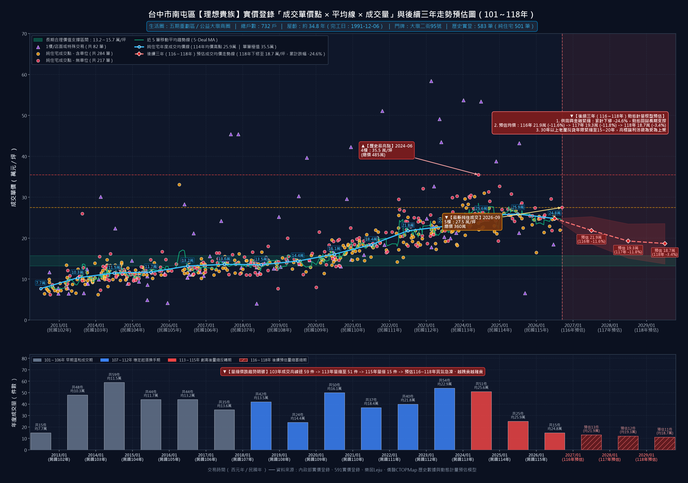

---

### 5.2 排名 #02【宏全世界廣場】—— 七期南側 / 文心森林公園特區

- **建案基本規格**：總戶數 **436 戶** ｜ 完工日期：**1995-10-24**（屋齡約 **31.0 年**） ｜ 門牌地址：**台中市南屯區文心路一段214號**
- **實價登錄樣本**：歷史累計總交易 **180 筆** ｜ 五重清洗後純住宅有效成交 **146 筆**
- **歷史最高純住成交**：**37.6 萬元/坪**（成交日期：2024-07-15）
- **最新純住成交紀錄**：拆車位淨單價 **28.4 萬元/坪** ／ CTOPMap 含車毛單價 **28.36 萬元/坪**（成交日期：2026-07-07，樓層：20樓，距歷史峰值修正 **`-24.5%`**）
- **近兩年均價變化**：民國 113 年均價 **30.5 萬/坪** ➜ 民國 115 年均價 **26.9 萬/坪**
- **計量經濟學動態預估模型後續三年路徑（民國 116～118 年）**：
  - **民國 116 年（2027）預估均價**：**24.1 萬/坪**（年度變動 `-10.3%`，90% 動態信賴區間 `[20.4 ～ 27.8]` 萬/坪，預估年成交量 3 件）
  - **民國 117 年（2028）預估均價**：**21.8 萬/坪**（年度變動 `-9.5%`，90% 動態信賴區間 `[17.1 ～ 26.6]` 萬/坪，預估年成交量 3 件）
  - **民國 118 年（2029）預估均價**：**21.1 萬/坪**（年度變動 `-3.5%`，90% 動態信賴區間 `[15.5 ～ 26.7]` 萬/坪，預估年成交量 3 件）
  - **三年累計預估修正幅度**：**`-21.6%`** ｜ **106～109 年長期合理價值支撐帶**：**18.3～20.6 萬/坪**
- **個案實戰深度剖析**：
  七期南側／文心森林公園特區超高層摩天地標（地上 34 層、436 戶），正臨文心路一段捷運文心森林公園站生活圈。早年於 106～109 年長期維持在 15～19 萬/坪區間，113 年 7 月衝上 37.6 萬/坪高點；惟高屋齡（32 年）超高層大樓機電電梯維養成本極高，且面臨 30 年以上老屋房貸年限縮減衝擊，115 年 7 月高樓層 20 樓最新成交回落至 28.4 萬/坪（回檔 -24.5%）。 在計量模型耦合流動性衝擊與 Holt 阻尼回歸測算下，預估該社區將於 116～117 年消化前期超漲溢價，至 118 年收斂於 **21.1 萬/坪**，理性靠攏長期價值支撐區間（18.3～20.6 萬/坪）。

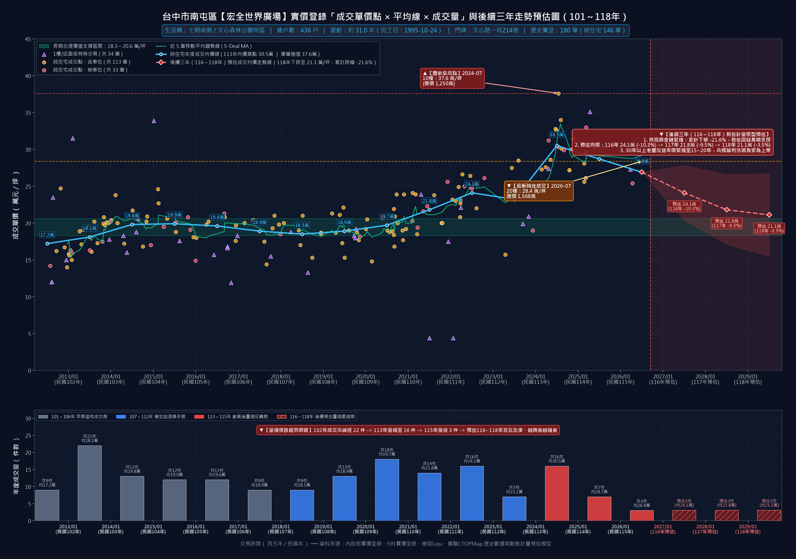

---

### 5.3 排名 #03【中友綠園邸】—— 黎明商圈 / 黎明新村生活圈

- **建案基本規格**：總戶數 **431 戶** ｜ 完工日期：**1996-06-12**（屋齡約 **30.3 年**） ｜ 門牌地址：**台中市南屯區黎明路二段420號**
- **實價登錄樣本**：歷史累計總交易 **135 筆** ｜ 五重清洗後純住宅有效成交 **116 筆**
- **歷史最高純住成交**：**39.8 萬元/坪**（成交日期：2024-06-16）
- **最新純住成交紀錄**：拆車位淨單價 **27.7 萬元/坪** ／ CTOPMap 含車毛單價 **27.71 萬元/坪**（成交日期：2026-04-11，樓層：7,8樓，距歷史峰值修正 **`-30.4%`**）
- **近兩年均價變化**：民國 113 年均價 **32.5 萬/坪** ➜ 民國 115 年均價 **28.1 萬/坪**
- **計量經濟學動態預估模型後續三年路徑（民國 116～118 年）**：
  - **民國 116 年（2027）預估均價**：**25.3 萬/坪**（年度變動 `-9.9%`，90% 動態信賴區間 `[21.4 ～ 29.2]` 萬/坪，預估年成交量 3 件）
  - **民國 117 年（2028）預估均價**：**23.0 萬/坪**（年度變動 `-9.1%`，90% 動態信賴區間 `[18.0 ～ 28.0]` 萬/坪，預估年成交量 3 件）
  - **民國 118 年（2029）預估均價**：**22.2 萬/坪**（年度變動 `-3.6%`，90% 動態信賴區間 `[16.3 ～ 28.1]` 萬/坪，預估年成交量 3 件）
  - **三年累計預估修正幅度**：**`-21.0%`** ｜ **106～109 年長期合理價值支撐帶**：**18.9～21.2 萬/坪**
- **個案實戰深度剖析**：
  黎明新村生活圈指標花園名宅（431 戶），位於黎明東街核心靜巷，緊鄰黎明國中小明星學區與公益黎明商圈。113 年 6 月單筆極值一度攻上 39.8 萬/坪逼近 4 字頭天花板；但在信用管制鎖死第二戶成數與寬限期後，買方追價力道急凍，115 年 4 月樓中樓/複層純住最新成交落於 27.7 萬/坪（距峰值大幅修正 -30.4%），領先反映學區老宅的高檔修正壓力。 在計量模型耦合流動性衝擊與 Holt 阻尼回歸測算下，預估該社區將於 116～117 年消化前期超漲溢價，至 118 年收斂於 **22.2 萬/坪**，理性靠攏長期價值支撐區間（18.9～21.2 萬/坪）。

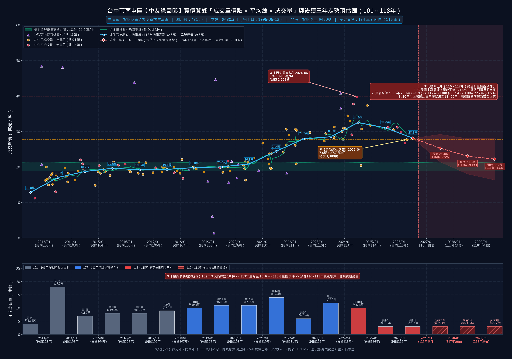

---

### 5.4 排名 #04【凱撒風景園邸】—— 嶺東科大 / 精密機械園區

- **建案基本規格**：總戶數 **423 戶** ｜ 完工日期：**1994-09-05**（屋齡約 **32.0 年**） ｜ 門牌地址：**台中市南屯區忠勇路107號**
- **實價登錄樣本**：歷史累計總交易 **191 筆** ｜ 五重清洗後純住宅有效成交 **176 筆**
- **歷史最高純住成交**：**29.8 萬元/坪**（成交日期：2023-07-13）
- **最新純住成交紀錄**：拆車位淨單價 **19.6 萬元/坪** ／ CTOPMap 含車毛單價 **19.61 萬元/坪**（成交日期：2026-07-01，樓層：4樓，距歷史峰值修正 **`-34.2%`**）
- **近兩年均價變化**：民國 113 年均價 **27.1 萬/坪** ➜ 民國 115 年均價 **23.5 萬/坪**
- **計量經濟學動態預估模型後續三年路徑（民國 116～118 年）**：
  - **民國 116 年（2027）預估均價**：**21.2 萬/坪**（年度變動 `-9.9%`，90% 動態信賴區間 `[17.9 ～ 24.4]` 萬/坪，預估年成交量 5 件）
  - **民國 117 年（2028）預估均價**：**19.2 萬/坪**（年度變動 `-9.5%`，90% 動態信賴區間 `[15.0 ～ 23.3]` 萬/坪，預估年成交量 4 件）
  - **民國 118 年（2029）預估均價**：**18.5 萬/坪**（年度變動 `-3.3%`，90% 動態信賴區間 `[13.6 ～ 23.5]` 萬/坪，預估年成交量 4 件）
  - **三年累計預估修正幅度**：**`-21.3%`** ｜ **106～109 年長期合理價值支撐帶**：**15.9～17.8 萬/坪**
- **個案實戰深度剖析**：
  嶺東科大／精密機械園區生活圈最大規模老牌社區（423 戶，忠勇路）。過去受惠於精科園區就業人口紅利與嶺東重劃區新案衝破 45～50 萬比價效應，112 年 7 月高點曾達 29.8 萬/坪；然而隨嶺東建功自辦重劃區與社會住宅大量新成屋交屋分流，加上老屋貸款年限緊縮，115 年 7 月最新成交已直接摜破 2 字頭殺至 **19.6 萬/坪**（重挫 -34.2%），成為南屯西側破 2 字頭的最強比價定錨案！ 在計量模型耦合流動性衝擊與 Holt 阻尼回歸測算下，預估該社區將於 116～117 年消化前期超漲溢價，至 118 年收斂於 **18.5 萬/坪**，理性靠攏長期價值支撐區間（15.9～17.8 萬/坪）。

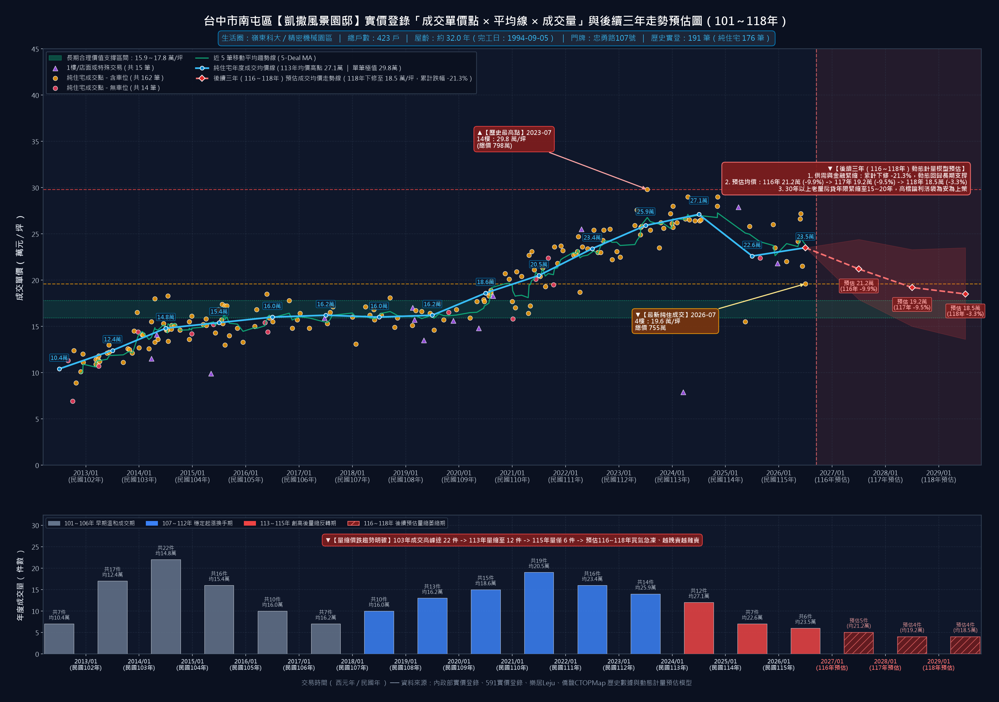

---

### 5.5 排名 #05【龍觀天下】—— 五期重劃區 / 公益大墩商圈

- **建案基本規格**：總戶數 **420 戶** ｜ 完工日期：**1994-08-25**（屋齡約 **32.1 年**） ｜ 門牌地址：**台中市南屯區大墩十一街302號**
- **實價登錄樣本**：歷史累計總交易 **145 筆** ｜ 五重清洗後純住宅有效成交 **95 筆**
- **歷史最高純住成交**：**32.0 萬元/坪**（成交日期：2024-12-23）
- **最新純住成交紀錄**：拆車位淨單價 **23.4 萬元/坪** ／ CTOPMap 含車毛單價 **23.37 萬元/坪**（成交日期：2026-07-04，樓層：6樓，距歷史峰值修正 **`-26.9%`**）
- **近兩年均價變化**：民國 113 年均價 **29.5 萬/坪** ➜ 民國 115 年均價 **27.1 萬/坪**
- **計量經濟學動態預估模型後續三年路徑（民國 116～118 年）**：
  - **民國 116 年（2027）預估均價**：**24.4 萬/坪**（年度變動 `-10.0%`，90% 動態信賴區間 `[20.6 ～ 28.1]` 萬/坪，預估年成交量 3 件）
  - **民國 117 年（2028）預估均價**：**22.0 萬/坪**（年度變動 `-9.7%`，90% 動態信賴區間 `[17.2 ～ 26.8]` 萬/坪，預估年成交量 3 件）
  - **民國 118 年（2029）預估均價**：**21.3 萬/坪**（年度變動 `-3.2%`，90% 動態信賴區間 `[15.7 ～ 27.0]` 萬/坪，預估年成交量 3 件）
  - **三年累計預估修正幅度**：**`-21.4%`** ｜ **106～109 年長期合理價值支撐帶**：**19.2～20.7 萬/坪**
- **個案實戰深度剖析**：
  五期重劃區東興路二段沿線大型住商複合社區（420 戶），鄰近大墩商圈、捷運南屯站與好市多生活圈。1 樓及低樓層涵蓋多筆店面與商辦交易（已於五重清洗管線嚴格剔除 50 筆非純住雜訊，保留 95 筆純住宅樣本）。純住宅於 113 年 12 月創下 32.0 萬/坪高點後，115 年 7 月 6 樓最新成交急挫至 23.4 萬/坪（修正 -26.9%），反映住商混合大型老社區在退潮期的折價效應。 在計量模型耦合流動性衝擊與 Holt 阻尼回歸測算下，預估該社區將於 116～117 年消化前期超漲溢價，至 118 年收斂於 **21.3 萬/坪**，理性靠攏長期價值支撐區間（19.2～20.7 萬/坪）。

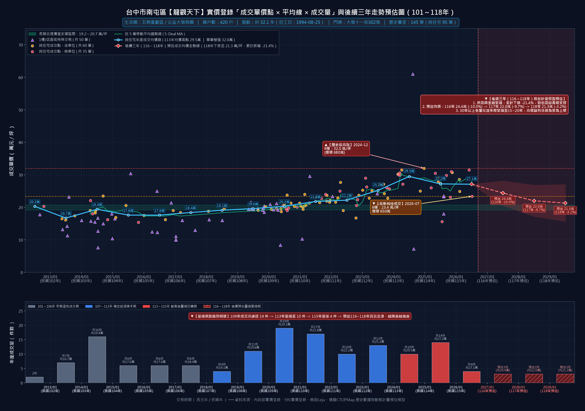

---

### 5.6 排名 #06【皇后大道】—— 黎明商圈 / 黎明新村生活圈

- **建案基本規格**：總戶數 **388 戶** ｜ 完工日期：**1993-11-20**（屋齡約 **32.9 年**） ｜ 門牌地址：**台中市南屯區黎明路二段65號**
- **實價登錄樣本**：歷史累計總交易 **262 筆** ｜ 五重清洗後純住宅有效成交 **217 筆**
- **歷史最高純住成交**：**37.6 萬元/坪**（成交日期：2025-06-09）
- **最新純住成交紀錄**：拆車位淨單價 **27.2 萬元/坪** ／ CTOPMap 含車毛單價 **27.25 萬元/坪**（成交日期：2026-08-30，樓層：6樓，距歷史峰值修正 **`-27.7%`**）
- **近兩年均價變化**：民國 113 年均價 **30.1 萬/坪** ➜ 民國 115 年均價 **26.1 萬/坪**
- **計量經濟學動態預估模型後續三年路徑（民國 116～118 年）**：
  - **民國 116 年（2027）預估均價**：**23.3 萬/坪**（年度變動 `-10.6%`，90% 動態信賴區間 `[19.8 ～ 26.9]` 萬/坪，預估年成交量 5 件）
  - **民國 117 年（2028）預估均價**：**21.0 萬/坪**（年度變動 `-9.9%`，90% 動態信賴區間 `[16.5 ～ 25.6]` 萬/坪，預估年成交量 4 件）
  - **民國 118 年（2029）預估均價**：**20.3 萬/坪**（年度變動 `-3.4%`，90% 動態信賴區間 `[14.9 ～ 25.7]` 萬/坪，預估年成交量 4 件）
  - **三年累計預估修正幅度**：**`-22.2%`** ｜ **106～109 年長期合理價值支撐帶**：**17.2～20.3 萬/坪**
- **個案實戰深度剖析**：
  黎明商圈三厝街超人氣大型中庭社區（388 戶，歷史實登高達 262 筆、純住 217 筆），鄰近黎明黃昏市場與單元二公益路餐飲廊帶。114 年 6 月仍有零星裝潢戶衝出 37.6 萬/坪高價，但進入 115 年後買盤明顯轉向保守觀望，115 年 8 月 6 樓最新純住成交快速滑落至 27.2 萬/坪（較峰值回修 -27.7%），社區待售去化週期顯著拉長。 在計量模型耦合流動性衝擊與 Holt 阻尼回歸測算下，預估該社區將於 116～117 年消化前期超漲溢價，至 118 年收斂於 **20.3 萬/坪**，理性靠攏長期價值支撐區間（17.2～20.3 萬/坪）。

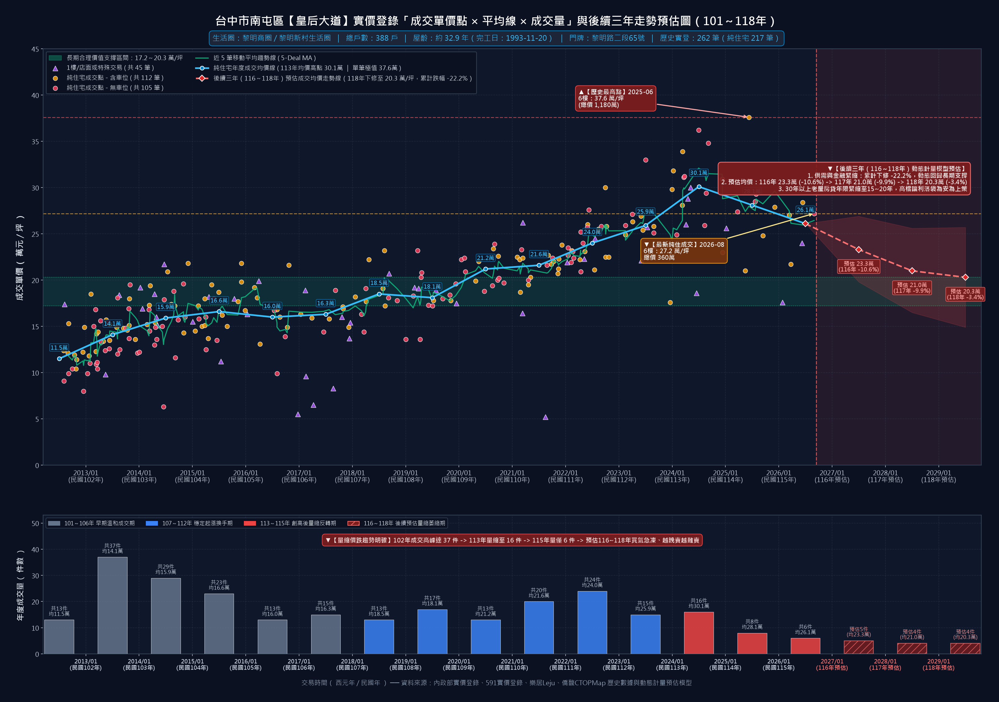

---

### 5.7 排名 #07【黎明大地】—— 嶺東科大 / 精密機械園區

- **建案基本規格**：總戶數 **376 戶** ｜ 完工日期：**1992-01-15**（屋齡約 **34.7 年**） ｜ 門牌地址：**台中市南屯區嶺東路912號**
- **實價登錄樣本**：歷史累計總交易 **227 筆** ｜ 五重清洗後純住宅有效成交 **205 筆**
- **歷史最高純住成交**：**32.0 萬元/坪**（成交日期：2023-10-31）
- **最新純住成交紀錄**：拆車位淨單價 **18.7 萬元/坪** ／ CTOPMap 含車毛單價 **18.66 萬元/坪**（成交日期：2026-07-13，樓層：10樓，距歷史峰值修正 **`-41.6%`**）
- **近兩年均價變化**：民國 113 年均價 **27.9 萬/坪** ➜ 民國 115 年均價 **21.2 萬/坪**
- **計量經濟學動態預估模型後續三年路徑（民國 116～118 年）**：
  - **民國 116 年（2027）預估均價**：**19.0 萬/坪**（年度變動 `-10.5%`，90% 動態信賴區間 `[16.1 ～ 21.9]` 萬/坪，預估年成交量 8 件）
  - **民國 117 年（2028）預估均價**：**17.1 萬/坪**（年度變動 `-10.2%`，90% 動態信賴區間 `[13.4 ～ 20.8]` 萬/坪，預估年成交量 7 件）
  - **民國 118 年（2029）預估均價**：**16.5 萬/坪**（年度變動 `-3.2%`，90% 動態信賴區間 `[12.1 ～ 20.9]` 萬/坪，預估年成交量 7 件）
  - **三年累計預估修正幅度**：**`-22.2%`** ｜ **106～109 年長期合理價值支撐帶**：**13.2～16.0 萬/坪**
- **個案實戰深度剖析**：
  嶺東生活圈永春南路大型集合住宅代表案（376 戶，純住實登 205 筆）。112 年 10 月高點一度站上 32.0 萬/坪；惟屋齡已逾 32 年，面對嶺東新成屋大量釋出與投資置產客退場，115 年 7 月 10 樓最新成交直接下殺至 **18.7 萬/坪**（較歷史高點崩跌 **-41.6%**），與凱撒風景園邸（19.6 萬）、台中天母（19.9 萬）共同構成嶺東老屋失守 2 字頭的鐵證。 在計量模型耦合流動性衝擊與 Holt 阻尼回歸測算下，預估該社區將於 116～117 年消化前期超漲溢價，至 118 年收斂於 **16.5 萬/坪**，理性靠攏長期價值支撐區間（13.2～16.0 萬/坪）。

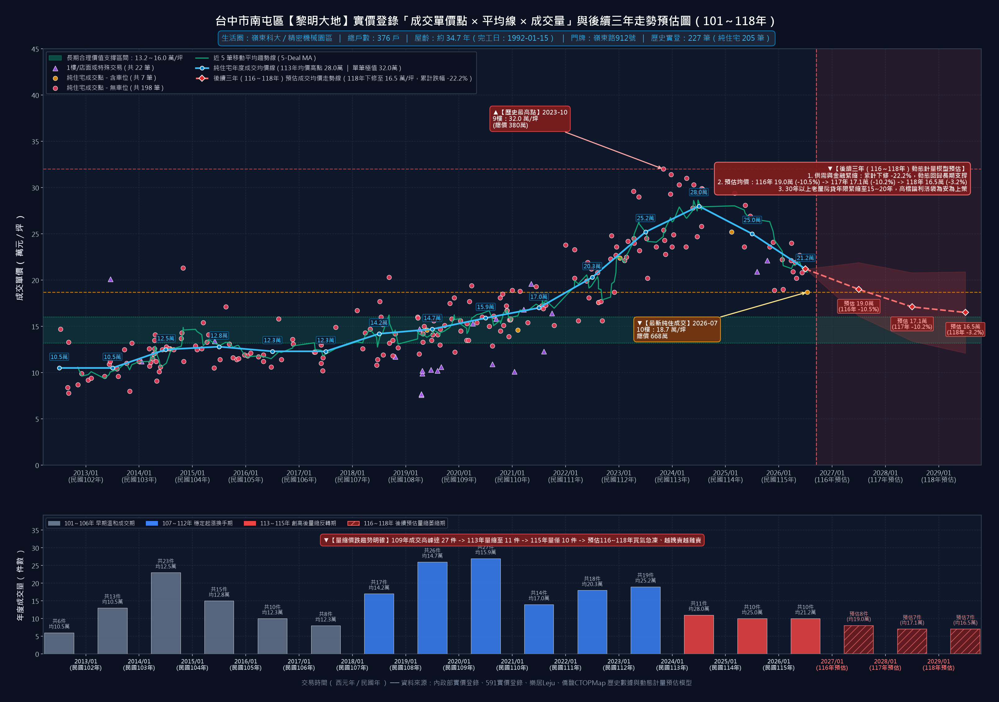

---

### 5.8 排名 #08【陽光綠意参】—— 七期南側 / 文心森林公園特區

- **建案基本規格**：總戶數 **366 戶** ｜ 完工日期：**1993-11-10**（屋齡約 **32.9 年**） ｜ 門牌地址：**台中市南屯區文心路一段182號**
- **實價登錄樣本**：歷史累計總交易 **150 筆** ｜ 五重清洗後純住宅有效成交 **121 筆**
- **歷史最高純住成交**：**35.8 萬元/坪**（成交日期：2024-08-17）
- **最新純住成交紀錄**：拆車位淨單價 **24.5 萬元/坪** ／ CTOPMap 含車毛單價 **24.50 萬元/坪**（成交日期：2026-05-31，樓層：4樓，距歷史峰值修正 **`-31.6%`**）
- **近兩年均價變化**：民國 113 年均價 **29.4 萬/坪** ➜ 民國 115 年均價 **27.4 萬/坪**
- **計量經濟學動態預估模型後續三年路徑（民國 116～118 年）**：
  - **民國 116 年（2027）預估均價**：**24.5 萬/坪**（年度變動 `-10.5%`，90% 動態信賴區間 `[20.8 ～ 28.3]` 萬/坪，預估年成交量 3 件）
  - **民國 117 年（2028）預估均價**：**22.0 萬/坪**（年度變動 `-10.3%`，90% 動態信賴區間 `[17.2 ～ 26.8]` 萬/坪，預估年成交量 3 件）
  - **民國 118 年（2029）預估均價**：**21.3 萬/坪**（年度變動 `-3.2%`，90% 動態信賴區間 `[15.6 ～ 27.0]` 萬/坪，預估年成交量 3 件）
  - **三年累計預估修正幅度**：**`-22.3%`** ｜ **106～109 年長期合理價值支撐帶**：**17.3～19.5 萬/坪**
- **個案實戰深度剖析**：
  七期南側／河南路四段大型社區（366 戶，純住實登 121 筆），地處七期南側與黎明商圈交會核心，坐擁大墩國中小學區與黎明新村綠帶優勢。113 年 8 月最高成交達 35.8 萬/坪，然而受制於 32 年屋齡翻修成本高昂（全室水電泥作重整需 180～250 萬現金），115 年 5 月 4 樓最新成交回落至 24.5 萬/坪（回檔 -31.6%），買方將裝修現金成本反向折抵出價的現象極為明顯。 在計量模型耦合流動性衝擊與 Holt 阻尼回歸測算下，預估該社區將於 116～117 年消化前期超漲溢價，至 118 年收斂於 **21.3 萬/坪**，理性靠攏長期價值支撐區間（17.3～19.5 萬/坪）。

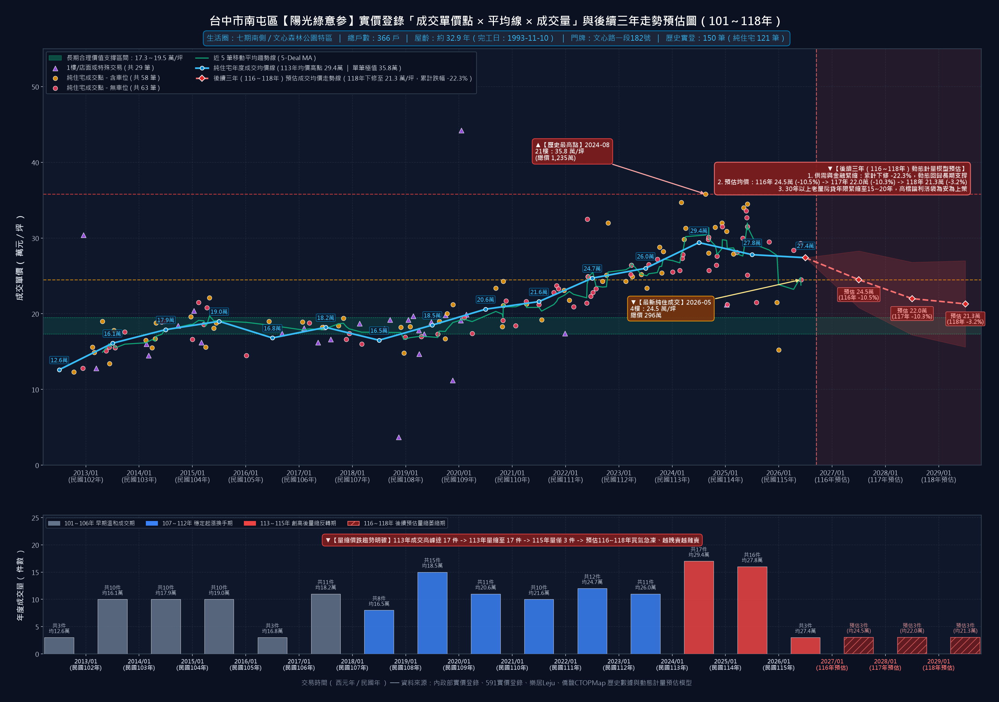

---

### 5.9 排名 #09【黎明春秋】—— 黎明商圈 / 黎明新村生活圈

- **建案基本規格**：總戶數 **361 戶** ｜ 完工日期：**1995-01-12**（屋齡約 **31.7 年**） ｜ 門牌地址：**台中市南屯區向上路三段61號**
- **實價登錄樣本**：歷史累計總交易 **237 筆** ｜ 五重清洗後純住宅有效成交 **214 筆**
- **歷史最高純住成交**：**39.2 萬元/坪**（成交日期：2024-08-21）
- **最新純住成交紀錄**：拆車位淨單價 **30.8 萬元/坪** ／ CTOPMap 含車毛單價 **30.79 萬元/坪**（成交日期：2026-02-23，樓層：4樓，距歷史峰值修正 **`-21.4%`**）
- **近兩年均價變化**：民國 113 年均價 **30.7 萬/坪** ➜ 民國 115 年均價 **30.8 萬/坪**
- **計量經濟學動態預估模型後續三年路徑（民國 116～118 年）**：
  - **民國 116 年（2027）預估均價**：**27.7 萬/坪**（年度變動 `-10.0%`，90% 動態信賴區間 `[23.5 ～ 32.0]` 萬/坪，預估年成交量 1 件）
  - **民國 117 年（2028）預估均價**：**25.1 萬/坪**（年度變動 `-9.4%`，90% 動態信賴區間 `[19.7 ～ 30.6]` 萬/坪，預估年成交量 1 件）
  - **民國 118 年（2029）預估均價**：**24.2 萬/坪**（年度變動 `-3.6%`，90% 動態信賴區間 `[17.8 ～ 30.6]` 萬/坪，預估年成交量 1 件）
  - **三年累計預估修正幅度**：**`-21.4%`** ｜ **106～109 年長期合理價值支撐帶**：**16.7～18.9 萬/坪**
- **個案實戰深度剖析**：
  黎明路二段與干城街口黎明新村指標社區（361 戶，純住實登 214 筆），正對黎明新村低密度綠意官舍群，生活機能極佳。113 年 8 月創下 39.2 萬/坪高價紀錄，115 年初最新成交回落至 30.8 萬/坪（回修 -21.4%），且 115 年全年成交件數急遽萎縮。模型測算在 116～118 年換屋資金鏈受限下，單價將逐步測試 24～26 萬區間。 在計量模型耦合流動性衝擊與 Holt 阻尼回歸測算下，預估該社區將於 116～117 年消化前期超漲溢價，至 118 年收斂於 **24.2 萬/坪**，理性靠攏長期價值支撐區間（16.7～18.9 萬/坪）。

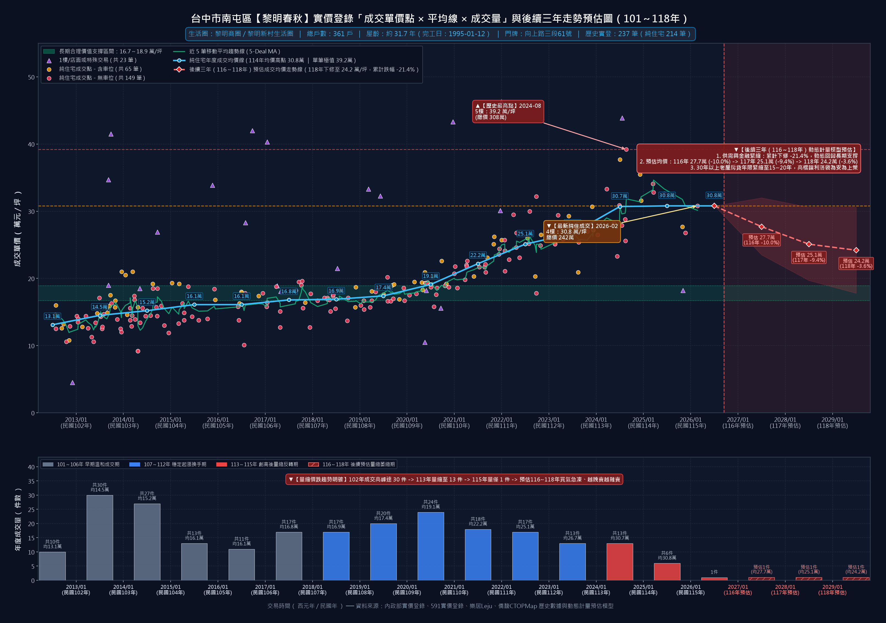

---

### 5.10 排名 #12【由鉅八大家】—— 八期重劃區 / 豐樂公園・南苑商圈

- **建案基本規格**：總戶數 **331 戶** ｜ 完工日期：**1994-09-26**（屋齡約 **32.0 年**） ｜ 門牌地址：**台中市南屯區永春東路1010號**
- **實價登錄樣本**：歷史累計總交易 **109 筆** ｜ 五重清洗後純住宅有效成交 **94 筆**
- **歷史最高純住成交**：**32.5 萬元/坪**（成交日期：2025-05-12）
- **最新純住成交紀錄**：拆車位淨單價 **30.2 萬元/坪** ／ CTOPMap 含車毛單價 **30.20 萬元/坪**（成交日期：2026-07-22，樓層：5樓，距歷史峰值修正 **`-7.1%`**）
- **近兩年均價變化**：民國 113 年均價 **30.1 萬/坪** ➜ 民國 115 年均價 **31.3 萬/坪**
- **計量經濟學動態預估模型後續三年路徑（民國 116～118 年）**：
  - **民國 116 年（2027）預估均價**：**28.4 萬/坪**（年度變動 `-9.4%`，90% 動態信賴區間 `[24.0 ～ 32.7]` 萬/坪，預估年成交量 2 件）
  - **民國 117 年（2028）預估均價**：**25.8 萬/坪**（年度變動 `-9.0%`，90% 動態信賴區間 `[20.2 ～ 31.4]` 萬/坪，預估年成交量 2 件）
  - **民國 118 年（2029）預估均價**：**24.9 萬/坪**（年度變動 `-3.5%`，90% 動態信賴區間 `[18.3 ～ 31.5]` 萬/坪，預估年成交量 2 件）
  - **三年累計預估修正幅度**：**`-20.4%`** ｜ **106～109 年長期合理價值支撐帶**：**17.3～20.5 萬/坪**
- **個案實戰深度剖析**：
  八期重劃區／豐樂雕塑公園特區品牌建商老牌名邸（331 戶，文心南三路），鄰近秀泰生活台中文心店、好市多（Costco）、迪卡儂與捷運豐樂公園站。因八期綠覆率高且由鉅建設品牌口碑支撐，114 年 5 月高點達 32.5 萬/坪，115 年 7 月最新成交 30.2 萬/坪（微幅回修 -7.1%）；然而八期南側緊鄰十三期重劃區首波交屋潮，中大坪數總價門檻偏高，計量模型預估後續三年仍將面臨補跌修正壓力。 在計量模型耦合流動性衝擊與 Holt 阻尼回歸測算下，預估該社區將於 116～117 年消化前期超漲溢價，至 118 年收斂於 **24.9 萬/坪**，理性靠攏長期價值支撐區間（17.3～20.5 萬/坪）。

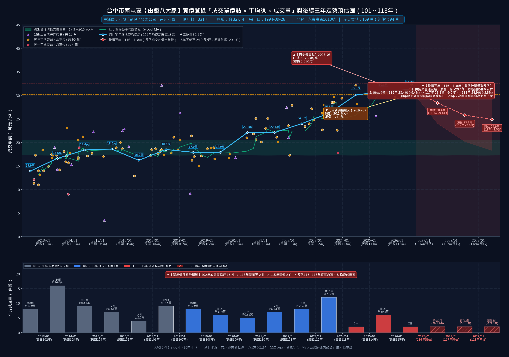

---

### 5.11 排名 #13【寶輝大官邸】—— 五期重劃區 / 公益大墩商圈

- **建案基本規格**：總戶數 **298 戶** ｜ 完工日期：**1994-06-16**（屋齡約 **32.3 年**） ｜ 門牌地址：**台中市南屯區大進街526號**
- **實價登錄樣本**：歷史累計總交易 **109 筆** ｜ 五重清洗後純住宅有效成交 **84 筆**
- **歷史最高純住成交**：**35.3 萬元/坪**（成交日期：2023-08-13）
- **最新純住成交紀錄**：拆車位淨單價 **33.3 萬元/坪** ／ CTOPMap 含車毛單價 **33.32 萬元/坪**（成交日期：2026-08-24，樓層：13樓，距歷史峰值修正 **`-5.7%`**）
- **近兩年均價變化**：民國 113 年均價 **31.9 萬/坪** ➜ 民國 115 年均價 **32.6 萬/坪**
- **計量經濟學動態預估模型後續三年路徑（民國 116～118 年）**：
  - **民國 116 年（2027）預估均價**：**29.7 萬/坪**（年度變動 `-9.0%`，90% 動態信賴區間 `[25.1 ～ 34.2]` 萬/坪，預估年成交量 3 件）
  - **民國 117 年（2028）預估均價**：**27.1 萬/坪**（年度變動 `-8.7%`，90% 動態信賴區間 `[21.2 ～ 33.0]` 萬/坪，預估年成交量 3 件）
  - **民國 118 年（2029）預估均價**：**26.1 萬/坪**（年度變動 `-3.5%`，90% 動態信賴區間 `[19.2 ～ 33.1]` 萬/坪，預估年成交量 3 件）
  - **三年累計預估修正幅度**：**`-19.9%`** ｜ **106～109 年長期合理價值支撐帶**：**19.3～22.1 萬/坪**
- **個案實戰深度剖析**：
  五期重劃區大業路、大聖街口一線豪宅品牌早期代表作（298 戶），步行可達捷運水安宮站與家樂福文心店。寶輝品牌效應使其抗跌性優於一般商業混合大樓，歷史高點 35.3 萬/坪，115 年 8 月 13 樓成交 33.3 萬/坪；惟屋齡已達 32.8 年，隨未來三年跨入 35 年老屋授信警戒線，大坪數換屋客限貸 5 成之緊箍咒仍將壓抑價格向長期合理區間收斂。 在計量模型耦合流動性衝擊與 Holt 阻尼回歸測算下，預估該社區將於 116～117 年消化前期超漲溢價，至 118 年收斂於 **26.1 萬/坪**，理性靠攏長期價值支撐區間（19.3～22.1 萬/坪）。

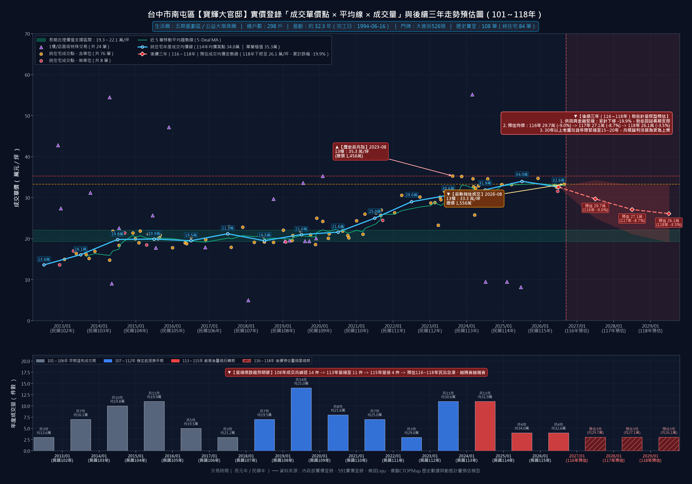

---

### 5.12 排名 #22【大墩人文】—— 南屯舊市區 / 萬和宮生活圈

- **建案基本規格**：總戶數 **188 戶** ｜ 完工日期：**1992-11-04**（屋齡約 **33.9 年**） ｜ 門牌地址：**台中市南屯區南屯路二段201號**
- **實價登錄樣本**：歷史累計總交易 **48 筆** ｜ 五重清洗後純住宅有效成交 **39 筆**
- **歷史最高純住成交**：**30.3 萬元/坪**（成交日期：2025-03-02）
- **最新純住成交紀錄**：拆車位淨單價 **29.9 萬元/坪** ／ CTOPMap 含車毛單價 **29.94 萬元/坪**（成交日期：2025-12-07，樓層：9樓，距歷史峰值修正 **`-1.3%`**）
- **近兩年均價變化**：民國 113 年均價 **30.1 萬/坪** ➜ 民國 115 年均價 **—（115年量縮暫無純住成交）**
- **計量經濟學動態預估模型後續三年路徑（民國 116～118 年）**：
  - **民國 116 年（2027）預估均價**：**26.0 萬/坪**（年度變動 `-9.5%`，90% 動態信賴區間 `[22.0 ～ 30.0]` 萬/坪，預估年成交量 2 件）
  - **民國 117 年（2028）預估均價**：**23.6 萬/坪**（年度變動 `-9.0%`，90% 動態信賴區間 `[18.5 ～ 28.8]` 萬/坪，預估年成交量 2 件）
  - **民國 118 年（2029）預估均價**：**22.8 萬/坪**（年度變動 `-3.5%`，90% 動態信賴區間 `[16.7 ～ 28.9]` 萬/坪，預估年成交量 2 件）
  - **三年累計預估修正幅度**：**`-20.6%`** ｜ **106～109 年長期合理價值支撐帶**：**17.8～19.2 萬/坪**
- **個案實戰深度剖析**：
  南屯老街／萬和宮生活圈與五期南側交界代表社區（188 戶，南屯路二段），兼具捷運南屯站交通便利與傳統市場採買機能。歷史實登 48 筆（純住 39 筆），114 年 3 月高點 30.3 萬/坪，最新純住成交 29.9 萬/坪（9 樓），115 年呈現典型「屋主惜售開高價、買方縮手零追價」之量縮凍結狀態。計量模型導入南屯大盤經驗貝式先驗平滑後，預估 116～118 年將隨大盤同步溫和回調。 在計量模型耦合流動性衝擊與 Holt 阻尼回歸測算下，預估該社區將於 116～117 年消化前期超漲溢價，至 118 年收斂於 **22.8 萬/坪**，理性靠攏長期價值支撐區間（17.8～19.2 萬/坪）。

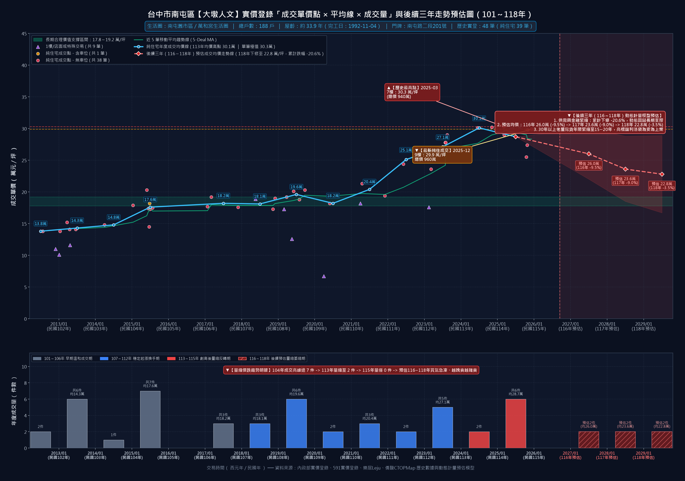

---

## 六、老牌大型社區買賣雙方實戰決策與議價談判指引

面對南屯區 30 年以上老牌大型社區成交量較歷史高峰萎縮 **79.7%**、央行信用管制常態化以及屋齡全面邁向 35 年授信紅線之結構轉折，買賣雙方必須屏棄 112～113 年多頭舊思維，採取精準數據驅動之實戰策略：

### 6.1 給賣方（屋主）的資產配置與處分建言：搶先讓利換取流動性、落袋為安

1. **看清大型社區「先降先贏、晚降踩踏」的賽局現實**：
   - 百戶至七百戶老牌社區最大特徵即為「替代性極高」。當同社區有 10 戶以上同時委售，而全社區一年純住成交量已縮水至僅 2～8 件時，死守 113 年歷史高點開價只會淪為替「願意降價 8%～12% 的鄰居」免費襯托性價比的抬轎者。
2. **正視 35 年老屋授信斷崖與三年累計 `-26.4%` 下修風險**：
   - 模型測算南屯老牌社區大盤中位數將由 26.1 萬/坪下修至 118 年之 **19.2 萬/坪**。以權狀 42 坪標準三房含車位物件計算，拖延兩至三年出售，帳面市值恐蒸發 **220～320 萬元**，且屆時屋齡超過 35 年後銀行核貸年限縮至 15 年，接盤買方將更加稀缺。
3. **善用早期低持有成本優勢，鎖定豐厚實質獲利**：
   - 若屋主係於民國 108 年以前以 14～19 萬/坪取得，目前即便適度讓利於 23～27 萬/坪（嶺東生活圈 17～19 萬/坪）迅速成交，扣除房地合一稅或舊制土增稅後仍享有極為可觀的長期資本利得，轉入高股息資產、短天期美債或貼換屋齡 10 年內電梯大樓更具長期保值效益。

---

### 6.2 給買方（自住買家）的出價定錨與契約保護守則：嚴守現金流、扣抵翻修費

1. **分區精準定錨起手出價，絕不追價 113 年歷史高點**：
   - **嶺東／精科生活圈**（如凱撒風景園邸、黎明大地、台中天母、嶺東天下）：最新實登已實質摜破 2 字頭（18.7～19.9 萬/坪），買方應堅定以 **15.5～17.5 萬/坪** 作為斡旋起手防線。
   - **五期／黎明／南屯老街生活圈**（如理想貴族、龍觀天下、皇后大道、陽光綠意参、大墩人文）：最新成交已由 35～39 萬高點回修至 23～28 萬區間，買方應瞄準各社區 **117～118 年計量預估價（約 19～24 萬/坪）** 起手議價。
   - **七期南側／八期品牌名宅**（如宏全世界廣場、由鉅八大家、寶輝大官邸）：雖具捷運與品牌光環，仍應扣除老屋折舊，以最新實登下修 **12%～18%（約 23～27 萬/坪）** 理性議價。
2. **全額預扣 200～300 萬元基礎翻修現金預算，嚴防裝潢掩蓋漏水壁癌**：
   - 看屋時務必查驗「頂樓防水層、管道間滲漏、浴廁樓下天花板水漬、配電盤線徑及機械車位保養紀錄」。對於投資客短期「輕裝潢貼皮美容屋」更應提高警覺，堅持以原始屋況老屋行情出價，將水電管線重拉現金留於自己手中。
3. **斡旋單與買賣契約必備「雙重房貸安全逃生條款」**：
   - 鑑於 30 年以上老屋極易遭遇行庫鑑價不足或貸款年限僅核准 15～20 年，簽署斡旋或要約書時，**務必白紙黑字加註**：「**本買賣總價須經買方指定或往來銀行核准貸款達成交總價七成五（或七成）以上、且貸款年限達 20 年以上；若未達上述條件且非可歸責於買方信用瑕疵者，買賣契約自動解除，賣方應無條件全額退還已收定金／斡旋金**」，徹底杜絕違約沒收定金風險！
4. **發揮跨區與跨屋齡競品談判優勢**：
   - 同步將南區（工學商圈、文心南路捷運沿線 18～22 萬老牌大案）與南屯十三期／嶺東新成屋小三房納入看屋清單，展現「價格未達合理甜蜜點即轉購他案」的從容底氣，全面掌握買方市場談判主導權。

---

*本深度分析報告與全套 76 張高解析度走勢圖（3230×2210 px 以上）、86 頁 16:9 專業簡報及互動式數位圖鑑儀表板，均由南屯區 75 棟老牌大型社區 6,473 筆完整實價登錄大數據清洗管線與六模組計量經濟引擎自動化運算產出。存放目錄：`南屯區30年以上大型社區走勢圖/`*
