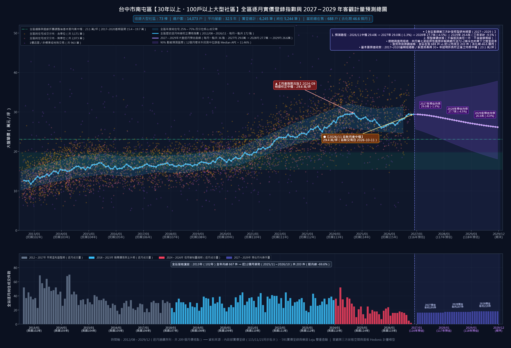

# 台中市南屯區【30年以上・100戶以上大型社區】逐月實價登錄價格序列與 2027～2029 年計量預測報告

> **研究立場聲明**：本報告採獨立第三方客觀計量經濟研究立場撰寫，不偏袒買方或賣方任一立場，亦不納入主觀室內裝修費用假設。全數歷史實價登錄資料同步至內政部 **115 年 11 月 21 日** 公開批次（最新交易日 `2026-10-11`），並經 **591 實價登錄** 與 **樂居 Leju（115.11.24 更新批次）** 雙平台交叉查驗。

- **研究母體**：台中市南屯區屋齡 ≥ 30 年（1996 年及以前完工）且總戶數 ≥ 100 戶之集合住宅社區，共 **73 棟**（合計 **14,073 戶**，平均屋齡 **32.5 年**）
- **交易樣本**：累計實價登錄 **6,245 筆**（經五重清洗後之標準純住宅交易 **5,244 筆**）
- **微觀在售庫存**：當前線上在售掛牌合計 **688 戶**（整體待售率 **4.89%**，庫存去化月數 **MOI = 46.6 個月**）
- **時間序列精度**：歷史序列 `2012-08`～`2026-11`（172 個月點）＋ 預測序列 `2027-01`～`2029-12`（36 個月點），**每一個月份皆具備明確之單價推估點**

---

## 一、全區大盤逐月價格週期與 2027～2029 年預測摘要

1. **歷史逐月指數軌跡（2012/08～2026/11）**：
   - 2017～2020 年（民國 106～109 年）剛需穩定期，全區純住宅四分位核心價格帶位於 **15.4～19.7 萬/坪**。
   - 隨總體資金寬鬆與重劃區比價效應帶動，全區逐月特徵校正指數於 **`2024-09`** 達歷史高點 **29.6 萬/坪**。
   - 2024 年下半年起受央行第七波選擇性信用管制與銀行授信水位影響，交易量顯著收斂：歷史年度成交高峰（2013年）為 **667 件**，近 12 個月滾動（2025/11～2026/10）成交量為 **203 件**（較高峰變動 **-69.6%**）；`2026-11` 最新月度特徵校正中樞為 **29.4 萬/坪**。
2. **2027～2029 年（民國 116～118 年）客觀計量預測結果**：
   - **2027 年（116 年）預估年均價**：**29.0 萬/坪**（年變動 `-1.3%`，90% 預測區間 `[24.3～34.6 萬]`）
   - **2028 年（117 年）預估年均價**：**27.7 萬/坪**（年變動 `-4.5%`，90% 預測區間 `[21.5～35.8 萬]`）
   - **2029 年（118 年）預估年均價**：**26.6 萬/坪**（年變動 `-4.0%`，90% 預測區間 `[19.0～37.1 萬]`）
   - **三年累計變動幅度**：**`-9.5%`**，逐步朝經通膨／名目所得成長與屋齡折舊雙向調整後之基本面均衡中樞（**23.1 萬/坪**）溫和收斂。

---

## 二、影響未來三年價格走勢之四大客觀結構機制（不含裝修費用假設）

### 2.1 微觀供需與在售庫存去化結構（Inventory & Absorption Microstructure）
- 不動產經濟學以「庫存去化月數（Months of Inventory, MOI = 當前在售戶數 ÷ 月均成交件數）」衡量微觀供需鬆緊，一般以 **6～9 個月** 為供需均衡基準。
- 南屯區 73 棟大型社區目前線上在售共 **688 戶**，全區整體 MOI 為 **46.6 個月**。掛售戶數較多、MOI 顯著高於均衡值之社區存在同社區比價調節壓力；反之在售稀少（MOI < 8 個月）之社區則具備價格支撐韌性。

### 2.2 建物自然物理折舊與高齡集合住宅生命週期（Physical Depreciation & Lifecycle）
- 研究母體平均屋齡為 **32.5 年**。依據不動產估價實證，30 年以上 RC 集合住宅每年自然物理折舊率約為 **0.6%～0.8%**。
- 大型社區公共機電、電梯與外牆管理維護基金之健全度，決定其抗折舊能力；而隨持有時間推進 10～20 年邁向 45～50 年高齡建築時，因大型社區產權人數眾多、都更整合門檻較高，次級市場流動性隨屋齡遞減屬客觀規律。

### 2.3 總體貨幣信用政策與高屋齡房貸授信準則（Credit Regime & Mortgage Underwriting）
- 央行第七波選擇性信用管制與銀行法 72-2 條不動產放款比率約束，使高槓桿需求退場並回歸剛性自住定價。
- 金融機構對 30～35 年以上住宅普遍適用「屋齡＋貸款年限 ≤ 50～55 年」內規，貸款期限較新成屋短，買方對總價與每月本息負擔之精算更趨嚴謹。

### 2.4 名目通膨、薪資成長與基本面均衡錨定（Nominal Growth & Equilibrium Cointegration）
- 客觀評估不可忽略 2019～2026 年台灣消費者物價指數（CPI）、營建重置成本與名目薪資之累積成長。將 2017～2020 年基期價格依名目經濟成長率正向調整並扣除建物屋齡折舊後，南屯區大型老牌社區之合理基本面均衡中樞約為 **23.1 萬/坪**，構成中長期實質底部支撐。

---

## 三、雙平台資料檢核、面板 Hedonic 校正與狀態空間逐月計量模型

1. **591 × 樂居 Leju 雙重查驗**：優先採用內政部原始申報車位拆分數據；針對國宅分管協議車位（如大慶國宅、博愛國宅）比照樂居規範不強行二次拆算；並排除未拆車位估算異常與親友特殊交易。
2. **面板固定效應 Hedonic 特徵校正（樣本數 N = 4,700）**：估計相對樓層高度係數 `+0.0742`、頂樓係數 `-0.0408`、四樓係數 `-0.0040` 與面積彈性 `-0.0108`，消除單月成交特定高低樓層造成之價格雜訊。
3. **Rauch-Tung-Striebel（RTS）卡爾曼平滑器逐月序列**：結合社區觀測成交與所屬生活圈月度動能，推估 `2012-08`～`2026-11` 每一個月份之連續價格點（共 172 點），並外推 `2027-01`～`2029-12` 未來三年逐月預測點（共 36 點）。
4. **12 個月樣本外滾動回測驗證（Walk-Forward Backtest）**：以 `2012-08 ~ 2025-10` 訓練並預測 `2025-11 ~ 2026-10 (12個月樣本外滾動測試)` 共 **177 筆** 實際純住成交，實測絕對誤差中位數 **Median APE = 11.46%**（MAPE = 12.59%，RMSE = 4.46 萬/坪，90% 預測區間覆蓋率 = 64.4%）。

---

## 四、十大指標大型社區（依總戶數規模 Top 10）實證與 2027～2029 預估對照表

| 規模排名 | 社區名稱 | 生活圈 | 戶數 / 屋齡 | 在售 (MOI) | 歷史最高 | 最新純住 (年月) | 2026/11月度中樞 | 2027預估 | 2028預估 | 2029預估 | 三年累計變動 |
|:---:|:---|:---|:---:|:---:|:---:|:---:|:---:|:---:|:---:|:---:|:---:|
| #01 | **理想貴族** | 五期重劃區 | 732戶 / 34.9年 | 28戶 (18月) | 35.5萬 | 27.5萬 (2026-09) | **25.9萬** | 25.5萬 | 24.4萬 | **23.4萬** | **-9.8%** |
| #02 | **中友綠園邸** | 黎明商圈 | 431戶 / 30.4年 | 13戶 (31月) | 39.8萬 | 23.6萬 (2026-09) | **28.8萬** | 28.5萬 | 27.8萬 | **27.3萬** | **-5.2%** |
| #03 | **凱撒風景園邸** | 嶺東科大 | 423戶 / 32.2年 | 37戶 (56月) | 31.7萬 | 19.6萬 (2026-07) | **24.3萬** | 23.9萬 | 23.1萬 | **22.6萬** | **-7.0%** |
| #04 | **龍觀天下** | 五期重劃區 | 420戶 / 32.2年 | 8戶 (16月) | 32.5萬 | 23.4萬 (2026-07) | **29.3萬** | 29.2萬 | 28.4萬 | **27.5萬** | **-6.1%** |
| #05 | **皇后大道** | 黎明商圈 | 388戶 / 33.0年 | 29戶 (70月) | 37.6萬 | 27.2萬 (2026-08) | **27.9萬** | 27.5萬 | 26.4萬 | **25.5萬** | **-8.6%** |
| #06 | **黎明大地** | 嶺東科大 | 376戶 / 34.8年 | 2戶 (2月) | 32.0萬 | 19.1萬 (2026-07) | **21.9萬** | 21.9萬 | 21.8萬 | **21.8萬** | **-0.4%** |
| #07 | **陽光綠意参** | 七期南側 | 366戶 / 33.0年 | 9戶 (22月) | 38.1萬 | 24.5萬 (2026-05) | **28.6萬** | 28.5萬 | 27.6萬 | **26.7萬** | **-6.5%** |
| #08 | **黎明春秋** | 黎明商圈 | 361戶 / 31.8年 | 23戶 (69月) | 39.2萬 | 28.1萬 (2026-10) | **31.1萬** | 30.4萬 | 28.9萬 | **27.6萬** | **-11.2%** |
| #09 | **博愛國宅** | 黎明商圈 | 350戶 / 32.2年 | 5戶 (20月) | 26.3萬 | 23.9萬 (2026-04) | **25.7萬** | 25.5萬 | 24.7萬 | **23.9萬** | **-6.9%** |
| #10 | **中友生活家** | 黎明商圈 | 335戶 / 31.2年 | 4戶 (7月) | 33.1萬 | 31.2萬 (2026-07) | **30.8萬** | 30.9萬 | 30.3萬 | **29.4萬** | **-4.4%** |

---

## 五、全南屯區 73 棟大型社區完整實價登錄與三年預估總名冊

| 排名 | 社區名稱 | 戶數 | 屋齡 | 門牌地址 | 純住/總實登 | 在售(MOI) | 歷史高點 | 最新成交 | 26/11中樞 | 2027預估 | 2028預估 | 2029預估 | 三年累計 | 走勢圖 |
|:---:|:---|---:|---:|:---|:---:|:---:|---:|---:|---:|---:|---:|---:|---:|:---:|
| #01 | **理想貴族** | 732 | 34.9年 | 大墩二街95號 | 497/584 | 28戶(18m) | 35.5萬 | 27.5萬 (2026-09) | 25.9萬 | 25.5萬 | 24.4萬 | **23.4萬** | `-9.8%` | [圖表](01_理想貴族_成交行情走勢圖.png) |
| #02 | **中友綠園邸** | 431 | 30.4年 | 黎明路二段420號 | 117/136 | 13戶(31m) | 39.8萬 | 23.6萬 (2026-09) | 28.8萬 | 28.5萬 | 27.8萬 | **27.3萬** | `-5.2%` | [圖表](02_中友綠園邸_成交行情走勢圖.png) |
| #03 | **凱撒風景園邸** | 423 | 32.2年 | 忠勇路107號 | 175/191 | 37戶(56m) | 31.7萬 | 19.6萬 (2026-07) | 24.3萬 | 23.9萬 | 23.1萬 | **22.6萬** | `-7.0%` | [圖表](03_凱撒風景園邸_成交行情走勢圖.png) |
| #04 | **龍觀天下** | 420 | 32.2年 | 大墩十一街302號 | 95/145 | 8戶(16m) | 32.5萬 | 23.4萬 (2026-07) | 29.3萬 | 29.2萬 | 28.4萬 | **27.5萬** | `-6.1%` | [圖表](04_龍觀天下_成交行情走勢圖.png) |
| #05 | **皇后大道** | 388 | 33.0年 | 黎明路二段65號 | 217/262 | 29戶(70m) | 37.6萬 | 27.2萬 (2026-08) | 27.9萬 | 27.5萬 | 26.4萬 | **25.5萬** | `-8.6%` | [圖表](05_皇后大道_成交行情走勢圖.png) |
| #06 | **黎明大地** | 376 | 34.8年 | 嶺東路912號 | 205/227 | 2戶(2m) | 32.0萬 | 19.1萬 (2026-07) | 21.9萬 | 21.9萬 | 21.8萬 | **21.8萬** | `-0.4%` | [圖表](06_黎明大地_成交行情走勢圖.png) |
| #07 | **陽光綠意参** | 366 | 33.0年 | 文心路一段182號 | 121/150 | 9戶(22m) | 38.1萬 | 24.5萬 (2026-05) | 28.6萬 | 28.5萬 | 27.6萬 | **26.7萬** | `-6.5%` | [圖表](07_陽光綠意参_成交行情走勢圖.png) |
| #08 | **黎明春秋** | 361 | 31.8年 | 向上路三段61號 | 216/239 | 23戶(69m) | 39.2萬 | 28.1萬 (2026-10) | 31.1萬 | 30.4萬 | 28.9萬 | **27.6萬** | `-11.2%` | [圖表](08_黎明春秋_成交行情走勢圖.png) |
| #09 | **博愛國宅** | 350 | 32.2年 | 干城街267號 | 53/77 | 5戶(20m) | 26.3萬 | 23.9萬 (2026-04) | 25.7萬 | 25.5萬 | 24.7萬 | **23.9萬** | `-6.9%` | [圖表](09_博愛國宅_成交行情走勢圖.png) |
| #10 | **中友生活家** | 335 | 31.2年 | 黎明路二段423號 | 150/165 | 4戶(7m) | 33.1萬 | 31.2萬 (2026-07) | 30.8萬 | 30.9萬 | 30.3萬 | **29.4萬** | `-4.4%` | [圖表](10_中友生活家_成交行情走勢圖.png) |
| #11 | **由鉅八大家** | 331 | 32.2年 | 永春東路1010號 | 94/109 | 13戶(52m) | 34.6萬 | 32.7萬 (2026-07) | 34.4萬 | 33.6萬 | 31.8萬 | **30.1萬** | `-12.4%` | [圖表](11_由鉅八大家_成交行情走勢圖.png) |
| #12 | **寶輝大官邸** | 298 | 32.4年 | 大進街526號 | 85/110 | 8戶(16m) | 36.8萬 | 36.8萬 (2026-09) | 35.4萬 | 35.2萬 | 34.1萬 | **32.9萬** | `-7.1%` | [圖表](12_寶輝大官邸_成交行情走勢圖.png) |
| #13 | **同隆上第一期** | 237 | 32.3年 | 文心路一段316號 | 66/73 | 3戶(9m) | 39.2萬 | 34.8萬 (2026-09) | 35.6萬 | 35.8萬 | 35.1萬 | **34.1萬** | `-4.3%` | [圖表](13_同隆上第一期_成交行情走勢圖.png) |
| #14 | **利亞倫敦** | 231 | 32.5年 | 大墩一街42號 | 100/120 | 1戶(5m) | 33.6萬 | 28.7萬 (2026-05) | 31.4萬 | 31.7萬 | 31.1萬 | **30.3萬** | `-3.6%` | [圖表](14_利亞倫敦_成交行情走勢圖.png) |
| #15 | **台中商務中心** | 230 | 36.3年 | 向上南路一段163號 | 142/160 | 13戶(22m) | 32.5萬 | 31.2萬 (2026-08) | 29.4萬 | 28.9萬 | 27.3萬 | **25.9萬** | `-12.0%` | [圖表](15_台中商務中心_成交行情走勢圖.png) |
| #16 | **現代經典** | 222 | 33.7年 | 南屯路二段18號 | 83/94 | 22戶(110m) | 33.5萬 | 33.5萬 (2026-04) | 33.0萬 | 32.3萬 | 30.6萬 | **29.0萬** | `-12.1%` | [圖表](16_現代經典_成交行情走勢圖.png) |
| #17 | **大台中新市** | 222 | 29.9年 | 大墩十一街537號 | 78/89 | 14戶(28m) | 39.1萬 | 34.2萬 (2026-08) | 36.8萬 | 36.3萬 | 34.8萬 | **33.3萬** | `-9.6%` | [圖表](17_大台中新市_成交行情走勢圖.png) |
| #18 | **海德堡藝術廣場** | 217 | 32.2年 | 文心南二路390號 | 62/78 | 8戶(40m) | 35.4萬 | 34.4萬 (2026-06) | 36.5萬 | 35.6萬 | 33.6萬 | **31.8萬** | `-12.8%` | [圖表](18_海德堡藝術廣場_成交行情走勢圖.png) |
| #19 | **波音市銀翼** | 201 | 31.2年 | 大墩十二街647號 | 54/68 | 6戶(30m) | 30.9萬 | 30.9萬 (2025-07) | 34.2萬 | 33.8萬 | 32.5萬 | **31.2萬** | `-8.7%` | [圖表](19_波音市銀翼_成交行情走勢圖.png) |
| #20 | **大墩天廈** | 199 | 31.7年 | 南屯路二段161號 | 50/62 | 1戶(5m) | 26.1萬 | 22.6萬 (2025-09) | 28.0萬 | 27.9萬 | 26.9萬 | **25.7萬** | `-8.3%` | [圖表](20_大墩天廈_成交行情走勢圖.png) |
| #21 | **大墩人文** | 188 | 34.0年 | 南屯路二段201號 | 39/48 | 0戶 | 30.3萬 | 29.9萬 (2025-12) | 33.3萬 | 33.5萬 | 32.9萬 | **31.8萬** | `-4.5%` | [圖表](21_大墩人文_成交行情走勢圖.png) |
| #22 | **東龍尊邸** | 187 | 31.9年 | 大業路224號 | 57/74 | 9戶(45m) | 32.4萬 | 31.0萬 (2025-05) | 32.9萬 | 32.4萬 | 31.1萬 | **29.8萬** | `-9.3%` | [圖表](22_東龍尊邸_成交行情走勢圖.png) |
| #23 | **三采大業天地** | 185 | 31.8年 | 大業路563號 | 53/62 | 12戶(60m) | 34.0萬 | 31.5萬 (2026-07) | 32.6萬 | 32.3萬 | 31.1萬 | **30.0萬** | `-7.9%` | [圖表](23_三采大業天地_成交行情走勢圖.png) |
| #24 | **熊貓帝國** | 181 | 30.8年 | 文心路一段272號 | 35/47 | 4戶(16m) | 33.1萬 | 31.5萬 (2026-02) | 32.3萬 | 32.1萬 | 30.8萬 | **29.6萬** | `-8.4%` | [圖表](24_熊貓帝國_成交行情走勢圖.png) |
| #25 | **國王與我** | 180 | 32.0年 | 河南路四段350巷2號 | 62/79 | 37戶(185m) | 37.1萬 | 34.3萬 (2026-01) | 35.1萬 | 34.2萬 | 32.1萬 | **30.3萬** | `-13.8%` | [圖表](25_國王與我_成交行情走勢圖.png) |
| #26 | **黎明太陽神** | 178 | 32.6年 | 黎明路二段359號 | 72/84 | 9戶(27m) | 38.5萬 | 24.4萬 (2026-04) | 29.7萬 | 29.3萬 | 28.2萬 | **27.2萬** | `-8.4%` | [圖表](26_黎明太陽神_成交行情走勢圖.png) |
| #27 | **美村黎明大廈** | 177 | 32.2年 | 向上路二段451號 | 40/55 | 15戶(75m) | 36.1萬 | 30.4萬 (2025-01) | 31.1萬 | 30.8萬 | 29.6萬 | **28.4萬** | `-8.7%` | [圖表](27_美村黎明大廈_成交行情走勢圖.png) |
| #28 | **羅馬假期二期** | 176 | 33.8年 | 大墩六街230號 | 110/119 | 5戶(20m) | 37.6萬 | 30.6萬 (2026-08) | 31.9萬 | 31.4萬 | 30.0萬 | **28.7萬** | `-10.0%` | [圖表](28_羅馬假期二期_成交行情走勢圖.png) |
| #29 | **五權花園廣場** | 176 | 32.5年 | 向上路五段139號 | 121/137 | 8戶(32m) | 28.1萬 | 22.4萬 (2026-07) | 24.5萬 | 24.2萬 | 23.3萬 | **22.4萬** | `-8.5%` | [圖表](29_五權花園廣場_成交行情走勢圖.png) |
| #30 | **台中天母** | 175 | 31.7年 | 忠勇路52號之60 | 75/81 | 2戶(10m) | 24.9萬 | 19.9萬 (2026-07) | 21.5萬 | 21.5萬 | 21.1萬 | **20.8萬** | `-3.3%` | [圖表](30_台中天母_成交行情走勢圖.png) |
| #31 | **文心尊龍大廈** | 173 | 32.2年 | 文心路一段382號 | 63/72 | 12戶(48m) | 32.9萬 | 25.8萬 (2026-05) | 29.1萬 | 28.6萬 | 27.3萬 | **26.0萬** | `-10.7%` | [圖表](31_文心尊龍大廈_成交行情走勢圖.png) |
| #32 | **世紀龍門** | 170 | 32.6年 | 嶺東路836號 | 68/77 | 23戶(115m) | 30.1萬 | 23.9萬 (2026-03) | 25.6萬 | 25.0萬 | 23.8萬 | **22.9萬** | `-10.4%` | [圖表](32_世紀龍門_成交行情走勢圖.png) |
| #33 | **三采陽光麗景** | 168 | 30.5年 | 黎明路二段302號 | 45/57 | 12戶(60m) | 34.1萬 | 34.1萬 (2024-12) | 33.1萬 | 32.6萬 | 31.2萬 | **29.9萬** | `-9.6%` | [圖表](33_三采陽光麗景_成交行情走勢圖.png) |
| #34 | **三采市政雙星** | 163 | 30.3年 | 大墩十二街626號 | 42/48 | 9戶(45m) | 34.6萬 | 31.2萬 (2026-01) | 34.3萬 | 33.3萬 | 31.1萬 | **29.3萬** | `-14.5%` | [圖表](34_三采市政雙星_成交行情走勢圖.png) |
| #35 | **三采大業新象** | 156 | 32.1年 | 大業路591號 | 26/38 | 4戶(20m) | 35.2萬 | 35.2萬 (2025-03) | 32.2萬 | 31.9萬 | 30.5萬 | **29.2萬** | `-9.5%` | [圖表](35_三采大業新象_成交行情走勢圖.png) |
| #36 | **早安黎明大樓** | 156 | 31.9年 | 黎明路二段50號 | 55/68 | 22戶(88m) | 33.5萬 | 30.6萬 (2026-08) | 30.2萬 | 30.1萬 | 29.2萬 | **28.3萬** | `-6.3%` | [圖表](36_早安黎明大樓_成交行情走勢圖.png) |
| #37 | **熊貓天與地公寓** | 156 | 31.8年 | 大墩路231號 | 36/45 | 8戶(40m) | 38.8萬 | 35.1萬 (2024-06) | 34.9萬 | 34.2萬 | 32.3萬 | **30.7萬** | `-12.0%` | [圖表](37_熊貓天與地公寓_成交行情走勢圖.png) |
| #38 | **藝術羅丹** | 151 | 32.1年 | 寶山三街1號 | 56/70 | 4戶(20m) | 25.6萬 | 17.1萬 (2025-03) | 18.1萬 | 18.3萬 | 18.3萬 | **18.3萬** | `+1.3%` | [圖表](38_藝術羅丹_成交行情走勢圖.png) |
| #39 | **三采藝術園邸** | 151 | 31.0年 | 大墩路764號 | 31/38 | 9戶(45m) | 33.5萬 | 33.5萬 (2026-04) | 32.0萬 | 31.6萬 | 30.4萬 | **29.2萬** | `-8.7%` | [圖表](39_三采藝術園邸_成交行情走勢圖.png) |
| #40 | **三采藝術大地** | 150 | 36.0年 | 大聖街328號 | 26/31 | 10戶(50m) | 30.2萬 | 29.2萬 (2026-05) | 29.8萬 | 29.0萬 | 27.3萬 | **25.8萬** | `-13.4%` | [圖表](40_三采藝術大地_成交行情走勢圖.png) |
| #41 | **綠卡大樓** | 148 | 32.6年 | 大業路245號 | 66/77 | 5戶(15m) | 44.8萬 | 35.5萬 (2026-08) | 35.2萬 | 34.8萬 | 33.4萬 | **32.0萬** | `-9.1%` | [圖表](41_綠卡大樓_成交行情走勢圖.png) |
| #42 | **大未來** | 146 | 31.7年 | 黎明路二段137號 | 72/79 | 16戶(64m) | 37.3萬 | 33.0萬 (2026-08) | 33.0萬 | 32.5萬 | 31.0萬 | **29.7萬** | `-10.1%` | [圖表](42_大未來_成交行情走勢圖.png) |
| #43 | **波音市彩翼** | 146 | 31.5年 | 大墩十二街650號 | 76/87 | 18戶(72m) | 38.6萬 | 37.5萬 (2026-02) | 35.6萬 | 34.6萬 | 32.5萬 | **30.7萬** | `-13.7%` | [圖表](43_波音市彩翼_成交行情走勢圖.png) |
| #44 | **嶺東天下** | 145 | 32.2年 | 忠勇路46號 | 53/70 | 5戶(25m) | 36.8萬 | 18.6萬 (2025-04) | 20.8萬 | 20.5萬 | 19.7萬 | **19.0萬** | `-8.7%` | [圖表](44_嶺東天下_成交行情走勢圖.png) |
| #45 | **海德堡五期** | 143 | 32.3年 | 京展街190號 | 22/28 | 3戶(15m) | 33.3萬 | 26.9萬 (2026-04) | 31.1萬 | 31.2萬 | 30.6萬 | **29.8萬** | `-4.0%` | [圖表](45_海德堡五期_成交行情走勢圖.png) |
| #46 | **新宿** | 143 | 31.4年 | 永春東路1102號 | 59/69 | 11戶(55m) | 41.9萬 | 25.0萬 (2026-02) | 29.7萬 | 29.1萬 | 27.7萬 | **26.3萬** | `-11.5%` | [圖表](46_新宿_成交行情走勢圖.png) |
| #47 | **熊貓國寶** | 142 | 32.3年 | 大墩路500號 | 38/46 | 8戶(40m) | 28.2萬 | 23.1萬 (2025-12) | 26.4萬 | 26.5萬 | 25.9萬 | **25.3萬** | `-4.2%` | [圖表](47_熊貓國寶_成交行情走勢圖.png) |
| #48 | **龍邦富邑** | 137 | 31.7年 | 五權西路二段680號 | 27/31 | 3戶(15m) | 31.1萬 | 31.1萬 (2026-06) | 30.7萬 | 30.5萬 | 29.5萬 | **28.4萬** | `-7.5%` | [圖表](48_龍邦富邑_成交行情走勢圖.png) |
| #49 | **熊貓寶座** | 136 | 33.0年 | 大英西一街92號 | 37/50 | 1戶(3m) | 34.4萬 | 29.8萬 (2026-07) | 32.3萬 | 32.7萬 | 32.2萬 | **31.4萬** | `-2.7%` | [圖表](49_熊貓寶座_成交行情走勢圖.png) |
| #50 | **大師大樓** | 136 | 30.4年 | 河南路四段502號 | 55/71 | 14戶(70m) | 36.9萬 | 30.1萬 (2025-12) | 35.4萬 | 35.0萬 | 33.7萬 | **32.4萬** | `-8.5%` | [圖表](50_大師大樓_成交行情走勢圖.png) |
| #51 | **台中黎明** | 134 | 33.9年 | 黎明路一段157巷25號 | 26/35 | 2戶(10m) | 25.8萬 | 23.8萬 (2025-10) | 25.0萬 | 24.9萬 | 24.2萬 | **23.4萬** | `-6.4%` | [圖表](51_台中黎明_成交行情走勢圖.png) |
| #52 | **鑫園21世紀** | 134 | 32.7年 | 大墩二街28號 | 40/45 | 1戶(5m) | 30.0萬 | 16.8萬 (2024-07) | 23.4萬 | 24.1萬 | 24.2萬 | **24.1萬** | `+2.8%` | [圖表](52_鑫園21世紀_成交行情走勢圖.png) |
| #53 | **文山親家十一期** | 132 | 31.6年 | 保安三街117號 | 46/59 | 9戶(45m) | 29.0萬 | 25.0萬 (2026-01) | 24.7萬 | 24.2萬 | 23.3萬 | **22.5萬** | `-8.8%` | [圖表](53_文山親家十一期_成交行情走勢圖.png) |
| #54 | **黎明玉璽大廈** | 130 | 32.9年 | 黎明路二段189巷16號 | 52/59 | 0戶 | 31.0萬 | 29.1萬 (2026-04) | 29.6萬 | 30.0萬 | 29.7萬 | **29.1萬** | `-1.6%` | [圖表](54_黎明玉璽大廈_成交行情走勢圖.png) |
| #55 | **陽光之邑** | 127 | 31.4年 | 嶺東路806號 | 85/99 | 11戶(55m) | 27.7萬 | 24.7萬 (2026-04) | 23.1萬 | 22.5萬 | 21.4萬 | **20.5萬** | `-11.2%` | [圖表](55_陽光之邑_成交行情走勢圖.png) |
| #56 | **黎明公寓大廈** | 125 | 43.7年 | 市政南二路211號 | 21/26 | 6戶(30m) | 29.0萬 | 24.7萬 (2026-06) | 29.5萬 | 29.1萬 | 27.7萬 | **26.4萬** | `-10.6%` | [圖表](56_黎明公寓大廈_成交行情走勢圖.png) |
| #57 | **黎明新天地** | 125 | 30.3年 | 黎明路一段304號 | 32/36 | 8戶(40m) | 32.3萬 | 32.3萬 (2026-07) | 30.1萬 | 29.6萬 | 28.1萬 | **26.8萬** | `-11.0%` | [圖表](57_黎明新天地_成交行情走勢圖.png) |
| #58 | **羅馬假期一期** | 121 | 34.0年 | 大墩六街218號 | 111/131 | 3戶(15m) | 36.0萬 | 23.4萬 (2026-08) | 27.4萬 | 27.6萬 | 27.2萬 | **26.6萬** | `-3.0%` | [圖表](58_羅馬假期一期_成交行情走勢圖.png) |
| #59 | **海德堡公園特區** | 119 | 33.0年 | 文心南二路221號 | 21/27 | 11戶(55m) | 37.8萬 | 24.3萬 (2025-11) | 30.8萬 | 30.4萬 | 29.1萬 | **27.9萬** | `-9.4%` | [圖表](59_海德堡公園特區_成交行情走勢圖.png) |
| #60 | **晶品大樓** | 117 | 32.2年 | 東興路二段219號 | 74/89 | 1戶(3m) | 35.0萬 | 29.5萬 (2026-04) | 31.1萬 | 31.6萬 | 31.2萬 | **30.5萬** | `-2.0%` | [圖表](60_晶品大樓_成交行情走勢圖.png) |
| #61 | **巴黎大道** | 115 | 31.5年 | 大墩路712號 | 47/54 | 16戶(80m) | 37.8萬 | 30.6萬 (2026-07) | 32.3萬 | 32.1萬 | 31.0萬 | **29.9萬** | `-7.3%` | [圖表](61_巴黎大道_成交行情走勢圖.png) |
| #62 | **山河風情** | 114 | 32.7年 | 嶺東南路40號 | 35/44 | 4戶(20m) | 28.3萬 | 16.0萬 (2025-11) | 18.6萬 | 18.9萬 | 19.1萬 | **19.2萬** | `+3.2%` | [圖表](62_山河風情_成交行情走勢圖.png) |
| #63 | **翰陽金墩大樓** | 113 | 33.1年 | 南屯路二段230號 | 26/35 | 2戶(10m) | 34.3萬 | 31.8萬 (2024-10) | 35.2萬 | 34.5萬 | 32.4萬 | **30.5萬** | `-13.5%` | [圖表](63_翰陽金墩大樓_成交行情走勢圖.png) |
| #64 | **領袖江山** | 113 | 32.6年 | 大光街36號 | 25/30 | 1戶(5m) | 29.1萬 | 25.1萬 (2026-08) | 28.2萬 | 28.7萬 | 28.6萬 | **28.2萬** | `+0.1%` | [圖表](64_領袖江山_成交行情走勢圖.png) |
| #65 | **儷園華廈(惠文南街)** | 113 | 31.8年 | 惠文南街261巷1號 | 40/51 | 1戶(5m) | 32.7萬 | 31.4萬 (2024-10) | 33.8萬 | 33.8萬 | 32.8萬 | **31.6萬** | `-6.4%` | [圖表](65_儷園華廈(惠文南街)_成交行情走勢圖.png) |
| #66 | **佳府世家** | 112 | 34.0年 | 保安五街211號 | 44/55 | 6戶(30m) | 29.9萬 | 18.5萬 (2025-10) | 21.8萬 | 21.4萬 | 20.5萬 | **19.8萬** | `-9.3%` | [圖表](66_佳府世家_成交行情走勢圖.png) |
| #67 | **愛人同志二期** | 109 | 33.6年 | 嶺東路750號 | 37/48 | 3戶(15m) | 24.8萬 | 23.5萬 (2025-05) | 21.6萬 | 21.6萬 | 21.3萬 | **20.9萬** | `-3.1%` | [圖表](67_愛人同志二期_成交行情走勢圖.png) |
| #68 | **向上園邸** | 108 | 31.7年 | 黎明東街193號 | 28/31 | 8戶(40m) | 34.3萬 | 34.3萬 (2026-05) | 33.7萬 | 33.1萬 | 31.5萬 | **30.1萬** | `-10.7%` | [圖表](68_向上園邸_成交行情走勢圖.png) |
| #69 | **寶璽公園爵邸** | 107 | 35.6年 | 大墩路455號 | 26/31 | 1戶(4m) | 30.5萬 | 29.9萬 (2026-10) | 29.1萬 | 29.1萬 | 28.1萬 | **27.0萬** | `-7.2%` | [圖表](69_寶璽公園爵邸_成交行情走勢圖.png) |
| #70 | **達觀** | 107 | 31.9年 | 大墩四街321號 | 47/51 | 17戶(85m) | 39.2萬 | 31.0萬 (2025-06) | 36.2萬 | 35.3萬 | 33.3萬 | **31.5萬** | `-13.0%` | [圖表](70_達觀_成交行情走勢圖.png) |
| #71 | **錦繡江山** | 104 | 32.5年 | 五權西路三段133號 | 48/60 | 13戶(65m) | 29.8萬 | 23.9萬 (2024-03) | 22.4萬 | 22.3萬 | 21.8萬 | **21.3萬** | `-5.0%` | [圖表](71_錦繡江山_成交行情走勢圖.png) |
| #72 | **我愛我家** | 103 | 33.1年 | 萬和路二段31號之25 | 23/30 | 19戶(95m) | 30.5萬 | 30.5萬 (2026-06) | 32.1萬 | 31.6萬 | 30.2萬 | **28.8萬** | `-10.3%` | [圖表](72_我愛我家_成交行情走勢圖.png) |
| #73 | **寶璽尊邸** | 102 | 32.6年 | 大進街295號 | 33/42 | 0戶 | 30.9萬 | 30.9萬 (2025-11) | 31.0萬 | 31.1萬 | 30.2萬 | **29.1萬** | `-6.0%` | [圖表](73_寶璽尊邸_成交行情走勢圖.png) |

---

## 六、資產持有方與購屋評估方之客觀對稱評估參考

- **對資產持有方（屋主）之客觀評估**：建議對照社區當前 `MOI` 去化月數與 `2026/11` 月度特徵校正中樞設定合理定價區間；若社區掛售量低（MOI < 8 個月）可維持穩健定價，若同社區競售戶數偏高則適度貼近月度均衡值有助於提升成交效率。
- **對購屋評估方（買方）之客觀評估**：建議以面板 Hedonic 標準樓層校正價及車位拆算淨單價作為客觀衡量基準，實地檢視社區管委會公共基金與設備維護紀錄，並於簽約前先行向銀行確認高屋齡標的之實際核貸成數與年限，確保財務穩健。
