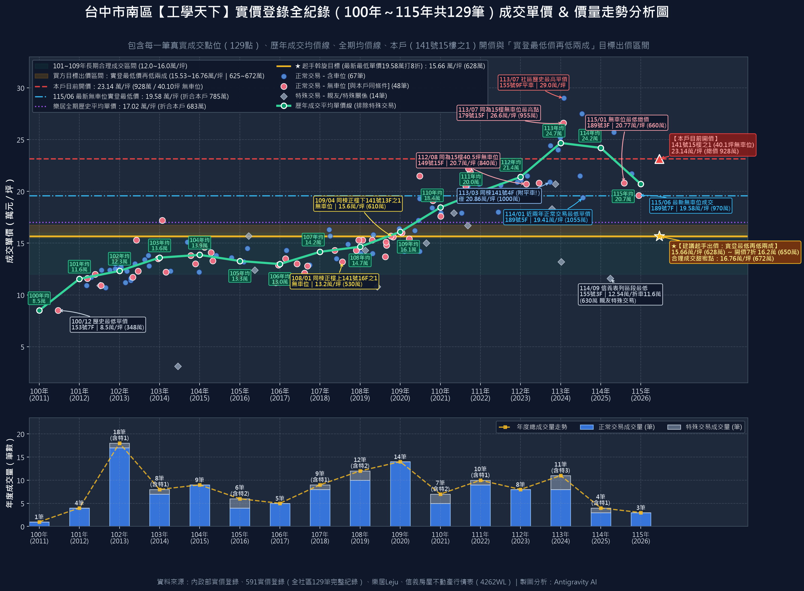

# 工學天下 15 樓之 1（次頂樓溫馨三房・銷售編號 4262WL）
## 房仲向屋主議價溝通文件（經紀人視角實戰版）暨買方簽約防坑特約清單

> **使用說明：**  
> 1. **前半部（第一～三階段）**：專門提供給**信義房屋承辦經紀人（陳建宇）／店長**使用。全篇以「**站在屋主利益角度著想、剖析 115 年最新實價登錄反轉現實、突顯稀缺自住買方的誠意**」為出發點，將買方在產調說明書中抓出的致命抗性，轉化為房仲替屋主分析局勢、軟化屋主價格防線並促成 **628 萬 ～ 680 萬** 區間成交的專業話術逐字稿。  
> 2. **後半部（第四階段）**：專門提供給**買方（張先生／張小姐）**在進入下斡旋、見面談與簽約前嚴格把關的**【六大防坑底線與必押合約特約條款】**。

---

## 【第一階段：開場破冰與局勢鋪陳】
### 🎯 房仲對屋主開場白（傳遞社區 23 間在售賣壓、最新實登跌破 20 萬與誠意自住客現身）

> 「大哥／大姐您好，今天特地跟您回報我們『工學天下 15 樓之 1』這陣子的帶看進度與最新市場實況。  
> 
> 相信您也感受到，自從央行第七波信用管制跟銀行房貸收緊之後，整個台中中古屋市場買氣急凍，看屋的人少了一大半。而且不瞞您說，**現在光是在 591 網站上，我們『工學天下』同一個社區就有高達 23 間房子同時拿出來賣（其中三房就佔了 22 間）！** 社區內部賣壓非常重，很多急售的屋主已經開始暗中殺價搶客了。  
> 
> 但今天我要跟您回報一個好消息：**我們在 10/4 初看、10/16 專程安排深度複看之後，遇到了一組非常優質、做足功課且極有誠意的自住家庭！**  
> 
> 這組客人非常喜歡您 15 樓次頂樓的採光與視野，但他們也是非常講求財務紀律的理性買方——他們把我們信義房屋的產調說明書一頁一頁讀完，也把社區今年（115年）最新的實價登錄全部調出來比對，並請統包師傅評估了 32 年老屋必做的全室水電與兩間無窗衛浴翻修工程。  
> 
> 我是站在協助您『在社區 23 間多殺多之前，順利高點獲利了結、把 30 年起家厝換成真金白銀落袋為安』的立場，把目前市場的真實成交水位與買方的出價算盤老實向您報告，我們一起來看看怎麼圓滿促成！」

---

## 【第二階段：房仲說服屋主的 12 大核心理由與話術逐字稿】

### 說服理由 1：【信義最新實登鐵證】115 年最新無車位成交已跌回 19.58 萬/坪、最低總價僅 660 萬！

* **說服邏輯：** 直接拿信義房屋自己列印在不動產說明書後面的行情表（115/06 最新成交 19.58 萬/坪、114/01 成交 19.41 萬/坪、115/01 成交總價 660 萬）以及上圖「全社區 129 筆實價登錄價量走勢圖」（清楚顯示 114~115 年成交量暴跌 7 成、均價從 24.68 萬大跌回 20.70 萬、最新無車位跌破 20 萬至 19.58 萬/坪），打破屋主對 928 萬（23.14 萬/坪）的幻想。
* **房仲對屋主說法：**
  > 「大哥／大姐，我們目前開價 928 萬，換算單價是 23.14 萬/坪。但現在買方看屋前都看過我們信義說明書後面的實價登錄表，還把全社區 129 筆成交畫成價量走勢圖（如上圖）帶來給我們看：  
  > 1. **今年（115年）6 月社區最新成交的一筆無車位（189號7樓之3），成交單價已經跌回 19.58 萬/坪！** 去年（114年）1 月 189 號 5 樓含車位也才成交 **19.41 萬/坪**！  
  > 2. **今年（115年）1 月最新成交的無車位三房（189號3樓之2），成交總價更只有 660 萬！**  
  > 3. 買方還調出樂居跟 591 的歷年價量統計：我們工學天下從民國 101 年到 109 年長達九年的時間，合理單價一直都在 **12 萬到 16 萬/坪**，樂居全期平均單價也才 **17.02 萬/坪**。113 年那波短暫高點後，114~115 年成交量從每年 11~14 筆暴跌到只剩 3 筆，最新行情實質已經退回 19.5 萬左右。  
  > 買方算得很精：我們這間 40.1 坪而且沒車位，就算先不扣老屋翻修跟瑕疵，照最新實登 19.5 萬/坪計算，市場天花板頂多就是 **780 萬**，完全不可能有買方去追 23 萬以上的價格。」

### 說服理由 2：【說明書第 `*7` 條致命揭露】主建物 27.1 坪竟「包含當層電樓梯間」，實際室內縮水約 3 坪！
* **說服邏輯：** 點出信義產調說明書白紙黑字載明「主建物含電樓梯間」，打破屋主「我這間室內有 27.1 坪很大」的認知，替買方扣減 50~60 萬虛坪價差建立絕對正當性。
* **房仲對屋主說法：**
  > 「大哥／大姐，這一點買方看得非常細，也是其他客人看完不敢出價的主因——我們信義產調說明書注意事項第 `*7` 條白紙黑字寫著：**『本物件經信義房屋確認主建物登記面積（27.1坪）含該層之（電）樓梯間，因此可能造成室內實際面積小於主建物登記之面積。』**  
  > 買方現場複看時拿捲尺跟格局圖一對就發現：這層 3 戶共用的 2 部電梯廳跟樓梯間，當年建商直接把它灌進『主建物』面積裡登記了！也就是說，帳面上主建物寫 27.1 坪，但扣掉分攤的當層電樓梯間（約 2.5 到 3.5 坪），**室內實際能住的面積其實只有 23.5 到 24 坪左右，實質公設比超過 30%！**  
  > 買方跟我們爭取說：『我花錢買 27.1 坪主建物，結果裡面有 3 坪是門外的電梯間跟樓梯間，這 3 坪虛坪算下來就要 60 萬，屋主本來就應該把這 60 萬虛坪價差折讓給我！』老實說，因為這是印在我們信義說明書上的事實，我們在談判桌上真的無法反駁他。」

### 說服理由 3：【說明書第 `13` 條重大抗性】本棟曾列為「須注意之建築物（921黃單修復）」，銀行貸款審核極嚴！
* **說服邏輯：** 搬出說明書第 13 條的「須注意之建築物」與「建議簽約前確認金融機構貸款條件」警語，說明 90% 買方看到這條就退縮，唯有這組買方願意理性承接，但價格必須反映風險折價。
* **房仲對屋主說法：**
  > 「還有一個最現實的貸款與轉手抗性：我們不動產說明書第 `13` 條明確記載：**『本棟建物為須注意之建築物，業已修復完成並取得建築師專業鑑定報告，建議承買人簽約前確認金融機構貸款條件。』**  
  > 雖然當年 921 震後社區已經修復完成並取得建築師鑑定報告，但因為說明書依法必須揭露這條，十組客人裡有八組一看到『須注意之建築物』加上『建議確認銀行貸款條件』就嚇跑了！  
  > 更何況現在屋齡已經 31.7 年、又沒有車位，銀行對這種有歷史註記的老大樓鑑價非常保守，貸款成數跟年限都會被壓縮，買方必須自己多掏大筆現金出來補自備款。這組買方沒有因為這條直接淘汰我們，還願意拿真金白銀出來談，已經是萬中選一的誠意買方了，我們在價格上真的要給予實質折讓。」

### 說服理由 4：【完全無車位硬傷 vs 同棟 141 號附平面車位才賣 20.8 萬/坪】
* **說服邏輯：** 拿同棟（工學北路 141 號 4 樓之 2）附平面車位才成交 20.86 萬/坪做對比，凸顯本戶「無車位」在工學市場旁難停車的明顯劣勢。
* **房仲對屋主說法：**
  > 「我們樓下就是工學市場跟工學北路商圈，平常連臨停買個便當都找不到車位。現在買三房的家庭幾乎都有車，沒有固定車位在中古市場上是非常大的硬傷。  
  > 買方直接調出我們**同一棟（工學北路 141 號 4 樓之 2）**在 113 年 3 月房市最熱時的實價登錄：那一戶**附了一個坡道平面大車位，成交單價也才 20.86 萬/坪（總價 1,000 萬 / 47.95 坪）**！  
  > 買方問我們：『同一棟 141 號，人家有平面車位在最貴的時候才賣 20.8 萬/坪；你們這間完全沒車位，現在房市又跌了，怎麼可能賣超過 16~17 萬/坪？』如果買方以後去外面租車位，一個月 3,000 元，住 20 年就要多花 72 萬租金，這筆無車位的折價買方一定會算進去。」

### 說服理由 5：【32 年老屋水電從未更換＋兩間廁所皆無開窗】120 萬基礎安全工程是剛性支出
* **說服邏輯：** 說明書載明水電未換、雙衛浴無窗、前陽台鐵窗違建，買方為求自住安全必須全室打掉重練，120 萬工程款是客觀剛性成本，必須從總預算倒扣。
* **房仲對屋主說法：**
  > 「大哥／大姐，我們這間屋齡已經快 32 年了，說明書上也勾選『水電管線未曾更換』，而且兩間浴廁都沒有開窗。  
  > 買方是一對準備長期安居的自住夫妻，他們10/16複看時算得非常清楚：為了居住安全，全室 32 年的老舊電線、冷熱水管一定要全部重拉；兩間沒有窗戶的廁所一定要見底打除重做防水層、並加裝獨立排風與暖風乾燥機才不會發霉壁癌；再加上廚房更新、前陽台老舊鐵窗更換為防風氣密窗、全室油漆泥作，現在師傅工資跟廢棄物清運費貴得嚇人，**最基本陽春的安全基礎工程報價就要 110 萬到 120 萬！**  
  > 買方不是投資客買來隨便粉刷轉賣，而是自己要掏 120 萬出來大翻修，所以他們必須把這 120 萬剛性工程款從購屋總價裡扣掉，這是非常務實的家庭財務規劃。」

### 說服理由 6：【同棟正樓下 13 樓與正樓上 16 樓實登定錨】610 萬、530 萬與近期 630 萬的強力定錨
* **說服邏輯：** 搬出同棟同座向無車位（141號13樓之1 成交 610 萬、141號16樓之1 成交 530 萬）與信義行情表首行印出的「最低單價 12.54 萬/坪（114/09 成交 630 萬）」，證明買方出價 628 萬～650 萬完全貼合本棟真實行情。
* **房仲對屋主說法：**
  > 「買方在決定出價前，把我們**工學北路 141 號同一棟**的歷史成交紀錄全翻出來了：  
  > - 我們**正樓下同座向（141 號 13 樓之 1，39.19 坪無車位）**，在 109 年正常成交價就是 **610 萬（單價 15.6 萬/坪）**！  
  > - 我們**正樓上（141 號 16 樓之 1，40.30 坪無車位）**，成交價更只有 **530 萬（單價 13.2 萬/坪）**！  
  > - 再加上我們信義行情表第一行就印著『本區段最低單價 12.54 萬/坪』（114 年 9 月 155 號 3 樓之 1 成交 **630 萬**），以及今年 1 月 189 號 3 樓之 2 無車位成交 **660 萬**。  
  > 所以買方心裡已經完全被 **610 萬 ～ 660 萬** 這個區間定錨住了！他認為在目前買氣冷清、又沒車位、又要花 120 萬翻修的條件下，這間房子的真實價值就是落在 600 多萬。」

### 說服理由 7：【買方「比目前實登最低價再低兩成」的嚴密精算】為何起手出 628 萬（或 650 萬）？
* **說服邏輯：** 完整攤開買方的數學公式，證明 **628 萬 ～ 650 萬** 是經過科學計算的誠意實拿價，而非胡亂砍價。
* **房仲對屋主說法：**
  > 「大哥／大姐，我把買方家庭的算盤原原本本攤給您看：  
  > 買方先看我們信義行情表上最新一筆無車位成交單價 **19.58 萬/坪**（以及去年 1 月的 **19.41 萬/坪**），乘上我們這間 40.1 坪，算出目前實登最低基準價是 **780 萬 ～ 785 萬**。  
  > 接著買方把這間房子的兩大必要成本扣掉（剛好比目前實登最低價再低兩成，打 8 折）：  
  > 1. 扣掉 32 年老屋必做的全室水電、雙無窗衛浴防水與廚具基礎翻修 **120 萬**；  
  > 2. 扣掉主建物灌水電樓梯間的虛坪與無車位折價 **約 35 萬**；  
  > **785 萬 × 0.8（減去約 157 萬）＝ 628 萬（單價約 15.66 萬/坪）！**  
  > 買方今天願意以 **628 萬（若配合店頭 7 折收斡規範則拉高至 650 萬）** 正式開立 10 萬支票下斡旋，每一分錢都是有憑有據算出來的！」

### 說服理由 8：【同社區 23 間在售的多殺多危機】早一步成交落袋，勝過跟鄰居削價競爭
* **說服邏輯：** 強化社區內部 23 間待售的競爭壓力，提醒屋主時間站在買方這邊。
* **房仲對屋主說法：**
  > 「現在最怕的不是買方出價實在，而是社區裡面其他 22 間正在賣三房的屋主有人撐不住先大降價！只要我們社區再跳出一筆 17 萬、18 萬/坪的實價登錄，後面所有買方出價又會再往下砍兩成。趁現在這組買方最喜歡我們 15 樓的視野、還沒被別間吸走之前，趕快把握機會成交，才不會陷入社區多殺多的泥淖。」

### 說服理由 9：【強烈具體競品施壓】買方同時已完成「大墩人文 11 樓」複看，隨時準備轉移簽約！
* **說服邏輯：** 點出買方在 10/16 同一天傍晚也完成了南屯捷運站旁「大墩人文 11 樓」的深度複看，且手上有其他附車位競品，製造「今天不談買方就去簽另一間」的急迫感（FOMO）。
* **房仲對屋主說法：**
  > 「大哥／大姐，我跟您講一個最真實的狀況：這組買方 10/16 下午是同時複看兩間房子，另一間是南屯捷運站、大墩學區的『大墩人文 11 樓』（室內實坪高達 30 坪，完全沒有灌水梯間），而且永義房屋那邊也一直帶他看南區其他已經翻修好或附車位的大樓。  
  > 買方跟我講得很坦白：他預算紀律踩得很死，兩間他都喜歡，**哪一間屋主有誠意先讓利談進他的目標預算內，他這週就直接跟哪一間簽約，另一間就立刻放棄！** 如果我們這邊價格踩太硬不願意給空間，他一轉頭去簽了大墩人文或永義的案子，我們這間空屋就不知道還要再等幾個月才會有下一組出價客了。」

### 說服理由 10：【15 樓次頂樓水壓與中繼水箱漏填之潛在顧慮】
* **說服邏輯：** 點出說明書第 `*3`、`*8` 條關於高層建築中繼水箱與幫浦機械室漏填事項，以及次頂樓外牆與水壓維護成本。
* **房仲對屋主說法：**
  > 「另外，我們說明書第 `*3` 條跟第 `*8` 條有特別註記，本棟是 16 層高層建築，但現況說明書第 14 項關於中繼水箱或幫浦機械室是漏填的，而且 15 樓次頂樓未來若頂樓加壓馬達震動或外牆防水老化，買方都要自己承擔修繕與維護成本，這也是買方在評估價格時希望屋主能體諒讓步的地方。」

### 說服理由 11：【268-4 地號道路用地徵收與稅費不確定性】
* **說服邏輯：** 提醒說明書第 `*1`、`*6` 條所載 268-4 地號道路用地問題，早日圓滿交屋免除日後繁瑣手續。
* **房仲對屋主說法：**
  > 「我們土地裡面有一筆 268-4 地號屬於道路用地（說明書第 `*1`、`*6` 條），日後有被徵收之虞，移轉時稅捐機關還要特別審查。趁現在有熟悉流程的買方願意配合我們信義代書一併處理，早日完成過戶交屋，對您來說也是最省事安心的選擇。」

### 說服理由 12：【屋主民國 85 年一手買入持有 30 年，零貸款純拿 600 多萬現金入袋＋善待起家厝！】
* **說服邏輯：** 擊中屋主內心最柔軟也最實際的一塊：民國 85 年買入成本僅 300 多萬，賣 650~680 萬等於淨賺 300 多萬現金，且房子交給會花上百萬用心翻修的自住好人家。
* **房仲對屋主說法：**
  > 「大哥／大姐，您在民國 85 年就買下這間起家厝，持有整整 30 年了，非常有福氣！當年買入成本才三百多萬，現在早就沒有房貸壓力了。  
  > 說句實在話，現在房子空在那裡沒人住，每個月還要白白繳 1,943 元管理費跟水電基本費，老房子空久了管線跟屋況只會加速老化。今天只要您點頭割愛，不管是 **650 萬還是 680 萬**，對您來說都是**實實在在淨拿 600 多萬真金白銀入袋、純賺三百多萬獲利了結**！  
  > 更難得的是，這組買方夫妻人品非常好，他們準備再花 100 多萬把全室水電、衛浴全部重新翻修，讓這間陪伴您 30 年的起家厝煥然一新、繼續溫暖下一個家庭。把房子交託給這樣有誠意、會惜福善待房子的自住買方，您又能抱著大筆現金安心享受生活，這真的是最棒的善緣！」

---

## 【第三階段：收尾逼單促成簽字】
### 🏆 拋出「10 萬真金白銀斡旋支票，促成買賣雙贏圓滿簽約」

> **🎯 房仲逼單最關鍵的一句話：**
> 
> 「大哥／大姐，現在市場上九成的看屋客都是隨便問問、不敢出價。但這組自住家庭態度非常誠懇堅定，已經準備好 **10 萬真金白銀的斡旋支票** 放在我們桌上，隨時可以出來簽約！  
> 
> 買方從最新無車位實價登錄 **19.58 萬/坪（780萬）** 出發，理性扣除 32 年老屋全室水電衛浴必花翻修款與梯間虛坪，誠意出價 **628 萬 ～ 650 萬**（若您願意給個見面談機會，買方最高努力擠到 **672 萬 ～ 680 萬** 的歷史均價極限）。  
> 
> 在全社區 23 間房子排隊等賣的時刻，能把這組全場最認真、最有誠意的自住買方留下來，一次把 600 多萬現金安穩放進口袋，請大哥／大姐今天給我們一個機會，我們直接約見面圓滿簽字！」

---

## 【第四階段：買方簽約前必守的「六大防坑底線與合約特約條款」】
*(※ 本節專供買方張先生／張小姐自己留存把關，下斡旋與簽約時務必堅持寫入契約特約欄！)*

為了確保您全家人的資金安全，針對 [`工學天下信義資料_2.jpg`](file:///d:/GoogleDrive/01_%E5%80%8B%E4%BA%BA_%E5%AE%B6%E5%BA%AD%E8%88%87%E7%94%9F%E6%B4%BB/02_%E5%AE%B6%E5%BA%AD_%E5%AE%89%E8%8E%89%E7%9A%84%E8%B3%87%E6%96%99/%E5%B0%8F%E5%AF%B6%E7%9A%84%E8%B2%B7%E6%88%BF%E5%AD%90%E8%B3%87%E6%96%99/%E5%B7%A5%E5%AD%B8%E5%A4%A9%E4%B8%8B15%E6%A8%93/%E5%B7%A5%E5%AD%B8%E5%A4%A9%E4%B8%8B%E4%BF%A1%E7%BE%A9%E8%B3%87%E6%96%99_2.jpg) 與 [`3.jpg`](file:///d:/GoogleDrive/01_%E5%80%8B%E4%BA%BA_%E5%AE%B6%E5%BA%AD%E8%88%87%E7%94%9F%E6%B4%BB/02_%E5%AE%B6%E5%BA%AD_%E5%AE%89%E8%8E%89%E7%9A%84%E8%B3%87%E6%96%99/%E5%B0%8F%E5%AF%B6%E7%9A%84%E8%B2%B7%E6%88%BF%E5%AD%90%E8%B3%87%E6%96%99/%E5%B7%A5%E5%AD%B8%E5%A4%A9%E4%B8%8B15%E6%A8%93/%E5%B7%A5%E5%AD%B8%E5%A4%A9%E4%B8%8B%E4%BF%A1%E7%BE%A9%E8%B3%87%E6%96%99_3.jpg) 揭露的各項風險，**簽約前請嚴格執行以下 6 道防線**：

### 1. 🛡️ 【銀行貸款安全防線】（最關鍵！防範「須注意建築物＋31.7年屋齡」貸不足額）
* **風險原因**：說明書第 `13` 條明載本棟曾為「須注意之建築物（921黃單修復）」，信義特別提醒「建議承買人簽約前確認金融機構貸款條件」。
* **必做動作**：
  1. **下斡旋／簽約前**：請信義房屋代書先將本戶門牌（工學北路141號15樓之1）送交 2～3 家配合銀行進行**「正式初估鑑價與可貸成數確認」**。
  2. **必押合約特約條款**：在斡旋單與買賣契約書上白紙黑字加註：
     > **「特約條款一（貸款成數保障）：本買賣契約以買方取得金融機構核貸金額不低於成交總價之八成（或新台幣〇〇〇萬元整）、且貸款年限不低於〇〇年為解除條件。若非因買方個人信用瑕疵，而係因標的物屋齡、歷史列管註記或銀行鑑價不足致無法達成上述核貸條件者，買方得無條件解除本契約，賣方應立即全額無息退還買方已支付之全部款項，買方亦無須支付任何仲介服務費。」**

### 2. 🛡️ 【索取並核對建築師專業鑑定報告與都發局解除列管公文】
* **風險原因**：說明書第 `13` 條載明「業已修復完成並取得建築師專業鑑定報告，鑑定報告詳如附件」。
* **必做動作**：簽約前要求信義房仲建宇出示該份**「建築師專業鑑定報告完整附件」**及**「台中市政府都發局解除列管證明」**，確認修復內容僅屬非主結構修繕且已合法銷案。

### 3. 🛡️ 【確認 15 樓次頂樓「中繼水箱／加壓幫浦」現況】
* **風險原因**：說明書第 `*3`、`*8` 條載明本棟為 16 層高層建築，但現況說明書第 14 項「有無設置中繼幫浦機械室或中繼水箱」係為**漏填**！
* **必做動作**：收定簽約前，要求房仲與屋主補填確認：**15 樓或 16 樓頂樓正上方是否有中繼水箱或加壓馬達機械室？** 並在夜間或用水尖峰時段確認室內有無低頻馬達共鳴聲。

### 4. 🛡️ 【268-4 地號道路用地稅費負擔特約】
* **風險原因**：說明書第 `*1`、`*6` 條載明本物件含 `268-4` 地號道路用地（徵收持分約 0.002 平方公尺），無法得知是否可適用自用住宅優惠土增稅率。
* **必押合約特約條款**：
  > **「特約條款二（土地增值稅負擔）：本買賣標的所含全部土地（含 268-4 地號道路用地），無論稅捐稽徵機關核定為一般稅率、自用住宅優惠稅率或是否免徵土地增值稅，本次買賣所生之全部土地增值稅概由賣方全額自行負擔，與買方無涉。」**

### 5. 🛡️ 【索取社區住戶規約與管委會財報（確認車位租用規則）】
* **風險原因**：說明書第 `14` 條載明「委託人表示社區有住戶規約，但目前尚未檢附，請委託人於簽約時出具」；且本戶**無車位**。
* **必做動作**：簽約前請房仲向管委會確認：
  1. 社區地下室是否有管委會公有車位可供住戶排隊抽籤或月租？（說明書第 2 頁寫管理費「車位：$100平面、$200機械」，代表社區有平面與機械車位管理制度，可詢問是否有住戶長期出租車位）。
  2. 社區公共基金餘額是否充足？近期有無電梯更新或外牆拉皮集資攤提計畫？

### 6. 🛡️ 【滲漏水保固與現況點交特約】
* **必押合約特約條款**：
  > **「特約條款三（滲漏水保固）：賣方保證本標的物交屋時無任何滲漏水或海砂、輻射、凶宅等重大瑕疵；自交屋日起算六個月內（搭配信義房屋漏水保固制度），若發現屋頂、外牆、窗框或樓板有非人為因素之滲漏水情形，賣方應負修繕或價金減少之法定物之瑕疵擔保責任。」**
