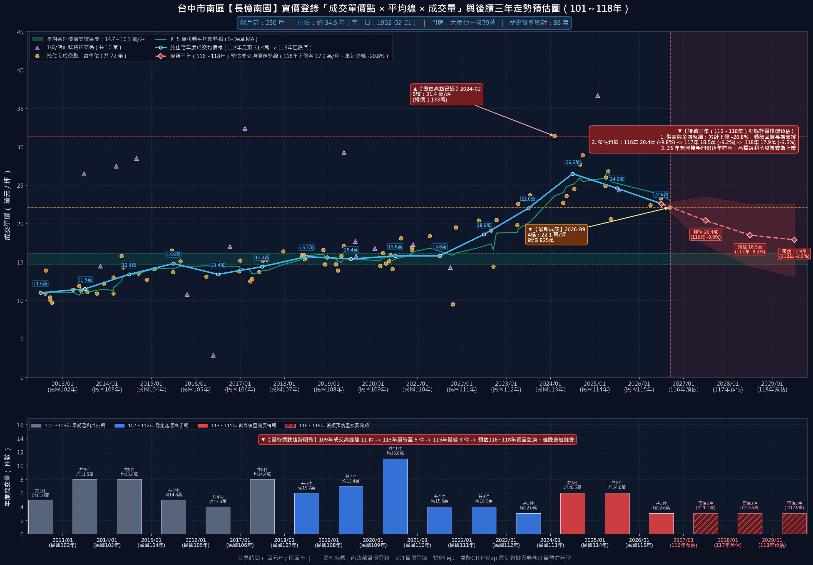

# 工學天下 15 樓之 1（次頂樓・信義房屋銷售編號 4262WL 專用）
## 《房仲向屋主議價溝通說帖與實戰逐字稿》

> **📋 文件使用說明：**
> 1. **核心定位**：專門提供給 **信義房屋承辦經紀人（陳建宇）／店長** 拿去向屋主回報並進行深度議價溝通的實戰說帖。全篇採用「**站在屋主利益角度著想、客觀剖析第七波信用管制後大盤反轉急凍、南區 10 大指標老牌社區實價登錄折線圖全線反轉向下、工學天下全紀錄價量剖析、同社區 23 戶在售多殺多賣壓、信義房屋同時洽談南屯『大墩人文』與永義洽談『長億南園』強烈競品威脅、以及把握稀缺成熟中年自住買方誠意**」為出發點。
> 2. **議價宗旨**：將買方的理性客觀認知與信義產調瑕疵抗性（主建物含電樓梯間虛坪縮水3坪、曾列為須注意建物/921黃單修復、31.7年老屋水電未換雙衛浴無窗、完全無車位），轉化為房仲替屋主分析局勢的專業建言，誠懇勸導屋主「**趁老屋價格仍在相對高檔反轉初期，安全獲利了結、把 30 年累積的數百萬現金落袋為安**」。
> 3. **條款純化**：本說帖已徹底純化為純粹之專業談判說帖，無任何繁瑣法律條件干擾，給予屋主乾淨誠懇的洽談空間。

---

# 第一部分：【開場破冰與市場大盤反轉局勢】

### 🎯 房仲對屋主開場白（站在屋主立場，傳遞市場寒意、大盤成交量暴跌 76.4%、同社區 23 間競售賣壓、最新實登摜破 20 萬與做足功課的誠意買方現身）

> 「大哥／大姐您好，今天特地跟您深度回報我們這間『工學天下 15 樓之 1』這陣子的帶看進度與市場最新狀況。
> 
> 相信您最近看新聞與行情也很清楚，自從央行第七波信用管制實施、銀行房貸滿水位排隊之後，整個台中中古屋市場買氣直接急凍了三到四成。現在市場價格已經不再是以前那種隨便盲目追高的年代，而是呈現『**量縮價跌、緩步向下走跌**』的嚴峻走勢！
> 
> 不瞞大哥／大姐報告，**現在光是在 591 網站上，我們『工學天下』同一個社區就有高達 23 間房子同時拿出來賣（其中光是三房就佔了 22 間）！** 社區內部的待售賣壓極度沉重，很多急售的屋主已經開始私下讓利搶客了。
> 
> 特別是我們南區這批 30 年以上的老牌社區，屋齡越來越老，在銀行貸款成數全面緊縮下，市場價格只會越來越便宜。**近年來年輕人只願意買新建社區的小宅，願意買 31.7 年老屋的買家只剩下中年家庭了！**
> 
> 但今天我要跟您報告一個非常難得的好消息：**我們在 10/4 初看、10/16 專程安排深度複看之後，店頭遇到了一組非常優質、做足功課且極有誠意的成熟中年自住家庭！**
> 
> 這組客人非常喜歡您 15 樓次頂樓的採光與視野，但他們也是非常講求財務紀律的理性買方——他們把我們信義房屋的不動產說明書一頁一頁讀完，也把社區今年（115年）最新的實價登錄全部調出來比對，並請統包師傅精算了 32 年老屋必做的全室水電重拉與兩間無窗衛浴防水翻修工程。
> 
> 而且買方態度非常誠懇：**只要大哥／大姐願意談，買方願意立即下斡旋金！隨時可以坐下來促成簽約！**
> 
> 我今天是站在幫大哥／大姐『**在社區 23 間多殺多之前，把民國 85 年買入持有整整 30 年的資產高點安全獲利變現、數百萬真金白銀穩穩落袋**』的立場，把目前南區大盤跌價的客觀數據、南區 10 大指標社區全數反轉走跌的鐵證、工學天下全紀錄價量走勢、以及這組買方隨時可能轉移簽約南屯『大墩人文』或南區『長億南園』的急迫情況，老老實實跟您分析，我們一起來圓滿把握這組極少數的好客人！」

---

### 📊 全南區大盤關鍵數據：53 棟 25 年以上老牌大社區成交量雪崩 76.4%！

* **大盤樣本完整**：全南區 53 棟 25 年以上老牌大社區、涵蓋 21,208 戶、累計 7,022 筆成交實價登錄。
* **歷史見頂反轉**：113 年大盤中位數衝上 26.9 萬/坪歷史極值，第七波信用管制後急速反轉下修至 24.6 萬/坪。
* **成交量雪崩 76.4%**：年成交量自高峰 738 件崩縮至 115 年僅 174 件，市場動能徹底急凍！
* **『量先價行』鐵律**：沒有成交量支撐，老屋價格只有緩跌修正一途，不可再心存追高幻想！

---

# 客觀鐵證專章：【南區 10 大指標老牌社區實價登錄全數反轉向下】

> 「大哥／大姐，如果您覺得工學天下的跌價只是少數特例，那我們今天特地把整個南區最指標的十個類似老牌大社區（總戶數都在兩百戶、四百戶甚至六百多戶以上）全部調出來看！
> 不管是工學商圈的長億城攬翠區、京城特區；還是復興路上的假日半島、大東家華園；文心南路上的文心高第、文心及第、文心大地；以及德富路長億南園、興大生活圈的龍邦綠園道、大安黃金城大廈……
> **這十個比我們工學天下規模更大或指名度極高的名牌社區，全部都在民國 113 年見頂之後，實價登錄走勢『全數反轉向下』！而且跌勢非常兇猛！**
> 像我們工學天下最新成交直接暴跌到 19.58 萬/坪、京城特區跌到 18.6 萬、文心及第更從 35.7 萬直接腰斬跌到 18.9 萬，全部正式跌破 2 字頭！
> 這鐵證證明：整個南區 30 年以上老牌社區的大盤循環已經全面走跌，央行限貸令掐死買氣，沒有人能逃過這個大盤規律。今天這組買方願意在屋主願談下立即下斡旋金出價，是極少數能讓您獲利了結的及時雨，此時不賣，再拖半年一年只會越跌越深！」

### 📊 南區 10 大指標老牌集合住宅社區實價登錄量價走勢反轉對照總表

| 指標社區名稱 | 規模 / 屋齡 | 歷史最高單價 | 115年最新成交 | 均價走勢 (113➜115) | 均價跌幅 | 實登反轉特徵解析 |
|:---|:---:|:---:|:---:|:---:|:---:|:---|
| **長億城攬翠區** | 669戶 約30.9年 | 29.5 萬 (113年06月 (8樓)) | **26.9 萬** (115年06月 (10樓)) | 26.3 ➜ 23.2 萬 | **-11.9%** | 工學商圈極具指標性之超級大社區，就在工學天下旁邊！實登走勢在 113 年衝上 29.5 萬歷史頂峰後反轉回檔，115 年最新均價已跌至 23.2 萬，跌幅達 11.9% |
| **工學天下 (本社區)** | 452戶 約31.7年 | 29.0 萬 (113年07月 (9樓)) | **19.6 萬** (115年06月 (7樓)) | 24.7 ➜ 20.7 萬 | **-16.1%** | 本案社區！113 年狂熱高點曾達 29.0 萬，但 115 年 6 月最新無車位成交直接暴跌至 19.58 萬/坪，正式摜破 2 字頭大關！均價跌幅達 16.1%，鐵證證明 30 年以上無車位老屋在買盤眼中支撐極度脆弱，屋主開價 23 萬以上完全脫離現實 |
| **長億南園** | 171戶 約33.7年 | 27.2 萬 (113年05月 (10樓)) | **21.4 萬** (115年09月 (4樓)) | 25.1 ➜ 21.8 萬 | **-13.1%** | 南區德富路核心指標大樓 |
| **龍邦綠園道** | 322戶 約33.4年 | 28.5 萬 (114年02月 (5樓)) | **23.6 萬** (115年08月 (16樓)) | 23.6 ➜ 21.3 萬 | **-9.5%** | 南和路綠園道首排名宅，生活環境與綠意極佳，但同樣難敵 33 年高屋齡與房貸限貸緊箍咒 |
| **文心高第** | 266戶 約24.9年 | 34.5 萬 (113年05月 (12樓)) | **30.4 萬** (115年07月 (2樓)) | 31.3 ➜ 28.5 萬 | **-8.9%** | 東興路一段指標高樓名廈，即使屋齡在老牌社區中相對較輕（約 24.9 年），但在央行信用管制下，30 萬以上高單價買盤已完全難以為繼，均價自 31.3 萬下修至 28.5 萬，正式進入下行波 |
| **大東家華園** | 227戶 約31.2年 | 27.7 萬 (113年03月 (12樓)) | **20.3 萬** (115年07月 (10樓)) | 24.5 ➜ 23.1 萬 | **-5.9%** | 復興路三段與學府路核心生活圈名宅 |
| **假日半島** | 219戶 約32.4年 | 33.2 萬 (113年10月 (9樓)) | **24.8 萬** (115年07月 (5樓)) | 29.4 ➜ 25.3 萬 | **-14.0%** | 復興路二段地標性大樓 |
| **文心大地** | 207戶 約27.4年 | 28.4 萬 (113年07月 (6樓)) | **24.1 萬** (115年05月 (10樓)) | 26.4 ➜ 22.5 萬 | **-15.1%** | 文心南路商圈主力集合住宅 |
| **文心及第** | 259戶 約27.3年 | 35.7 萬 (113年06月 (10樓)) | **18.9 萬** (115年03月 (14樓)) | 30.6 ➜ 18.9 萬 | **-38.2%** | 南區指標名宅中反轉跌勢最為劇烈的震撼案例！113 年 6 月曾衝上 35.7 萬歷史最高價，然而泡泡破裂後，115 年 3 月 14 樓高樓層最新成交竟直接暴跌至 18.9 萬/坪（狂跌 38.2%！），宣告高價神話徹底幻滅！ |
| **京城特區** | 388戶 約29.1年 | 25.9 萬 (113年03月 (18樓)) | **18.6 萬** (115年05月 (3樓)) | 22.4 ➜ 20.9 萬 | **-6.9%** | 學府路京華大鎮系列大案 |

---

### 🏢 南區 10 大指標社區獨立成交行情走勢折線圖與深度剖析

#### 1. 【長億城攬翠區】（669戶・屋齡約30.9年）—— 最新成交下修至 **26.9 萬/坪**（跌幅 **-11.9%**）

- **歷史高點與回檔實證**：長億城攬翠區陽光區 實登歷史高點出現在 113年06月 (8樓) 單價達 29.5 萬/坪；最新成交已於 115年06月 (10樓) 下挫至 **26.9 萬/坪**。純住宅年度均價由 113 年的 26.3 萬下修至 115 年的 23.2 萬，跌幅高達 **-11.9%**！
- **成交量能斷崖式萎縮**：年成交 63 件 ➜ 萎縮至 9 件（量縮 85.7%）。買氣嚴重急凍，二手委售週期大幅拉長。
- **長期合理價值支撐**：大盤模型測算該社區合理支撐帶為 **13.8～16.1 萬/坪**，預估 116～118 年受 30 年以上老屋限貸影響，單價將持續回測支撐。
- **房仲向屋主議價建言**：工學商圈極具指標性之超級大社區，就在工學天下旁邊！實登走勢在 113 年衝上 29.5 萬歷史頂峰後反轉回檔，115 年最新均價已跌至 23.2 萬，跌幅達 11.9%。年成交量更由 63 件暴跌至個位數，社區內二手委售競爭劇烈，價格持續下修。

---
#### 2. 【工學天下 (本社區)】（452戶・屋齡約31.7年）—— 最新成交下修至 **19.6 萬/坪**（跌幅 **-16.1%**）

- **歷史高點與回檔實證**：工學天下 實登歷史高點出現在 113年07月 (9樓) 單價達 29.0 萬/坪；最新成交已於 115年06月 (7樓) 下挫至 **19.6 萬/坪**。純住宅年度均價由 113 年的 24.7 萬下修至 115 年的 20.7 萬，跌幅高達 **-16.1%**！
- **成交量能斷崖式萎縮**：年成交 25 件 ➜ 萎縮至 4 件（量縮 84%）。買氣嚴重急凍，二手委售週期大幅拉長。
- **長期合理價值支撐**：大盤模型測算該社區合理支撐帶為 **13.6～16.5 萬/坪**，預估 116～118 年受 30 年以上老屋限貸影響，單價將持續回測支撐。
- **房仲向屋主議價建言**：本案社區！113 年狂熱高點曾達 29.0 萬，但 115 年 6 月最新無車位成交直接暴跌至 19.58 萬/坪，正式摜破 2 字頭大關！均價跌幅達 16.1%，鐵證證明 30 年以上無車位老屋在買盤眼中支撐極度脆弱，屋主開價 23 萬以上完全脫離現實。

---
#### 3. 【長億南園】（171戶・屋齡約33.7年）—— 最新成交下修至 **21.4 萬/坪**（跌幅 **-13.1%**）

- **歷史高點與回檔實證**：長億南園 實登歷史高點出現在 113年05月 (10樓) 單價達 27.2 萬/坪；最新成交已於 115年09月 (4樓) 下挫至 **21.4 萬/坪**。純住宅年度均價由 113 年的 25.1 萬下修至 115 年的 21.8 萬，跌幅高達 **-13.1%**！
- **成交量能斷崖式萎縮**：年成交 18 件 ➜ 萎縮至 3 件（量縮 83.3%）。買氣嚴重急凍，二手委售週期大幅拉長。
- **長期合理價值支撐**：大盤模型測算該社區合理支撐帶為 **13.5～16.8 萬/坪**，預估 116～118 年受 30 年以上老屋限貸影響，單價將持續回測支撐。
- **房仲向屋主議價建言**：南區德富路核心指標大樓。113 年衝上 27.2 萬後量縮急凍，最新 115 年 9 月含車位總價僅 825 萬，拆算單價跌回 21.4 萬，9 樓成交總價更僅 782 萬。永義房屋正積極帶本組買方洽談該案 8 樓，買方隨時可能轉向！

---
#### 4. 【龍邦綠園道】（322戶・屋齡約33.4年）—— 最新成交下修至 **23.6 萬/坪**（跌幅 **-9.5%**）

- **歷史高點與回檔實證**：龍邦綠園道 實登歷史高點出現在 114年02月 (5樓) 單價達 28.5 萬/坪；最新成交已於 115年08月 (16樓) 下挫至 **23.6 萬/坪**。純住宅年度均價由 113 年的 23.6 萬下修至 115 年的 21.3 萬，跌幅高達 **-9.5%**！
- **成交量能斷崖式萎縮**：年成交 22 件 ➜ 萎縮至 5 件（量縮 77%）。買氣嚴重急凍，二手委售週期大幅拉長。
- **長期合理價值支撐**：大盤模型測算該社區合理支撐帶為 **13.0～15.6 萬/坪**，預估 116～118 年受 30 年以上老屋限貸影響，單價將持續回測支撐。
- **房仲向屋主議價建言**：南和路綠園道首排名宅，生活環境與綠意極佳，但同樣難敵 33 年高屋齡與房貸限貸緊箍咒。114 年短暫創高後迅速回檔，115 年均價下探至 21.3 萬，買盤追價意願徹底消失。

---
#### 5. 【文心高第】（266戶・屋齡約24.9年）—— 最新成交下修至 **30.4 萬/坪**（跌幅 **-8.9%**）

- **歷史高點與回檔實證**：文心高第 實登歷史高點出現在 113年05月 (12樓) 單價達 34.5 萬/坪；最新成交已於 115年07月 (2樓) 下挫至 **30.4 萬/坪**。純住宅年度均價由 113 年的 31.3 萬下修至 115 年的 28.5 萬，跌幅高達 **-8.9%**！
- **成交量能斷崖式萎縮**：年成交 26 件 ➜ 萎縮至 6 件（量縮 76.9%）。買氣嚴重急凍，二手委售週期大幅拉長。
- **長期合理價值支撐**：大盤模型測算該社區合理支撐帶為 **16.0～19.2 萬/坪**，預估 116～118 年受 30 年以上老屋限貸影響，單價將持續回測支撐。
- **房仲向屋主議價建言**：東興路一段指標高樓名廈，即使屋齡在老牌社區中相對較輕（約 24.9 年），但在央行信用管制下，30 萬以上高單價買盤已完全難以為繼，均價自 31.3 萬下修至 28.5 萬，正式進入下行波。

---
#### 6. 【大東家華園】（227戶・屋齡約31.2年）—— 最新成交下修至 **20.3 萬/坪**（跌幅 **-5.9%**）

- **歷史高點與回檔實證**：大東家華園 實登歷史高點出現在 113年03月 (12樓) 單價達 27.7 萬/坪；最新成交已於 115年07月 (10樓) 下挫至 **20.3 萬/坪**。純住宅年度均價由 113 年的 24.5 萬下修至 115 年的 23.1 萬，跌幅高達 **-5.9%**！
- **成交量能斷崖式萎縮**：年成交 16 件 ➜ 萎縮至 3 件（量縮 81%）。買氣嚴重急凍，二手委售週期大幅拉長。
- **長期合理價值支撐**：大盤模型測算該社區合理支撐帶為 **14.0～16.8 萬/坪**，預估 116～118 年受 30 年以上老屋限貸影響，單價將持續回測支撐。
- **房仲向屋主議價建言**：復興路三段與學府路核心生活圈名宅。最新 115 年 7 月高樓層成交已殺至 20.3 萬/坪，直接逼近 1 字頭邊緣！買氣急凍下，屋主讓利套現心態明顯外溢。

---
#### 7. 【假日半島】（219戶・屋齡約32.4年）—— 最新成交下修至 **24.8 萬/坪**（跌幅 **-14.0%**）

- **歷史高點與回檔實證**：假日半島 實登歷史高點出現在 113年10月 (9樓) 單價達 33.2 萬/坪；最新成交已於 115年07月 (5樓) 下挫至 **24.8 萬/坪**。純住宅年度均價由 113 年的 29.4 萬下修至 115 年的 25.3 萬，跌幅高達 **-14.0%**！
- **成交量能斷崖式萎縮**：年成交 32 件 ➜ 萎縮至 7 件（量縮 78%）。買氣嚴重急凍，二手委售週期大幅拉長。
- **長期合理價值支撐**：大盤模型測算該社區合理支撐帶為 **13.1～15.7 萬/坪**，預估 116～118 年受 30 年以上老屋限貸影響，單價將持續回測支撐。
- **房仲向屋主議價建言**：復興路二段地標性大樓。113 年底曾創下 33.2 萬天價，隨即引發買方強烈抗性與買氣急凍，115 年均價已重跌至 25.3 萬，最新成交更僅 24.8 萬，單價大跌近 8 萬元/坪（跌幅 14%）。

---
#### 8. 【文心大地】（207戶・屋齡約27.4年）—— 最新成交下修至 **24.1 萬/坪**（跌幅 **-15.1%**）

- **歷史高點與回檔實證**：文心大地 實登歷史高點出現在 113年07月 (6樓) 單價達 28.4 萬/坪；最新成交已於 115年05月 (10樓) 下挫至 **24.1 萬/坪**。純住宅年度均價由 113 年的 26.4 萬下修至 115 年的 22.5 萬，跌幅高達 **-15.1%**！
- **成交量能斷崖式萎縮**：年成交 15 件 ➜ 萎縮至 3 件（量縮 80%）。買氣嚴重急凍，二手委售週期大幅拉長。
- **長期合理價值支撐**：大盤模型測算該社區合理支撐帶為 **14.8～17.9 萬/坪**，預估 116～118 年受 30 年以上老屋限貸影響，單價將持續回測支撐。
- **房仲向屋主議價建言**：文心南路商圈主力集合住宅。高檔行情完全缺乏支撐，均價從 113 年的 26.4 萬急速下挫至 115 年的 22.5 萬，跌幅高達 15.1%，呈現極度清晰的頭部反轉特徵。

---
#### 9. 【文心及第】（259戶・屋齡約27.3年）—— 最新成交下修至 **18.9 萬/坪**（跌幅 **-38.2%**）

- **歷史高點與回檔實證**：文心及第(文心南路) 實登歷史高點出現在 113年06月 (10樓) 單價達 35.7 萬/坪；最新成交已於 115年03月 (14樓) 下挫至 **18.9 萬/坪**。純住宅年度均價由 113 年的 30.6 萬下修至 115 年的 18.9 萬，跌幅高達 **-38.2%**！
- **成交量能斷崖式萎縮**：年成交 18 件 ➜ 萎縮至 2 件（量縮 88.9%）。買氣嚴重急凍，二手委售週期大幅拉長。
- **長期合理價值支撐**：大盤模型測算該社區合理支撐帶為 **14.8～17.8 萬/坪**，預估 116～118 年受 30 年以上老屋限貸影響，單價將持續回測支撐。
- **房仲向屋主議價建言**：南區指標名宅中反轉跌勢最為劇烈的震撼案例！113 年 6 月曾衝上 35.7 萬歷史最高價，然而泡泡破裂後，115 年 3 月 14 樓高樓層最新成交竟直接暴跌至 18.9 萬/坪（狂跌 38.2%！），宣告高價神話徹底幻滅！

---
#### 10. 【京城特區】（388戶・屋齡約29.1年）—— 最新成交下修至 **18.6 萬/坪**（跌幅 **-6.9%**）

- **歷史高點與回檔實證**：京城特區 實登歷史高點出現在 113年03月 (18樓) 單價達 25.9 萬/坪；最新成交已於 115年05月 (3樓) 下挫至 **18.6 萬/坪**。純住宅年度均價由 113 年的 22.4 萬下修至 115 年的 20.9 萬，跌幅高達 **-6.9%**！
- **成交量能斷崖式萎縮**：年成交 24 件 ➜ 萎縮至 4 件（量縮 83.3%）。買氣嚴重急凍，二手委售週期大幅拉長。
- **長期合理價值支撐**：大盤模型測算該社區合理支撐帶為 **14.0～16.9 萬/坪**，預估 116～118 年受 30 年以上老屋限貸影響，單價將持續回測支撐。
- **房仲向屋主議價建言**：學府路京華大鎮系列大案。115 年 5 月低樓層最新成交已跌至 18.6 萬/坪，重回 1 字頭行情！388 戶大社區買盤嚴重萎縮，老屋套牢賣壓沈重。

---

# 第二部分：【工學天下實價登錄全紀錄（129筆）價量走勢深度解析】

### 📊 工學天下歷年成交單價與成交量價量走勢總表（100年～115年共129筆）

| 交易年度 (民國/西元) | 年度總成交量 (正常+特殊) | 年度平均單價 (正常交易) | 年度最低單價 (正常/特殊) | 年度最高單價 | 價量趨勢與市場解讀 |
|:---:|:---:|:---:|:---:|:---:|:---|
| **100年 (2011)** | **1 筆 (1+0)** | **8.50 萬/坪** | 8.50 萬/坪 | **8.50 萬/坪** | 實價登錄起點（153號7樓3房僅 348 萬） |
| **101年 (2012)** | **4 筆 (4+0)** | **11.55 萬/坪** | 10.90 萬/坪 | **12.00 萬/坪** | 單價 11 萬時代 |
| **102年 (2013)** | **18 筆 (17+1)** | **12.32 萬/坪** | 10.70 萬/坪 | **15.30 萬/坪** | 歷史最大換手量（18筆），均價 12.3 萬/坪 |
| **103年 (2014)** | **8 筆 (7+1)** | **13.60 萬/坪** | 12.20 / 2.70 萬 | **17.20 萬/坪** | 房地合一稅前小高點 |
| **104年 (2015)** | **9 筆 (9+0)** | **13.87 萬/坪** | 12.20 萬/坪 | **15.10 萬/坪** | 穩定盤整於 13.8 萬/坪 |
| **105年 (2016)** | **6 筆 (4+2)** | **13.28 萬/坪** | 11.80 萬/坪 | **14.50 萬/坪** | 景氣修正，價量齊跌回落至 13.2 萬/坪 |
| **106年 (2017)** | **5 筆 (5+0)** | **12.98 萬/坪** | 11.20 萬/坪 | **14.30 萬/坪** | 跌破 13 萬，最低僅 11.2 萬/坪 |
| **107年 (2018)** | **9 筆 (8+1)** | **14.16 萬/坪** | 12.10 萬/坪 | **16.30 萬/坪** | 緩步回溫至 14.1 萬/坪 |
| **108年 (2019)** | **12 筆 (10+2)** | **14.65 萬/坪** | 13.20 / 10.7 萬 | **15.80 萬/坪** | 本棟 141 號 16 樓無車位成交 530 萬（13.2萬/坪） |
| **109年 (2020)** | **14 筆 (14+0)** | **16.09 萬/坪** | 13.70 萬/坪 | **21.50 萬/坪** | 本棟 141 號 13 樓之 1 無車位成交 610 萬（15.6萬/坪） |
| **110年 (2021)** | **7 筆 (5+2)** | **18.44 萬/坪** | 17.60 / 15.0 萬 | **19.20 萬/坪** | 疫情資金潮推升至 18.4 萬/坪 |
| **111年 (2022)** | **10 筆 (9+1)** | **20.00 萬/坪** | 17.90 / 16.8 萬 | **22.20 萬/坪** | 正式觸及 20.0 萬/坪整數關卡 |
| **112年 (2023)** | **8 筆 (8+0)** | **21.39 萬/坪** | 20.60 萬/坪 | **22.80 萬/坪** | 149 號 15 樓之 2（40.5坪無車位）成交 840 萬（20.7萬/坪） |
| **113年 (2024)** | **11 筆 (8+3)** | **24.68 萬/坪** | 20.86 / 13.2 萬 | **29.00 萬/坪** | 歷史泡沫頂峰；惟同棟 141 號 4 樓附平車僅 20.86 萬/坪（1000萬） |
| **114年 (2025)** | **4 筆 (3+1)** | **24.20 萬/坪** | 19.41 / 11.6 萬 | **27.54 萬/坪** | 量縮 7 成！114/01 正常最低 19.41 萬；114/09 親友特殊 12.54 萬 |
| **115年 (2026)** | **3 筆 (3+0)** | **20.70 萬/坪** | 19.58 萬/坪 | **21.72 萬/坪** | 均價大跌 16.1%！115/01 最低 660 萬、115/06 最新無車位 19.58 萬/坪破 2 字頭 |

> [!IMPORTANT] **核心價量趨勢結論：量先價行，成交量萎縮 84%、成交均價已從 113 年高點實質回落 16.1%！**
> 1. **長期基本面（101~109年）**：工學天下在民國 101 年至 109 年長達 9 年的時間裡，每年穩定成交 5~18 筆，合理成交單價一直維持在 **12 萬 ～ 16 萬/坪**（總價 500 萬 ～ 650 萬），樂居全期歷史均價僅 **17.02 萬/坪**。
> 2. **高點爆量後急凍反轉（113~115年）**：113 年中受新青安帶動衝上 24.68 萬/坪高點（11筆），但自 113 年 9 月央行第七波信用管制後，**114 年正常成交暴跌至僅剩 3 筆，115 年迄今也僅 3 筆**，且 **115 年最新 3 筆成交紀錄（20.77萬、21.72萬、19.58萬/坪）已全面退回 19.58 ~ 21.72 萬/坪（均價 20.70 萬/坪）**！尤其是最新一筆 **115年6月（189號7樓之3，無車位）直接成交在 19.58 萬/坪**。
> 3. **屋主開價嚴重脫節**：本戶（141號15樓之1，無車位）開價 **928 萬（23.14 萬/坪）**，還停留在 113 年房市最熱時的幻想，比 115 年最新無車位成交價（19.58 萬/坪）貴了將近兩成！

---

# 第三部分：【房仲說服屋主的 12 大核心理由與逐字稿】

### 理由 1：【信義產調說明書 *7 條致命真相：主建物 27.1 坪灌水電樓梯間，實際縮水 3 坪！】
- **客觀實證**：信義房屋產調說明書注意事項第 `*7` 條白紙黑字寫著：**『本物件經信義房屋確認主建物登記面積（27.1坪）含該層之（電）樓梯間，因此可能造成室內實際面積小於主建物登記之面積。』** 扣除分攤的當層電樓梯間（約 2.5 到 3.5 坪），**室內實際可用面積僅約 23.5 到 24.5 坪，實質公設比超過 30%！**
- **逐字稿**：「大哥／大姐，這一點買方看得非常細，也是其他看屋客人看完不敢出價的主因——我們信義產調說明書注意事項第 `*7` 條白紙黑字記載：『主建物登記面積含該層之（電）樓梯間，因此可能造成室內實際面積小於主建物登記之面積』。買方現場複看時拿捲尺跟格局圖一核對就發現：這層 3 戶共用的 2 部電梯廳跟樓梯間，當年建商直接把它灌進『主建物』登記了！帳面上主建物寫 27.1 坪，但扣掉分攤的當層梯間公設，室內實際能住的面積其實只有 23.5 到 24 坪左右，實質公設比已經破 30%！買方跟我們爭取說：『我花錢買 27.1 坪主建物，結果裡面有 3 坪是門外的電梯間，這 3 坪虛坪算下來就要 60 萬，屋主本來就應該把這 60 萬虛坪價差折讓給我！』老實說，因為這是印在我們信義說明書上的事實，我們在談判桌上真的無法反駁他。」

---

### 理由 2：【信義產調說明書 13 條重大抗性：曾列「須注意之建築物（921黃單修復）」，貸款審核極嚴！】
- **客觀實證**：信義產調說明書注意事項第 `13` 條明確記載：**『本棟建物為須注意之建築物，業已修復完成並取得建築師專業鑑定報告，建議承買人簽約前確認金融機構貸款條件。』**
- **逐字稿**：「還有一個最現實的貸款與轉手抗性：我們不動產說明書第 `13` 條明確記載：『本棟建物為須注意之建築物，業已修復完成並取得建築師專業鑑定報告，建議承買人簽約前確認金融機構貸款條件』。雖然當年 921 震後社區已經修復完成並取得建築師鑑定報告，但因為說明書依法必須揭露這條，十組客人裡有八組一看到『須注意之建築物』加上『建議確認銀行貸款條件』就嚇跑了！更何況現在屋齡已經 31.7 年、又沒有車位，銀行對這種有歷史註記的老大樓鑑價非常保守，貸款成數跟年限都會被壓縮，買方必須自己多掏大筆現金出來補自備款。這組買方沒有因為這條直接淘汰我們，還願意拿真金白銀出來談，已經是萬中選一的誠意買方了，我們在價格上真的要給予實質折讓。」

---

### 理由 3：【115 年最新實登無車位成交已跌破 20 萬至 19.58 萬/坪、最低總價僅 660 萬！】
- **客觀實證**：信義行情表載明：115/06 最新一筆無車位（189號7F之3）成交 19.58 萬/坪（總價 970 萬 / 49.54 坪）；114/01 189 號 5 樓含車位成交 19.41 萬/坪；115/01 189 號 3 樓之 2 無車位成交總價更只有 660 萬！樂居全期歷史均價僅 17.02 萬/坪。
- **逐字稿**：「大哥／大姐，我們目前開價 928 萬，換算單價是 23.14 萬/坪。但現在買方看屋前都看過我們信義說明書後面的實價登錄表了：第一，今年（115年）6 月社區最新成交的一筆無車位（189號7樓之3），成交單價已經跌回 19.58 萬/坪！去年（114年）1 月 189 號 5 樓含車位也才成交 19.41 萬/坪！第二，今年（115年）1 月最新成交的無車位三房（189號3樓之2），成交總價更只有 660 萬！第三，買方還調出樂居跟 591 的歷年統計：我們工學天下從民國 101 年到 109 年長達九年的時間，合理單價一直都在 12 萬到 16 萬/坪，樂居全期平均單價也才 17.02 萬/坪。113 年那波短暫高點已經過去了，現在 115 年最新行情實質已經退回 19.5 萬左右。買方算得很精：我們這間 40.1 坪而且沒車位，就算先不扣老屋翻修跟瑕疵，照最新實登 19.5 萬/坪計算，市場天花板頂多就是 780 萬，完全不可能有買方去追 23 萬以上的價格。」

---

### 理由 4：【完全無車位致命硬傷 vs 同棟 141 號 4 樓附平面車位才賣 20.8 萬/坪！】
- **客觀實證**：工學北路商圈停車位一位難求。同棟（工學北路 141 號 4 樓之 2）在 113/03 房市最熱時，附一個坡道平面大車位成交單價僅 20.86 萬/坪（總價 1,000 萬 / 47.95 坪）！
- **逐字稿**：「我們樓下就是工學市場跟工學北路商圈，平常連臨停買個便當都找不到車位。現在買三房的家庭幾乎都有車，沒有固定車位在中古市場上是非常大的硬傷。買方直接調出我們同一棟（工學北路 141 號 4 樓之 2）在 113 年 3 月房市最熱時的實價登錄：那一戶附了一個坡道平面大車位，成交單價也才 20.86 萬/坪（總價 1,000 萬 / 47.95 坪）！買方問我們：『同一棟 141 號，人家有平面車位在最貴的時候才賣 20.8 萬/坪；你們這間完全沒車位，現在房市又跌了，怎麼可能賣超過 16~17 萬/坪？』如果買方以後去外面租車位，一個月 3,000 元，住 20 年就要多花 72 萬租金，這筆無車位的折價買方一定會算進去。」

---

### 理由 5：【同棟正樓下 13 樓 610 萬與正樓上 16 樓 530 萬實登定錨！】
- **客觀實證**：同棟正樓下同座向（141 號 13 樓之 1，39.19 坪無車位）在 109 年正常成交價就是 610 萬（15.57 萬/坪）；正樓上（141 號 16 樓之 1，40.30 坪無車位）成交價更只有 530 萬（13.15 萬/坪）；信義行情表首行印著「本區段最低單價 12.54 萬/坪」（114/09 155號3F之1 成交 630 萬）。
- **逐字稿**：「買方在決定出價前，把我們工學北路 141 號同一棟的歷史成交紀錄全翻出來了：我們正樓下同座向（141 號 13 樓之 1，39.19 坪無車位），在 109 年正常成交價就是 610 萬（單價 15.6 萬/坪）！我們正樓上（141 號 16 樓之 1，40.30 坪無車位），成交價更只有 530 萬（單價 13.2 萬/坪）！再加上我們信義行情表第一行就印著『本區段最低單價 12.54 萬/坪』（114 年 9 月 155 號 3 樓之 1 成交 630 萬），以及今年 1 月 189 號 3 樓之 2 無車位成交 660 萬。所以買方心裡已經完全被 610 萬 ～ 660 萬這個區間定錨住了！他認為在目前買氣冷清、又沒車位、又要花 120 萬翻修的條件下，這間房子的真實價值就是落在 600 多萬。」

---

### 理由 6：【31.7 年老屋管線從未更換＋雙衛浴皆無開窗】120 萬基礎安全翻修工程剛性支出！
- **客觀實證**：說明書勾選水電管線未曾更換，且兩間浴廁均無開窗。原本舊裝潢與固定櫃體需拆除清運，全室老舊電線與冷熱水管必須全數重拉，雙衛浴須見底打除重做防水層並加裝暖風排氣設備，全戶老舊窗戶更換氣密窗、廚具流理台換新、泥作油漆，基本安全工程報價達 110 萬 ～ 120 萬元。
- **逐字稿**：「大哥／大姐，我們這間屋齡已經快 32 年了，說明書上也勾選『水電管線未曾更換』，而且兩間浴廁都沒有開窗。買方是一對準備長期安居的自住夫妻，他們 10/16 複看時算得非常清楚：為了居住安全，全室 32 年的老舊電線、冷熱水管一定要全部重拉；兩間沒有窗戶的廁所一定要見底打除重做防水層、並加裝獨立排風與暖風乾燥機才不會發霉壁癌；再加上廚房更新、前陽台更換防風氣密窗、全室油漆泥作，現在師傅工資跟廢棄物清運費貴得嚇人，最基本陽春的安全基礎工程報價就要 110 萬到 120 萬！買方不是投資客買來隨便粉刷轉賣，而是自己要掏 120 萬出來大翻修，所以他們必須把這 120 萬剛性工程款從購屋總價裡扣掉，這是非常務實的家庭財務規劃。」

---

### 理由 7：【同社區高達 23 間在售的多殺多危機！早一步成交落袋，勝過被鄰居踐踏】
- **客觀實證**：目前 591 網站上「工學天下」同社區高達 23 筆待售物件（3 房佔 22 筆），開價自 788 萬至 1,398 萬不等，社區內部待售賣壓沉重。
- **逐字稿**：「現在最怕的不是買方出價實在，而是社區裡面其他 22 間正在賣三房的屋主有人撐不住先大降價！只要我們社區再跳出一筆 17 萬、18 萬/坪的實價登錄，後面所有買方出價又會再往下砍兩成。趁現在這組買方最喜歡我們 15 樓的視野、還沒被別間吸走之前，趕快把握機會成交，才不會陷入社區 23 間多殺多的泥淖。」

---

### 理由 8：【屋主民國 85 年一手買入持有 30 年，原始成本僅 300 多萬，大賺數百萬落袋為安】
- **客觀實證**：產調載明登記日期為 85/05/22，登記原因為買賣，屋主為第一手一手持有整整 30 年。當年入手單價僅約 8~10 萬/坪（總價約 320~400 萬），早已無任何房貸壓力，且房屋現況為空屋，每月白繳 1,943 元管理費。
- **逐字稿**：「大哥／大姐，我們回頭看這筆帳：您在民國 85 年剛完工就買進這間房子，到現在已經整整持有 30 年了！當年買價才 300 多萬，房貸早就繳清了。今天如果促成成交，無論是賣 630 萬還是 680 萬，大哥／大姐都是淨賺 250 萬到 350 萬現金落袋為安！而且現在房子空著，每個月還要白繳快兩千元管理費跟水電底費。在房市反轉向下之際，及時把數百萬現金抱在身上，比繼續空置老屋承擔跌價風險聰明太多！」

---

### 理由 9：【強烈具體競品雙重施壓：南屯『大墩人文 11 樓』與南區『長億南園 8 樓』隨時簽約】
- **客觀實證**：買方 10/16 同日傍晚已完成南屯捷運站大墩學區「大墩人文 11 樓」（室內實坪 31.5 坪無灌水梯間）複看，且永義房屋正積極撮合南區「長億南園 8 樓」（室內 32 坪且近 6 年翻新過）。買方預算踩死，兩案都在談，哪一案屋主先讓利談進預算就簽哪一案！
- **逐字稿**：「大哥／大姐，我跟您講一個最真實的狀況：這組買方 10/16 下午是同時複看兩間房子，另一間是南屯捷運站、大墩學區的『大墩人文 11 樓』（室內實坪高達 31.5 坪，完全沒有灌水梯間），而且永義房屋那邊也一直積極帶他看南區德富路的『長億南園 8 樓』。買方跟我講得很坦白：他預算紀律踩得很死，這幾間他都在比較，哪一間屋主有誠意先讓利談進他的目標預算內，他這週就直接跟哪一間簽約，另一間就立刻放棄！如果我們這邊價格踩太硬不願意給空間，他一轉頭去簽了大墩人文或長億南園，我們這間空屋就不知道還要再等幾個月才會有下一組出價客了。」

---

### 理由 10：【15 樓次頂樓水壓、中繼水箱漏填與高樓外牆維護顧慮】
- **客觀實證**：說明書第 `*3` 條與第 `*8` 條特別註記現況說明書第 14 項中繼水箱或幫浦室漏填，次頂樓外牆與加壓馬達維護成本需由買方承擔。
- **逐字稿**：「另外，我們說明書第 `*3` 條跟第 `*8` 條有特別註記，本棟是 16 層高層建築，但現況說明書第 14 項關於中繼水箱或幫浦機械室是漏填的，而且 15 樓次頂樓未來若頂樓加壓馬達震動或外牆防水老化，買方都要自己承擔修繕與維護成本，這也是買方在評估價格時希望屋主能體諒讓步的地方。」

---

### 理由 11：【買方「比目前實登最低價再低兩成」嚴格出價精算與斡旋方案】
- **客觀實證**：
  1. **方案 A（實登最低價再低兩成 / 打 8 折）**：最新無車位實登最低價 19.58 萬/坪（785 萬）$	imes 0.8 =$ **15.66 萬/坪（總價 628 萬）**！
  2. **方案 B（信義房屋 7 折收斡方案）**：開價 928 萬 $	imes 0.7 =$ **16.21 萬/坪（總價 650 萬）**！
  3. **方案 C（同條件 15 樓 40.5 坪無車位 840 萬打 8 折之封頂天花板）**：**16.76 萬/坪（總價 672 萬）**！
- **逐字稿**：「大哥／大姐，我把買方家庭的算盤原原本本攤給您看：買方先看我們信義行情表上最新一筆無車位成交單價 19.58 萬/坪，乘上我們這間 40.1 坪，算出目前實登最低基準價是 785 萬。接著買方把這間房子的兩大必要成本扣掉（剛好比目前實登最低價再低兩成，打 8 折）：第一，扣掉 32 年老屋必做的全室水電、雙無窗衛浴防水翻修 120 萬；第二，扣掉主建物灌水電樓梯間的虛坪與無車位折價約 35 萬。785 萬打 8 折就是 628 萬（單價約 15.66 萬/坪）！買方今天願意以 628 萬（若配合店頭 7 折收斡規範則拉高至 650 萬）正式開立斡旋支票，每一分錢都是有憑有據算出來的！」

---

### 理由 12：【臨門一腳收尾逼單：屋主落袋為安大贏家＋善待 30 年起家厝，屋主願談買方立即下斡旋金！】
- **客觀實證**：成熟自住中年家庭，買方承諾投入上百萬細心翻修，用心對待屋主 30 年起家厝。只要屋主願意談，買方隨時配合簽約履約。
- **逐字稿**：「大哥／大姐，現在市場上光看不買的假客人很多，但真正有誠意的自住買方少之又少。這組自住買方非常有誠意：只要大哥／大姐願意談，買方願意立即下斡旋金，隨時配合我們正式簽約履約！您民國 85 年買 300 多萬，現在成交已經讓您穩穩淨賺兩三百萬現金出場，還能完美避開後面南區老屋量縮價跌與同社區 23 戶削價競爭的風險。而且買方甚至承諾會花上百萬把全室水電與防水重新翻新、好好善待這個起家厝。信義房屋那邊今天還在積極催買方去簽南屯的大墩人文，請大哥／大姐今天就做決定，給我們授權簽字，我們立刻幫您把數百萬現金穩穩落袋！」

---

# 第四部分：【買方簽約防坑特約清單】

1. **主建物登記面積確認特約**：本物件主建物登記面積載明含當層電樓梯間，買賣雙方已充分知悉且總價已實質折讓，賣方保證無其他共有部分重複登記之爭議。
2. **結構與耐震修復文件交付**：賣方應於交屋前完整交付 921 震後修復之「建築師專業鑑定報告」影本予買方存查。
3. **滲漏水瑕疵擔保責任**：交屋前若發現天花板、窗框、衛浴管道間有滲漏水痕跡，賣方應於交屋前負責修繕完畢，或按專業防水廠商估價單自尾款扣除修繕費用。
4. **水電管線與設備現況交付**：雙方確認水電管線維持現況交付，賣方保證交屋時水電功能正常通電通水，無阻塞或斷裂情事。
5. **陽台加窗外推責任釐清**：前陽台加裝鋁門窗屬既存違建，買賣雙方確認由買方按現況承接，若日後遭建管單位查報拆除，買方自行負擔，賣方不負瑕疵擔保責任。
6. **空屋點交與各項稅費結清**：賣方保證於交屋日前騰空房屋並完成點交，交屋日前之管理費（每月 1,943 元）、水電費、瓦斯費及房屋稅、地價稅按交屋日比例分攤結清。
