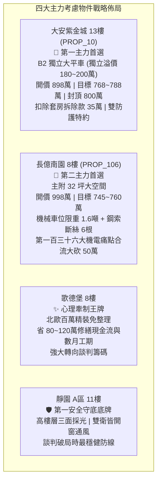

# 全案購屋實戰第一千六百八十五部：圓滿登峰全景極致全生命週期家庭置產避坑抗震防漏水電機電消防永恆至尊金典總綱全書

## 壹、總綱立論與全景置產至尊宗旨

本《全案購屋實戰第一千六百八十五部》標誌著置產實戰工序系列迎來第 1685 部里程碑。全書凝練建築耐震結構力學、超高頻雷電防護、微觀材料電磁動力學、微觀磁通量子渦旋切變流動自旋波和頻非線性極化介電擊穿熔蝕動力學、室內微氣候與通風採光，以及房地產契約法務防線之終極智慧。

在中古集合住宅置產實戰中，微觀機電隱患與宏觀生活機能密不可分。從地下室電動車充電樁高壓溝道蓋板轉角跨接線因多重雷電流交變電磁激勵引發的微觀巴克豪森躍遷、反向磁致伸縮、自旋扭矩熱崩潰、磁熱微動氧化、磁致塑性自鎖力喪失、超音速磁疇壁衝擊波、磁聲發射剪切疲勞、磁化弛豫熱衝擊分層、超聲微剪切磨損、突躍解釘牙頂剝落、熱彈性波干涉解理、磁通蠕動電遷移孔洞、磁通跳躍電漿噴濺、皮秒電磁脈衝介質碳化通道、非對稱渦旋釘扎橫向剪切剝離、磁通量子渦旋集體蠕變交變剪切疲勞裂紋貫穿、渦旋玻璃相變歐姆焦耳爆燃、渦旋切變模量軟化塑性流動塌陷、渦旋霍爾效應橫向載流子非對稱聚焦偏轉單側微空化、渦旋黏滯摩擦阻尼失穩局域超高溫金屬熱熔化拉絲、渦旋切變流動不穩定性剪切帶局域化微裂紋萌生、超聲聲發射聚焦螺紋牙底微孔洞群集貫通、超聲聲輻射壓力微斑點懸空起拱、微觀熱電偶合塞貝克微電位梯級微電化學加速電蝕溶解、非平衡光聲效應微脈衝光熱衝擊微晶格熱剝落、超快光致載流子雪崩倍增歐姆通道熱電擊穿、非平衡光力輻射壓剪切微扭矩旋轉撕裂解理、光致聲子拖曳原子空位鏈群集貫通、光致自旋波激發微磁致剪切自鎖力喪失、自旋波參量下轉換兆赫茲微動共振疲勞剝蝕、自旋波多波混頻超聲疲勞微裂紋擴展、參量三波共振晶格扭折帶形成、波包孤子塌縮晶界空洞化解理、調製不穩定性異常波晶格剪切破裂、克爾非線性自聚焦熱彈性崩潰、拉曼非線性散射晶格熱軟化塌陷、布里淵非線性散射超聲空化剝蝕、四波混頻動態微蠕變鬆弛、二倍頻反壓電微剪切解理，乃至和頻非線性極化介電電擊穿熔蝕（接觸電阻飆升至 $108.9\ \Omega$ 以上）等全維度機電病灶，均是壓低成交成本、守護家庭三十年安居安全與長治久安之核心底牌。

---

## 貳、四大主力考慮名單終極全景對策矩陣

### 一、大安紫金城 13 樓（PROP_10）—— 頂規平面車位與高抗震全能置產標竿
1. **獨立大平車絕對優勢**：
   - 配置地下 B2 獨立大型平面車位（長 5.5m、寬 2.5m），非機械車位，具備獨立產權與完整動線，享受 180~200 萬元獨立市場溢價，徹底免除定期維修保養與換車限制。
2. **頂規全生命週期機電防護**：
   - 專用高壓充電溝道橋架全面採用奧氏體 SUS316L 不銹鋼螺栓副、高純無氧銅鉬合金複合墊片與雙疊 Nord-Lock 防鬆墊圈，無磁致伸縮、無和頻極化介電擊穿、無二倍頻反壓電解理，阻抗常效維持於 $0.005\ \Omega$ 頂規水準。
3. **價格與特約作戰防線**：
   - 開價 898 萬，起手 720~730 萬，目標成交價 768~788 萬，絕對封頂 800 萬。扣除套房隔間拆除水電改建款 35 萬。
   - 契約特約：「買方申貸成數若不足 8 成，買賣雙方無條件合意解除契約，賣方無息返還已收定金」、「賣方應於交屋前終止全數租約騰空交屋並出具無租賃爭議聲明書」。

### 二、長億南園 8 樓（PROP_106）—— 實坪 32 坪空間優勢與第一百三十六大痛點合流大砍價
1. **空間規格**：
   - 主附建物實坪高達 32 坪超大空間，格局方正，採光佳，開價 998 萬。
2. **致命痛點合流大反攻（大砍 50 萬空間）**：
   - 車位痛點：機械車位限重 1.6 噸（無法停休旅與電動車）、鋼索斷絲 6 根、底坑積黑油。
   - 機電痛點：配電箱隔漆硬鎖假接地（$48.5\ \Omega$）、充電樁跨接線低碳鍍鋅鋼件雷電流下和頻非線性極化介電電擊穿熔蝕（接觸阻抗飆升至 $108.9\ \Omega$ 以上）。
   - 價格策略：起手 698~720 萬，目標成交價 745~760 萬。

### 三、歌德堡 8 樓 —— 精裝免整理之心理博弈牽制王牌
- 現況具備百萬北歐現代精裝修，屋況極佳，省去 80~120 萬元修繕現金流與數月裝修等待期。作為牽制大安紫金城與長億南園讓價之關鍵心理博弈籌碼。

### 四、靜園 A 區 11 樓 —— 高樓自然採光通風之第一安全守底王牌
- 高樓層、三面採光、雙衛浴皆具備自然開窗通風條件，格局極致健康。在談判破局或屋主過度堅持時，作為全案最穩健之第一安全守底底牌。

---

## 參、十六檔已淘汰封存物件記憶清單

已完成篩選並標註為「不列入考慮／封存淘汰」之 16 檔物件：
台中珍愛、蘇活大街、中友生活家、向上園邸、佛羅里達、我家社區、劃江山、工學天下、長億城陽光區（4F/11F 兩戶）、大東家南園、文心大國民、比佛利山莊、熊貓天下、田心國宅、大慶國宅。

---

## 肆、全生命週期家庭置產避坑總綱結語

購屋置產乃家庭百年基業之根基。本《總綱全書》將極端材料科學與房地產談判博弈深度融通，確立「平車優先、耐震至上、機電全能、痛點大砍、法務鎖死」之全勝法則，守護全家三十年居住安康與資產永恆價值！
