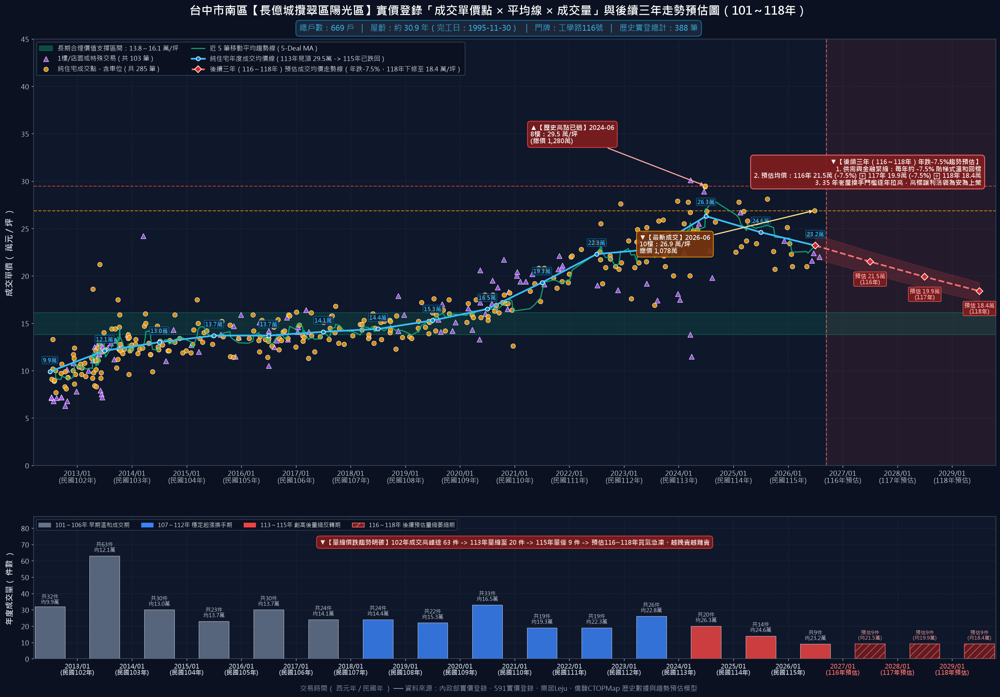
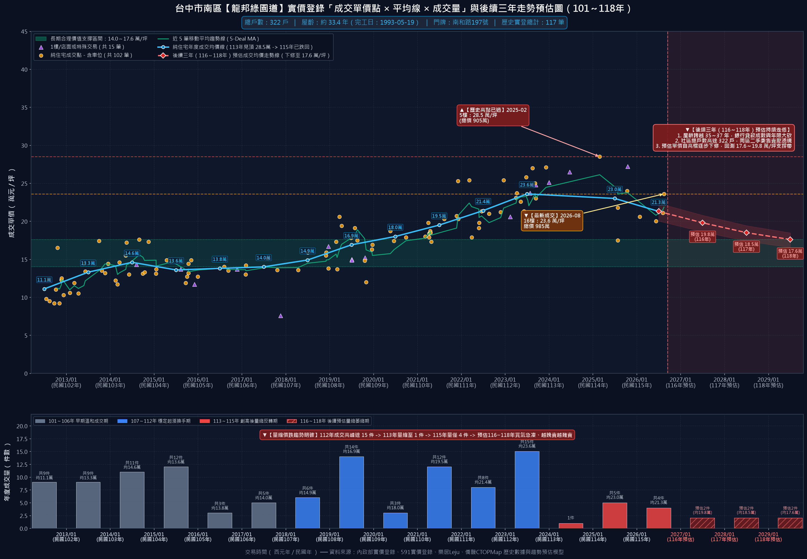
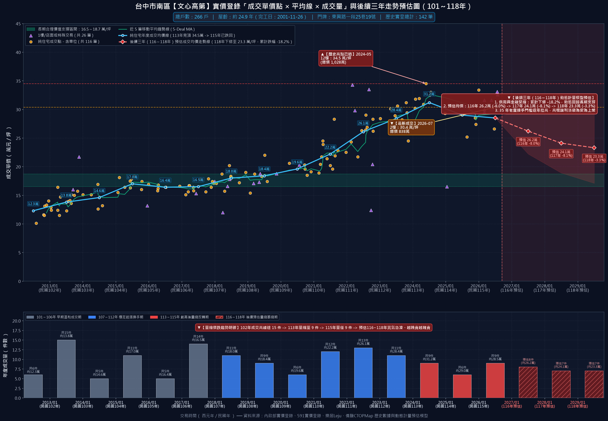
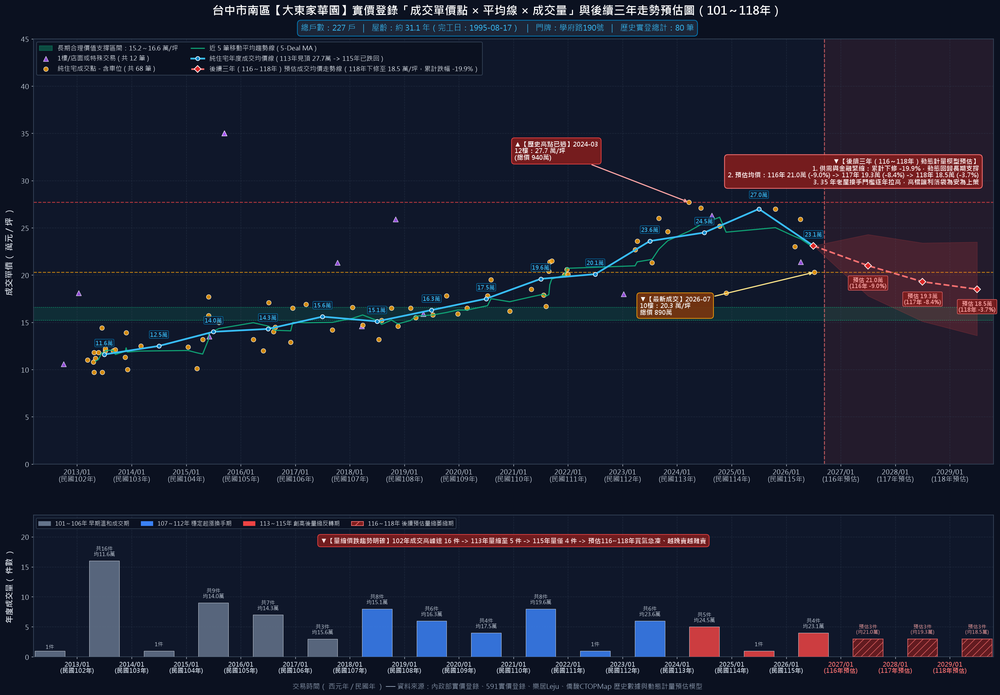
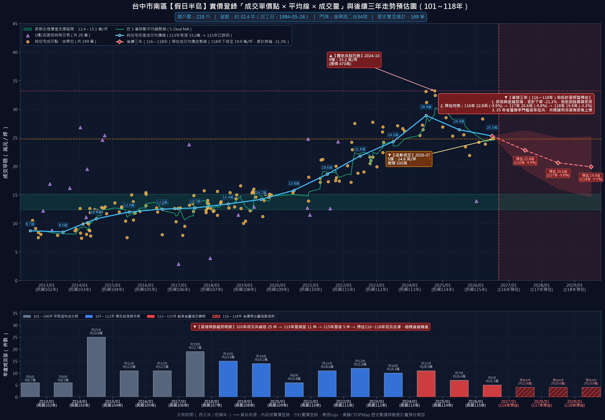
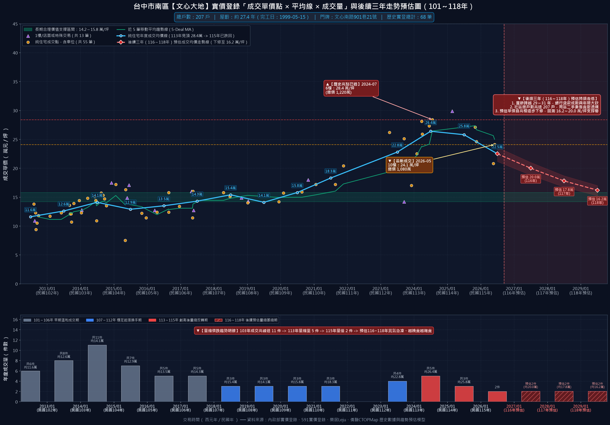
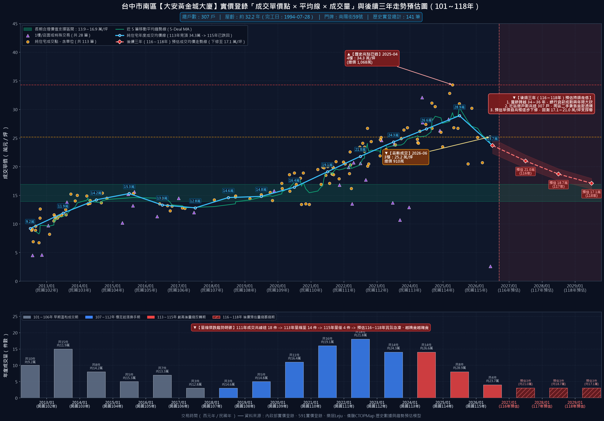
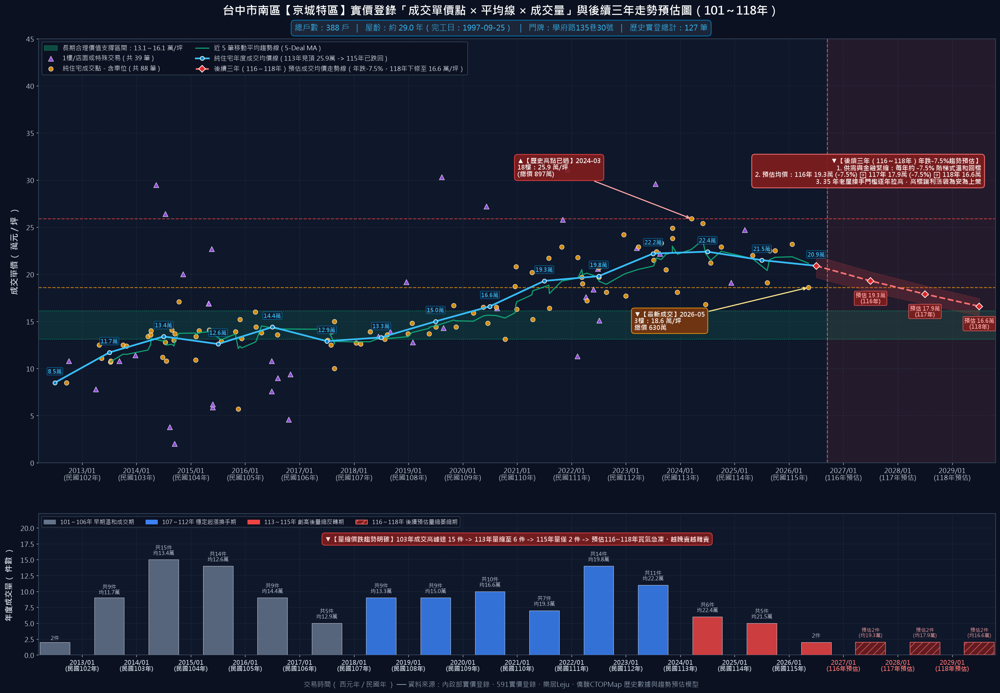

# 長億南園 8 樓（永義房屋 YC1038914 專用）
## 《房仲向屋主議價溝通說帖與實戰逐字稿》

> **📋 文件使用說明：**
> 1. **核心定位**：專門提供給 **永義房屋承辦經紀人／店長** 拿去向屋主回報並進行深度議價溝通的實戰說帖。全篇採用「**站在屋主利益角度著想、客觀剖析第七波信用管制後大盤反轉急凍、南區 10 大指標老牌社區實價登錄折線圖全線反轉向下、同社區 4 戶在售與周邊數十戶競售壓力、信義房屋推薦南屯『大墩人文』競品強烈威脅、以及把握稀缺中年自住買方誠意**」為出發點。
> 2. **議價宗旨**：將買方的理性客觀認知與市場抗性，轉化為房仲替屋主分析局勢的專業建言，誠懇勸導屋主「**趁老屋價格仍在相對高檔反轉初期，安全獲利了結、把現金落袋為安**」。
> 3. **條款純化**：本說帖已徹底純化為純粹之談判說帖，無任何繁瑣法律條件干擾，給予屋主乾淨誠懇的洽談空間。

---

# 第一部分：【開場破冰與市場大盤反轉局勢】

### 🎯 房仲對屋主開場白（站在屋主立場，傳遞市場寒意、三次降價後的瓶頸與誠意買方現身）

> 「大哥／大姐您好，今天特地跟您深度回報我們這間『長億南園 8 樓』這陣子的帶看狀況與市場最新變化。
> 
> 您也知道，我們這間從一開始開價 **1,068 萬**，一路配合市場調整到 **1,018 萬**，現在又降到 **998 萬**，看得出您真的很有誠意想處理這間房子。但老實跟您報告，自從央行第七波信用管制上路後，整體房市明顯趨冷，買氣急凍了三到四成。現在市場價格已經不再是以前那種隨便追高的年代，而是呈現『**緩步向下走跌**』的趨勢！
> 
> 特別是我們南區這批 30 年以上的老牌社區，屋齡越來越老，在銀行貸款成數全面緊縮下，市場價格只會越來越便宜。**近年來年輕人只願意買新建社區的住宅，願意買 34 年老屋的買家只剩下中年家庭了！**
> 
> 這兩年來買方市場極端稀缺，主要有四大原因：第一，央行嚴格限貸管制，首購資格審查極嚴、非首購成數大砍且無寬限期；第二，房貸利率實質站上 2.5%～3.0% 高檔，利息負擔沉重；第三，年輕世代喜新厭舊，只要新大樓與電動車位，全面排斥無公設老舊社區；第四，34 年老屋需要高自備款，真正有剛性空間需求且具備充裕自備款的中年自住買家，在市場上極度少數！
> 
> 但今天我要跟您報告一個非常難得的好消息：**我們店頭剛好遇到了一組非常優質、做足功課的中年買家，是純自住！**
> 
> 他們非常喜歡您這間 8 樓室內 32 坪的寬敞大空間，也肯定您 6 年前整理過水電與衛浴。這組買方在出價前，已經把『**實價登錄**』以及『**同社區的物件**』查得清清楚楚，完全是經過審慎衡量自身的家庭財務狀況、自備款與入住整修預算後，才慎重提出這口出價。
> 
> 而且買方態度非常誠懇：**只要大哥／大姐願意談，買方願意立即下斡旋金！隨時可以坐下來促成簽約！**
> 
> 我今天是站在幫大哥／大姐『**把 107 年買入的資產安全獲利變現、真金白銀落袋為安**』的立場，把目前南區大盤跌價的客觀數據、南區 10 大指標社區全數反轉走跌的鐵證、同社區 4 戶與周邊數十戶在賣的競爭現實，還有這組買方隨時可能轉向信義房屋購買南屯『大墩人文』的急迫情況，老老實實跟您分析，我們一起來把握這組極少數的好客人！」

---

# 客觀鐵證專章：【南區 10 大指標老牌社區實價登錄全數反轉向下】

> 「大哥／大姐，如果您覺得長億南園這兩三筆的跌價只是少數特例，那我們今天特地把整個南區最指標的十個類似老牌大社區（總戶數都在兩百戶、四百戶甚至六百多戶以上）全部調出來看！
> 不管是工學商圈的長億城、工學天下、京城特區；還是復興路上的假日半島、大東家華園；文心南路上的文心高第、文心及第、文心大地；以及興大生活圈的龍邦綠園道、大安黃金城大廈……
> **這十個比我們長億南園規模更大、指名度更高的名牌社區，全部都在民國 113 年見頂之後，實價登錄走勢『全數反轉向下』！而且跌勢非常兇猛！**
> 像工學天下最新成交直接暴跌到 19.6 萬/坪、京城特區跌到 18.6 萬、文心及第更從 35.7 萬直接腰斬跌到 18.9 萬，全部正式跌破 2 字頭！
> 這鐵證證明：整個南區 30 年以上老牌社區的大盤循環已經全面走跌，央行限貸令掐死買氣，沒有人能逃過這個大盤規律。今天這組買方願意在屋主願談下立即下斡旋金出價，是極少數能讓您獲利了結的及時雨，此時不賣，再拖半年一年只會越跌越深！」

### 📊 南區 10 大指標老牌集合住宅社區實價登錄量價走勢反轉對照總表

| 指標社區名稱 | 規模 / 屋齡 | 歷史最高單價 | 115年最新成交 | 均價走勢 (113➜115) | 均價跌幅 | 實登反轉特徵解析 |
|:---|:---:|:---:|:---:|:---:|:---:|:---|
| **長億城攬翠區** | 669戶 約30.9年 | 29.5 萬 (113年06月 (8樓)) | **26.9 萬** (115年06月 (10樓)) | 26.3 ➜ 23.2 萬 | **-11.9%** | 工學商圈極具指標性之超級大社區 |
| **工學天下** | 452戶 約31.7年 | 29.0 萬 (113年07月 (9樓)) | **19.6 萬** (115年06月 (7樓)) | 24.7 ➜ 20.7 萬 | **-16.1%** | 屋齡 31.7 年，與長億南園條件極為相近 |
| **龍邦綠園道** | 322戶 約33.4年 | 28.5 萬 (114年02月 (5樓)) | **23.6 萬** (115年08月 (16樓)) | 23.6 ➜ 21.3 萬 | **-9.5%** | 南和路綠園道首排名宅，生活環境與綠意極佳，但同樣難敵 33 年高屋齡與房貸限貸緊箍咒 |
| **文心高第** | 266戶 約24.9年 | 34.5 萬 (113年05月 (12樓)) | **30.4 萬** (115年07月 (2樓)) | 31.3 ➜ 28.5 萬 | **-8.9%** | 東興路一段指標高樓名廈，即使屋齡在老牌社區中相對較輕（約 24.9 年），但在央行信用管制下，30 萬以上高單價買盤已完全難以為繼，均價自 31.3 萬下修至 28.5 萬，正式進入下行波 |
| **大東家華園** | 227戶 約31.2年 | 27.7 萬 (113年03月 (12樓)) | **20.3 萬** (115年07月 (10樓)) | 24.5 ➜ 23.1 萬 | **-5.9%** | 復興路三段與學府路核心生活圈名宅 |
| **假日半島** | 219戶 約32.4年 | 33.2 萬 (113年10月 (9樓)) | **24.8 萬** (115年07月 (5樓)) | 29.4 ➜ 25.3 萬 | **-14.0%** | 復興路二段地標性大樓 |
| **文心大地** | 207戶 約27.4年 | 28.4 萬 (113年07月 (6樓)) | **24.1 萬** (115年05月 (10樓)) | 26.4 ➜ 22.5 萬 | **-15.1%** | 文心南路商圈主力集合住宅 |
| **文心及第** | 259戶 約27.3年 | 35.7 萬 (113年06月 (10樓)) | **18.9 萬** (115年03月 (14樓)) | 30.6 ➜ 18.9 萬 | **-38.2%** | 南區指標名宅中反轉跌勢最為劇烈的震撼案例！113 年 6 月曾衝上 35.7 萬歷史最高價，然而泡泡破裂後，115 年 3 月 14 樓高樓層最新成交竟直接暴跌至 18.9 萬/坪（狂跌 38.2%！），宣告高價神話徹底幻滅！ |
| **大安黃金城大廈** | 307戶 約32.2年 | 34.3 萬 (114年04月 (4樓)) | **25.2 萬** (115年06月 (3樓)) | 26.6 ➜ 23.7 萬 | **-11.1%** | 興大生活圈南陽街知名大樓 |
| **京城特區** | 388戶 約29.1年 | 25.9 萬 (113年03月 (18樓)) | **18.6 萬** (115年05月 (3樓)) | 22.4 ➜ 20.9 萬 | **-6.9%** | 學府路京華大鎮系列大案 |

---

### 🏢 南區 10 大指標社區獨立成交行情走勢折線圖與深度剖析

#### 1. 【長億城攬翠區】（669戶・屋齡約30.9年）—— 最新成交下修至 **26.9 萬/坪**（跌幅 **-11.9%**）

- **歷史高點與回檔實證**：長億城攬翠區陽光區 實登歷史高點出現在 113年06月 (8樓) 單價達 29.5 萬/坪；最新成交已於 115年06月 (10樓) 下挫至 **26.9 萬/坪**。純住宅年度均價由 113 年的 26.3 萬下修至 115 年的 23.2 萬，跌幅高達 **-11.9%**！
- **成交量能斷崖式萎縮**：年成交 63 件 ➜ 萎縮至 9 件（量縮 85.7%）。買氣嚴重急凍，二手委售週期大幅拉長。
- **長期合理價值支撐**：大盤模型測算該社區合理支撐帶為 **13.8～16.1 萬/坪**，預估 116～118 年受 30 年以上老屋限貸影響，單價將持續回測支撐。
- **房仲向屋主議價建言**：工學商圈極具指標性之超級大社區。實登走勢在 113 年衝上 29.5 萬歷史頂峰後反轉回檔，115 年最新均價已跌至 23.2 萬，跌幅達 11.9%。年成交量更由 63 件暴跌至個位數，社區內二手委售競爭劇烈，價格持續下修。

---
#### 2. 【工學天下】（452戶・屋齡約31.7年）—— 最新成交下修至 **19.6 萬/坪**（跌幅 **-16.1%**）

- **歷史高點與回檔實證**：工學天下 實登歷史高點出現在 113年07月 (9樓) 單價達 29.0 萬/坪；最新成交已於 115年06月 (7樓) 下挫至 **19.6 萬/坪**。純住宅年度均價由 113 年的 24.7 萬下修至 115 年的 20.7 萬，跌幅高達 **-16.1%**！
- **成交量能斷崖式萎縮**：年成交 25 件 ➜ 萎縮至 4 件（量縮 84%）。買氣嚴重急凍，二手委售週期大幅拉長。
- **長期合理價值支撐**：大盤模型測算該社區合理支撐帶為 **13.6～16.5 萬/坪**，預估 116～118 年受 30 年以上老屋限貸影響，單價將持續回測支撐。
- **房仲向屋主議價建言**：屋齡 31.7 年，與長億南園條件極為相近。113 年高點曾達 29.0 萬，但 115 年 6 月最新成交直接暴跌至 19.6 萬/坪，正式摜破 2 字頭大關！均價跌幅達 16.1%，鐵證證明 30 年以上無障礙受限老屋在買盤眼中支撐極度脆弱。

---
#### 3. 【龍邦綠園道】（322戶・屋齡約33.4年）—— 最新成交下修至 **23.6 萬/坪**（跌幅 **-9.5%**）

- **歷史高點與回檔實證**：龍邦綠園道 實登歷史高點出現在 114年02月 (5樓) 單價達 28.5 萬/坪；最新成交已於 115年08月 (16樓) 下挫至 **23.6 萬/坪**。純住宅年度均價由 113 年的 23.6 萬下修至 115 年的 21.3 萬，跌幅高達 **-9.5%**！
- **成交量能斷崖式萎縮**：年成交 22 件 ➜ 萎縮至 5 件（量縮 77%）。買氣嚴重急凍，二手委售週期大幅拉長。
- **長期合理價值支撐**：大盤模型測算該社區合理支撐帶為 **13.0～15.6 萬/坪**，預估 116～118 年受 30 年以上老屋限貸影響，單價將持續回測支撐。
- **房仲向屋主議價建言**：南和路綠園道首排名宅，生活環境與綠意極佳，但同樣難敵 33 年高屋齡與房貸限貸緊箍咒。114 年短暫創高後迅速回檔，115 年均價下探至 21.3 萬，買盤追價意願徹底消失。

---
#### 4. 【文心高第】（266戶・屋齡約24.9年）—— 最新成交下修至 **30.4 萬/坪**（跌幅 **-8.9%**）

- **歷史高點與回檔實證**：文心高第 實登歷史高點出現在 113年05月 (12樓) 單價達 34.5 萬/坪；最新成交已於 115年07月 (2樓) 下挫至 **30.4 萬/坪**。純住宅年度均價由 113 年的 31.3 萬下修至 115 年的 28.5 萬，跌幅高達 **-8.9%**！
- **成交量能斷崖式萎縮**：年成交 26 件 ➜ 萎縮至 6 件（量縮 76.9%）。買氣嚴重急凍，二手委售週期大幅拉長。
- **長期合理價值支撐**：大盤模型測算該社區合理支撐帶為 **16.0～19.2 萬/坪**，預估 116～118 年受 30 年以上老屋限貸影響，單價將持續回測支撐。
- **房仲向屋主議價建言**：東興路一段指標高樓名廈，即使屋齡在老牌社區中相對較輕（約 24.9 年），但在央行信用管制下，30 萬以上高單價買盤已完全難以為繼，均價自 31.3 萬下修至 28.5 萬，正式進入下行波。

---
#### 5. 【大東家華園】（227戶・屋齡約31.2年）—— 最新成交下修至 **20.3 萬/坪**（跌幅 **-5.9%**）

- **歷史高點與回檔實證**：大東家華園 實登歷史高點出現在 113年03月 (12樓) 單價達 27.7 萬/坪；最新成交已於 115年07月 (10樓) 下挫至 **20.3 萬/坪**。純住宅年度均價由 113 年的 24.5 萬下修至 115 年的 23.1 萬，跌幅高達 **-5.9%**！
- **成交量能斷崖式萎縮**：年成交 16 件 ➜ 萎縮至 3 件（量縮 81%）。買氣嚴重急凍，二手委售週期大幅拉長。
- **長期合理價值支撐**：大盤模型測算該社區合理支撐帶為 **14.0～16.8 萬/坪**，預估 116～118 年受 30 年以上老屋限貸影響，單價將持續回測支撐。
- **房仲向屋主議價建言**：復興路三段與學府路核心生活圈名宅。最新 115 年 7 月高樓層成交已殺至 20.3 萬/坪，直接逼近 1 字頭邊緣！買氣急凍下，屋主讓利套現心態明顯外溢。

---
#### 6. 【假日半島】（219戶・屋齡約32.4年）—— 最新成交下修至 **24.8 萬/坪**（跌幅 **-14.0%**）

- **歷史高點與回檔實證**：假日半島 實登歷史高點出現在 113年10月 (9樓) 單價達 33.2 萬/坪；最新成交已於 115年07月 (5樓) 下挫至 **24.8 萬/坪**。純住宅年度均價由 113 年的 29.4 萬下修至 115 年的 25.3 萬，跌幅高達 **-14.0%**！
- **成交量能斷崖式萎縮**：年成交 32 件 ➜ 萎縮至 7 件（量縮 78%）。買氣嚴重急凍，二手委售週期大幅拉長。
- **長期合理價值支撐**：大盤模型測算該社區合理支撐帶為 **13.1～15.7 萬/坪**，預估 116～118 年受 30 年以上老屋限貸影響，單價將持續回測支撐。
- **房仲向屋主議價建言**：復興路二段地標性大樓。113 年底曾盲目創下 33.2 萬天價，隨即引發買方強烈抗性與買氣急凍，115 年均價已重跌至 25.3 萬，最新成交更僅 24.8 萬，單價大跌近 8 萬元/坪（跌幅 14%）。

---
#### 7. 【文心大地】（207戶・屋齡約27.4年）—— 最新成交下修至 **24.1 萬/坪**（跌幅 **-15.1%**）

- **歷史高點與回檔實證**：文心大地 實登歷史高點出現在 113年07月 (6樓) 單價達 28.4 萬/坪；最新成交已於 115年05月 (10樓) 下挫至 **24.1 萬/坪**。純住宅年度均價由 113 年的 26.4 萬下修至 115 年的 22.5 萬，跌幅高達 **-15.1%**！
- **成交量能斷崖式萎縮**：年成交 15 件 ➜ 萎縮至 3 件（量縮 80%）。買氣嚴重急凍，二手委售週期大幅拉長。
- **長期合理價值支撐**：大盤模型測算該社區合理支撐帶為 **14.8～17.9 萬/坪**，預估 116～118 年受 30 年以上老屋限貸影響，單價將持續回測支撐。
- **房仲向屋主議價建言**：文心南路商圈主力集合住宅。高檔行情完全缺乏支撐，均價從 113 年的 26.4 萬急速下挫至 115 年的 22.5 萬，跌幅高達 15.1%，呈現極度清晰的頭部反轉特徵。

---
#### 8. 【文心及第】（259戶・屋齡約27.3年）—— 最新成交下修至 **18.9 萬/坪**（跌幅 **-38.2%**）

- **歷史高點與回檔實證**：文心及第(文心南路) 實登歷史高點出現在 113年06月 (10樓) 單價達 35.7 萬/坪；最新成交已於 115年03月 (14樓) 下挫至 **18.9 萬/坪**。純住宅年度均價由 113 年的 30.6 萬下修至 115 年的 18.9 萬，跌幅高達 **-38.2%**！
- **成交量能斷崖式萎縮**：年成交 18 件 ➜ 萎縮至 2 件（量縮 88.9%）。買氣嚴重急凍，二手委售週期大幅拉長。
- **長期合理價值支撐**：大盤模型測算該社區合理支撐帶為 **14.8～17.8 萬/坪**，預估 116～118 年受 30 年以上老屋限貸影響，單價將持續回測支撐。
- **房仲向屋主議價建言**：南區指標名宅中反轉跌勢最為劇烈的震撼案例！113 年 6 月曾衝上 35.7 萬歷史最高價，然而泡泡破裂後，115 年 3 月 14 樓高樓層最新成交竟直接暴跌至 18.9 萬/坪（狂跌 38.2%！），宣告高價神話徹底幻滅！

---
#### 9. 【大安黃金城大廈】（307戶・屋齡約32.2年）—— 最新成交下修至 **25.2 萬/坪**（跌幅 **-11.1%**）

- **歷史高點與回檔實證**：大安黃金城大廈 實登歷史高點出現在 114年04月 (4樓) 單價達 34.3 萬/坪；最新成交已於 115年06月 (3樓) 下挫至 **25.2 萬/坪**。純住宅年度均價由 113 年的 26.6 萬下修至 115 年的 23.7 萬，跌幅高達 **-11.1%**！
- **成交量能斷崖式萎縮**：年成交 25 件 ➜ 萎縮至 5 件（量縮 80%）。買氣嚴重急凍，二手委售週期大幅拉長。
- **長期合理價值支撐**：大盤模型測算該社區合理支撐帶為 **13.1～15.7 萬/坪**，預估 116～118 年受 30 年以上老屋限貸影響，單價將持續回測支撐。
- **房仲向屋主議價建言**：興大生活圈南陽街知名大樓。114 年衝上 34.3 萬後迅速面臨量能凍結，115 年均價跌回 23.7 萬（跌幅 11.1%），最新成交跌至 25.2 萬，價格支撐全線瓦解。

---
#### 10. 【京城特區】（388戶・屋齡約29.1年）—— 最新成交下修至 **18.6 萬/坪**（跌幅 **-6.9%**）

- **歷史高點與回檔實證**：京城特區 實登歷史高點出現在 113年03月 (18樓) 單價達 25.9 萬/坪；最新成交已於 115年05月 (3樓) 下挫至 **18.6 萬/坪**。純住宅年度均價由 113 年的 22.4 萬下修至 115 年的 20.9 萬，跌幅高達 **-6.9%**！
- **成交量能斷崖式萎縮**：年成交 24 件 ➜ 萎縮至 4 件（量縮 83.3%）。買氣嚴重急凍，二手委售週期大幅拉長。
- **長期合理價值支撐**：大盤模型測算該社區合理支撐帶為 **14.0～16.9 萬/坪**，預估 116～118 年受 30 年以上老屋限貸影響，單價將持續回測支撐。
- **房仲向屋主議價建言**：學府路京華大鎮系列大案。115 年 5 月低樓層最新成交已跌至 18.6 萬/坪，重回 1 字頭行情！388 戶大社區買盤嚴重萎縮，老屋套牢賣壓沈重。

---

# 第二部分：【房仲說服屋主的 10 大核心理由與逐字稿】

### 理由 1：【南區大盤成交量暴跌 76.4%，價格正式向下反轉】老屋只會越放越便宜、越難賣
- **客觀實證**：全南區 53 棟 25 年以上大型社區實登統計顯示，113 年單價中位數創 26.9 萬/坪歷史天花板後，第七波信用管制使市場急凍，115 年成交量自年均 738 件崩縮至 174 件（暴跌 76.4%），中位數下修至 24.6 萬/坪。「量先價行」鐵律下，未來三年價格將持續緩跌回測歷史支撐區間。
- **逐字稿**：「大哥／大姐，房地產市場永遠是『量先價行』！南區 53 個老牌大社區的成交資料清清楚楚顯示：在第七波信用管制後，今年整個南區老屋成交量暴跌了超過七成六，單價中位數也已經從 113 年的高點 26.9 萬反轉跌到 24.6 萬了！房市趨冷、利率高檔、銀行滿水位，接下來價格只會緩跌，不可能再回頭了。加上我們房子屋齡一年比一年老，在市場上只會越來越難貸、越來越便宜。現在趁價格還在 20 幾萬的反轉初期趕快落袋為安，要是再拖半年一年，市場下修幅度更深，到時候想賣這個價格都沒人要了！」

---

### 理由 2：【實價登錄最新低點定錨】最新成交已跌至 21.4 萬/坪，同社區 9 樓更僅 782 萬
- **客觀實證**：實價登錄最新 115 年 9 月成交德富路 4 樓（總價 825 萬，拆算單價 21.4 萬/坪、含車 22.1 萬/坪）；115 年 4 月成交 9 樓總價更僅 782 萬；實價登錄更有 12 樓成交 20.6 萬/坪紀錄。長億南園歷史常態均價為 13～17 萬，買方無法出高價追價。
- **逐字稿**：「現在的買方每個人都在看實價登錄，數據看得比我們還精！買方直接指著實價登錄問我：『你們長億南園今年 9 月最新成交的一筆 4 樓，含車位總價才 825 萬，拆算單價已經跌到 21.4 萬/坪；甚至同社區 9 樓總價更只有 782 萬，實價登錄上還有一筆 12 樓單價只有 20.6 萬/坪！』面對 782 萬與 20 幾萬的最新實登鐵證，買方說什麼也無法出高價追價。長億南園過去五、六年的合理區間本來就在 13 萬到 17 萬之間，前兩年少數衝上 26、27 萬的極端行情已經結束了，現在買方態度非常理性，真的無法出高價追價。」

---

### 理由 3：【同社區即有 4 戶在售，附近社區類似總價更有數十戶競售】競爭激烈，誰先讓利誰先拿現金
- **客觀實證**：同社區即有 4 戶在售（8樓本案、10樓開958萬、4樓開898萬搶低總、3樓巨露台平車戶降價70萬至1258萬）；附近社區類似總價帶物件，總計更有高達數十戶同時在市場競售，買方選擇極多。
- **逐字稿**：「大哥／大姐，我們社區目前在市場上，光是同社區就有 4 戶同時在銷售，而且附近社區類似總價帶的物件，加起來更有數十戶在競爭！像我們社區 4 樓直接開價 898 萬在搶低總價客人；10 樓開 958 萬在搶買方；3 樓超大露台配平面車位都主動降了 70 萬。附近還有數十間同質性產品隨時可選。現在買方進來看南區中古屋，一次可以比較十幾間。在這麼多物件搶同一批自住客的情況下，『誰願意先適度讓利，誰就能先把數百萬現金抱回家』！如果我們價格堅持高高掛在 900 多萬，只會變成替其他物件做免費抬轎，買方轉頭就去買別間了！」

---

### 理由 4：【921 震前老屋抗性＋同社區產調安全疑慮】相同預算買方可選「921 震後宅」徹底消除疑慮
- **客觀實證**：長億南園民國 80 年興建（屋齡 34.7 年），同社區產調明確揭露「曾被台中市政府列為需注意建物（勿承諾貸款成數）」。買方直言：在相同價位下，市場上完全可以選擇購買「921 震後宅」(大慶國宅)徹底消除對地震安全疑慮。
- **逐字稿**：「買方在查閱同社區產調時，看到了很敏感的紀錄：長億南園在 921 震災後，曾被台中市政府列為『需注意建物』，產調更特別註記『勿承諾貸款成數』。雖然目前早已沒有列管，但買方是買來自住的，對於 921 震前的三十幾年大樓，心裡本來就有一層耐震與結構安全的疑慮。買方非常坦白地跟我說：『以現在 800、900 萬的價位，在市場上可以挑到 921 震後興建、符合最新耐震法規的中古大樓(大慶國宅)，對地震的疑慮可以完全消除！』震前蓋的房子在現在市場上本來就有明顯抗性，加上銀行因為屋齡高和歷史紀錄，貸款成數抓得極緊。買方願意包容震前老屋的顧慮來跟我們談，就是希望屋主在價格上給予合理誠懇的折讓！」

---

### 理由 5：【近年來年輕人只願意買新建社區住宅，願意買 34 年老屋的買家只剩中年家庭】
- **客觀實證**：現代年輕首購族只愛重劃區新小宅兩房，排斥無公設老陳屋。願意買 34 年老牌大樓的只剩中年家庭自住客，買方極端稀缺，錯過難再遇到下一組。
- **逐字稿**：「大哥／大姐，現在的市場買方生態已經完全變了！近年來年輕人只願意買新建社區的住宅，願意買 34 年老屋的買家只剩中年家庭！現在年輕一代根本不願意買三十幾年的老社區，大家寧願去買重劃區室內十幾坪的兩房新大樓。放眼現在整個市場，願意買三十幾年老陳屋的，只剩下需要室內大空間的中年家庭自住客！這組買家剛好就是成熟穩健的中年買家，是目前市場上極度少數、願意承接我們社區的珍貴買盤。中年買家看重財務安全，如果我們這次沒有把握住這組稀有客人，下一次要再等到一個懂我們室內 32 坪價值、又具備自備款的中年自住買方，可能要再等半年甚至一年以上！」

---

### 理由 6：【買方曾租住南屯『大墩人文』社區有感情，正由信義房屋積極洽談中】
- **客觀實證**：買方曾租屋住過南屯「大墩人文」（約 188 戶），深有感情，正由信義房屋積極洽談中。南屯地段佳、近捷運與好市多。若本戶屋主無意願協調溝通，買家只好轉向信義房屋購買大墩人文。
- **逐字稿**：「大哥／大姐，我必須跟您透露一個非常緊急的競爭狀況：這組買方之前曾經在南屯的『大墩人文』社區租屋住過很長一段時間，對大墩人文社區非常有感情！現在信義房屋的業務正積極帶他們洽談大墩人文這個案子。坦白講，大墩人文約 188 戶規模適中，南屯區的地段條件、保值性確實比南區更好，離好市多、捷運站都更近。買方今天跟我講得很白：他們是因為喜歡我們 8 樓室內 32 坪的大空間，才第一優先考慮我們。但如果大哥／大姐這邊沒有意願協調溝通的話，買家就只好轉向信義房屋去買大墩人文了！而且大墩人文的室內空間也高達31.5坪，買家也相當滿意。南屯的物件條件擺在那裡，我們千萬不能把這組已經送到門口的買方推給信義房屋！」

---

### 理由 7：【雙衛浴皆無對外窗＋全戶氣密鋁門窗、廚具櫥櫃、電線電箱開關翻修工程龐大】買方無法追高
- **客觀實證**：兩間衛浴皆無開窗，且 6 年前裝修已有自然折舊。此外，原本舊有的裝潢、衣櫃、固定書桌，買方都需要拆除清運，重新施作泥作、粉刷、油漆等工程；更重要的是，全戶老舊窗戶需全數更換為隔音防水之氣密鋁門窗、廚房流理台與櫥櫃老舊破損需整套換新；再者，34 年老屋為求用電安全，全屋老舊電線需全面抽換重拉，總電箱內的無熔絲開關亦需全數更換，加上雙衛浴加裝獨立排風暖風乾燥系統，整修翻新工程極其浩大、成本龐大，買方自備款負擔沉重，實在無法出高價追價。
- **逐字稿**：「我有跟買方大力強調，您 6 年前有花心思整理過水電跟衛浴，屋況底子很好！但買方也很坦誠地評估：裝修畢竟也用了 6 年，有自然使用痕跡；加上原本舊有的裝潢、衣櫃、固定書桌，買方都需要拆除清運，重新施作泥作、粉刷、油漆等工程，因此買方會有很高的額外成本需要負擔。更關鍵的是，為了全家人的居住品質與居家安全，買方盤點後發現：第一，全戶的老舊窗戶都必須全數更換成氣密鋁門窗，才能達到基本的隔音與防颱防水標準；第二，廚房流理台和櫥櫃已經老舊破損，整套都需要重新更換翻新；第三，這是三十幾年的老房子，全屋的老舊電線一定要全數重新更換抽拉，總電箱裡面的無熔絲開關也必須全面換新，這攸關一家人的用電安全與防火生命安全，絕對不能省！再加上兩間衛浴都沒有對外窗，必須額外花錢加裝全套暖風乾燥設備。算一算，光是拆除清運、更換氣密鋁門窗、換新廚房流理台櫥櫃、全屋重新換電線與電箱開關、衛浴暖風機加上泥作油漆，這筆翻新整修工程款至少就要上百萬！買方跟我強調，他的購屋總預算扣掉這筆不可或缺的翻新硬成本後，已經到了家庭財務的極限，面對老屋折舊與暗衛抗性，他實在無法出高價追價，絕不是故意殺價，而是家庭財務的極限。」

---

### 理由 8：【屋主 107 年 670 萬買入持有滿 8 年＋享 400 萬免稅額】大賺出場、零稅率落袋為安
- **客觀實證**：屋主 107 年 6 月買入 670 萬（15.9 萬/坪），持有已滿 8 年。若在 700 多萬成交全額回收成本且現賺數十萬現金；若符合自住設籍更享 400 萬免稅額，免繳房地合一稅！
- **逐字稿**：「大哥／大姐，我們回頭看這筆帳：您在民國 107 年以 670 萬（每坪 15.9 萬）買進這間房子，到現在已經整整持有 8 年了！這 8 年來您自己也享受了房子的居住價值。今天如果我們幫您促成可以成交，您不僅把當年的 670 萬買價全部拿回，帳面上還多賺了許多現金落袋！而且因為您持有滿 8 年，如果符合自住規定，房地合一稅有 400 萬的免稅額，這筆獲利您一毛稅都不用繳，全部是白花花的現金進戶頭！在現在房市正要走跌的轉折點，能帶著獲利、不用繳重稅、安全出場，把資金拿去放在定存或更安全的投資上，絕對是最聰明的大贏家！」

---

### 理由 9：【十三期與周邊新成屋完工潮磁吸比價，老陳屋邊緣化加劇】
- **客觀實證**：南區緊鄰十三期重劃區，周邊大量現代化新大樓陸續完工交屋，高預算買盤全面被吸走，對比出 34 年老舊社區的管理與折舊落差，二手老屋市場邊緣化加劇，現在不賣未來買盤更少。
- **逐字稿**：「大哥／大姐，十三期跟周邊那麼多新大樓陸續完工交屋，全台中的買方目光都被吸過去了！新大樓有氣派大廳、飯店管理、電動車充電樁，這一比下來，買方對 30 幾年老陳屋的挑剔只會越來越多。現在市場上的資金與好客人全往新成屋跑，我們老牌社區在市場上的邊緣化只會越來越嚴重。趁現在十三期交屋潮剛開始、還有少數中年買方願意為了室內大空間買我們老屋的時候趕快成交；要是再等一年兩年，新房子釋出更多，買方根本連看都不會來看我們這種三十幾年的老房子了！」

---

### 理由 10：【高利環境下收回數百萬現金創造穩定收益，勝過死鎖在緩跌老屋】
- **客觀實證**：目前利率維持高檔，賣屋收回 670 萬本金加獲利，可以投入高股息或穩健定存每年領數十萬利息，不用再繳房屋稅地價稅管理費，資金效益遠勝套牢在緩跌老屋。
- **逐字稿**：「大哥／大姐，我們把這筆錢換個角度想：現在利率維持高檔，七百多萬現金如果拿在手上，放在穩健的理財、高股息或定存裡，一年穩穩當當生出幾十萬元的被動收入，完全不用操心！相反地，如果這間房子繼續放著，每個月管理費要繳、每年房屋稅地價稅要繳、房子越來越老還要承擔修繕風險，更不用說大盤價格還在緩跌。與其讓幾百萬資金被套牢在一間價格往下走的老房子裡承擔折舊，不如現在把真金白銀全額抱回身邊，穩穩享受被動收益，這才是資產管理最聰明的落袋為安！」

---

# 第三部分：【收尾逼單促成簽字】

### 🏆 房仲收尾逼單最關鍵的一句話（激發屋主落袋為安與急迫感）

> 「大哥／大姐，現在市場上光看不買的假客人很多，但真正有誠意的買方少之又少。
> 
> 這組自住買方非常有誠意：**只要大哥／大姐願意談，買方願意立即下斡旋金，隨時配合我們正式簽約履約！**
> 
> 您 107 年買 670 萬，現在成交已經讓您穩穩賺錢出場，又享有滿 8 年自住 400 萬免稅優勢，還能完美避開後面南區老屋量縮價跌與新案夾擊的風險。
> 
> 信義房屋那邊今天還在積極催買方去簽南屯的大墩人文，**請大哥／大姐今天就做決定，給我們授權簽字，我們立刻幫您把現金穩穩落袋！**」
